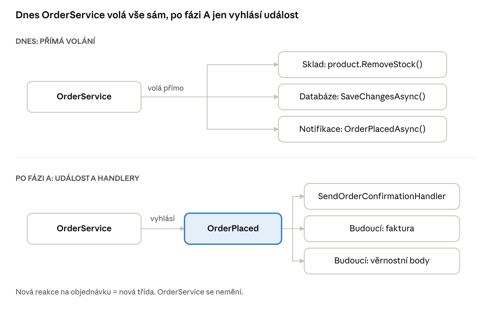
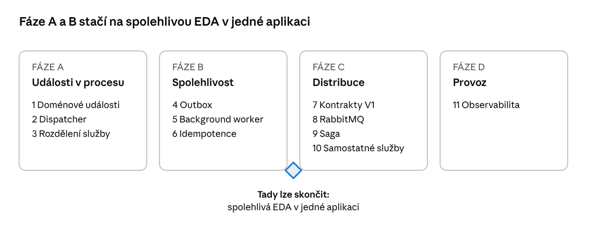
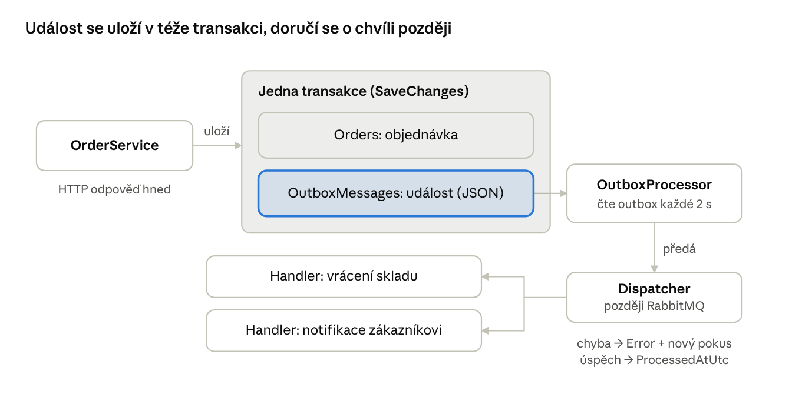
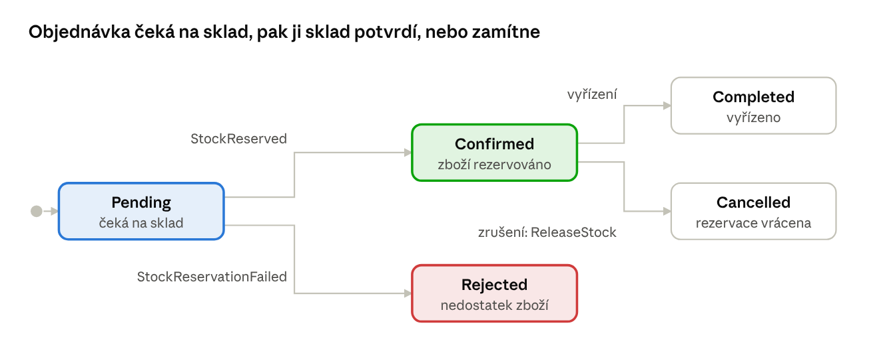
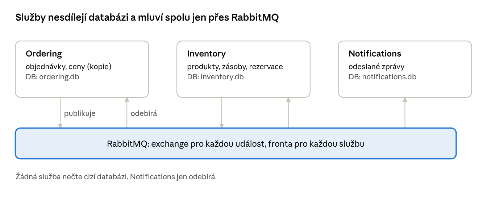

# MiniShop: cesta k event-driven architektuře

16. 10. 2026 · František

MiniShop převedeme na event-driven architekturu v 11 malých krocích. Po každém kroku aplikace funguje a testy procházejí. Dokument je zatím jen plán, do kódu se nic nemění.

## Úvod: co je EDA a proč ji chceme

**Event-driven architektura (EDA)** je styl, ve kterém si části systému neposílají přímé příkazy („odečti sklad“). Místo toho oznamují, **co se stalo** („objednávka byla vytvořena“). Kdo se o událost zajímá, sám na ni zareaguje. Odesílatel nemusí vědět, kdo poslouchá.

Příklad ze života: kuchař v restauraci nevolá každému číšníkovi zvlášť. Zazvoní na zvonek „jídlo je hotové“ a kdo má na starosti daný stůl, přijde si pro něj. Kuchař nezná číšníky a přidání nového číšníka kuchaře nijak nezmění.

### Proč to dělat

- **Volná vazba (loose coupling).** `OrderService` dnes ví o skladu i o notifikacích. Po přestavbě bude vědět jen o objednávce.
- **Rozšiřitelnost.** Novou reakci na objednávku, například věrnostní body nebo fakturu, přidáte novým handlerem. Existující kód se neupravuje, což je Open/Closed princip na úrovni celé architektury.
- **Odolnost.** Když spadne e-mailový server, objednávka se přesto vytvoří a e-mail se pošle později.
- **Škálování a nezávislé nasazování.** Sklad a objednávky mohou později běžet jako samostatné služby.

### Cena, kterou za to platíme

- **Eventual consistency (konečná konzistence).** Data nejsou konzistentní okamžitě, ale „za chvíli“. Objednávka může chvíli existovat dřív, než je potvrzený sklad.
- **Složitější ladění.** Tok není vidět v jedné metodě, je rozprostřený do handlerů. Proto je posledním krokem observabilita.
- **Nové problémy.** Duplicitní doručení zpráv, pořadí zpráv, verzování kontraktů. Každý z nich řeší jeden z kroků níže.

### Základní pojmy

| Pojem | Význam | Příklad v MiniShopu |
| --- | --- | --- |
| Událost (event) | Fakt, který se stal. Pojmenovaná v minulém čase, nedá se odmítnout. | `OrderPlaced`, `OrderCancelled` |
| Příkaz (command) | Žádost, aby se něco stalo. Může být odmítnuta. | `PlaceOrder`, `ReserveStock` |
| Publisher | Kdo událost vyhlásí | `Order` / `OrderService` |
| Handler (consumer) | Kdo na událost reaguje | `SendOrderConfirmationHandler` |
| Message broker | Pošťák mezi službami, drží frontu zpráv | RabbitMQ |
| Doménová událost | Událost uvnitř jedné aplikace, ve stejné transakci | `OrderPlacedDomainEvent` |
| Integrační událost | Událost posílaná jiným službám přes broker | `OrderPlacedIntegrationEvent` |

Zlaté pravidlo: **příkaz má jednoho adresáta, událost libovolný počet posluchačů (i nula).**

## Výchozí stav: jedna metoda dělá všechno

Dnes `OrderService.PlaceOrderAsync` v jedné synchronní metodě a jedné transakci postupně:

1. načte produkty,
2. odečte zboží ze skladu (`product.RemoveStock`),
3. vytvoří objednávku a spočítá slevy,
4. uloží vše přes `SaveChangesAsync`,
5. zavolá `notifier.OrderPlacedAsync`.

**Co je na tom dobře:** je to jednoduché, čitelné a vždy konzistentní. Pro malou aplikaci je to úplně v pořádku. EDA není cíl sama o sobě.

**Slabá místa, která EDA řeší:**

- **Objednávky ví o skladu.** Kdo chce změnit pravidla skladu, musí sahat do `OrderService`.
- **Každá nová reakce znamená úpravu metody.** Faktura, věrnostní body nebo statistiky by přidávaly další řádky do `PlaceOrderAsync`.
- **Notifikace může selhat po uložení.** Kdyby `OrderPlacedAsync` posílala e-mail a spadla, objednávka je uložená, ale zákazník nic nedostal a nikdo se to nedozví. To je takzvaný **dual-write problém**: zápis do databáze a odeslání zprávy nejsou atomické.
- **Všechno běží v jednom procesu.** Sklad ani notifikace nejdou škálovat nebo nasadit zvlášť.



Nahoře dnešní stav: `OrderService` musí znát každého příjemce. Dole stav po kroku 3: vyhlásí jednu událost a handlery se přidávají bez zásahu do něj.

## Přehled kroků

Kroky jsou seřazené tak, aby každý stavěl na předchozím a aby šlo kdykoli přestat. Už po fázi A máte čistou EDA uvnitř jedné aplikace. Fáze C a D dávají smysl teprve tehdy, když chcete samostatné služby.



Kosočtverec mezi fázemi B a C označuje rozumné místo, kde se můžete zastavit.

| Krok | Fáze | Co přinese | Nová závislost |
| --- | --- | --- | --- |
| 1. Doménové události | A – události v procesu | Entity hlásí, co se stalo | žádná |
| 2. Dispatcher a handlery | A | Události se doručí handlerům | žádná (vlastní kód) |
| 3. Rozdělení OrderService | A | Sklad a notifikace jako handlery | žádná |
| 4. Outbox | B – spolehlivost | Událost se neztratí | tabulka v SQLite |
| 5. Background worker | B | Asynchronní zpracování outboxu | `BackgroundService` |
| 6. Idempotence (inbox) | B | Bezpečné opakování | tabulka v SQLite |
| 7. Integrační události | C – distribuce | Veřejné kontrakty mezi službami | projekt `Contracts` |
| 8. Message broker | C | Zprávy mezi procesy | RabbitMQ, MassTransit, Docker |
| 9. Saga objednávky | C | Rezervace skladu s kompenzací | MassTransit state machine |
| 10. Samostatné služby | C | Ordering, Inventory, Notifications | více projektů a databází |
| 11. Observabilita | D – provoz | Sledování toku napříč službami | OpenTelemetry |

Každý krok níže má stejnou strukturu: **teorie** (co to je), **proč** (jaký problém řeší), **v MiniShopu** (konkrétní změna s ukázkou kódu) a **hotovo, když** (jak ověřit, že krok je dokončený).

## Krok 1: Doménové události v entitách

**Teorie.** Doménová událost (domain event, pojem z Domain-Driven Design) je malý neměnný objekt, který popisuje business fakt: „objednávka 42 byla vytvořena“. Vzniká **uvnitř entity** ve chvíli, kdy se změní její stav. Entita ji zatím nikam neposílá, jen si ji zapíše do seznamu „co se se mnou stalo“.

**Proč.** Dnes o tom, že je potřeba někoho informovat, rozhoduje `OrderService`. Když událost vytvoří sama entita, nemůže se stát, že někdo zavolá `order.Cancel()` a zapomene poslat notifikaci. Pravda o tom, co se stalo, je na jednom místě.

**V MiniShopu:**

```csharp
// Domain/Common/IDomainEvent.cs
public interface IDomainEvent
{
    DateTime OccurredAtUtc { get; }
}

// Domain/Common/Entity.cs – společný předek entit
public abstract class Entity
{
    private readonly List<IDomainEvent> _domainEvents = new();
    public IReadOnlyCollection<IDomainEvent> DomainEvents => _domainEvents.AsReadOnly();
    protected void Raise(IDomainEvent e) => _domainEvents.Add(e);
    public void ClearDomainEvents() => _domainEvents.Clear();
}

// Domain/Orders/Events/OrderPlaced.cs
public sealed record OrderPlaced(Order Order, DateTime OccurredAtUtc) : IDomainEvent;

// Order.cs
public void Cancel()
{
    EnsureStatus(OrderStatus.Created, "Zrušit lze jen novou objednávku.");
    Status = OrderStatus.Cancelled;
    Raise(new OrderCancelled(this, DateTime.UtcNow));
}
```

Události pro začátek: `OrderPlaced`, `OrderCompleted`, `OrderCancelled`. Později přibudou `ProductStockChanged` nebo `ProductPriceChanged`.

**Důležitý detail:** událost nese odkaz na entitu `Order`, protože ještě neopouští proces. Pro události, které jdou ven, to v kroku 7 změníme.

**Hotovo, když:** unit test ověří, že po `order.Cancel()` obsahuje `order.DomainEvents` právě jednu událost `OrderCancelled`. Chování aplikace se zatím nemění.

## Krok 2: In-process dispatcher a handlery

**Teorie.** Události z kroku 1 je potřeba někomu doručit. **Dispatcher** je malá služba, která pro každou událost najde v DI kontejneru všechny **handlery** (`IDomainEventHandler<OrderPlaced>`) a zavolá je. Jde o vzor **Publish/Subscribe**, zatím uvnitř jednoho procesu a bez sítě. Je to stejný princip, jaký používá knihovna MediatR. Vlastní implementace má asi 30 řádků a naučíte se na ní víc.

**Proč.** Oddělíme, *kdo událost vyhlásil*, od toho, *kdo na ni reaguje*. Přidání reakce je pak jen nová třída zaregistrovaná v DI.

**V MiniShopu:**

```csharp
// Application/Abstractions
public interface IDomainEventHandler<in TEvent> where TEvent : IDomainEvent
{
    Task HandleAsync(TEvent domainEvent, CancellationToken ct);
}

public interface IDomainEventDispatcher
{
    Task DispatchAsync(IEnumerable<IDomainEvent> events, CancellationToken ct);
}

// Infrastructure – MiniShopDbContext
public override async Task<int> SaveChangesAsync(CancellationToken ct = default)
{
    var entities = ChangeTracker.Entries<Entity>().Select(e => e.Entity).ToList();
    var events = entities.SelectMany(e => e.DomainEvents).ToList();
    entities.ForEach(e => e.ClearDomainEvents());

    var result = await base.SaveChangesAsync(ct);
    await _dispatcher.DispatchAsync(events, ct);   // až po uložení
    return result;
}
```

**Rozhodnutí: dispatch před, nebo po uložení?**

| Varianta | Výhoda | Nevýhoda |
| --- | --- | --- |
| Před `SaveChanges` | Handler je ve stejné transakci, chyba v něm vrátí vše zpět | ID objednávky ještě není známé, pomalý handler drží transakci |
| Po `SaveChanges` (doporučeno) | Data jsou uložená, handler zná ID | Pád procesu mezi uložením a handlerem událost ztratí, řeší krok 4 |

**Hotovo, když:** existuje dispatcher a jeden pokusný handler (`LogOrderPlacedHandler`), který do logu zapíše „objednávka 42 vytvořena“. Integrační test ověří, že se handler zavolal.

## Krok 3: Rozdělení OrderService na handlery

**Teorie.** Teď máme nástroj, tak ho použijeme. Vedlejší účinky objednávky přesuneme do handlerů. Každý handler má **jednu odpovědnost** (Single Responsibility) a o ostatních neví. Tento přístup se někdy nazývá **choreografie**: každý účastník zná svůj „taneční krok“ a reaguje na hudbu (události), žádný dirigent neexistuje.

**Proč.** `OrderService` přestane záviset na `IOrderNotifier` a jeho jediná starost bude objednávka. Notifikace a další budoucí reakce si žijí vlastním životem.

**V MiniShopu:**

| Handler | Reaguje na | Dělá |
| --- | --- | --- |
| `SendOrderConfirmationHandler` | `OrderPlaced` | Notifikace zákazníkovi (nahradí `IOrderNotifier`) |
| `ReturnStockOnOrderCancelledHandler` | `OrderCancelled` | Vrátí zboží na sklad (dnes je to v `CancelAsync`) |
| `SendCancellationNoticeHandler` | `OrderCancelled` | Notifikace o zrušení |

```csharp
// OrderService.CancelAsync – po přestavbě
public async Task<OrderDto> CancelAsync(int id, CancellationToken ct)
{
    var order = await GetOrderAsync(id, ct);
    order.Cancel();                        // vyvolá OrderCancelled
    await unitOfWork.SaveChangesAsync(ct); // dispatcher zavolá handlery
    return order.ToDto();
}
```

**Pozor na odečtení skladu při vytvoření objednávky.** To zatím **necháme v `PlaceOrderAsync`**. Kontrola „je dost zboží?“ musí proběhnout *před* přijetím objednávky. Kdyby ji dělal handler až po uložení, objednávka by už existovala. Správné asynchronní řešení (rezervace s kompenzací) přijde až v kroku 9 se ságou.

**Hotovo, když:** `IOrderNotifier` zmizel z konstruktoru `OrderService`, existující testy po úpravách procházejí a v logu je vidět, že handlery proběhly.

## Krok 4: Outbox pattern

**Teorie.** Po kroku 3 máme skrytý problém. Handler `ReturnStockOnOrderCancelledHandler` běží až **po** uložení objednávky a ukládá ve vlastní, druhé transakci. Když aplikace spadne mezi těmito dvěma uloženími, objednávka je zrušená, ale zboží se na sklad nikdy nevrátí. To je zmíněný **dual-write problém**.

**Outbox** ho řeší jednoduše. Událost se neposílá hned, ale **uloží se jako řádek do tabulky `OutboxMessages` ve stejné transakci** jako změna objednávky. Databáze garantuje, že se uloží buď obojí, nebo nic. Někdo jiný (krok 5) pak tabulku čte a události doručuje.

Přirovnání: místo toho, abyste dopis hned nesli na poštu, vložíte ho do schránky „odchozí“ na stole. Ze schránky se neztratí a pošťák si ho vyzvedne, i když mezitím odejdete z kanceláře.



Objednávka a událost se uloží spolu, nebo vůbec. O doručení se pak stará `OutboxProcessor` z kroku 5, až po skončení HTTP požadavku.

**Proč.** Garance **at-least-once** (alespoň jednou): událost, která se stala, bude doručena. Toto je nejdůležitější spolehlivostní vzor celé EDA.

**V MiniShopu:**

```csharp
public sealed class OutboxMessage
{
    public Guid Id { get; init; }
    public string Type { get; init; } = "";      // např. "OrderCancelled"
    public string Payload { get; init; } = "";   // JSON události
    public DateTime OccurredAtUtc { get; init; }
    public DateTime? ProcessedAtUtc { get; set; }
    public string? Error { get; set; }
}

// MiniShopDbContext.SaveChangesAsync – místo dispatch události uložíme
OutboxMessages.AddRange(events.Select(e => OutboxMessage.From(e)));
return await base.SaveChangesAsync(ct);   // jedna transakce
```

Událost se ukládá jako JSON, proto v ní místo celé entity `Order` musí být jen data: `OrderId`, položky (`ProductId`, `Quantity`), e-mail. To je dobrý nácvik na krok 7.

**Hotovo, když:** po zrušení objednávky je v tabulce `OutboxMessages` řádek typu `OrderCancelled` s `ProcessedAtUtc = NULL`. Uvidíte ho třeba v DB Browseru for SQLite.

## Krok 5: Background worker pro outbox

**Teorie.** **Outbox processor** je proces na pozadí. V ASP.NET Core je to třída zděděná z `BackgroundService`, která běží po celou dobu života aplikace. V pravidelném intervalu načte nezpracované řádky z outboxu, každý deserializuje na událost, předá dispatcheru z kroku 2 a označí jako zpracovaný. Tady poprvé vzniká opravdová **asynchronnost**: HTTP požadavek skončí hned a handlery proběhnou o chvilku později.

**Proč.** Spolu s krokem 4 dostáváme spolehlivé doručení. Když handler selže, řádek zůstane nezpracovaný s vyplněnou chybou a worker to zkusí znovu (**retry**). Když aplikace spadne, po restartu worker pokračuje tam, kde skončil. Uživatel navíc nečeká na pomalé činnosti jako e-mail.

**V MiniShopu:**

```csharp
public sealed class OutboxProcessor(IServiceScopeFactory scopes, ILogger<OutboxProcessor> log)
    : BackgroundService
{
    protected override async Task ExecuteAsync(CancellationToken stoppingToken)
    {
        using var timer = new PeriodicTimer(TimeSpan.FromSeconds(2));
        while (await timer.WaitForNextTickAsync(stoppingToken))
        {
            await using var scope = scopes.CreateAsyncScope();   // nový DbContext
            // 1) načíst max. 20 zpráv s ProcessedAtUtc == null
            // 2) deserializovat a zavolat IDomainEventDispatcher
            // 3) úspěch => ProcessedAtUtc = now; chyba => Error = ex.Message, Attempts++
        }
    }
}
```

**Praktické detaily:**

- **Scope.** `BackgroundService` je singleton, `DbContext` je scoped. Proto se v každém kole vytváří nový scope.
- **Počet pokusů.** Zpráva, která selže například 5×, se přestane zkoušet. Tomu se říká **poison message** a patří do zvláštní fronty (**dead-letter**), kam se podívá člověk.
- **UI.** Po zrušení objednávky se sklad obnoví s malým zpožděním. To je eventual consistency v praxi.

**Hotovo, když:** po zrušení objednávky se do 2–3 sekund vrátí zboží na sklad a řádek v outboxu má vyplněné `ProcessedAtUtc`. Když v handleru schválně vyhodíte výjimku, uvidíte opakované pokusy.

## Krok 6: Idempotentní handlery (inbox)

**Teorie.** At-least-once znamená *alespoň* jednou, tedy někdy i dvakrát. Stačí, aby handler úspěšně vrátil zboží na sklad a worker spadl dřív, než stihl označit zprávu jako zpracovanou. Po restartu ji zpracuje znovu a zboží se vrátí dvakrát. Operace je **idempotentní**, když její opakování má stejný výsledek jako jedno provedení. Například „nastav stav na Zrušena“ je idempotentní, „přičti 5 ks“ není.

**Inbox pattern** je zrcadlo outboxu. Handler si do tabulky `ProcessedMessages` zapíše dvojici (ID zprávy, název handleru), a to **ve stejné transakci** jako svou změnu. Před zpracováním se podívá, jestli tam záznam už je. Pokud ano, zprávu přeskočí.

**Proč.** V distribuovaných systémech garance **exactly-once** (právě jednou) prakticky neexistuje. Správný přístup zní: **at-least-once doručení + idempotentní příjemce = efektivně právě jednou.** Tuto rovnici si zapamatujte, platí i pro RabbitMQ, Kafku nebo Azure Service Bus.

**V MiniShopu:**

```csharp
// společný dekorátor – obalí každý handler (vzor Decorator, Open/Closed)
public sealed class IdempotentHandler<T>(IDomainEventHandler<T> inner, MiniShopDbContext db)
    : IDomainEventHandler<T> where T : IDomainEvent
{
    public async Task HandleAsync(T e, CancellationToken ct)
    {
        var key = (e.EventId, inner.GetType().Name);
        if (await db.ProcessedMessages.AnyAsync(m => m.EventId == key.EventId && m.Handler == key.Name, ct))
            return;                                     // už zpracováno
        await inner.HandleAsync(e, ct);
        db.ProcessedMessages.Add(new(key.EventId, key.Name));
        await db.SaveChangesAsync(ct);                  // změna + záznam spolu
    }
}
```

Události proto potřebují jednoznačné `EventId` (`Guid`). Přidáme ho do `IDomainEvent`.

**Hotovo, když:** test zavolá stejný handler dvakrát se stejnou událostí a sklad se zvýší jen jednou.

## Krok 7: Integrační události a kontrakty

**Teorie.** Zatím jsou všechny události **doménové**, tedy interní. Smí se měnit, kdykoli se změní doména. Jakmile ale událost opustí aplikaci a čte ji jiná služba, stává se z ní **veřejné API**. Takové události se říká **integrační** a její tvar je **kontrakt**, který se nesmí rozbít.

|  | Doménová událost | Integrační událost |
| --- | --- | --- |
| Kdo ji čte | Handlery ve stejné aplikaci | Jiné služby |
| Obsah | Může nest entitu | Jen jednoduchá data (ID, čísla, texty) |
| Změna tvaru | Kdykoli | Jen zpětně kompatibilně |
| Kde žije | `MiniShop.Domain` | Nový projekt `MiniShop.Contracts` |

**Proč.** Bez oddělení by každá úprava entity `Order` rozbila ostatní služby. Kontrakty jsou hranice, která dovoluje měnit vnitřek nezávisle.

**V MiniShopu:**

```csharp
// MiniShop.Contracts – žádné závislosti, sdílí se mezi službami
namespace MiniShop.Contracts.Orders;

public sealed record OrderPlacedV1(
    Guid EventId,
    int OrderId,
    string CustomerEmail,
    decimal TotalPrice,
    IReadOnlyList<OrderLineV1> Lines,
    DateTime OccurredAtUtc);

public sealed record OrderLineV1(int ProductId, int Quantity);
```

Překlad mezi doménovou a integrační událostí dělá handler: `OrderPlaced` (doménová) → handler → `OrderPlacedV1` do outboxu.

**Pravidla verzování:**

- Nové **volitelné** pole přidat smíte.
- Přejmenovat nebo odebrat pole nesmíte. Vytvoří se `OrderPlacedV2` a chvíli se publikují obě verze.
- Příjemce musí ignorovat pole, která nezná (**tolerant reader**).

**Hotovo, když:** projekt `MiniShop.Contracts` existuje a outbox obsahuje integrační události s `V1` v názvu typu.

## Krok 8: Message broker (RabbitMQ)

**Teorie.** Dosud vše běží v jednom procesu a „pošťákem“ je náš worker. **Message broker** je samostatný server, který přijímá zprávy od publisherů a drží je ve **frontách** (queue), dokud si je consumer nevyzvedne. V RabbitMQ funguje publikování události takto:

1. Publisher pošle zprávu do **exchange** typu fanout nebo topic.
2. Exchange ji zkopíruje do všech front, které se k ní **přihlásily** (binding).
3. Každá služba má svou frontu, takže každá dostane vlastní kopii.
4. Consumer zprávu po zpracování **potvrdí (ack)**. Když spadne, broker ji doručí znovu.

**Proč.** Broker umožní, aby události četly jiné procesy (kroky 9 a 10). Když je příjemce zrovna vypnutý, zprávy na něj počkají ve frontě. Publisher a consumer nemusí běžet současně, tomu se říká časové oddělení (temporal decoupling).

**V MiniShopu:**

- RabbitMQ spustíte lokálně v Dockeru: `docker run -d -p 5672:5672 -p 15672:15672 rabbitmq:management`. Na `http://localhost:15672` (guest/guest) pak uvidíte fronty a zprávy.
- Outbox processor z kroku 5 bude místo volání dispatcheru **publikovat do RabbitMQ**.
- Na RabbitMQ je dobré použít knihovnu, která řeší serializaci, retry, dead-letter fronty i outbox. Nejznámější je **MassTransit**. Pozor na licenci: pokud vím, verze 9 je komerční a open-source zůstává verze 8. Alternativy jsou **Wolverine** nebo **Rebus**. Volbu uděláme, až na tento krok dojdeme.

```csharp
// consumer v MassTransit – obdoba našeho handleru
public sealed class OrderPlacedConsumer(ILogger<OrderPlacedConsumer> log) : IConsumer<OrderPlacedV1>
{
    public Task Consume(ConsumeContext<OrderPlacedV1> context)
    {
        log.LogInformation("Objednávka {Id} přijata", context.Message.OrderId);
        return Task.CompletedTask;
    }
}
```

Dobrá zpráva: díky krokům 1–7 se mění jen infrastruktura. Doména, služby a handlery zůstávají stejné. Tak se v praxi projevuje Dependency Inversion.

**Hotovo, když:** v management UI RabbitMQ vidíte exchange `OrderPlacedV1` a po vytvoření objednávky zprávu ve frontě.

## Krok 9: Saga objednávky – rezervace skladu a kompenzace

**Teorie.** Teď se vrátíme k odloženému problému z kroku 3: jak odečíst sklad, když objednávky a sklad nesdílejí jednu transakci? Distribuované transakce (2PC) jsou pomalé a křehké, proto se používá **saga**. Saga je posloupnost lokálních transakcí propojených událostmi. Když některý krok selže, spústí se **kompenzační akce**, které vrátí předchozí kroky. Nejde o technický rollback, ale o business opačný krok, například „zruš rezervaci“.

Saga má dva styly:

- **Choreografie:** služby reagují na události, centrální řízení neexistuje (jako v kroku 3). Hodí se na 2–3 kroky.
- **Orchestrace:** jeden **orchestrátor** (state machine) drží stav celého procesu a posílá příkazy. Je přehlednější pro delší procesy a snadno se v něm zjistí, „kde objednávka vísne“.

**Proč.** Objednávky už nebudou volat `product.RemoveStock()` přímo. Díky tomu jde sklad oddělit jako samostatnou službu s vlastní databází (krok 10).

**V MiniShopu: nový životní cyklus objednávky**

1. `POST /api/orders` vytvoří objednávku ve stavu **Pending** a publikuje `OrderPlacedV1`. API vrátí `202 Accepted` místo `201 Created`.
2. Sklad přijme `ReserveStock`. Když je zboží dost, zarezervuje ho a publikuje `StockReserved`, jinak publikuje `StockReservationFailed`.
3. Při `StockReserved` přejde objednávka do stavu **Confirmed** a odešle se potvrzení zákazníkovi.
4. Při `StockReservationFailed` přejde objednávka do stavu **Rejected** a zákazník dostane omluvu.
5. Zrušení potvrzené objednávky je kompenzace: `ReleaseStock` vrátí rezervaci.



Šipky označené názvem události posouvá sklad, ostatní spouští uživatel. Zelená a červená jsou dva možné výsledky rezervace.

**Co to znamená pro uživatele:** UI už po odeslání neukáže „hotovo“, ale „objednávka přijata, ověřujeme sklad“. Stránka se pak obnoví (polling) nebo dostane zprávu přes SignalR. Toto je největší viditelná změna celé přestavby a je dobré ji vyřešit vědomě.

**Hotovo, když:** objednávka 999 kusů monitoru skončí ve stavu Rejected bez chyby 400. Bezžná objednávka projde stavy Pending → Confirmed a všechny události jsou vidět v logu.

## Krok 10: Rozdělení na samostatné služby

**Teorie.** **Bounded context** (ohraničený kontext, pojem z DDD) je oblast, ve které má model jednoznačný význam. „Produkt“ znamená pro katalog název, popis a cenu, pro sklad hlavně množství a rezervace. Každý kontext může být samostatná služba s **vlastní databází** (database per service). Služby se nikdy nedotýkají cizích tabulek, komunikují jen přes události a API.

**Proč.** Nezávislé nasazování, škálování a výpadky: když nejdou notifikace, objednávky běží dál. **Upozornění:** tohle je nejdražší krok a pro učení není nutný. Většinu EDA se naučíte už v krocích 1–9, i když vše poběží v jedné aplikaci, tzv. **modulárním monolitu**.

**V MiniShopu: cílové rozdělení**

| Služba | Vlastní data | Publikuje | Odebírá |
| --- | --- | --- | --- |
| Ordering | Objednávky, položky | `OrderPlacedV1`, `OrderCancelledV1` | `StockReserved`, `StockReservationFailed` |
| Inventory (sklad) | Produkty, zásoby, rezervace | `StockReserved`, `StockReservationFailed`, `ProductPriceChanged` | `OrderPlacedV1`, `OrderCancelledV1` |
| Notifications | Odeslané zprávy | – | všechny události objednávek |



Každá služba má svou databázi. Jediná společná věc je broker a kontrakty z kroku 7.

**Doporučený postup:**

1. Nejdřív **modulární monolit**: složky nebo projekty `Ordering`, `Inventory`, `Notifications` v jednom procesu, každý s vlastním `DbContext` a vlastním DB schématem nebo souborem SQLite.
2. Hlídat, aby se moduly nevolaly přímo. To jde vynutit testem architektury, například knihovnou NetArchTest.
3. Až pak vyjmout modul do samostatného ASP.NET projektu. Pro spouštění více služeb najednou se hodí **.NET Aspire** nebo `docker compose`.

**Otázka, kterou musíte vyřešit:** Ordering potřebuje znát cenu produktu, ale nesmí číst databázi skladu. Řešením je **lokální kopie** (read model): Ordering odebírá `ProductPriceChanged` a drží si vlastní tabulku cen.

**Hotovo, když:** kterákoli služba jde vypnout a ostatní dál fungují. Po jejím zapnutí zpracuje zprávy, které na ni čekaly ve frontě.

## Krok 11: Observabilita – korelace a tracing

**Teorie.** V synchronní aplikaci ukáže stack trace celou cestu požadavku. V EDA se jeden business proces rozpadne na desítky zpráv v různých procesech a v různých časech. **Observabilita** je schopnost zjistit z venku, co se uvnitř děje. Stojí na třech pilířích:

- **Logy:** strukturované záznamy, které už máme (`{OrderId}` v `LogInformation`).
- **Metriky:** čísla v čase, například délka outboxu nebo počet chyb v handlerech.
- **Trasy (traces):** cesta jednoho procesu napříč službami, které drží pohromadě **correlation ID** (trace ID).

**Proč.** Bez toho nezodpovíte základní otázku podpory: „proč objednávka 42 visí ve stavu Pending?“ Proto je observabilita součástí architektury, ne doplněk na konec.

**V MiniShopu:**

1. Každá zpráva v outboxu dostane `CorrelationId`, tedy ID původního HTTP požadavku (`Activity.Current?.TraceId`). Handler ho předává dál do zpráv, které sám publikuje.
2. **OpenTelemetry** (balíčky `OpenTelemetry.Extensions.Hosting` a instrumentace pro ASP.NET Core, EF Core a HTTP) automaticky propojí HTTP → DB → broker → consumer do jedné trasy. MassTransit i Wolverine OpenTelemetry podporují.
3. Zobrazení: **.NET Aspire dashboard** (běží lokálně, ideální pro učení) nebo Jaeger v Dockeru.
4. Jednoduchý **health check** `/health`, který hlásí problém, když outbox obsahuje zprávy starší než 5 minut.

**Tip:** correlation ID do logů se vyplatí zavést už v kroku 5. Stojí málo a od začátku usnadňuje ladění.

**Hotovo, když:** v dashboardu uvidíte jednu trasu „POST /api/orders“ se všemi navazujícími kroky: zápis do DB, publikace, rezervace skladu, potvrzení.

## Slovníček a další čtení

| Pojem | Stručně | Krok |
| --- | --- | --- |
| At-least-once | Zpráva dorazí alespoň jednou, může i víckrát | 4, 5 |
| Bounded context | Hranice, uvnitř které má model jednoznačný význam | 10 |
| Correlation ID | Společné ID všech zpráv jednoho business procesu | 11 |
| Dead-letter queue | Odkladiště zpráv, které opakovaně selhaly | 5, 8 |
| Dual-write problém | Zápis do DB a odeslání zprávy nejsou atomické | 4 |
| Eventual consistency | Data se srovnají s malým zpožděním | 5, 9 |
| Idempotence | Opakování operace nezmění výsledek | 6 |
| Inbox | Záznam o zpracovaných zprávách, chrání před duplicitou | 6 |
| Kompenzace | Business opak kroku, který už proběhl | 9 |
| Modulární monolit | Jedna aplikace s přísně oddělenými moduly | 10 |
| Outbox | Události ukládané do DB ve stejné transakci jako data | 4 |
| Saga | Proces z lokálních transakcí s kompenzacemi | 9 |
| Tolerant reader | Příjemce ignoruje neznámá pole zprávy | 7 |

**Doporučené čtení** (tipy na samostudium, ne zdroje tohoto dokumentu):

- Martin Fowler: [What do you mean by “Event-Driven”?](https://martinfowler.com/articles/201701-event-driven.html), čtyři významy pojmu EDA
- Chris Richardson: [Transactional outbox](https://microservices.io/patterns/data/transactional-outbox.html) a [Saga](https://microservices.io/patterns/data/saga.html), katalog vzorů na microservices.io
- Microsoft: [.NET Microservices: Architecture for Containerized .NET Applications](https://learn.microsoft.com/dotnet/architecture/microservices/), kapitoly o doménových a integračních událostech
- Kniha Vaughn Vernon: *Implementing Domain-Driven Design*, kapitola Domain Events
