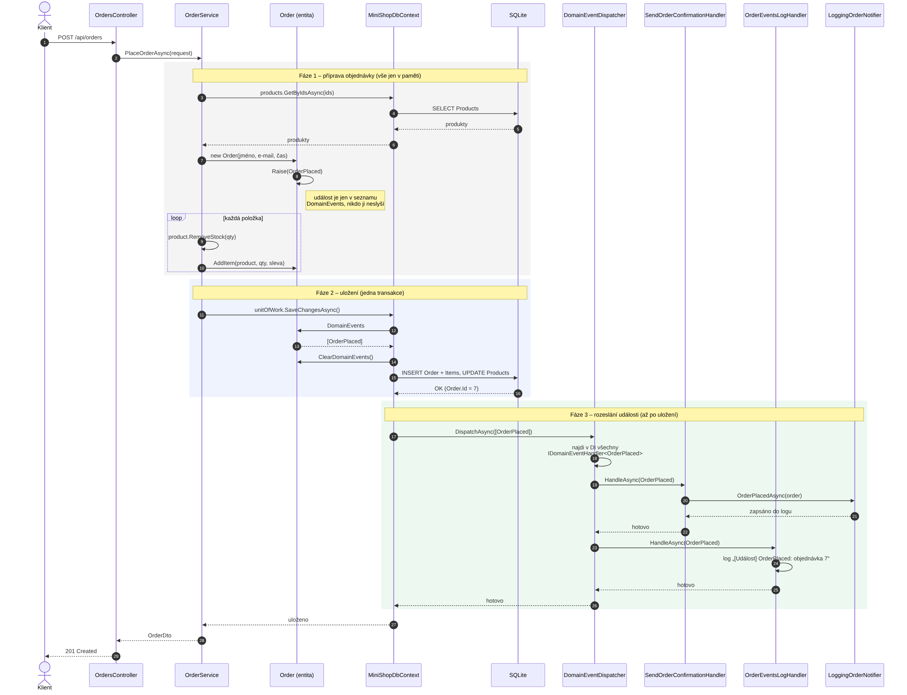
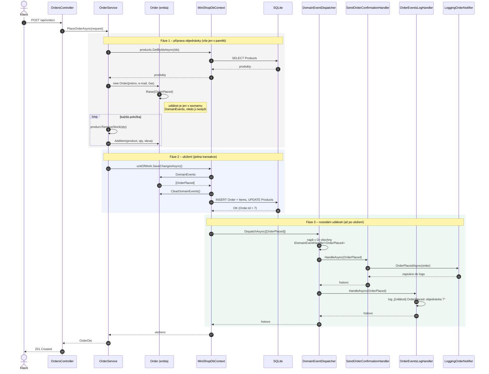

# Sekvenční diagram: vytvoření objednávky (stav po kroku 3)

## Jak diagram číst

- **Fáze 1 (šedá):** `OrderService` připraví objednávku v paměti. Konstruktor `Order` vyvolá `OrderPlaced`,
  ale událost zatím jen leží v seznamu `DomainEvents` (krok 8). Nikdo ji ještě neslyší.
- **Fáze 2 (modrá):** `SaveChangesAsync` vybere události z entit (12–14) a uloží vše v jedné transakci (15–16).
  Objednávka teprve teď dostane `Id`.
- **Fáze 3 (zelená):** `MiniShopDbContext` předá události **dispatcheru** (17). Ten najde v DI všechny
  **handlery** `IDomainEventHandler<OrderPlaced>` (18) a postupně je zavolá (19 a 23).
  Pořadí handlerů odpovídá pořadí registrace: nejdřív aplikační (`AddApplication`), pak infrastrukturní.
- `OrderService` o dispatcheru ani handlerech nic neví – jen volá `SaveChangesAsync` (11).

Zrušení objednávky vypadá stejně, jen místo `OrderPlaced` putuje `OrderCancelled` a ve fázi 3
jsou tři handlery: `ReturnStockOnOrderCancelledHandler`, `SendCancellationNoticeHandler` a `OrderEventsLogHandler`.

## Zdroj diagramu (Mermaid)

Vykreslí se na GitHubu nebo ve VS Code s rozšířením *Markdown Preview Mermaid Support*.

