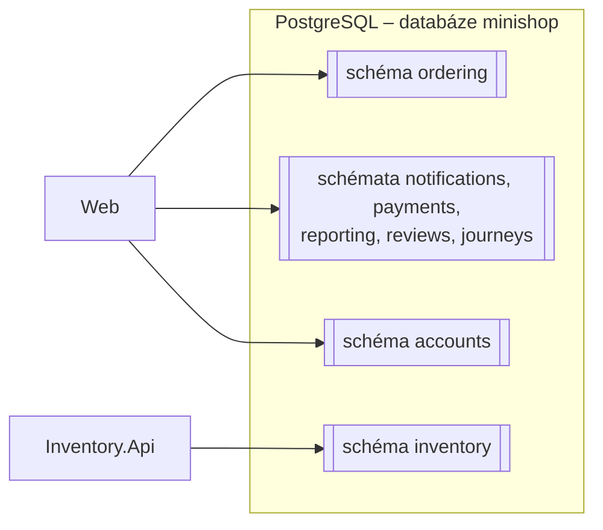
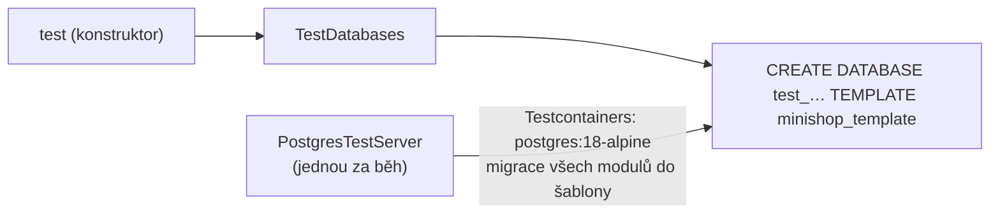

> **V jedné větě:** Všechny moduly ukládají data do **jedné databáze PostgreSQL** (`minishop`), každý do **vlastního schématu**
> (`ordering`, `inventory`, `accounts`, …). Schéma je „vlastní databáze modulu“ – moduly do cizích tabulek nesahají.

## Proč PostgreSQL

Do listopadu 2026 měl každý modul vlastní SQLite soubor (`ordering.db`, `inventory.db`, …). SQLite je ale soubor na disku
jedné VM: druhý stroj k němu nemá přístup a dva procesy se přetahují o zápis (SQLite má jediného zapisovatele). Aby mohl
MiniShop běžet ve **víc instancích**, potřebuje databázový server. Plán celého přechodu je v
[Skalovani-roadmap.md](code:docs/Skalovani-roadmap.md).

Přechod šel způsobem **expand → contract** (stejně jako `ProductUpdatedV1` → `V2`):

1. **expand** – aplikace uměla obě databáze (škálování krok 1), testy běžely nad oběma (krok 2),
2. převod produkčních dat s krátkou odstávkou a přepnutí 4. 11. 2026 (kroky 3A a 3B), obnova ze zálohy (krok 4),
3. **contract** – SQLite z kódu odstraněno (krok 3C).

Přirovnání: stěhování firmy. Napřed se v nové budově vybaví kanceláře (aplikace umí PostgreSQL), pak se o víkendu
přestěhují šanony (data) a teprve potom se vrátí klíče od staré budovy (SQLite pryč).

## Schéma = vlastní databáze modulu



- Každý modul má tabulky **jen ve svém schématu** a v něm i vlastní tabulku historie migrací `__EFMigrationsHistory`.
  Web a Inventory.Api tak migrují nezávisle.
- Server, heslo (`POSTGRES_PASSWORD`) a záloha (`pg_dump`) jsou jen jedny – proto ne osm databází.
- Outbox a inbox leží ve **stejném schématu** jako data modulu – transakce „data + zpráva“ je jedna.

## Připojení

| Kde | Odkud je connection string `ConnectionStrings:minishop` |
| --- | --- |
| Lokálně přes AppHost | Aspire – kontejner `postgres`, volume `minishop-postgres-data`, heslo v user secrets AppHostu |
| Lokálně bez Aspire | `appsettings.Development.json` → kontejner `minishop-postgres` ([Lokální vývoj](../nasazeni/lokalne.md)) |
| Compose / produkce | `compose.yaml` → služba `postgres` (`postgres:18-alpine`), heslo `POSTGRES_PASSWORD` (v produkci secret) |
| Testy | Testcontainers – čerstvá databáze pro každý test (viz níže) |

V kódu je všechno v [ModuleDatabase.cs](code:src/MiniShop.Infrastructure/Persistence/ModuleDatabase.cs):

- `ModuleDatabase.FromConfiguration` přečte connection string (Program.cs Webu i Inventory.Api),
- `UseModuleDatabase` zaregistruje `DbContext` modulu s jeho schématem (historie migrací ve schématu modulu),
- `UseModuleSchema` (v `OnModelCreating`) dá tabulky do schématu – je zapsané jen na jednom místě (konstanta `Schema` kontextu),
- `UseUtcDateTimes` (v `ConfigureConventions`) – PostgreSQL ukládá `DateTime` jako `timestamp with time zone` a odmítne
  čas, který není označený jako UTC. Všechny časy v MiniShopu jsou UTC, při zápisu i čtení je tak označí.

Další místa:

- Druhý zápis stejné unikátní hodnoty (souběh v pokladně, kupon) = SQLSTATE `23505` → `ConcurrencyConflictException`
  ([ModuleDbContext](code:src/MiniShop.Infrastructure/Persistence/ModuleDbContext.cs)).
- `/health` hlídá dostupnost databáze (kontroly `database-ordering`, `database-inventory` –
  [DatabaseHealthCheck](code:src/MiniShop.Infrastructure/Observability/DatabaseHealthCheck.cs)).

## Migrace

Migrace jsou v [MiniShop.Infrastructure](code:src/MiniShop.Infrastructure/) – `Ordering/Migrations`, `Inventory/Migrations` …
Nová migrace (z kořene repozitáře, poprvé `dotnet tool restore`):

```text
dotnet ef migrations add <Nazev> --project src/MiniShop.Infrastructure --context OrderingDbContext --output-dir Ordering/Migrations
```

- Design-time továrny pro `dotnet ef` jsou v [DesignTimeDbContextFactories.cs](code:src/MiniShop.Infrastructure/DesignTimeDbContextFactories.cs).
- První migrace se jmenují `…_InitialPostgres` (vznikly ve škálování kroku 1). **Jména migrací se nemění** – produkce
  je má zapsané v historii a EF podle jména pozná, co už proběhlo.
- **Migrace musí fungovat i se starší verzí kódu** (škálování krok 5B): při postupném nasazení nová kopie spustí migraci,
  zatímco stará kopie ještě chvíli obsluhuje. Přidat sloupec (s výchozí hodnotou nebo nullable) či tabulku ano;
  přejmenovat nebo smazat jen ve dvou nasazeních – nejdřív přidat nové a přestat používat staré, v dalším nasazení
  staré odebrat (expand → contract). Viz [CD – postupné nasazení](../github/cd.md).
- Ruční SQL v migraci (data, ne schéma – např. kategorie „Nezařazeno“ v `UncategorizedCategory`) EF nevygeneruje, je
  potřeba ho dopsat ručně.
- [DatabaseMigrationTests](code:tests/MiniShop.Tests/Infrastructure/DatabaseMigrationTests.cs) hlídají zapomenutou migraci,
  tabulky jen ve schématu modulu a produkční historii migrací.

## Testy nad skutečnou databází

Testy běží nad PostgreSQL (lokálně je potřeba **Docker**):



- [TestDatabases](code:tests/MiniShop.Tests/TestDoubles/TestDatabases.cs) dá testu čerstvou databázi – moduly v ní oddělují
  schémata stejně jako v produkci.
- [PostgresTestServer](code:tests/MiniShop.Tests/TestDoubles/PostgresTestServer.cs) spustí kontejner jednou za běh testů a
  migrace provede jen jednou do šablony. Každý test dostane **kopii šablony** (desítky milisekund) a po sobě ji smaže –
  testy se navzájem neovlivní, i když běží paralelně. Kontejner po skončení uklidí Testcontainers.
- Ruční SQL v testech nepoužívat (schéma, uvozovky) – změnu dat udělat přes EF (`ExecuteUpdateAsync`).
- Transakce běží opravdu souběžně – test `Kupon_PosledniPouzitiNaraz_ProjdeJenJednaObjednavka` ověřuje, že poslední
  použití kuponu dostane jen jedna ze dvou současných objednávek (concurrency token `Coupon.Version`).

Testy nad PostgreSQL našly při přechodu skutečnou chybu: kategorii „Nezařazeno“ zakládalo v SQLite ručně dopsané SQL
v migraci, v migracích PostgreSQL chyběla (škálování krok 2).

## Jak proběhl převod dat (4. 11. 2026)

Jednorázový příkaz `migrate-to-postgres` (kroky 3A a 3B, z kódu odstraněn v kroku 3C – zůstal v historii gitu) převedl
při zastavených službách 1 702 řádků ve 41 tabulkách: řízeně podle modelu EF, se stejnými ID, v jedné transakci na modul
a s kontrolou počtů. Podrobně v souhrnech [krok 3A](code:docs/kroky-skalovani/krok-03a-priprava-prevodu.md) a
[krok 3B](code:docs/kroky-skalovani/krok-03b-prepnuti-produkce.md).

Viz také: [Sdílené jádro – migrace](sdilene-jadro.md), [Zálohy a obnova](../nasazeni/zalohy.md),
[Lokální vývoj](../nasazeni/lokalne.md).
