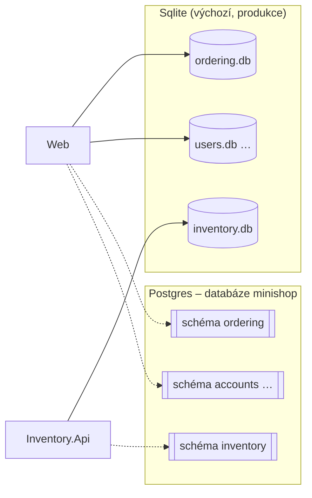

> **V jedné větě:** Každý modul má **vlastní databázi**. Dnes je to SQLite soubor (`ordering.db`, `inventory.db`, …);
> od škálování kroku 1 umí aplikace i **PostgreSQL** – jeden server, v něm **schéma pro každý modul**. Kterou databázi
> služba použije, určuje konfigurace `Database:Provider`.

## Proč PostgreSQL

SQLite je soubor na disku jedné VM: druhý stroj k němu nemá přístup a dva procesy se přetahují o zápis (SQLite má
jediného zapisovatele). Aby mohl MiniShop běžet ve **víc instancích**, potřebuje databázový server.
Plán celého přechodu je v [Skalovani-roadmap.md](code:docs/Skalovani-roadmap.md).

Přechod jde způsobem **expand → contract** (stejně jako `ProductUpdatedV1` → `V2`):

1. **expand** – aplikace umí obě databáze, produkce dál běží na SQLite (škálování krok 1, dnešní stav),
2. převod produkčních dat s krátkou odstávkou a přepnutí (krok 3),
3. **contract** – SQLite se z kódu odstraní.

Přirovnání: stěhování firmy. Napřed se v nové budově vybaví kanceláře (aplikace umí PostgreSQL), pak se o víkendu
přestěhují šanony (data) a teprve potom se vrátí klíče od staré budovy (SQLite pryč).

## Schéma = vlastní databáze modulu



- Moduly zůstávají oddělené: každý má tabulky **jen ve svém schématu** (`ordering`, `inventory`, `journeys`,
  `notifications`, `payments`, `reporting`, `reviews`, `accounts`) a v něm i vlastní tabulku historie migrací
  `__EFMigrationsHistory`. Web a Inventory.Api tak migrují nezávisle.
- Server, zálohu a heslo je ale potřeba spravovat jen jednou – to je důvod, proč ne osm databází.
- Outbox a inbox leží dál ve **stejném schématu** jako data modulu – transakce „data + zpráva“ funguje stejně.

## Jak se provider volí

| Konfigurace | SQLite | PostgreSQL |
| --- | --- | --- |
| `Database:Provider` | `Sqlite` (výchozí) | `Postgres` |
| Connection string | `ConnectionStrings:Ordering`, `…:Inventory`, … (soubor pro každý modul) | `ConnectionStrings:minishop` (jeden pro všechny) |
| Lokálně | `-- --Database:Provider=Sqlite` u AppHostu, nebo služby bez Aspire | AppHost (výchozí): kontejner `postgres` s volume `minishop-postgres-data` |
| Compose | výchozí | `DATABASE_PROVIDER=Postgres` + `POSTGRES_PASSWORD` v `.env`, `docker compose --profile postgres up -d` |
| Produkce | **ano** (zatím) | až po převodu dat (škálování krok 3) |

V kódu je rozdíl jen na jednom místě – [ModuleDatabase.cs](code:src/MiniShop.Infrastructure/Persistence/ModuleDatabase.cs):

- `ModuleDatabase.FromConfiguration` přečte provider a connection string (Program.cs Webu i Inventory.Api),
- `UseModuleDatabase` zaregistruje `DbContext` modulu – u PostgreSQL s jeho schématem a migracemi z druhého projektu,
- `UseModuleSchema` (v `OnModelCreating`) dá tabulky do schématu; SQLite schémata nezná, jeho model zůstává beze změny,
- `UseUtcDateTimes` (v `ConfigureConventions`) – PostgreSQL ukládá `DateTime` jako `timestamp with time zone` a odmítne
  čas, který není označený jako UTC. Všechny časy v MiniShopu jsou UTC, při zápisu je tak jen označí.

Další rozdíly databází, které kód řeší:

| Situace | SQLite | PostgreSQL | Kde |
| --- | --- | --- | --- |
| Druhý zápis stejné unikátní hodnoty (souběh v pokladně, kupon) | chyba 2067 | SQLSTATE `23505` | [ModuleDbContext](code:src/MiniShop.Infrastructure/Persistence/ModuleDbContext.cs) → `ConcurrencyConflictException` |
| Stará databáze bez historie migrací (baseline) | ano – produkce z doby `EnsureCreated` | nikdy – vzniká rovnou migracemi | [DatabaseMigrator](code:src/MiniShop.Infrastructure/Persistence/DatabaseMigrator.cs) |

## Dvě sady migrací

Migrace se generují pro konkrétní databázi (typy sloupců `TEXT` × `uuid`, `timestamp with time zone`, `numeric`…),
proto má každý `DbContext` **dvě sady**:

| Provider | Projekt | Design-time továrny |
| --- | --- | --- |
| SQLite | [MiniShop.Infrastructure](code:src/MiniShop.Infrastructure/) – `Ordering/Migrations` … (beze změny) | `…DesignTimeDbContextFactory` v modulu |
| PostgreSQL | [MiniShop.Infrastructure.PostgreSql](code:src/MiniShop.Infrastructure.PostgreSql/) – `Ordering/Migrations` … (`InitialPostgres`) | [PostgresDesignTimeFactories.cs](code:src/MiniShop.Infrastructure.PostgreSql/PostgresDesignTimeFactories.cs) |

**Změna schématu = migrace pro oba providery se stejným názvem** (z kořene repozitáře):

```text
dotnet ef migrations add <Nazev> --project src/MiniShop.Infrastructure --context OrderingDbContext --output-dir Ordering/Migrations
dotnet ef migrations add <Nazev> --project src/MiniShop.Infrastructure.PostgreSql --context OrderingDbContext --output-dir Ordering/Migrations --namespace MiniShop.Infrastructure.PostgreSql.Ordering.Migrations
```

Na zapomenutou migraci upozorní testy: [DatabaseMigrationTests](code:tests/MiniShop.Tests/Infrastructure/DatabaseMigrationTests.cs)
(SQLite) a [PostgresMigrationTests](code:tests/MiniShop.Tests/Infrastructure/PostgresMigrationTests.cs) (PostgreSQL –
model proti snapshotu, tabulky jen ve schématu modulu; server k tomu není potřeba). Testy aplikace zatím běží nad SQLite
v paměti, proti skutečnému PostgreSQL až od škálování kroku 2 (Testcontainers).

Projekt s migracemi PostgreSQL referencují Web, Inventory.Api i testy – EF ho za běhu načítá podle jména
(`MigrationsAssembly`), musí tedy ležet vedle jejich DLL. Proto je i v `COPY *.csproj` obou Dockerfile.

Viz také: [Sdílené jádro – migrace](sdilene-jadro.md), [Lokální vývoj](../nasazeni/lokalne.md).
