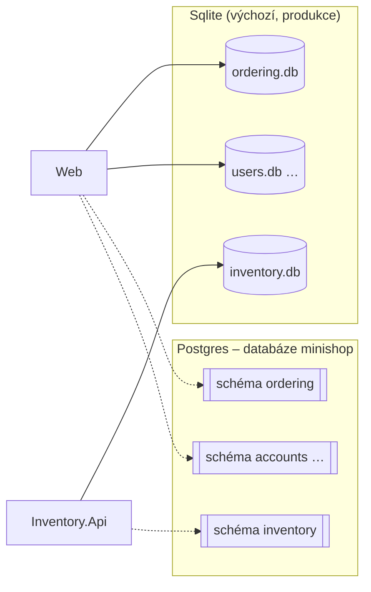
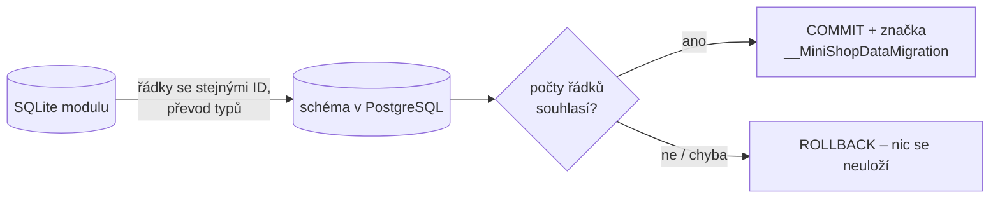
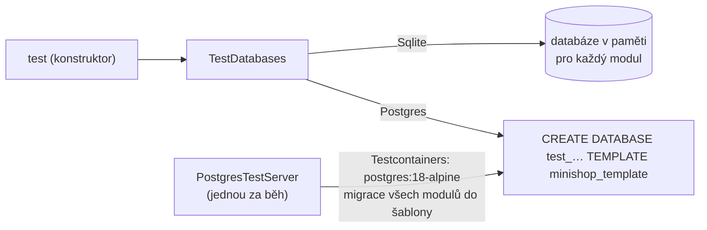

> **V jedné větě:** Každý modul má **vlastní databázi**. Produkce od 4. 11. 2026 běží na **PostgreSQL** (škálování krok 3B), aplikace umí i SQLite soubory (`ordering.db`, `inventory.db`, …);
> v PostgreSQL je jeden server a v něm **schéma pro každý modul**. Kterou databázi
> služba použije, určuje konfigurace `Database:Provider`.

## Proč PostgreSQL

SQLite je soubor na disku jedné VM: druhý stroj k němu nemá přístup a dva procesy se přetahují o zápis (SQLite má
jediného zapisovatele). Aby mohl MiniShop běžet ve **víc instancích**, potřebuje databázový server.
Plán celého přechodu je v [Skalovani-roadmap.md](code:docs/Skalovani-roadmap.md).

Přechod jde způsobem **expand → contract** (stejně jako `ProductUpdatedV1` → `V2`):

1. **expand** – aplikace umí obě databáze, produkce dál běží na SQLite (škálování krok 1, dnešní stav),
2. převod produkčních dat s krátkou odstávkou a přepnutí (krok 3),
3. **contract** – SQLite se z kódu odstraní.

Přirovnání: stěhování firmy. Napřed se v nové budově vybaví kanceláře (aplikace umí PostgreSQL), pak se o víkendu
přestěhují šanony (data) a teprve potom se vrátí klíče od staré budovy (SQLite pryč).

## Schéma = vlastní databáze modulu



- Moduly zůstávají oddělené: každý má tabulky **jen ve svém schématu** (`ordering`, `inventory`, `journeys`,
  `notifications`, `payments`, `reporting`, `reviews`, `accounts`) a v něm i vlastní tabulku historie migrací
  `__EFMigrationsHistory`. Web a Inventory.Api tak migrují nezávisle.
- Server, zálohu a heslo je ale potřeba spravovat jen jednou – to je důvod, proč ne osm databází.
- Outbox a inbox leží dál ve **stejném schématu** jako data modulu – transakce „data + zpráva“ funguje stejně.

## Jak se provider volí

| Konfigurace | SQLite | PostgreSQL |
| --- | --- | --- |
| `Database:Provider` | `Sqlite` (výchozí) | `Postgres` |
| Connection string | `ConnectionStrings:Ordering`, `…:Inventory`, … (soubor pro každý modul) | `ConnectionStrings:minishop` (jeden pro všechny) |
| Lokálně | `-- --Database:Provider=Sqlite` u AppHostu, nebo služby bez Aspire | AppHost (výchozí): kontejner `postgres` s volume `minishop-postgres-data` |
| Compose | výchozí (`DATABASE_PROVIDER=Sqlite`) | `DATABASE_PROVIDER=Postgres` v `.env`; služba `postgres` běží vždy (od kroku 3, heslo `POSTGRES_PASSWORD` povinné) |
| Produkce | do 4. 11. 2026; soubory zůstávají ve volumes jako cesta zpět (stav z okamžiku převodu) do kroku 3C | **ano** – od 4. 11. 2026 (škálování krok 3B), `DATABASE_PROVIDER=Postgres` v `deploy/production.env` |

V kódu je rozdíl jen na jednom místě – [ModuleDatabase.cs](code:src/MiniShop.Infrastructure/Persistence/ModuleDatabase.cs):

- `ModuleDatabase.FromConfiguration` přečte provider a connection string (Program.cs Webu i Inventory.Api),
- `UseModuleDatabase` zaregistruje `DbContext` modulu – u PostgreSQL s jeho schématem a migracemi z druhého projektu,
- `UseModuleSchema` (v `OnModelCreating`) dá tabulky do schématu; SQLite schémata nezná, jeho model zůstává beze změny,
- `UseUtcDateTimes` (v `ConfigureConventions`) – PostgreSQL ukládá `DateTime` jako `timestamp with time zone` a odmítne
  čas, který není označený jako UTC. Všechny časy v MiniShopu jsou UTC, při zápisu je tak jen označí.

Další rozdíly databází, které kód řeší:

| Situace | SQLite | PostgreSQL | Kde |
| --- | --- | --- | --- |
| Druhý zápis stejné unikátní hodnoty (souběh v pokladně, kupon) | chyba 2067 | SQLSTATE `23505` | [ModuleDbContext](code:src/MiniShop.Infrastructure/Persistence/ModuleDbContext.cs) → `ConcurrencyConflictException` |
| Stará databáze bez historie migrací (baseline) | ano – produkce z doby `EnsureCreated` | nikdy – vzniká rovnou migracemi | [DatabaseMigrator](code:src/MiniShop.Infrastructure/Persistence/DatabaseMigrator.cs) |

## Převod dat ze SQLite (migrate-to-postgres)

Data se ze SQLite do PostgreSQL přenesou jednou, při plánované odstávce (škálování krok 3B). Každá služba převádí své
moduly – data leží v jejích volumes:

```text
docker compose stop web inventory-api                       # nikdo nezapisuje
docker compose run --rm --no-deps inventory-api migrate-to-postgres
docker compose run --rm --no-deps web migrate-to-postgres
```



- [SqliteToPostgresCopier](code:src/MiniShop.Infrastructure/Persistence/SqliteToPostgresCopier.cs) se řídí **relačním modelem EF**
  (tabulky, sloupce, cizí klíče): tabulky v pořadí podle cizích klíčů, hodnoty převedené podle typu cílového sloupce
  (SQLite má GUID, čas i desetinná čísla jako text, `bool` jako 0/1), stejná ID, pak posune čítače identity – další
  objednávka dostane další číslo. Nový sloupec nebo tabulka se převede bez úpravy kódu.
- Celý modul v **jedné transakci**; na konci porovná počty řádků každé tabulky a vypíše je. Při neshodě se nic neuloží.
- **Pojistky proti přepsání nových dat:** úspěšný převod zapíše značku do tabulky `__MiniShopDataMigration` ve schématu
  modulu – podruhé se modul převede jen s `--replace` (např. po návratu na SQLite). Nové řádky zapsané aplikací
  (klíč, který v SQLite není) převod odmítne vždy. Data z migrací (kategorie „Nezařazeno“, role) nevadí – jsou i v SQLite.
- [MigrateToPostgresCommand](code:src/MiniShop.Infrastructure/MigrateToPostgresCommand.cs) bere SQLite z `ConnectionStrings:<Modul>`
  a PostgreSQL z `ConnectionStrings:minishop` – nezáleží na `Database:Provider`.
- [PostgresDataMigrationTests](code:tests/MiniShop.Tests/Infrastructure/PostgresDataMigrationTests.cs) převedou data skutečných
  scénářů (objednávky přes celou ságu, platby, kupony, expedice, vratky, hodnocení, přehled tržeb, notifikace, účty
  se zablokovaným uživatelem) a porovnají **obsah každé tabulky**, ne jen počty.

Po přepnutí běží zálohy `pg_dump` a obnova `restore.sh` s `pg_restore` (viz [Zálohy](../nasazeni/zalohy.md)) a `/health` hlídá i dostupnost databáze
(kontrola `database-ordering`, `database-inventory` – [DatabaseHealthCheck](code:src/MiniShop.Infrastructure/Observability/DatabaseHealthCheck.cs)).

## Dvě sady migrací

Migrace se generují pro konkrétní databázi (typy sloupců `TEXT` × `uuid`, `timestamp with time zone`, `numeric`…),
proto má každý `DbContext` **dvě sady**:

| Provider | Projekt | Design-time továrny |
| --- | --- | --- |
| SQLite | [MiniShop.Infrastructure](code:src/MiniShop.Infrastructure/) – `Ordering/Migrations` … (beze změny) | `…DesignTimeDbContextFactory` v modulu |
| PostgreSQL | [MiniShop.Infrastructure.PostgreSql](code:src/MiniShop.Infrastructure.PostgreSql/) – `Ordering/Migrations` … (`InitialPostgres`) | [PostgresDesignTimeFactories.cs](code:src/MiniShop.Infrastructure.PostgreSql/PostgresDesignTimeFactories.cs) |

**Změna schématu = migrace pro oba providery se stejným názvem** (z kořene repozitáře):

```text
dotnet ef migrations add <Nazev> --project src/MiniShop.Infrastructure --context OrderingDbContext --output-dir Ordering/Migrations
dotnet ef migrations add <Nazev> --project src/MiniShop.Infrastructure.PostgreSql --context OrderingDbContext --output-dir Ordering/Migrations --namespace MiniShop.Infrastructure.PostgreSql.Ordering.Migrations
```

Na zapomenutou migraci upozorní testy: [DatabaseMigrationTests](code:tests/MiniShop.Tests/Infrastructure/DatabaseMigrationTests.cs)
(SQLite) a [PostgresMigrationTests](code:tests/MiniShop.Tests/Infrastructure/PostgresMigrationTests.cs) (PostgreSQL –
model proti snapshotu, tabulky jen ve schématu modulu; server k tomu není potřeba).

Ruční SQL v migraci (data, ne schéma – např. kategorie „Nezařazeno“) EF pro druhého providera nevygeneruje – je potřeba
ho dopsat i do migrace PostgreSQL. Přesně tohle našly první testy nad PostgreSQL (migrace `UncategorizedCategory`).

## Testy nad oběma databázemi

Celá sada testů běží nad SQLite i nad PostgreSQL – přepíná ji proměnná prostředí `MINISHOP_TEST_DATABASE`:

```text
dotnet test MiniShop.slnx                                           # SQLite v paměti (výchozí, bez Dockeru, ~50 s)
$env:MINISHOP_TEST_DATABASE="Postgres"; dotnet test MiniShop.slnx   # skutečný PostgreSQL (potřeba Docker, ~1,5 min)
```



- [TestDatabases](code:tests/MiniShop.Tests/TestDoubles/TestDatabases.cs) dá testu databáze modulů. Nad PostgreSQL mají
  všechny moduly jednu databázi a oddělují je schémata – stejně jako v produkci.
- [PostgresTestServer](code:tests/MiniShop.Tests/TestDoubles/PostgresTestServer.cs) spustí kontejner jednou za běh testů a
  migrace provede jen jednou do šablony. Každý test dostane **kopii šablony** (desítky milisekund) a po sobě ji smaže –
  testy se navzájem neovlivní, i když běží paralelně. Kontejner po skončení uklidí Testcontainers.
- Ruční SQL v testech nepoužívat (jména tabulek, schéma, uvozovky se liší) – změnu dat udělat přes EF (`ExecuteUpdateAsync`).
- Nad PostgreSQL běží transakce opravdu souběžně – test `Kupon_PosledniPouzitiNaraz_ProjdeJenJednaObjednavka` ověřuje,
  že poslední použití kuponu dostane jen jedna ze dvou současných objednávek (concurrency token `Coupon.Version`).
- V CI běží obě varianty souběžně – viz [CI](../github/ci.md).

Projekt s migracemi PostgreSQL referencují Web, Inventory.Api i testy – EF ho za běhu načítá podle jména
(`MigrationsAssembly`), musí tedy ležet vedle jejich DLL. Proto je i v `COPY *.csproj` obou Dockerfile.

Viz také: [Sdílené jádro – migrace](sdilene-jadro.md), [Lokální vývoj](../nasazeni/lokalne.md).
