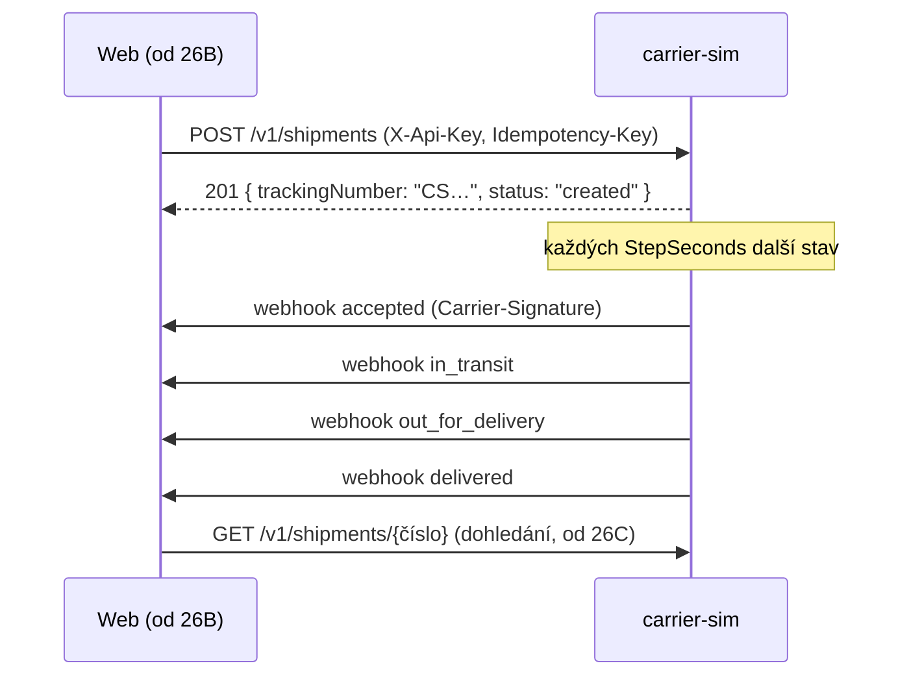

> **V jedné větě:** [MiniShop.CarrierSimulator](code:src/MiniShop.CarrierSimulator/) je „cizí firma“ v našem Compose:
> přijme zásilku přes REST API, přidělí jí číslo a sám pak hlásí webhooky, jak putuje – a umí se chovat nespolehlivě
> přesně tak, jak se chovají skutečné služby třetích stran.

## Proč simulátor, a ne skutečný dopravce

Skutečné API dopravce (Zásilkovna, PPL, Česká pošta) chce obchodní účet nebo smlouvu a vytváří skutečné zásilky.
Simulátor stojí 0 Kč a dá se mu poručit, aby zlobil – to je pro výuku cennější než spolehlivý sandbox. Stejný postup
jako u plateb: nejdřív simulovaná brána (e-shop krok 8), pak skutečný Stripe (krok 16) za stejným rozhraním.

Přirovnání: simulátor je cvičná pošta. Dopisy doručuje, ale občas ztratí potvrzení o převzetí, pošle SMS dvakrát
nebo pozdě – a e-shop se musí naučit s tím počítat dřív, než ho potká skutečná pošta.

Plán celé integrace: [Doprava-roadmap](code:docs/Doprava-roadmap.md) (26A simulátor, 26B vytvoření zásilky,
26C webhooky a dohledání stavu). Od kroku 26B zásilky zakládá [modul Shipping](moduly/shipping.md) po kliknutí
„Předat dopravci“ v Expedici a od 26C přijímá webhooky o stavu (`/api/shipping/carrier-webhook`) – doručení hlásí dopravce.

## Co umí



| Endpoint | Co dělá |
| --- | --- |
| `POST /v1/shipments` | Založí zásilku (reference = číslo objednávky, příjemce, hmotnost, dobírka). Povinná hlavička `Idempotency-Key`: stejný klíč a stejné tělo = stejná zásilka (200 + `Idempotent-Replayed: true`), stejný klíč a jiné tělo = 409. Trvalé chyby 422 s kódem (`invalid_postal_code`, `parcel_too_heavy`, `invalid_request`). |
| `GET /v1/shipments/{číslo}` | Stav a historie událostí (bez adresy příjemce). Pro dohledání, když webhook nepřišel. |
| `GET /health` | Healthcheck pro Compose, bez klíče. |

Celé `/v1` jen s hlavičkou `X-Api-Key` (secret `CARRIER_API_KEY`).

**Stavy** jsou ve slovníku dopravce (`created`, `accepted`, `in_transit`, `out_for_delivery`, `delivered`), ne MiniShopu.
E-shop si je přeloží na své pojmy – tzv. *anti-corruption layer* (vrstva, která nepustí cizí pojmy do naší domény).

**Webhook** (`POST` na `Carrier:WebhookUrl`, prázdná = neposílat):

```json
{ "id": "evt_…", "type": "shipment.status_changed", "created": "…",
  "data": { "trackingNumber": "CS…", "reference": "42", "status": "in_transit", "sequence": 2, "occurredAt": "…" } }
```

- `id` = ID události – opakovaný webhook má stejné (e-shop pozná duplicitu).
- `sequence` = pořadí stavu u zásilky – podle něj e-shop pozná starší zprávu, která přišla pozdě.
- Hlavička `Carrier-Signature: t=<unix čas>,v1=<hex HMAC-SHA256(tajemství, "t.tělo")>` (jako u Stripu; secret
  `CARRIER_WEBHOOK_SECRET`). Čas brání přehrání staré zprávy, HMAC podvržení.
- E-shop neodpoví 2xx → další pokus za 10 s, 20 s, 40 s … (nejvýš 10 min), po `MaxWebhookAttempts` (8) to dopravce vzdá.

## Zlobení

Pravděpodobnosti 0–1 v `Carrier:Chaos` (Compose `CARRIER_CHAOS_…`, výchozí 0 = spolehlivý dopravce):

| Nastavení | Co se stane | Co se tím e-shop naučí |
| --- | --- | --- |
| `FailureRate` | `POST` vrátí 503, nic nevznikne | zopakovat s odstupem |
| `LostResponseRate` | zásilka vznikne, ale odpověď je 503 | opakovat se **stejným** `Idempotency-Key` – jinak by vznikly dvě zásilky |
| `DuplicateRate` | webhook přijde dvakrát | inbox – zpracovat událost jen jednou |
| `ReorderRate` | webhook se zdrží až za následující | stav jen dopředu (`sequence`) |
| `DropRate` | webhook se nepošle vůbec | dohledat stav sám (`GET`) |
| `RejectRate` (krok 26B) | `POST` vrátí 422 `address_not_serviceable` („na adresu nedoručujeme“) | trvalá chyba – neopakovat, říct člověku (Expedice ukáže hlášku a „Zkusit znovu“) |

## Provoz

- **Produkce (e-shop krok 26C):** `deploy/production.env` – webhooky na `http://web:8080/api/shipping/carrier-webhook`
  (uvnitř sítě Compose, jméno `web` = všechny kopie), krok 30 s (doručení ~2 min), mírné zlobení: dvakrát 20 %, mimo
  pořadí 20 %, vůbec 10 %, 503 a ztracená odpověď 5 %, odmítnutí 0. Změna = PR do `production.env`.
- Kontejner `carrier-sim` ([compose.yaml](code:deploy/compose.yaml)), image `minishop-carrier-sim`, jen ve vnitřní síti
  Compose (žádný port ven), `mem_limit 256m`. Nasazuje se jako infrastruktura – krátký restart = dopravce chvíli
  neodpovídá, což e-shop musí snést.
- Data: soubor `/data/carrier-state.json` na volume `carrier-data` (zásilky a čekající webhooky přežijí restart).
  Nezálohuje se – jsou to „cizí“ data. Doručené zásilky i s adresou se mažou po `RetentionDays` (30).
- Do logu jde jen číslo zásilky a reference, **nikdy adresa příjemce**. Telemetrii do Grafany neposílá (cizí firma
  by ji nedala) – pozná se jen podle odpovědí a logu `docker compose logs carrier-sim`.
- Lokálně: AppHost (`carrier-sim`, klíče generuje Aspire) nebo `dotnet run --project src/MiniShop.CarrierSimulator`
  (port 5184, vývojové klíče v `appsettings.Development.json`, krok 15 s).
- Testy: [CarrierSimulatorTests](code:tests/MiniShop.Tests/CarrierSimulator/CarrierSimulatorTests.cs) – simulátor
  v paměti se zastaveným časem, webhooky chytá falešný e-shop.

## Na internetu

- [Stripe: Idempotent requests](https://docs.stripe.com/api/idempotent_requests)
- [Stripe: Check webhook signatures](https://docs.stripe.com/webhooks#verify-official-libraries)
- [Microservices.io: Anti-corruption layer](https://microservices.io/patterns/refactoring/anti-corruption-layer.html)
