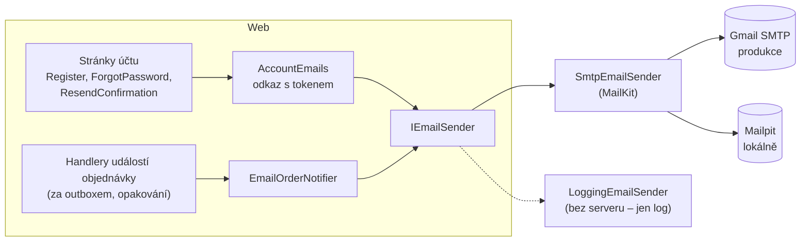
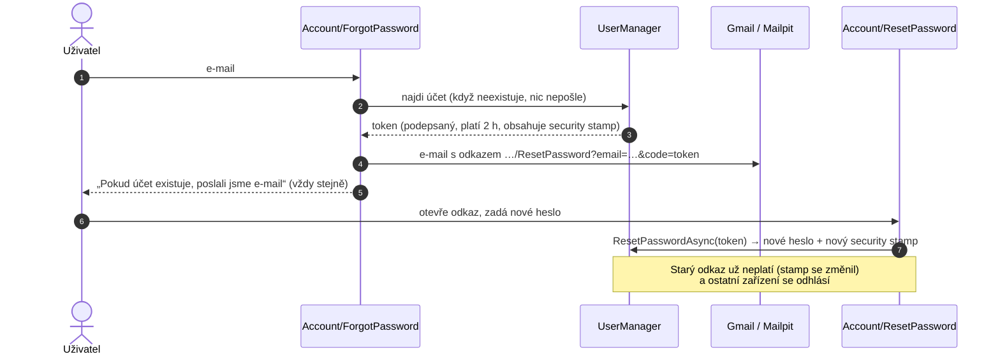

> **V jedné větě:** Web posílá e-maily přes **SMTP** (knihovna MailKit) – v produkci přes Gmail, lokálně do
> „cvičné pošty“ **Mailpit**, kde je vidíte, ale nikomu neodejdou. Bez nastaveného serveru se e-mail jen zapíše do logu.

Přidáno v [účty kroku 5](code:docs/kroky-ucty/krok-05-emaily.md).

## Kdo co posílá

| E-mail | Kdy | Jak |
| --- | --- | --- |
| **Potvrzení e-mailu** | po registraci, nebo tlačítkem *Poslat znovu* v upozornění nahoře na stránce | hned během požadavku ([AccountEmails](code:src/MiniShop.Web/Accounts/AccountEmails.cs)) |
| **Nové heslo** | stránka *Zapomenuté heslo* | hned během požadavku |
| **Objednávka** potvrzená / zamítnutá / vyřízená / zrušená | když se změní stav objednávky | z handleru doménové události **za outboxem** ([EmailOrderNotifier](code:src/MiniShop.Infrastructure/Ordering/EmailOrderNotifier.cs)) |

**Proč dvě cesty?** Ordering má outbox – e-mail o objednávce se pošle spolehlivě, i když Gmail chvíli nejde
(až 5 pokusů). Modul Accounts outbox nemá, e-mail účtu se posílá hned; když selže, uživatel to vidí a může to
zkusit znovu (*Poslat znovu*, nové *Zapomenuté heslo*).

## Odkazy s tokenem

- **Token** vyrábí ASP.NET Core Identity (`AddDefaultTokenProviders`), podepisuje ho klíči Data Protection a platí
  **2 hodiny**. Kdo ho změní, rozbije podpis.
- **Stejná odpověď** pro existující i neexistující e-mail – stránka neprozradí, kdo má v MiniShopu účet.
- **Potvrzený e-mail** je v cookie jako claim `minishop:email_confirmed`; bez něj ukazuje stránka upozornění.
  Povinné potvrzení před objednávkou přijde v účtech kroku 9.
- Do logu jde jen **předmět** e-mailu – adresa je osobní údaj a text obsahuje odkaz s tokenem.

## Konfigurace (sekce `Email`)

| Klíč | Lokálně (Aspire) | Produkce | Poznámka |
| --- | --- | --- | --- |
| `Email:Host` | adresa kontejneru Mailpit | `smtp.gmail.com` (`EMAIL_HOST` v `production.env`) | prázdný = jen log |
| `Email:Port` | port Mailpitu (1025) | `587` | |
| `Email:UseTls` | `false` | `true` (STARTTLS) | |
| `Email:UserName` | – | `ftichy.gemini@gmail.com` | |
| `Email:Password` | – | secret **`SMTP_PASSWORD`** (heslo aplikace Gmailu) | viz [Secrets](../github/secrets.md) |
| `Email:FromAddress` | `minishop@localhost` | `ftichy.gemini@gmail.com` | Gmail jinou adresu odesílatele přepíše |

Kód: [EmailSettings.cs](code:src/MiniShop.Infrastructure/Email/EmailSettings.cs),
[SmtpEmailSender.cs](code:src/MiniShop.Infrastructure/Email/SmtpEmailSender.cs),
[EmailServiceCollectionExtensions.cs](code:src/MiniShop.Infrastructure/Email/EmailServiceCollectionExtensions.cs),
Mailpit v [AppHost.cs](code:src/MiniShop.AppHost/AppHost.cs).

## Mailpit lokálně

Při `dotnet run --project src/MiniShop.AppHost` spustí Aspire i kontejner **mailpit**. V Aspire dashboardu
u prostředku *mailpit* klikněte na adresu `http` – otevře se schránka se všemi e-maily, které Web „odeslal“.

> **Přirovnání:** Mailpit je cvičná poštovní schránka na stole – dopisy se do ní hodí, můžete si je přečíst
> i kliknout na odkaz, ale nikam neodjedou.

## Známá omezení

- E-mail o objednávce může při pádu mezi odesláním a zápisem do inboxu přijít dvakrát (at-least-once).
- Gmail povolí zhruba 500 e-mailů denně a heslo aplikace dává přístup k celé schránce účtu – proto samostatný účet.
- Testovací účty s vymyšlenou adresou vrátí Gmail jako nedoručitelné (oznámení přijde do schránky odesílatele).
