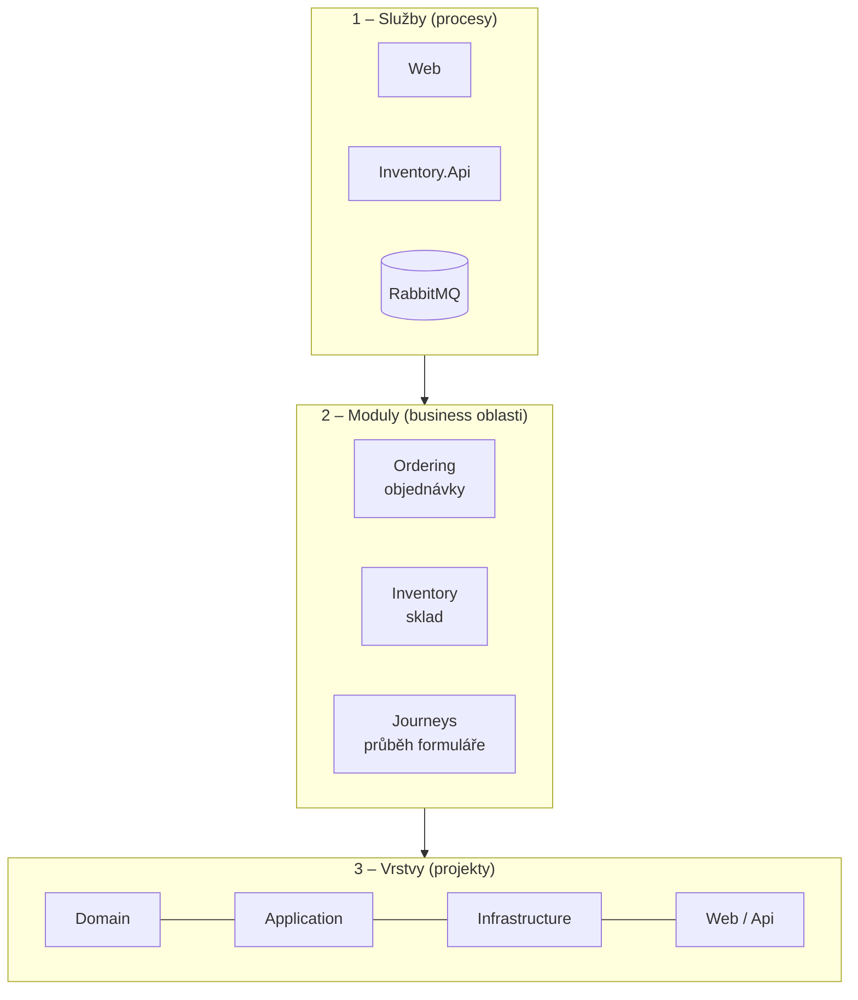

> **V jedné větě:** MiniShop jsou **dvě služby** (Web a Inventory.Api), které si posílají zprávy přes RabbitMQ.
> Uvnitř jsou rozdělené na **moduly** (Ordering, Inventory, Journeys) a každý modul na **vrstvy**
> (Domain, Application, Infrastructure).

## Tři pohledy na stejnou aplikaci

Představte si budovu. Můžete ji popsat podle **budov v areálu** (které procesy běží), podle **oddělení**
(moduly – kdo za co odpovídá) a podle **pater** (vrstvy – co je business logika a co technika).
Všechny tři pohledy platí současně:

- Služba **Web** hostuje moduly *Ordering* a *Journeys*, služba **Inventory.Api** modul *Inventory*.
- Každý modul má kód ve všech vrstvách (např. `Domain/Orders`, `Application/Ordering`, `Infrastructure/Ordering`).
- Společné „potrubí“ pro zprávy (outbox, inbox, RabbitMQ) je v [sdíleném jádru](sdilene-jadro.md) a nezná žádný modul.

## Hlavní pravidla

1. **Závislosti vedou dovnitř** – doména nezávisí na ničem, databáze a web jsou jen „detail“. Viz [Vrstvy](vrstvy.md).
2. **Moduly se navzájem neznají** – žádná reference, žádná sdílená tabulka. Mluví spolu jen zprávami
   z `MiniShop.Contracts`. Hlídá to test [ModuleBoundariesTests](code:tests/MiniShop.Tests/Architecture/ModuleBoundariesTests.cs).
3. **Každý modul má vlastní databázi** (`ordering.db`, `inventory.db`, `journeys.db`, `users.db`).
4. **Business tok jde jen přes zprávy** – HTTP mezi službami slouží jen k zobrazení dat v UI.

## Proč takhle (a ne jednodušeji)

Pro tak malý e-shop by stačila jedna aplikace s jednou databází. MiniShop je ale **výukový** – postupně prošel
celou cestou od „jedné aplikace“ po „samostatné služby“ (viz `docs/EDA-roadmap.md` v repozitáři). Každé
rozdělení má svou cenu (víc pohyblivých částí, data se synchronizují se zpožděním) a dokumentace u každého
konceptu říká, **proč** se vyplatí a **co stojí**.

## Na internetu

- [Model C4](https://c4model.com/) – jak kreslit architekturu na několika úrovních přiblížení
- [Microsoft: Běžné architektury webových aplikací](https://learn.microsoft.com/dotnet/architecture/modern-web-apps-azure/common-web-application-architectures)
