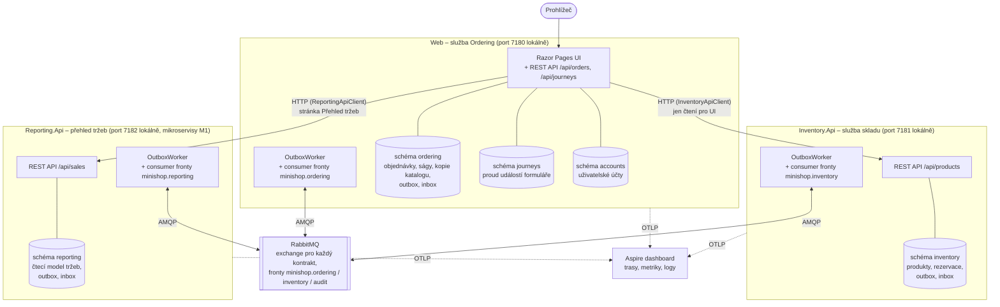

> **V jedné větě:** Běží čtyři .NET služby – **Web** (objednávky + celé UI), **Inventory.Api** (sklad), od mikroservis M1
> **Reporting.Api** (přehled tržeb) a od M2C **Notifications.Api** (e-maily, oznámení push) – a mezi nimi **RabbitMQ**. Moduly mají data v **PostgreSQL** (každý své schéma) a posílají telemetrii do **Aspire dashboardu**.

## Diagram

## Jednotlivé části

| Část | Co dělá | Proč existuje |
| --- | --- | --- |
| **Web** ([MiniShop.Web](code:src/MiniShop.Web/)) | UI pro celý obchod, REST API objednávek, sága objednávky, kopie katalogu, sledování formuláře, účty a přihlášení | Hostuje moduly Ordering, Journeys a Accounts. UI je jedno pro celý e-shop, i když data skladu patří jiné službě. |
| **Inventory.Api** ([MiniShop.Inventory.Api](code:src/MiniShop.Inventory.Api/)) | Produkty a zásoby, vyřizuje příkazy rezervace a uvolnění | Sklad je samostatná služba: může se nasadit, restartovat či spadnout nezávisle na objednávkách. |
| **Reporting.Api** ([MiniShop.Reporting.Api](code:src/MiniShop.Reporting.Api/)) | Přehled tržeb – čtecí model (CQRS) ze zpráv objednávek a plateb, API pro stránku Přehled tržeb | Mikroservisy M1: první modul vyjmutý z Webu do samostatné služby – ukázka, že odběratel událostí může běžet kdekoli. Výpadek = jen nedostupný přehled. Viz [Reporting](moduly/reporting.md). |
| **Notifications.Api** ([MiniShop.Notifications.Api](code:src/MiniShop.Notifications.Api/)) | E-maily a oznámení push podle zpráv objednávek, plateb, faktur a skladu; API pro stránky Webu (zařízení push, oznámení k práci, „Dejte mi vědět“) | Mikroservisy M2C: odběratel, který za běhu potřebuje data jiných modulů – bere je z interního API Webu (`/internal/…`). Výpadek = e-maily počkají ve frontě. Viz [Notifications](moduly/notifications.md). |
| **carrier-sim** ([MiniShop.CarrierSimulator](code:src/MiniShop.CarrierSimulator/)) | Simulovaný dopravce – přidělí číslo zásilky, posílá webhooky o stavu, na přání „zlobí“ | E-shop krok 26A: „cizí firma“ bez sdíleného kódu a databáze, aby šla vyzkoušet integrace s nespolehlivou službou třetí strany. Viz [Simulovaný dopravce](dopravce.md). |
| **RabbitMQ** | Doručuje zprávy mezi službami, drží je, když příjemce neběží | Služby se nevolají přímo – odesílatel nemusí vědět, kdo zprávu čte, ani čekat, až příjemce odpoví. Viz [Broker](../eda/broker.md). |
| **PostgreSQL, schéma na modul** | Jedna databáze, každý modul vlastní schéma (škálování krok 3C) | Žádné sdílené tabulky = žádné skryté závislosti mezi moduly. Outbox a inbox leží v DB modulu, aby byly v téže transakci jako data. |
| **Aspire dashboard** | Zobrazuje trasy, metriky a logy obou služeb | Bez něj by se tok přes dvě služby a broker ladil velmi těžko. Viz [Observabilita](../eda/observabilita.md). |

## Kdo s kým mluví a jak

- **Prohlížeč → Web**: HTTP(S). Formulář objednávky je Razor Page, data se posílají klasicky formulářem.
- **Web → Inventory.Api přes HTTP**: jen kvůli administraci (stránka Produkty a kategorie). Výloha a formulář
  objednávky berou nabídku i dostupnost z kopie katalogu (e-shop krok 2) – na sklad se neptají.
  Klient [InventoryApiClient](code:src/MiniShop.Web/Inventory/InventoryApiClient.cs) má zapnutou *resilienci*
  (opakování, circuit breaker) – když sklad neběží, stránka se načte, jen bez údajů skladu.
- **Web → Reporting.Api přes HTTP** (mikroservisy M1): jen stránka Přehled tržeb ([ReportingApiClient](code:src/MiniShop.Web/Reporting/ReportingApiClient.cs),
  servisní klíč `REPORTING_API_KEY`). Data dostává služba jen ze zpráv.
- **Web ↔ Notifications.Api přes HTTP** (mikroservisy M2C): Web volá API služby kvůli stránkám (`NOTIFICATIONS_API_KEY`),
  služba volá interní API Webu kvůli kontaktu zákazníka, rolím, názvu produktu a PDF faktur (`WEB_INTERNAL_API_KEY`).
- **Web → carrier-sim přes HTTP** (e-shop krok 26B): modul Shipping zakládá zásilky u [simulovaného dopravce](dopravce.md)
  (`CARRIER_API_KEY`, `Idempotency-Key`). Volá se z handleru zprávy `CreateShipmentV1`, ne ze stránky – výpadek dopravce
  tak jen zdrží odeslání, stránky běží dál.
- **Business tok jde jen přes RabbitMQ.** Objednávka nikdy nevolá sklad synchronně. Kdyby sklad neběžel, objednávka
  se přijme a počká (nebo ji sága po timeoutu zamítne).

> **Přirovnání:** HTTP volání je telefon – když druhá strana nezvedne, máte smůlu. Zpráva přes broker je
> doporučený dopis – pošta ho podrží, dokud si ho adresát nevyzvedne.

## Jak se to spouští

- **Lokálně přes .NET Aspire** – [AppHost.cs](code:src/MiniShop.AppHost/AppHost.cs) popisuje služby jako kód:
  spustí RabbitMQ v Dockeru, obě služby, předá jim adresy a otevře dashboard. Sdílené nastavení (health checky,
  service discovery, resilience, OpenTelemetry) dodává [MiniShop.ServiceDefaults](code:src/MiniShop.ServiceDefaults/ServiceDefaultsExtensions.cs).
- **V cloudu** – Docker Compose na virtuálním stroji (popsáno v části o nasazení).

## Proč víc služeb (a ne jedna)

Sklad se z aplikace „vystěhoval“ v kroku 10B, aby bylo vidět, co se změní, když modul přestane být ve stejném
procesu: transport *v paměti* přestal stačit, adresy služeb se musí zjistit (service discovery), HTTP volání
musí přežít výpadek (resilience) a ladění potřebuje trasování. Kód modulů se přitom téměř nezměnil –
díky tomu, že už předtím mluvily jen přes zprávy.

Reporting a Notifications následovaly na zkoušku (mikroservisy M1–M2C). Vyhodnocení s naměřenou cenou a rozhodnutím
dál nevyjímat je na stránce [Mikroservisy – co stály](mikroservisy.md).

## Na internetu

- [C4: Container diagram](https://c4model.com/diagrams/container)
- [.NET Aspire – přehled](https://learn.microsoft.com/dotnet/aspire/get-started/aspire-overview)
- [Microservices.io: Database per service](https://microservices.io/patterns/data/database-per-service.html)
