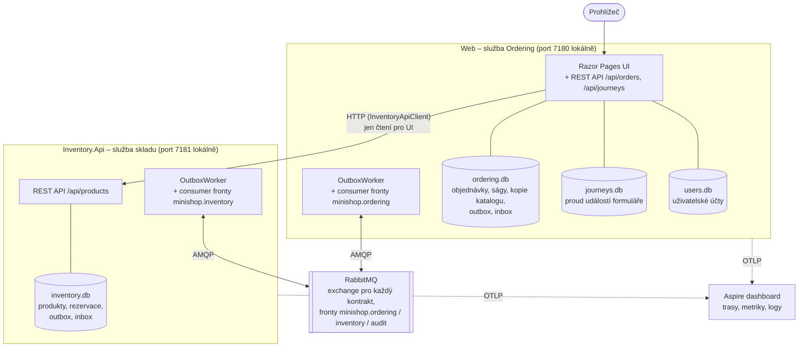

> **V jedné větě:** Běží dvě .NET služby – **Web** (objednávky + celé UI) a **Inventory.Api** (sklad) –
> a mezi nimi **RabbitMQ**. Každá služba má vlastní SQLite databáze a posílá telemetrii do **Aspire dashboardu**.

## Diagram

## Jednotlivé části

| Část | Co dělá | Proč existuje |
| --- | --- | --- |
| **Web** ([MiniShop.Web](code:src/MiniShop.Web/)) | UI pro celý obchod, REST API objednávek, sága objednávky, kopie katalogu, sledování formuláře, účty a přihlášení | Hostuje moduly Ordering, Journeys a Accounts. UI je jedno pro celý e-shop, i když data skladu patří jiné službě. |
| **Inventory.Api** ([MiniShop.Inventory.Api](code:src/MiniShop.Inventory.Api/)) | Produkty a zásoby, vyřizuje příkazy rezervace a uvolnění | Sklad je samostatná služba: může se nasadit, restartovat či spadnout nezávisle na objednávkách. |
| **RabbitMQ** | Doručuje zprávy mezi službami, drží je, když příjemce neběží | Služby se nevolají přímo – odesílatel nemusí vědět, kdo zprávu čte, ani čekat, až příjemce odpoví. Viz [Broker](../eda/broker.md). |
| **SQLite databáze** | Jeden soubor na modul | Žádná sdílená databáze = žádné skryté závislosti mezi moduly. Outbox a inbox leží v DB modulu, aby byly v téže transakci jako data. |
| **Aspire dashboard** | Zobrazuje trasy, metriky a logy obou služeb | Bez něj by se tok přes dvě služby a broker ladil velmi těžko. Viz [Observabilita](../eda/observabilita.md). |

## Kdo s kým mluví a jak

- **Prohlížeč → Web**: HTTP(S). Formulář objednávky je Razor Page, data se posílají klasicky formulářem.
- **Web → Inventory.Api přes HTTP**: jen kvůli administraci (stránka Produkty a kategorie). Výloha a formulář
  objednávky berou nabídku i dostupnost z kopie katalogu (e-shop krok 2) – na sklad se neptají.
  Klient [InventoryApiClient](code:src/MiniShop.Web/Inventory/InventoryApiClient.cs) má zapnutou *resilienci*
  (opakování, circuit breaker) – když sklad neběží, stránka se načte, jen bez údajů skladu.
- **Business tok jde jen přes RabbitMQ.** Objednávka nikdy nevolá sklad synchronně. Kdyby sklad neběžel, objednávka
  se přijme a počká (nebo ji sága po timeoutu zamítne).

> **Přirovnání:** HTTP volání je telefon – když druhá strana nezvedne, máte smůlu. Zpráva přes broker je
> doporučený dopis – pošta ho podrží, dokud si ho adresát nevyzvedne.

## Jak se to spouští

- **Lokálně přes .NET Aspire** – [AppHost.cs](code:src/MiniShop.AppHost/AppHost.cs) popisuje služby jako kód:
  spustí RabbitMQ v Dockeru, obě služby, předá jim adresy a otevře dashboard. Sdílené nastavení (health checky,
  service discovery, resilience, OpenTelemetry) dodává [MiniShop.ServiceDefaults](code:src/MiniShop.ServiceDefaults/ServiceDefaultsExtensions.cs).
- **V cloudu** – Docker Compose na virtuálním stroji (popsáno v části o nasazení).

## Proč dvě služby (a ne jedna)

Sklad se z aplikace „vystěhoval“ v kroku 10B, aby bylo vidět, co se změní, když modul přestane být ve stejném
procesu: transport *v paměti* přestal stačit, adresy služeb se musí zjistit (service discovery), HTTP volání
musí přežít výpadek (resilience) a ladění potřebuje trasování. Kód modulů se přitom téměř nezměnil –
díky tomu, že už předtím mluvily jen přes zprávy.

## Na internetu

- [C4: Container diagram](https://c4model.com/diagrams/container)
- [.NET Aspire – přehled](https://learn.microsoft.com/dotnet/aspire/get-started/aspire-overview)
- [Microservices.io: Database per service](https://microservices.io/patterns/data/database-per-service.html)
