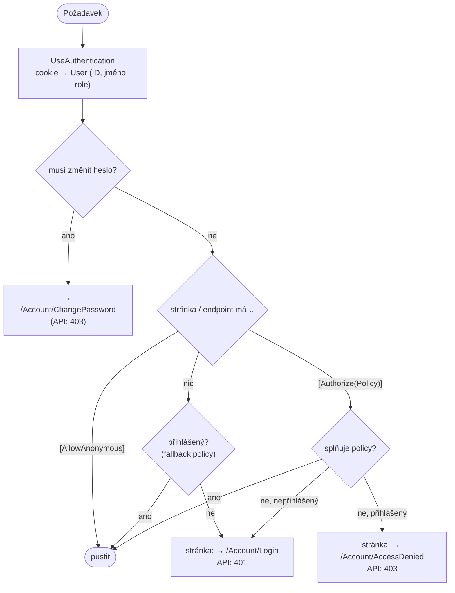
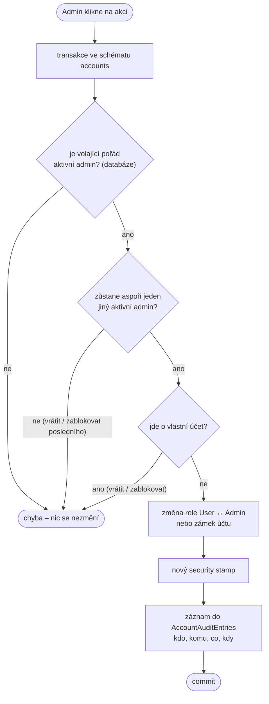
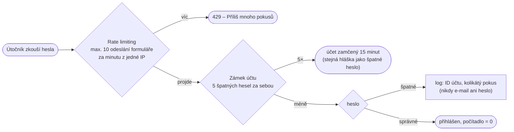
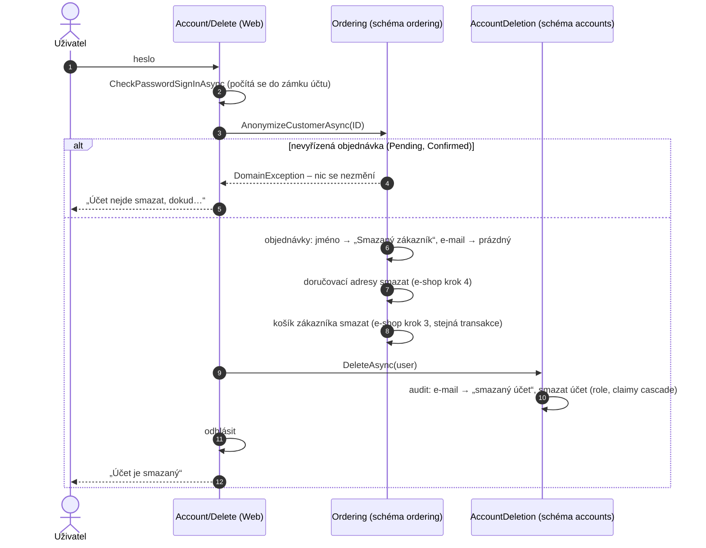
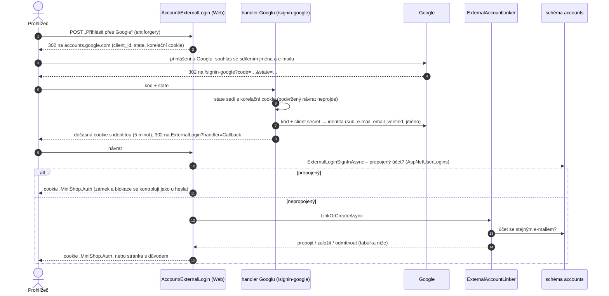
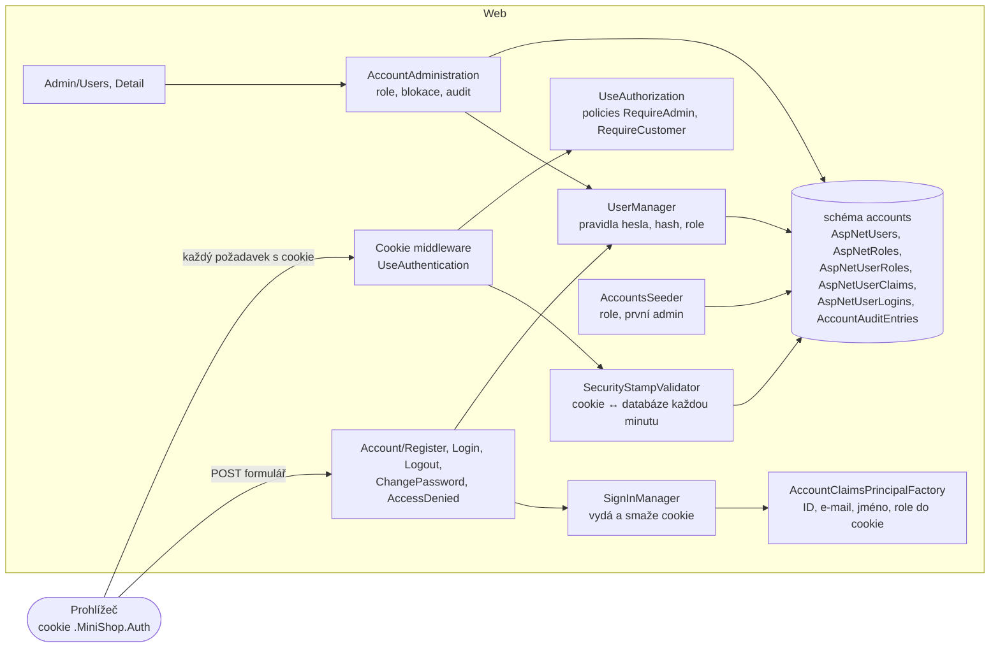
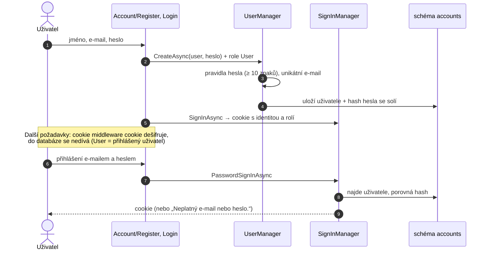

> **V jedné větě:** Accounts ví, **kdo** je přihlášený a **co smí**: uživatel se zaregistruje e-mailem a heslem,
> při přihlášení dostane zašifrovanou **cookie** se svými rolemi a Web podle **policies** rozhodne, kam ho pustí.
> Běží ve službě **Web**, data má ve schématu `accounts`.

Modul vzniká postupně podle plánu [Uživatelské účty a role](code:docs/Ucty-roadmap.md). Hotové jsou kroky 1
(registrace, přihlášení), 2 (role, oprávnění, první admin), 3 (vlastník objednávky – zákazník vidí jen své,
viz [Ordering](ordering.md)), 5 ([e-maily](../emaily.md)), 6 (správa uživatelů a audit), 8 ([zpevnění](#zpevnění)),
9 ([otevřený web](#otevřený-web-a-osobní-údaje)) a 10 ([přihlášení přes Google](#přihlášení-přes-google)); krok 7 zabezpečil sklad ([Inventory](inventory.md)).

## Role a oprávnění

| Kde | Nepřihlášený | User (zákazník) | Admin |
| --- | :-: | :-: | :-: |
| Úvod, Dokumentace, Přihlášení, Registrace, Ochrana osobních údajů, `/health` | ✅ | ✅ | ✅ |
| Objednávky – seznam a detail | → přihlášení | jen své (cizí = 404) | všechny |
| Objednávky – založit (stránka i `POST /api/orders`) | ❌ | ✅ jen s **potvrzeným e-mailem** (jméno a e-mail z účtu) | ❌ |
| Smazat vlastní účet | ❌ | ✅ (bez nevyřízených objednávek) | ❌ (nejdřív vrátit na usera) |
| Objednávky – zrušit (kdykoli před odesláním, e-shop krok 9) | ❌ | jen svou | jakoukoli |
| Expedice – balit, odeslat, doručeno (`/Admin/Fulfilment`, e-shop krok 6), obnovit katalog | ❌ | ❌ | ✅ |
| Produkty – přidat, naskladnit, upravit, smazat | ❌ | ❌ | ✅ |
| Průběh a přehrání objednávky (stránky i `GET /api/journeys/…`) | ❌ | ❌ | ✅ |
| Změna hesla (účet bez hesla: Nastavit heslo, účty krok 10) | ❌ | ✅ | ✅ |
| Přihlášení přes Google – propojit, odpojit (`/Account/ExternalLogins`, účty krok 10) | přihlásit se ✅ | ✅ | ✅ |
| Nastavení e-mailů – souhlas s připomínkou košíku (`/Account/EmailPreferences`, e-shop krok 10, výchozí vypnuto) | ❌ | ✅ | ❌ |
| Dvoufázové ověření – zapnout, záchranné kódy (`/Account/TwoFactor`, bezpečnost A1); vypnout jen zákazník | ❌ | ✅ | ✅ (vypnout ne) |
| Cokoli v administraci, když admin **nemá zapnuté 2FA** (bezpečnost A2) | ❌ | ❌ | ❌ – přesměrování na `/Account/TwoFactor` (API 403) |
| Uživatelé – přehled, detail, povýšit / vrátit na usera, zablokovat / odblokovat (`/Admin/…`) | ❌ | ❌ | ✅ (ne sám sobě) |

Pravidla jsou pojmenovaná na jednom místě – **policies** `RequireAdmin` a `RequireCustomer`
v [AuthorizationPolicies.cs](code:src/MiniShop.Web/Accounts/AuthorizationPolicies.cs), registrované v
[AccountsServiceCollectionExtensions.cs](code:src/MiniShop.Web/Extensions/AccountsServiceCollectionExtensions.cs).
Celou tabulku ověřuje test [AuthorizationMatrixTests](code:tests/MiniShop.Tests/Web/AuthorizationMatrixTests.cs)
skutečnými HTTP požadavky proti celému Webu.

### Jak se rozhoduje



- **Secure by default (fallback policy):** co není výslovně `[AllowAnonymous]`, vyžaduje přihlášení. Nová stránka
  je zamčená, i když na ni autor zapomene.
- **Stránka Objednávky** má víc akcí (handlerů) s různými pravidly – Razor Pages umí `[Authorize]` jen na celou
  stránku, proto handlery volají `IAuthorizationService` se stejnými policies a bez oprávnění vrátí `Forbid()`.
- **Skrytí v UI je jen pohodlí** (menu Produkty a Expedice, košík a pokladna, tlačítko Zrušit). Chrání server.

## První admin

Admina jmenuje admin – kdo ale jmenuje prvního? (Problém slepice a vejce.)

- **V produkci** se první admin zakládá příkazem přímo v běžícím kontejneru:
  ```text
  sudo -u deploy docker compose exec web dotnet MiniShop.Web.dll create-admin --email <e-mail> --name "<jméno>"
  ```
  Heslo se píše skrytě do terminálu – nikdy neleží v GitHubu, v `.env` ani v historii příkazů. Příkaz projde,
  jen když žádný admin není. Kód: [CreateAdminCommand.cs](code:src/MiniShop.Web/Accounts/CreateAdminCommand.cs).
- **Ve vývoji** ho při startu vytvoří seed z `AdminBootstrap` v `appsettings.Development.json`
  (`admin@minishop.local`). Heslo je v repozitáři, proto má příznak **„musí změnit heslo“** – dokud ho nezmění,
  přesměruje ho každá stránka na změnu hesla ([MustChangePasswordMiddleware.cs](code:src/MiniShop.Web/Accounts/MustChangePasswordMiddleware.cs)).
- **Existující účet se adminem nikdy nestane.** Bez potvrzení e-mailu by si kdokoli mohl adminův e-mail zaregistrovat
  dřív a seed by mu práva admina dal.
- Účty z kroku 1 (bez role) dostanou při startu roli User. Kód: [AccountsSeeder.cs](code:src/MiniShop.Infrastructure/Accounts/AccountsSeeder.cs).
- **Další admini** vznikají povýšením v aplikaci (níže). Nový admin se nejdřív sám zaregistruje – heslo tak zná jen on.

## Správa uživatelů

Menu **Uživatelé** (jen admin): přehled všech účtů s rolí, stavem, počtem objednávek a útratou, detail s objednávkami
a historií změn. Na detailu jsou tlačítka **Povýšit na admina / Vrátit na usera** a **Zablokovat / Odblokovat**.



- **Rozhoduje databáze, ne cookie.** Admin, kterému jiný admin právě roli odebral, má možná ještě starou cookie –
  akce mu přesto neprojde.
- **Vždy zůstane aktivní admin** a nikdo si nemůže sám odebrat roli ani se zablokovat. Kontrola i změna jsou v jedné
  transakci: když dva admini ve stejnou chvíli odebírají jeden druhého, zámek v PostgreSQL (`pg_advisory_xact_lock`) změny seřadí a druhá už vidí výsledek první (škálování krok 3C).
- **Zablokování** = zámek účtu Identity „navždy“ (do odblokování). Přihlášení skončí stejnou hláškou jako špatné
  heslo – jiná by prozradila, že účet existuje.
- **Odhlášení do minuty:** každá změna vymění **security stamp** (otisk „verze“ účtu). Web cookie každou minutu
  porovná s databází (`SecurityStampValidator`, interval v
  [AccountsServiceCollectionExtensions.cs](code:src/MiniShop.Web/Extensions/AccountsServiceCollectionExtensions.cs));
  nesedí-li, cookie zahodí. Přirovnání: přenastavený zámek – staré klíče přestanou fungovat.
- **Audit** jen přibývá (žádná úprava ani mazání), e-maily v něm jsou kopie z doby akce.
- **Objednávky** dodá Ordering (`IOrderService.GetCustomerSummariesAsync`, detail přes `OrderAccess.Customer(id)`) –
  moduly se neznají, spojí je až stránka ve Webu přes ID uživatele.

Kód: [AccountAdministration.cs](code:src/MiniShop.Infrastructure/Accounts/AccountAdministration.cs),
stránky [Admin/Users](code:src/MiniShop.Web/Pages/Admin/Users/Index.cshtml.cs) a
[Detail](code:src/MiniShop.Web/Pages/Admin/Users/Detail.cshtml.cs). Celá složka `/Admin` je navíc zamčená
konvencí `AuthorizeFolder` v `Program.cs`.

## Zpevnění

Účty krok 8 přidaly několik vrstev obrany (*defense in depth*) – každá chytí něco, co ostatní propustí.



| Vrstva | Co dělá | Kód |
| --- | --- | --- |
| **Zámek účtu** | 5 špatných hesel za sebou → 15 minut. Admin zámek vidí v přehledu („zamčený do 15:42“) a může ho zrušit. Dočasný zámek adminovi práva nebere – útočník by jinak zkoušením hesel „odstavil“ všechny adminy. | [AccountsInfrastructure.cs](code:src/MiniShop.Infrastructure/Accounts/AccountsInfrastructure.cs), [Login.cshtml.cs](code:src/MiniShop.Web/Pages/Account/Login.cshtml.cs) |
| **Rate limiting** | Formuláře přihlášení, registrace, zapomenutého a nového hesla, *Poslat znovu* a změny hesla: z jedné IP nejvýš 10 odeslání za minutu, pak **429**. Brzdí hádání hesel, zkoušení uniklých hesel z jiných webů (*credential stuffing*) i zahlcení Gmailu. IP za Caddy z `X-Forwarded-For`. | [AccountRateLimiting.cs](code:src/MiniShop.Web/Security/AccountRateLimiting.cs) |
| **Bezpečnostní hlavičky** | CSP (skripty jen ze souborů MiniShopu – žádné inline `<script>`, Bootstrap lokálně), HSTS (jen HTTPS, 1 rok, bez preload), `X-Frame-Options: DENY` + `frame-ancestors 'none'` (proti *clickjackingu*), `nosniff`, `Referrer-Policy` (odkaz s tokenem neodejde jinému webu) | [SecurityHeaders.cs](code:src/MiniShop.Web/Security/SecurityHeaders.cs) |
| **Logy a trasy** | Do trasy jen `enduser.id` (ID účtu); v logu nikdy e-mail ani heslo (hlídá test). Serilog loguje cestu bez query stringu, OpenTelemetry query string maskuje. | [SecurityHeaders.cs](code:src/MiniShop.Web/Security/SecurityHeaders.cs) (`UseEndUserTracing`) |

> **Přirovnání:** rate limiting je vrátný, který ke dveřím pustí jen pár lidí za minutu; zámek účtu je platební karta,
> která po třech špatných PINech na chvíli přestane fungovat; CSP je provozní řád, podle kterého prohlížeč nespustí
> nic, co nepřišlo z MiniShopu.

## Otevřený web a osobní údaje

Od účtů kroku 9 je web **veřejný** – Caddy už nechce heslo (basic auth zůstal jen před Aspire dashboardem).
Prohlížet může každý, ale:

- **Objednávat jde až s potvrzeným e-mailem.** Policy `RequireCustomer` = role User **a** claim
  `minishop:email_confirmed`. Robot s vymyšlenou adresou nic neobjedná a e-maily o objednávkách nechodí cizím lidem.
- **Smazání účtu** (*právo být zapomenut*, GDPR): jméno v hlavičce → *Smazat účet* → znovu heslo (účet bez hesla:
  nové přihlášení u Googlu, viz [Přihlášení přes Google](#přihlášení-přes-google)).



- **Pořadí:** nejdřív objednávky, pak účet. Když smazání účtu selže, uživatel to zkusí znovu (anonymizace podruhé
  nic nepokazí). Obráceně by mohl zůstat smazaný účet s objednávkami, na kterých je pořád jeho e-mail.
- **Objednávky zůstanou** (položky, ceny, stav – účetnictví a statistiky), `CustomerId` také: po smazání účtu
  sám nikoho neidentifikuje. E-mail o objednávce se na prázdnou adresu neposílá.
- **Admin** si účet smazat nemůže (pravidlo „vždy zůstane admin“) – jiný admin ho nejdřív vrátí na usera.
- **Stránka [Ochrana osobních údajů](code:src/MiniShop.Web/Pages/Privacy.cshtml)** (odkaz v patičce a u registrace):
  co MiniShop ukládá, proč, jak dlouho (zálohy 7 dní), kdo zpracovává (Oracle Cloud, Gmail), jen nezbytné cookies.

Kód: [Delete.cshtml.cs](code:src/MiniShop.Web/Pages/Account/Delete.cshtml.cs),
[AccountDeletion.cs](code:src/MiniShop.Infrastructure/Accounts/AccountDeletion.cs), `Order.Anonymize`
v [Order.cs](code:src/MiniShop.Domain/Orders/Order.cs).

## Přihlášení přes Google

Účty krok 10. Tlačítko **Přihlásit přes Google** na přihlášení i registraci. Protokol je **OpenID Connect**
(postavený na OAuth 2.0). Přirovnání: vrátný (MiniShop) tě nezná, ale uzná občanku (Google). Pošle tě na úřad,
úřad tě ověří a dá ti potvrzení s razítkem, vrátný zkontroluje razítko. Heslo ke Googlu MiniShop nikdy nevidí.



| Situace po návratu z Googlu | Co MiniShop udělá |
| --- | --- |
| Google účet už je propojený | přihlásí (zablokovaný nebo zamčený účet ne – stejná hláška jako u hesla) |
| Účet se stejným e-mailem, e-mail **potvrzený** | propojí a přihlásí |
| Účet se stejným e-mailem, e-mail **nepotvrzený** | **odmítne** – „přihlaste se heslem a potvrďte e-mail“ |
| Žádný účet | založí nový **bez hesla**, role User, e-mail rovnou potvrzený (ověřil ho Google) |
| Google e-mail neověřil (`email_verified=false`) | odmítne |
| Uživatel na Googlu klikl na Zrušit | stránka s hláškou (`OnRemoteFailure` – jinak by handler skončil chybou 500) |

- **Proč odmítnout nepotvrzený e-mail** (*pre-account hijacking*): útočník by si mohl předem založit účet s cizím
  e-mailem a vlastním heslem. Až by se majitel e-mailu přihlásil Googlem, účty by se spojily a útočník by znal heslo
  k cizímu účtu. Potvrzený e-mail dokazuje, že účet založil majitel schránky. Přihlášený uživatel si ale Google propojit
  smí vždy (stránka *Přihlášení přes Google* v nastavení účtu) – je to jeho účet.
- **Propojení** = řádek v `AspNetUserLogins` (`LoginProvider = Google`, `ProviderKey = sub` – stálé ID účtu Google;
  e-mail se u Googlu změnit může, `sub` ne). Tabulku vytvořil Identity už v kroku 1, **migrace nebyla potřeba**.
- **Role zůstávají v MiniShopu** – Google jen potvrzuje, kdo uživatel je. Admin se přes Google přihlásí se stejnými pravidly.
- **Účet bez hesla:** *Změna hesla* pošle na **Nastavit heslo** (`AddPasswordAsync`); Google jde odpojit, jen když účet
  má heslo (jinak by se k němu už nikdo nepřihlásil). Zapomenuté heslo funguje i pro něj.
- **Smazání účtu bez hesla** potvrdí uživatel novým přihlášením u Googlu (`prompt=login` – Google se zeptá znovu,
  nepustí ho ze své otevřené relace). Smaže se, jen když se vrátí stejný účet Google, který je s účtem propojený; ID
  účtu MiniShopu je ve `state` (návrat patří jen k tomuto přihlášení). Propojení zmizí s účtem (kaskáda).
- **CSP:** `form-action 'self' https://accounts.google.com` – formulář jde na MiniShop, ten odpoví přesměrováním na Google
  a prohlížeč `form-action` kontroluje i u přesměrování po odeslání formuláře.
- **Víc kopií Webu:** dočasnou a korelační cookie přečte kterákoli kopie – klíče Data Protection jsou společné.
  Za Caddy se adresa návratu sestaví jako `https://` díky `ASPNETCORE_FORWARDEDHEADERS_ENABLED`.
- **Konfigurace:** `Authentication:Google:ClientId` + `ClientSecret` (lokálně user secrets Webu, Compose `GOOGLE_CLIENT_ID` +
  `GOOGLE_CLIENT_SECRET`, produkce Client ID v `deploy/production.env`, tajemství jako [secret](../../github/secrets.md)).
  Bez nich se tlačítko neukáže. OAuth klient v [Google Cloud Console](../../treti-strany/sluzby.md) má povolené adresy návratu
  `https://minishop-tichy.cz/signin-google` a `https://localhost:7180/signin-google`.
- **Testy** nahrazují Google falešným schématem
  ([FakeGoogle.cs](code:tests/MiniShop.Tests/TestDoubles/FakeGoogle.cs)) – projdou celou cestu přes stránky bez internetu
  ([GoogleLoginTests](code:tests/MiniShop.Tests/Web/GoogleLoginTests.cs)).

Kód: [GoogleLogin.cs](code:src/MiniShop.Web/Accounts/GoogleLogin.cs),
[ExternalAccountLinker.cs](code:src/MiniShop.Infrastructure/Accounts/ExternalAccountLinker.cs),
stránky [ExternalLogin](code:src/MiniShop.Web/Pages/Account/ExternalLogin.cshtml.cs),
[ExternalLogins](code:src/MiniShop.Web/Pages/Account/ExternalLogins.cshtml.cs),
[SetPassword](code:src/MiniShop.Web/Pages/Account/SetPassword.cshtml.cs) a
[Delete](code:src/MiniShop.Web/Pages/Account/Delete.cshtml.cs).

## Dvoufázové ověření (2FA, bezpečnost A1)

Heslo samo může uniknout (jiný web, phishing). **Dvoufázové ověření** přidá druhý zámek: 6místný kód z aplikace
v telefonu (Google Authenticator, Microsoft Authenticator, Authy…), který se mění každých 30 sekund (**TOTP**, RFC 6238).
Přirovnání: heslo je klíč od bytu, kód je alarm, který bez telefonu nevypnete – zloděj s klíčem se dovnitř nedostane.
Je to **dobrovolné pro zákazníka** (část A1) a **povinné pro admina** (část A2, [issue #94](https://github.com/ftichy/MiniShop/issues/94)).

- **Zapnutí** (`/Account/TwoFactor`, odkaz „Dvoufázové ověření“ pod nastavením účtu): stránka ukáže **QR kód** a tajný klíč
  textem. QR se vykreslí **na serveru jako SVG** (knihovna [QRCoder](../../treti-strany/knihovny.md), MIT) a vloží do HTML –
  žádný JavaScript ani CDN, takže CSP `script-src 'self'` zůstává beze změny. Zapnout jde až po zadání prvního platného kódu
  (jinak by se uživatel mohl zamknout špatně naskenovaným klíčem). Pak se **jednou** zobrazí 10 **záchranných kódů**
  (každý jde použít jednou; nikam se znovu neukládají v čitelné podobě).
- **Přihlášení:** po správném hesle `PasswordSignInAsync` vrátí `RequiresTwoFactor` a [Login](code:src/MiniShop.Web/Pages/Account/Login.cshtml.cs)
  přesměruje na [LoginWith2fa](code:src/MiniShop.Web/Pages/Account/LoginWith2fa.cshtml.cs) (kód z aplikace) nebo
  [LoginWithRecoveryCode](code:src/MiniShop.Web/Pages/Account/LoginWithRecoveryCode.cshtml.cs). Heslo si mezitím pamatuje dočasná cookie Identity.
  **Špatný kód se počítá do zámku účtu** stejně jako špatné heslo (5 × → 15 minut) a formuláře mají rate limiting.
- **Zapamatovat zařízení** nabízí jen zákazníkovi. Pravidlo je na jednom místě – `TwoFactorHelper.MayRememberDevice`
  ([TwoFactorHelper.cs](code:src/MiniShop.Web/Accounts/TwoFactorHelper.cs)): admin zadává kód vždy.
- **Vypnout** jde jen zákazníkovi, a to platným kódem z aplikace (admin ne – `MayDisable`). Vypnutí vymění klíč, takže se
  při novém zapnutí musí aplikace nastavit znovu. **Nové záchranné kódy** se vytvoří také po zadání platného kódu; staré přestanou platit.
- **Bez vlastní kryptografie:** klíč, ověření kódu i záchranné kódy dělá Identity (`UserManager`: `GetAuthenticatorKeyAsync`,
  `VerifyTwoFactorTokenAsync`, `GenerateNewTwoFactorRecoveryCodesAsync`; `SignInManager`: `TwoFactorAuthenticatorSignInAsync`,
  `TwoFactorRecoveryCodeSignInAsync`). Do tabulek `AspNetUsers`/`AspNetUserTokens`, které už existují – **bez migrace**.
- **Do logu** jen ID účtu a událost („zapnul 2FA“, „neplatný kód“) – nikdy kód, klíč ani e-mail (hlídá `TwoFactorTests`).
- **Povinné pro admina (A2):** policy `RequireAdmin` vyžaduje kromě role i claim `minishop:two_factor`
  (`AccountClaimTypes.TwoFactorEnabled`, přidává ho [AccountClaimsPrincipalFactory](code:src/MiniShop.Infrastructure/Accounts/AccountClaimsPrincipalFactory.cs)
  při každém přihlášení podle `TwoFactorEnabled`). Je to **jediné místo pravidla**, takže platí pro heslo, Google, účet z `create-admin`,
  vývojový `AdminBootstrap` i povýšeného uživatele. Admin bez 2FA se může přihlásit, ale každá stránka a akce administrace ho
  přesměruje na `/Account/TwoFactor` (cookie událost `OnRedirectToAccessDenied`), API vrací 403. Stránka 2FA mu vysvětlí proč.
  Po zapnutí se cookie obnoví (`RefreshSignInAsync`), takže se administrace odemkne bez nového přihlášení. Pojistka navíc:
  `ToOrderAccess` dá „všechny objednávky“ jen adminovi s 2FA.
- **Google:** Google se jako druhý faktor **nepočítá**. `ExternalLogin` už nepoužívá `bypassTwoFactor`, takže kdo má 2FA zapnuté
  (admin vždy), zadá po Googlu ještě kód z aplikace; admin bez vlastního TOTP projde Googlem, ale administrace zůstane zamčená.
- **Povýšení uživatele na admina:** role se změní s novým security stampem. Zapamatované zařízení z doby zákazníka se u admina
  **neuznává** – [AccountSignInManager](code:src/MiniShop.Web/Accounts/AccountSignInManager.cs) přepisuje `IsTwoFactorClientRememberedAsync`
  podle role, takže nezáleží na tom, v jakém prohlížeči cookie zůstala. Nový admin si 2FA nastaví při prvním přihlášení.
- **Vývoj (`AdminBootstrap`):** vývojový admin `admin@minishop.local` je admin bez 2FA. Po přihlášení (a změně hesla) ho přesměruje
  na `/Account/TwoFactor`: naskenujte QR kód v telefonu (nebo klíč zadejte do jakékoli TOTP aplikace, i do webové) a opište kód.
  Při smazání lokální databáze se nastavuje znovu. Žádná zadní vrátka v produkčním kódu nejsou – testy a E2E si kód počítají samy.
- **Ztráta telefonu (A2):** 1) záchranný kód na stránce přihlášení („Použít záchranný kód“), pak hned vytvořit nové kódy a přidat nový telefon
  (u admina nejde 2FA vypnout, ale jde ho znovu nastavit po resetu); 2) bez záchranných kódů nouzový příkaz na serveru:
  ```text
  sudo systemctl start minishop-backup          # ruční záloha před akcí
  sudo -u deploy docker compose exec web dotnet MiniShop.Web.dll reset-2fa --email <e-mail>
  ```
  Příkaz ([ResetTwoFactorCommand](code:src/MiniShop.Web/Accounts/ResetTwoFactorCommand.cs), služba `TwoFactorReset`) vypne 2FA, zahodí klíč a záchranné
  kódy, vymění security stamp (všechna přihlášení účtu skončí do minuty) a zapíše audit `TwoFactorReset` s původcem „příkaz na serveru“.
  Důvěra je stejná jako u `create-admin`: kdo se dostane do kontejneru, stejně má přístup k databázi. Admin se pak přihlásí heslem
  a musí si 2FA nastavit znovu (administrace je do té doby zamčená).
- **Nasazení do produkce:** po sloučení A2 se stávající admin při prvním přihlášení dostane jen na nastavení 2FA – mějte po ruce telefon.
  Před nasazením si admin 2FA nastaví **sám** (stránka `/Account/TwoFactor` existuje od A1) a uloží záchranné kódy; až pak se A2 nasadí.
  Před rizikovou akcí ruční záloha (`sudo systemctl start minishop-backup`).
- **Testy:** [TwoFactorTests](code:tests/MiniShop.Tests/Web/TwoFactorTests.cs) a [TwoFactorAdminTests](code:tests/MiniShop.Tests/Web/TwoFactorAdminTests.cs)
  počítají TOTP sami (RFC 6238, `TestTotp`) a projdou skutečné stránky. Testovací admin z `MiniShopWebFactory` má 2FA zapnuté a `LoginAsync`
  mu kód dopočítá; `CreateAdminAsync(…, twoFactor: false)` vytvoří admina bez něj. Scénář expedice v E2E: `ShopFlow.LoginAdminAsync`.

## Databáze a migrace

Účty jako první přešly na **EF Core migrace** (účty krok 6 – jsou v ní účty, nesmí se mazat;
ostatní databáze ji následovaly v e-shop kroku 1) ([Accounts/Migrations](code:src/MiniShop.Infrastructure/Accounts/Migrations/AccountsDbContextModelSnapshot.cs)).
Při startu Webu (i příkazu `create-admin`) [AccountsDatabaseInitializer](code:src/MiniShop.Infrastructure/Accounts/AccountsDatabaseInitializer.cs)
spustí migrace přes sdílený [DatabaseMigrator](../sdilene-jadro.md) – ten doplní jen chybějící migrace
a zapamatuje si je v tabulce `__EFMigrationsHistory`.

- Databáze z kroků 1–5 (vytvořená přes `EnsureCreated`) historii nemá – migrátor ji pozná podle tabulky `AspNetUsers`,
  zapíše do ní první migraci `InitialAccounts` jako provedenou (schéma odpovídá) a pak se doplní jen novější.
- Nová migrace (z kořene repozitáře, nástroj `dotnet-ef` z `dotnet-tools.json` – poprvé `dotnet tool restore`):
  ```text
  dotnet ef migrations add <Nazev> --project src/MiniShop.Infrastructure --context AccountsDbContext --output-dir Accounts/Migrations
  ```

## Komponentní diagram



## Registrace a přihlášení



## Komponenty

| Komponenta | K čemu slouží | Kód |
| --- | --- | --- |
| **ApplicationUser** | Účet: e-mail (= přihlašovací jméno), hash hesla, zobrazované jméno. Business pravidla nemá, proto nežije v doméně. | [ApplicationUser.cs](code:src/MiniShop.Infrastructure/Accounts/ApplicationUser.cs) |
| **AccountRoles** | Názvy rolí `User` a `Admin`. | [AccountRoles.cs](code:src/MiniShop.Infrastructure/Accounts/AccountRoles.cs) |
| **AccountsDbContext** | Tabulky Identity ve schématu `accounts`. | [AccountsDbContext.cs](code:src/MiniShop.Infrastructure/Accounts/AccountsDbContext.cs) |
| **AccountsInfrastructure** | Jádro Identity a pravidla: heslo ≥ 10 znaků bez povinných speciálních znaků (NIST), unikátní e-mail. | [AccountsInfrastructure.cs](code:src/MiniShop.Infrastructure/Accounts/AccountsInfrastructure.cs) |
| **AccountsSeeder** | Při startu: role, role User pro účty bez role, první admin z konfigurace; totéž pro příkaz `create-admin`. | [AccountsSeeder.cs](code:src/MiniShop.Infrastructure/Accounts/AccountsSeeder.cs) |
| **AccountsDatabaseInitializer** | Migrace schématu `accounts` a seed. | [AccountsDatabaseInitializer.cs](code:src/MiniShop.Infrastructure/Accounts/AccountsDatabaseInitializer.cs) |
| **AccountAdministration** | Správa uživatelů adminem: role, blokace, pravidla (poslední admin, sám sebe), security stamp, audit. | [AccountAdministration.cs](code:src/MiniShop.Infrastructure/Accounts/AccountAdministration.cs) |
| **AccountAuditEntry** | Auditní záznam: kdo, komu, co, kdy (tabulka `AccountAuditEntries`). | [AccountAuditEntry.cs](code:src/MiniShop.Infrastructure/Accounts/AccountAuditEntry.cs) |
| **AccountDeletion** | Smazání vlastního účtu (účty krok 9): admin ne, e-mail z auditu pryč, účet i role a claimy smazané. | [AccountDeletion.cs](code:src/MiniShop.Infrastructure/Accounts/AccountDeletion.cs) |
| **ExternalAccountLinker** | Přihlášení přes Google (účty krok 10): propojit podle potvrzeného e-mailu, založit účet bez hesla, nebo odmítnout; propojení z nastavení a odpojení. | [ExternalAccountLinker.cs](code:src/MiniShop.Infrastructure/Accounts/ExternalAccountLinker.cs) |
| **GoogleLogin** | Ve Webu: `AddGoogle` jen s nastaveným OAuth klientem, `email_verified` do claimu, chyba z Googlu → stránka s hláškou, `prompt=login` pro smazání účtu. | [GoogleLogin.cs](code:src/MiniShop.Web/Accounts/GoogleLogin.cs) |
| **CzechIdentityErrorDescriber** | České chybové hlášky Identity. | [CzechIdentityErrorDescriber.cs](code:src/MiniShop.Infrastructure/Accounts/CzechIdentityErrorDescriber.cs) |
| **AccountClaimsPrincipalFactory** | Co se uloží do cookie – navíc zobrazované jméno (role a claimy uživatele přidá Identity). | [AccountClaimsPrincipalFactory.cs](code:src/MiniShop.Infrastructure/Accounts/AccountClaimsPrincipalFactory.cs) |
| **AddAccounts** | Ve Webu: `SignInManager`, cookie, policies, fallback policy; `/api/*` dostane 401/403 místo přesměrování. | [AccountsServiceCollectionExtensions.cs](code:src/MiniShop.Web/Extensions/AccountsServiceCollectionExtensions.cs) |
| **Stránky účtu** | Registrace, přihlášení, odhlášení (jen POST), změna hesla, přístup odepřen. | [Register.cshtml.cs](code:src/MiniShop.Web/Pages/Account/Register.cshtml.cs), [Login.cshtml.cs](code:src/MiniShop.Web/Pages/Account/Login.cshtml.cs), [ChangePassword.cshtml.cs](code:src/MiniShop.Web/Pages/Account/ChangePassword.cshtml.cs) |

## Zajímavá rozhodnutí

- **Žádná vlastní kryptografie.** Hashování hesel (PBKDF2 se solí), security stamp, role, zámek účtu
  i přihlášení přes Google (účty krok 10) dodává ASP.NET Core Identity.
- **Cookie** je `HttpOnly` (JavaScript ji nepřečte), `Secure` (jen HTTPS) a `SameSite=Lax` (cizí web s ní nepošle
  formulář). Šifruje se klíči Data Protection – v cloudu leží na volume, takže přihlášení přežije nasazení.
- **Role jsou v cookie.** Proto každá změna role nebo blokace vymění security stamp a Web cookie každou minutu porovná
  s databází – dotyčný je do minuty odhlášený a novou roli dostane při dalším přihlášení.
- **Příznak „musí změnit heslo“ je claim uživatele** (tabulka `AspNetUserClaims`) – žádný nový sloupec, schéma `accounts` se nemaže.
- **Stejná hláška pro neznámý e-mail i špatné heslo**, návrat po přihlášení jen na adresu v MiniShopu
  (`Url.IsLocalUrl` – ochrana proti „open redirect“), do logu jen ID uživatele.
- **Ostatní moduly o Accounts nevědí.** Ordering bude znát jen ID uživatele (hlídá test hranic modulů).
- Accounts zatím neposílá zprávy, proto `AccountsDbContext` (jako Journeys) nedědí ze společného `ModuleDbContext`.
- **Žádná databáze se nemaže** – změna schématu = nová migrace (od e-shop kroku 1 u všech modulů, účty první).

## Dál

- Plán dalších kroků: [docs/Ucty-roadmap.md](code:docs/Ucty-roadmap.md)
- [Moduly](index.md)
