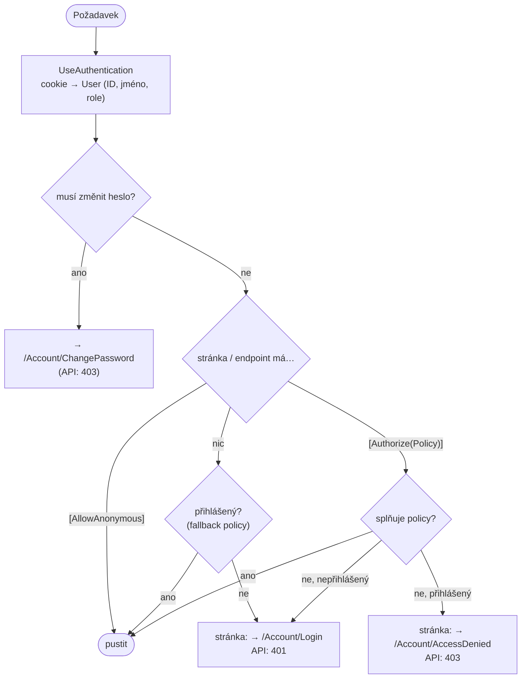
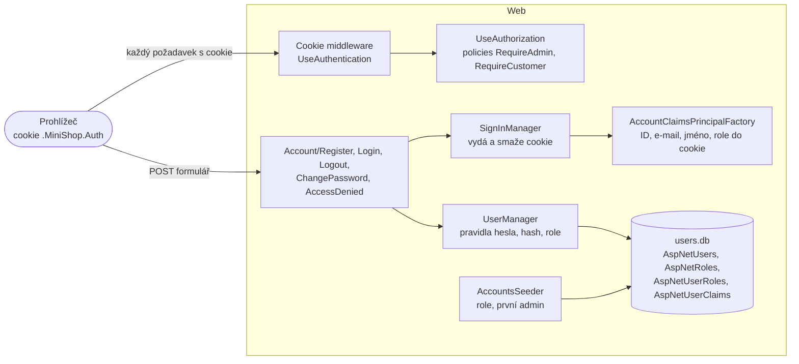
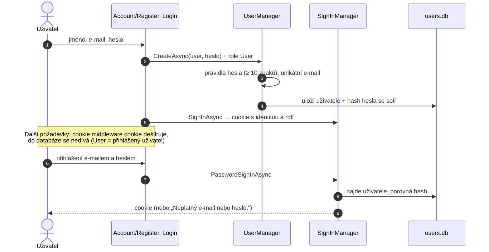

> **V jedné větě:** Accounts ví, **kdo** je přihlášený a **co smí**: uživatel se zaregistruje e-mailem a heslem,
> při přihlášení dostane zašifrovanou **cookie** se svými rolemi a Web podle **policies** rozhodne, kam ho pustí.
> Běží ve službě **Web**, data má v `users.db`.

Modul vzniká postupně podle plánu [Uživatelské účty a role](code:docs/Ucty-roadmap.md). Hotové jsou kroky 1
(registrace, přihlášení) a 2 (role, oprávnění, první admin). Vlastník objednávky (User vidí jen své) přijde v kroku 3.

## Role a oprávnění

| Kde | Nepřihlášený | User (zákazník) | Admin |
| --- | :-: | :-: | :-: |
| Úvod, Dokumentace, Přihlášení, Registrace, `/health` | ✅ | ✅ | ✅ |
| Objednávky – seznam | → přihlášení | ✅ (zatím všechny) | ✅ |
| Objednávky – založit (stránka i `POST /api/orders`) | ❌ | ✅ | ❌ |
| Objednávky – zrušit | ❌ | ✅ | ✅ |
| Objednávky – vyřídit, obnovit katalog | ❌ | ❌ | ✅ |
| Produkty – přidat, naskladnit, upravit, smazat | ❌ | ❌ | ✅ |
| Průběh a přehrání objednávky (stránky i `GET /api/journeys/…`) | ❌ | ❌ | ✅ |
| Změna hesla | ❌ | ✅ | ✅ |

Pravidla jsou pojmenovaná na jednom místě – **policies** `RequireAdmin` a `RequireCustomer`
v [AuthorizationPolicies.cs](code:src/MiniShop.Web/Accounts/AuthorizationPolicies.cs), registrované v
[AccountsServiceCollectionExtensions.cs](code:src/MiniShop.Web/Extensions/AccountsServiceCollectionExtensions.cs).
Celou tabulku ověřuje test [AuthorizationMatrixTests](code:tests/MiniShop.Tests/Web/AuthorizationMatrixTests.cs)
skutečnými HTTP požadavky proti celému Webu.

### Jak se rozhoduje



- **Secure by default (fallback policy):** co není výslovně `[AllowAnonymous]`, vyžaduje přihlášení. Nová stránka
  je zamčená, i když na ni autor zapomene.
- **Stránka Objednávky** má víc akcí (handlerů) s různými pravidly – Razor Pages umí `[Authorize]` jen na celou
  stránku, proto handlery volají `IAuthorizationService` se stejnými policies a bez oprávnění vrátí `Forbid()`.
- **Skrytí v UI je jen pohodlí** (menu Produkty, formulář objednávky, tlačítko Vyřídit). Chrání server.

## První admin

Admina jmenuje admin – kdo ale jmenuje prvního? (Problém slepice a vejce.)

- **V produkci** se první admin zakládá příkazem přímo v běžícím kontejneru:
  ```text
  sudo -u deploy docker compose exec web dotnet MiniShop.Web.dll create-admin --email <e-mail> --name "<jméno>"
  ```
  Heslo se píše skrytě do terminálu – nikdy neleží v GitHubu, v `.env` ani v historii příkazů. Příkaz projde,
  jen když žádný admin není. Kód: [CreateAdminCommand.cs](code:src/MiniShop.Web/Accounts/CreateAdminCommand.cs).
- **Ve vývoji** ho při startu vytvoří seed z `AdminBootstrap` v `appsettings.Development.json`
  (`admin@minishop.local`). Heslo je v repozitáři, proto má příznak **„musí změnit heslo“** – dokud ho nezmění,
  přesměruje ho každá stránka na změnu hesla ([MustChangePasswordMiddleware.cs](code:src/MiniShop.Web/Accounts/MustChangePasswordMiddleware.cs)).
- **Existující účet se adminem nikdy nestane.** Bez potvrzení e-mailu by si kdokoli mohl adminův e-mail zaregistrovat
  dřív a seed by mu práva admina dal.
- Účty z kroku 1 (bez role) dostanou při startu roli User. Kód: [AccountsSeeder.cs](code:src/MiniShop.Infrastructure/Accounts/AccountsSeeder.cs).

## Komponentní diagram



## Registrace a přihlášení



## Komponenty

| Komponenta | K čemu slouží | Kód |
| --- | --- | --- |
| **ApplicationUser** | Účet: e-mail (= přihlašovací jméno), hash hesla, zobrazované jméno. Business pravidla nemá, proto nežije v doméně. | [ApplicationUser.cs](code:src/MiniShop.Infrastructure/Accounts/ApplicationUser.cs) |
| **AccountRoles** | Názvy rolí `User` a `Admin`. | [AccountRoles.cs](code:src/MiniShop.Infrastructure/Accounts/AccountRoles.cs) |
| **AccountsDbContext** | Tabulky Identity v `users.db`. | [AccountsDbContext.cs](code:src/MiniShop.Infrastructure/Accounts/AccountsDbContext.cs) |
| **AccountsInfrastructure** | Jádro Identity a pravidla: heslo ≥ 10 znaků bez povinných speciálních znaků (NIST), unikátní e-mail. | [AccountsInfrastructure.cs](code:src/MiniShop.Infrastructure/Accounts/AccountsInfrastructure.cs) |
| **AccountsSeeder** | Při startu: role, role User pro účty bez role, první admin z konfigurace; totéž pro příkaz `create-admin`. | [AccountsSeeder.cs](code:src/MiniShop.Infrastructure/Accounts/AccountsSeeder.cs) |
| **CzechIdentityErrorDescriber** | České chybové hlášky Identity. | [CzechIdentityErrorDescriber.cs](code:src/MiniShop.Infrastructure/Accounts/CzechIdentityErrorDescriber.cs) |
| **AccountClaimsPrincipalFactory** | Co se uloží do cookie – navíc zobrazované jméno (role a claimy uživatele přidá Identity). | [AccountClaimsPrincipalFactory.cs](code:src/MiniShop.Infrastructure/Accounts/AccountClaimsPrincipalFactory.cs) |
| **AddAccounts** | Ve Webu: `SignInManager`, cookie, policies, fallback policy; `/api/*` dostane 401/403 místo přesměrování. | [AccountsServiceCollectionExtensions.cs](code:src/MiniShop.Web/Extensions/AccountsServiceCollectionExtensions.cs) |
| **Stránky účtu** | Registrace, přihlášení, odhlášení (jen POST), změna hesla, přístup odepřen. | [Register.cshtml.cs](code:src/MiniShop.Web/Pages/Account/Register.cshtml.cs), [Login.cshtml.cs](code:src/MiniShop.Web/Pages/Account/Login.cshtml.cs), [ChangePassword.cshtml.cs](code:src/MiniShop.Web/Pages/Account/ChangePassword.cshtml.cs) |

## Zajímavá rozhodnutí

- **Žádná vlastní kryptografie.** Hashování hesel (PBKDF2 se solí), security stamp, role i budoucí zámek účtu
  a přihlášení přes Google dodává ASP.NET Core Identity.
- **Cookie** je `HttpOnly` (JavaScript ji nepřečte), `Secure` (jen HTTPS) a `SameSite=Lax` (cizí web s ní nepošle
  formulář). Šifruje se klíči Data Protection – v cloudu leží na volume, takže přihlášení přežije nasazení.
- **Role jsou v cookie.** Změna role se projeví po novém přihlášení nebo nejpozději za 30 minut (kontrola security stampu).
- **Příznak „musí změnit heslo“ je claim uživatele** (tabulka `AspNetUserClaims`) – žádný nový sloupec, `users.db` se nemaže.
- **Stejná hláška pro neznámý e-mail i špatné heslo**, návrat po přihlášení jen na adresu v MiniShopu
  (`Url.IsLocalUrl` – ochrana proti „open redirect“), do logu jen ID uživatele.
- **Ostatní moduly o Accounts nevědí.** Ordering bude znát jen ID uživatele (hlídá test hranic modulů).
- Accounts zatím neposílá zprávy, proto `AccountsDbContext` (jako Journeys) nedědí ze společného `ModuleDbContext`.

## Dál

- Plán dalších kroků: [docs/Ucty-roadmap.md](code:docs/Ucty-roadmap.md)
- [Moduly](index.md)
