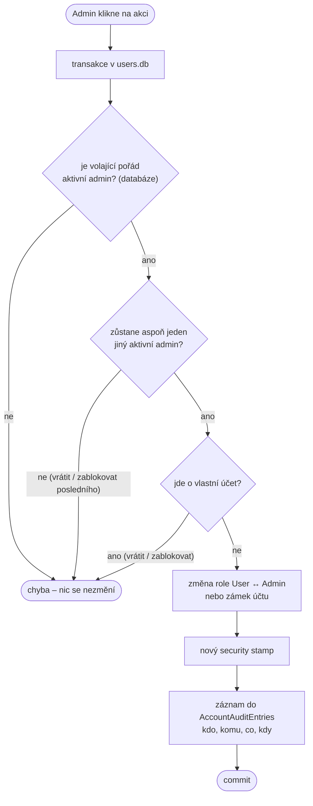
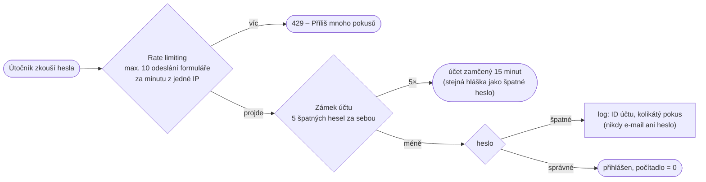
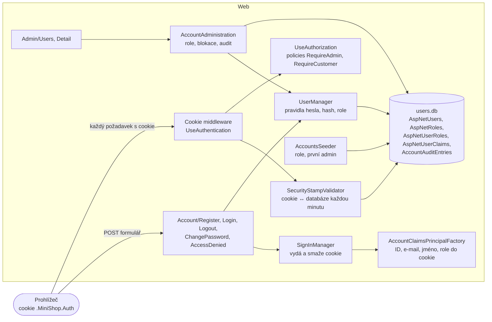
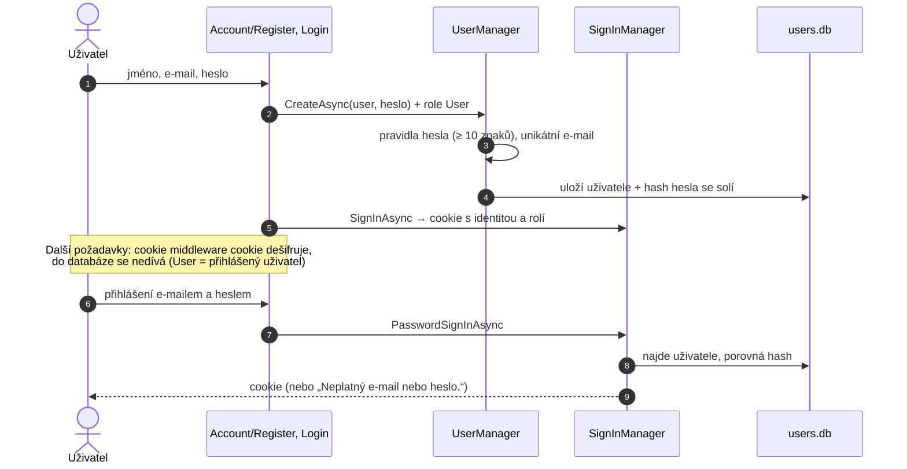

> **V jedné větě:** Accounts ví, **kdo** je přihlášený a **co smí**: uživatel se zaregistruje e-mailem a heslem,
> při přihlášení dostane zašifrovanou **cookie** se svými rolemi a Web podle **policies** rozhodne, kam ho pustí.
> Běží ve službě **Web**, data má v `users.db`.

Modul vzniká postupně podle plánu [Uživatelské účty a role](code:docs/Ucty-roadmap.md). Hotové jsou kroky 1
(registrace, přihlášení), 2 (role, oprávnění, první admin), 3 (vlastník objednávky – zákazník vidí jen své,
viz [Ordering](ordering.md)), 5 ([e-maily](../emaily.md)), 6 (správa uživatelů a audit) a 8 ([zpevnění](#zpevnění)); krok 7 zabezpečil sklad ([Inventory](inventory.md)).

## Role a oprávnění

| Kde | Nepřihlášený | User (zákazník) | Admin |
| --- | :-: | :-: | :-: |
| Úvod, Dokumentace, Přihlášení, Registrace, `/health` | ✅ | ✅ | ✅ |
| Objednávky – seznam a detail | → přihlášení | jen své (cizí = 404) | všechny |
| Objednávky – založit (stránka i `POST /api/orders`) | ❌ | ✅ (jméno a e-mail z účtu) | ❌ |
| Objednávky – zrušit | ❌ | jen svou | jakoukoli |
| Objednávky – vyřídit, obnovit katalog | ❌ | ❌ | ✅ |
| Produkty – přidat, naskladnit, upravit, smazat | ❌ | ❌ | ✅ |
| Průběh a přehrání objednávky (stránky i `GET /api/journeys/…`) | ❌ | ❌ | ✅ |
| Změna hesla | ❌ | ✅ | ✅ |
| Uživatelé – přehled, detail, povýšit / vrátit na usera, zablokovat / odblokovat (`/Admin/…`) | ❌ | ❌ | ✅ (ne sám sobě) |

Pravidla jsou pojmenovaná na jednom místě – **policies** `RequireAdmin` a `RequireCustomer`
v [AuthorizationPolicies.cs](code:src/MiniShop.Web/Accounts/AuthorizationPolicies.cs), registrované v
[AccountsServiceCollectionExtensions.cs](code:src/MiniShop.Web/Extensions/AccountsServiceCollectionExtensions.cs).
Celou tabulku ověřuje test [AuthorizationMatrixTests](code:tests/MiniShop.Tests/Web/AuthorizationMatrixTests.cs)
skutečnými HTTP požadavky proti celému Webu.

### Jak se rozhoduje


- **Secure by default (fallback policy):** co není výslovně `[AllowAnonymous]`, vyžaduje přihlášení. Nová stránka
  je zamčená, i když na ni autor zapomene.
- **Stránka Objednávky** má víc akcí (handlerů) s různými pravidly – Razor Pages umí `[Authorize]` jen na celou
  stránku, proto handlery volají `IAuthorizationService` se stejnými policies a bez oprávnění vrátí `Forbid()`.
- **Skrytí v UI je jen pohodlí** (menu Produkty, formulář objednávky, tlačítko Vyřídit). Chrání server.

## První admin

Admina jmenuje admin – kdo ale jmenuje prvního? (Problém slepice a vejce.)

- **V produkci** se první admin zakládá příkazem přímo v běžícím kontejneru:
  ```text
  sudo -u deploy docker compose exec web dotnet MiniShop.Web.dll create-admin --email <e-mail> --name "<jméno>"
  ```
  Heslo se píše skrytě do terminálu – nikdy neleží v GitHubu, v `.env` ani v historii příkazů. Příkaz projde,
  jen když žádný admin není. Kód: [CreateAdminCommand.cs](code:src/MiniShop.Web/Accounts/CreateAdminCommand.cs).
- **Ve vývoji** ho při startu vytvoří seed z `AdminBootstrap` v `appsettings.Development.json`
  (`admin@minishop.local`). Heslo je v repozitáři, proto má příznak **„musí změnit heslo“** – dokud ho nezmění,
  přesměruje ho každá stránka na změnu hesla ([MustChangePasswordMiddleware.cs](code:src/MiniShop.Web/Accounts/MustChangePasswordMiddleware.cs)).
- **Existující účet se adminem nikdy nestane.** Bez potvrzení e-mailu by si kdokoli mohl adminův e-mail zaregistrovat
  dřív a seed by mu práva admina dal.
- Účty z kroku 1 (bez role) dostanou při startu roli User. Kód: [AccountsSeeder.cs](code:src/MiniShop.Infrastructure/Accounts/AccountsSeeder.cs).
- **Další admini** vznikají povýšením v aplikaci (níže). Nový admin se nejdřív sám zaregistruje – heslo tak zná jen on.

## Správa uživatelů

Menu **Uživatelé** (jen admin): přehled všech účtů s rolí, stavem, počtem objednávek a útratou, detail s objednávkami
a historií změn. Na detailu jsou tlačítka **Povýšit na admina / Vrátit na usera** a **Zablokovat / Odblokovat**.



- **Rozhoduje databáze, ne cookie.** Admin, kterému jiný admin právě roli odebral, má možná ještě starou cookie –
  akce mu přesto neprojde.
- **Vždy zůstane aktivní admin** a nikdo si nemůže sám odebrat roli ani se zablokovat. Kontrola i změna jsou v jedné
  transakci: když dva admini ve stejnou chvíli odebírají jeden druhého, SQLite druhou změnu nepustí.
- **Zablokování** = zámek účtu Identity „navždy“ (do odblokování). Přihlášení skončí stejnou hláškou jako špatné
  heslo – jiná by prozradila, že účet existuje.
- **Odhlášení do minuty:** každá změna vymění **security stamp** (otisk „verze“ účtu). Web cookie každou minutu
  porovná s databází (`SecurityStampValidator`, interval v
  [AccountsServiceCollectionExtensions.cs](code:src/MiniShop.Web/Extensions/AccountsServiceCollectionExtensions.cs));
  nesedí-li, cookie zahodí. Přirovnání: přenastavený zámek – staré klíče přestanou fungovat.
- **Audit** jen přibývá (žádná úprava ani mazání), e-maily v něm jsou kopie z doby akce.
- **Objednávky** dodá Ordering (`IOrderService.GetCustomerSummariesAsync`, detail přes `OrderAccess.Customer(id)`) –
  moduly se neznají, spojí je až stránka ve Webu přes ID uživatele.

Kód: [AccountAdministration.cs](code:src/MiniShop.Infrastructure/Accounts/AccountAdministration.cs),
stránky [Admin/Users](code:src/MiniShop.Web/Pages/Admin/Users/Index.cshtml.cs) a
[Detail](code:src/MiniShop.Web/Pages/Admin/Users/Detail.cshtml.cs). Celá složka `/Admin` je navíc zamčená
konvencí `AuthorizeFolder` v `Program.cs`.

## Zpevnění

Účty krok 8 přidaly několik vrstev obrany (*defense in depth*) – každá chytí něco, co ostatní propustí.



| Vrstva | Co dělá | Kód |
| --- | --- | --- |
| **Zámek účtu** | 5 špatných hesel za sebou → 15 minut. Admin zámek vidí v přehledu („zamčený do 15:42“) a může ho zrušit. Dočasný zámek adminovi práva nebere – útočník by jinak zkoušením hesel „odstavil“ všechny adminy. | [AccountsInfrastructure.cs](code:src/MiniShop.Infrastructure/Accounts/AccountsInfrastructure.cs), [Login.cshtml.cs](code:src/MiniShop.Web/Pages/Account/Login.cshtml.cs) |
| **Rate limiting** | Formuláře přihlášení, registrace, zapomenutého a nového hesla, *Poslat znovu* a změny hesla: z jedné IP nejvýš 10 odeslání za minutu, pak **429**. Brzdí hádání hesel, zkoušení uniklých hesel z jiných webů (*credential stuffing*) i zahlcení Gmailu. IP za Caddy z `X-Forwarded-For`. | [AccountRateLimiting.cs](code:src/MiniShop.Web/Security/AccountRateLimiting.cs) |
| **Bezpečnostní hlavičky** | CSP (skripty jen ze souborů MiniShopu – žádné inline `<script>`, Bootstrap lokálně), HSTS (jen HTTPS, 1 rok, bez preload), `X-Frame-Options: DENY` + `frame-ancestors 'none'` (proti *clickjackingu*), `nosniff`, `Referrer-Policy` (odkaz s tokenem neodejde jinému webu) | [SecurityHeaders.cs](code:src/MiniShop.Web/Security/SecurityHeaders.cs) |
| **Logy a trasy** | Do trasy jen `enduser.id` (ID účtu); v logu nikdy e-mail ani heslo (hlídá test). Serilog loguje cestu bez query stringu, OpenTelemetry query string maskuje. | [SecurityHeaders.cs](code:src/MiniShop.Web/Security/SecurityHeaders.cs) (`UseEndUserTracing`) |

> **Přirovnání:** rate limiting je vrátný, který ke dveřím pustí jen pár lidí za minutu; zámek účtu je platební karta,
> která po třech špatných PINech na chvíli přestane fungovat; CSP je provozní řád, podle kterého prohlížeč nespustí
> nic, co nepřišlo z MiniShopu.

## Databáze a migrace

`users.db` se na rozdíl od ostatních databází **nesmí mazat** (jsou v ní účty), proto ji od účtů kroku 6 spravují
**EF Core migrace** ([Accounts/Migrations](code:src/MiniShop.Infrastructure/Accounts/Migrations/AccountsDbContextModelSnapshot.cs)).
Při startu Webu (i příkazu `create-admin`) [AccountsDatabaseInitializer](code:src/MiniShop.Infrastructure/Accounts/AccountsDatabaseInitializer.cs)
spustí `Migrate` – ten doplní jen chybějící migrace a zapamatuje si je v tabulce `__EFMigrationsHistory`.

- Databáze z kroků 1–5 (vytvořená přes `EnsureCreated`) historii nemá – initializer do ní zapíše první migraci
  `InitialAccounts` jako provedenou (schéma odpovídá) a pak se doplní jen novější.
- Nová migrace (z kořene repozitáře, nástroj `dotnet-ef` z `dotnet-tools.json` – poprvé `dotnet tool restore`):
  ```text
  dotnet ef migrations add <Nazev> --project src/MiniShop.Infrastructure --context AccountsDbContext --output-dir Accounts/Migrations
  ```

## Komponentní diagram



## Registrace a přihlášení



## Komponenty

| Komponenta | K čemu slouží | Kód |
| --- | --- | --- |
| **ApplicationUser** | Účet: e-mail (= přihlašovací jméno), hash hesla, zobrazované jméno. Business pravidla nemá, proto nežije v doméně. | [ApplicationUser.cs](code:src/MiniShop.Infrastructure/Accounts/ApplicationUser.cs) |
| **AccountRoles** | Názvy rolí `User` a `Admin`. | [AccountRoles.cs](code:src/MiniShop.Infrastructure/Accounts/AccountRoles.cs) |
| **AccountsDbContext** | Tabulky Identity v `users.db`. | [AccountsDbContext.cs](code:src/MiniShop.Infrastructure/Accounts/AccountsDbContext.cs) |
| **AccountsInfrastructure** | Jádro Identity a pravidla: heslo ≥ 10 znaků bez povinných speciálních znaků (NIST), unikátní e-mail. | [AccountsInfrastructure.cs](code:src/MiniShop.Infrastructure/Accounts/AccountsInfrastructure.cs) |
| **AccountsSeeder** | Při startu: role, role User pro účty bez role, první admin z konfigurace; totéž pro příkaz `create-admin`. | [AccountsSeeder.cs](code:src/MiniShop.Infrastructure/Accounts/AccountsSeeder.cs) |
| **AccountsDatabaseInitializer** | Migrace `users.db` (i staré databáze bez historie migrací) a seed. | [AccountsDatabaseInitializer.cs](code:src/MiniShop.Infrastructure/Accounts/AccountsDatabaseInitializer.cs) |
| **AccountAdministration** | Správa uživatelů adminem: role, blokace, pravidla (poslední admin, sám sebe), security stamp, audit. | [AccountAdministration.cs](code:src/MiniShop.Infrastructure/Accounts/AccountAdministration.cs) |
| **AccountAuditEntry** | Auditní záznam: kdo, komu, co, kdy (tabulka `AccountAuditEntries`). | [AccountAuditEntry.cs](code:src/MiniShop.Infrastructure/Accounts/AccountAuditEntry.cs) |
| **CzechIdentityErrorDescriber** | České chybové hlášky Identity. | [CzechIdentityErrorDescriber.cs](code:src/MiniShop.Infrastructure/Accounts/CzechIdentityErrorDescriber.cs) |
| **AccountClaimsPrincipalFactory** | Co se uloží do cookie – navíc zobrazované jméno (role a claimy uživatele přidá Identity). | [AccountClaimsPrincipalFactory.cs](code:src/MiniShop.Infrastructure/Accounts/AccountClaimsPrincipalFactory.cs) |
| **AddAccounts** | Ve Webu: `SignInManager`, cookie, policies, fallback policy; `/api/*` dostane 401/403 místo přesměrování. | [AccountsServiceCollectionExtensions.cs](code:src/MiniShop.Web/Extensions/AccountsServiceCollectionExtensions.cs) |
| **Stránky účtu** | Registrace, přihlášení, odhlášení (jen POST), změna hesla, přístup odepřen. | [Register.cshtml.cs](code:src/MiniShop.Web/Pages/Account/Register.cshtml.cs), [Login.cshtml.cs](code:src/MiniShop.Web/Pages/Account/Login.cshtml.cs), [ChangePassword.cshtml.cs](code:src/MiniShop.Web/Pages/Account/ChangePassword.cshtml.cs) |

## Zajímavá rozhodnutí

- **Žádná vlastní kryptografie.** Hashování hesel (PBKDF2 se solí), security stamp, role i budoucí zámek účtu
  a přihlášení přes Google dodává ASP.NET Core Identity.
- **Cookie** je `HttpOnly` (JavaScript ji nepřečte), `Secure` (jen HTTPS) a `SameSite=Lax` (cizí web s ní nepošle
  formulář). Šifruje se klíči Data Protection – v cloudu leží na volume, takže přihlášení přežije nasazení.
- **Role jsou v cookie.** Proto každá změna role nebo blokace vymění security stamp a Web cookie každou minutu porovná
  s databází – dotyčný je do minuty odhlášený a novou roli dostane při dalším přihlášení.
- **Příznak „musí změnit heslo“ je claim uživatele** (tabulka `AspNetUserClaims`) – žádný nový sloupec, `users.db` se nemaže.
- **Stejná hláška pro neznámý e-mail i špatné heslo**, návrat po přihlášení jen na adresu v MiniShopu
  (`Url.IsLocalUrl` – ochrana proti „open redirect“), do logu jen ID uživatele.
- **Ostatní moduly o Accounts nevědí.** Ordering bude znát jen ID uživatele (hlídá test hranic modulů).
- Accounts zatím neposílá zprávy, proto `AccountsDbContext` (jako Journeys) nedědí ze společného `ModuleDbContext`.
- **Migrace jen u `users.db`.** Ostatní databáze jde při změně schématu smazat (data jsou cvičná nebo se obnoví), účty ne.

## Dál

- Plán dalších kroků: [docs/Ucty-roadmap.md](code:docs/Ucty-roadmap.md)
- [Moduly](index.md)
