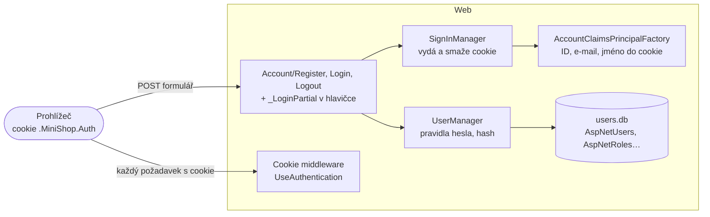
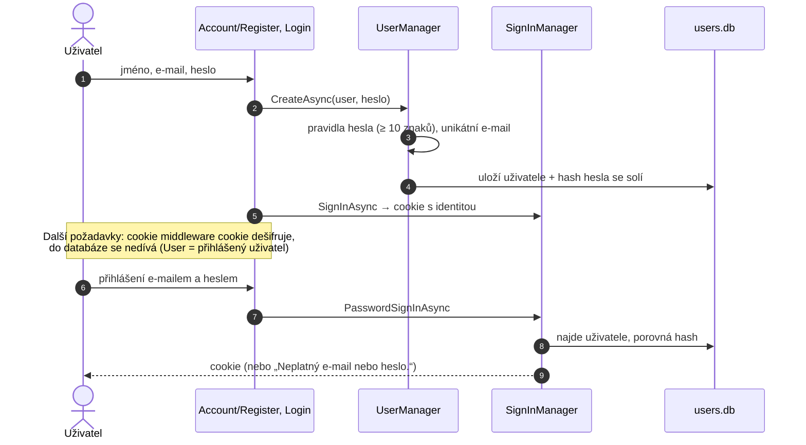

> **V jedné větě:** Accounts ví, **kdo** je přihlášený: uživatel se zaregistruje e-mailem a heslem, při přihlášení
> dostane zašifrovanou **cookie** a s ní ho Web pozná při každém dalším požadavku. Běží ve službě **Web**, data má v `users.db`.

Modul vzniká postupně podle plánu [Uživatelské účty a role](code:docs/Ucty-roadmap.md). Zatím (účty krok 1) umí
registraci, přihlášení a odhlášení – **nic se ještě nezamyká**, objednávat jde i bez přihlášení. Role User/Admin
a pravidla „kdo smí co“ přijdou v dalších krocích.

## Komponentní diagram

## Registrace a přihlášení

## Komponenty

| Komponenta | K čemu slouží | Kód |
| --- | --- | --- |
| **ApplicationUser** | Účet: e-mail (= přihlašovací jméno), hash hesla, zobrazované jméno. Business pravidla nemá, proto nežije v doméně. | [ApplicationUser.cs](code:src/MiniShop.Infrastructure/Accounts/ApplicationUser.cs) |
| **AccountsDbContext** | Tabulky Identity v `users.db` – i tabulky rolí, které využije další krok. | [AccountsDbContext.cs](code:src/MiniShop.Infrastructure/Accounts/AccountsDbContext.cs) |
| **AccountsInfrastructure** | Jádro Identity a pravidla: heslo ≥ 10 znaků bez povinných speciálních znaků (NIST), unikátní e-mail. | [AccountsInfrastructure.cs](code:src/MiniShop.Infrastructure/Accounts/AccountsInfrastructure.cs) |
| **CzechIdentityErrorDescriber** | České chybové hlášky Identity. | [CzechIdentityErrorDescriber.cs](code:src/MiniShop.Infrastructure/Accounts/CzechIdentityErrorDescriber.cs) |
| **AccountClaimsPrincipalFactory** | Co se uloží do cookie – navíc zobrazované jméno pro hlavičku. | [AccountClaimsPrincipalFactory.cs](code:src/MiniShop.Infrastructure/Accounts/AccountClaimsPrincipalFactory.cs) |
| **AddAccounts** | Ve Webu přidá přihlašování: `SignInManager` a nastavení cookie; `/api/*` dostane 401 místo přesměrování. | [AccountsServiceCollectionExtensions.cs](code:src/MiniShop.Web/Extensions/AccountsServiceCollectionExtensions.cs) |
| **Stránky účtu** | Registrace, přihlášení, odhlášení (jen POST). | [Register.cshtml.cs](code:src/MiniShop.Web/Pages/Account/Register.cshtml.cs), [Login.cshtml.cs](code:src/MiniShop.Web/Pages/Account/Login.cshtml.cs), [Logout.cshtml.cs](code:src/MiniShop.Web/Pages/Account/Logout.cshtml.cs) |

## Zajímavá rozhodnutí

- **Žádná vlastní kryptografie.** Hashování hesel (PBKDF2 se solí), security stamp i budoucí zámek účtu a přihlášení
  přes Google dodává ASP.NET Core Identity.
- **Cookie** je `HttpOnly` (JavaScript ji nepřečte), `Secure` (jen HTTPS) a `SameSite=Lax` (cizí web s ní nepošle
  formulář). Šifruje se klíči Data Protection – v cloudu leží na volume, takže přihlášení přežije nasazení.
- **Stejná hláška pro neznámý e-mail i špatné heslo** – nikdo tak nezjistí, kdo v MiniShopu má účet.
- **Návrat po přihlášení jen na adresu v MiniShopu** (`Url.IsLocalUrl`) – ochrana proti „open redirect“.
- **Do logu jen ID uživatele**, nikdy e-mail ani heslo.
- **Ostatní moduly o Accounts nevědí.** Ordering bude znát jen ID uživatele (hlídá test hranic modulů).
- Accounts zatím neposílá zprávy, proto `AccountsDbContext` (jako Journeys) nedědí ze společného `ModuleDbContext`.

## Dál

- Plán dalších kroků: [docs/Ucty-roadmap.md](code:docs/Ucty-roadmap.md)
- [Moduly](index.md)
