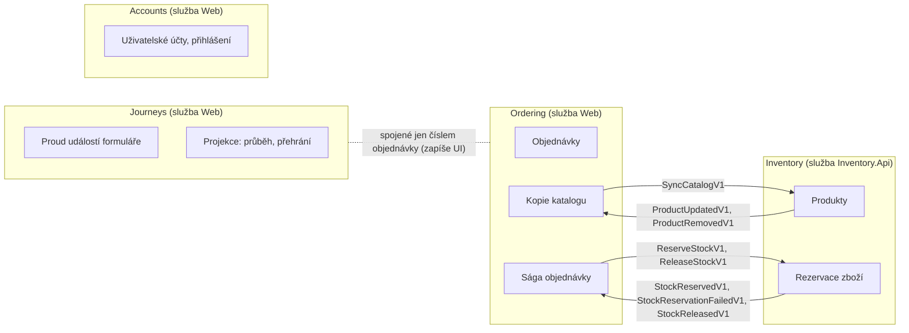

> **V jedné větě:** Modul je samostatné „oddělení“ firmy s vlastními daty a vlastními pravidly. Moduly spolu
> mluví jen zprávami – nikdy si nesahají do databáze ani do kódu.

## Přehled

| Modul | Odpovídá za | Databáze | Kde v kódu |
| --- | --- | --- | --- |
| [Ordering](ordering.md) | objednávky, jejich stavy, ságu, kopii katalogu, oznámení zákazníkovi | `ordering.db` | `Domain/Orders`, `Application/Ordering`, `Infrastructure/Ordering` |
| [Inventory](inventory.md) | produkty, skladové zásoby, rezervace | `inventory.db` | `Domain/Inventory`, `Application/Inventory`, `Infrastructure/Inventory` |
| [Journeys](journeys.md) | co uživatel dělal ve formuláři objednávky | `journeys.db` | `Domain/Journeys`, `Application/Journeys`, `Infrastructure/Journeys` |
| [Accounts](accounts.md) | uživatelské účty, registrace a přihlášení (ASP.NET Core Identity) | `users.db` | `Infrastructure/Accounts`, stránky `Pages/Account` ve Webu |

## Pravidla hranic

1. **Žádné reference mezi moduly** v žádné vrstvě. Hlídá to test
   [ModuleBoundariesTests](code:tests/MiniShop.Tests/Architecture/ModuleBoundariesTests.cs) – kdo z pohodlnosti
   sáhne z objednávek do skladu, neprojde mu build v CI.
2. **Vlastní databáze** – žádné sdílené tabulky. Ordering zná název a cenu produktu jen ze své
   [kopie katalogu](../../eda/kopie-katalogu.md).
3. **Vlastní outbox a inbox v databázi modulu** – jinak by zpráva nebyla v téže transakci jako data.
4. **Vlastní rozhraní pro ukládání a odesílání** (`IOrderingUnitOfWork`, `IInventoryMessagePublisher`…).
   Handler modulu nikdy nebere obecné `IUnitOfWork` – nemohl by omylem uložit do cizí databáze.
5. **Společné je jen jádro** (outbox, inbox, bus) a **kontrakty**. Jádro nezná žádný modul.

## Modulární monolit → samostatné služby

V kroku 10A byly všechny moduly v jednom procesu (*modulární monolit*), ale už s oddělenými databázemi a komunikací
přes zprávy. V kroku 10B se Inventory „odstěhoval“ do vlastní služby – a protože hranice už byly čisté, šlo hlavně
o změnu hostitele, ne o přepis kódu.

> **Přirovnání:** Nejdřív si oddělení rozdělí kanceláře v jedné budově a domluví se, že si budou posílat jen
> oficiální poštu. Až potom se jedno z nich může přestěhovat do jiné budovy, aniž by se změnil způsob práce.

**Proč nezačít rovnou mikroslužbami?** Hranice se na začátku často odhadnou špatně. V monolitu se dají
levně posunout; mezi službami už je to drahé (síť, nasazení, verze kontraktů).

## Na internetu

- [Kamil Grzybek: Modular Monolith Primer](https://www.kamilgrzybek.com/blog/posts/modular-monolith-primer)
- [Martin Fowler: MonolithFirst](https://martinfowler.com/bliki/MonolithFirst.html)
- [Martin Fowler: Bounded Context](https://martinfowler.com/bliki/BoundedContext.html)
