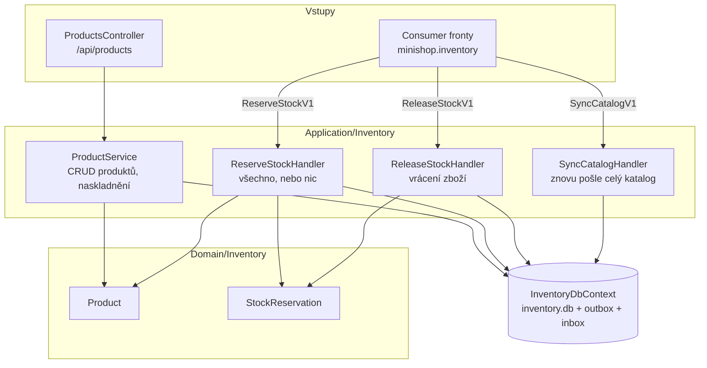

> **V jedné větě:** Inventory spravuje produkty a zásoby a vyřizuje příkazy „zarezervuj“ a „uvolni“.
> Běží jako samostatná služba **Inventory.Api** s databází `inventory.db`.

## Komponentní diagram

## Komponenty

| Komponenta | K čemu slouží | Kód |
| --- | --- | --- |
| **ProductsController** | REST API produktů – čte ho UI Webu přes `InventoryApiClient`. | [ProductsController.cs](code:src/MiniShop.Inventory.Api/Controllers/ProductsController.cs) |
| **ProductService** | Založení, změna, smazání, naskladnění produktu. Změna názvu/ceny vyvolá událost → `ProductUpdatedV1`. | [ProductService.cs](code:src/MiniShop.Application/Inventory/ProductService.cs) |
| **Product** | Entita s pravidly (cena > 0, zásoba nesmí být záporná). | [Product.cs](code:src/MiniShop.Domain/Inventory/Product.cs) |
| **ReserveStockHandler** | Vyřídí `ReserveStockV1`: nejdřív zkontroluje všechny položky, pak buď zarezervuje vše, nebo nic. Odpoví `StockReservedV1` / `StockReservationFailedV1`. | [ReserveStockHandler.cs](code:src/MiniShop.Application/Inventory/ReserveStockHandler.cs) |
| **ReleaseStockHandler** | Vyřídí `ReleaseStockV1`: vrátí zboží podle **svých** rezervací (ne podle objednávky) a odpoví `StockReleasedV1`. | [ReleaseStockHandler.cs](code:src/MiniShop.Application/Inventory/ReleaseStockHandler.cs) |
| **SyncCatalogHandler** | Vyřídí `SyncCatalogV1`: pošle `ProductUpdatedV1` pro každý produkt s časem jeho poslední změny. | [SyncCatalogHandler.cs](code:src/MiniShop.Application/Inventory/SyncCatalogHandler.cs) |
| **StockReservation** | Záznam „pro objednávku X je odložených N kusů produktu Y“. | [StockReservation.cs](code:src/MiniShop.Domain/Inventory/StockReservation.cs) |
| **InventoryDbContext** | `inventory.db`. Doménové události produktu převádí na integrační **rovnou při uložení**. | [InventoryDbContext.cs](code:src/MiniShop.Infrastructure/Inventory/InventoryDbContext.cs) |

## Zajímavá rozhodnutí

- **Sklad nezná objednávky.** Pracuje jen s daty z příkazu (číslo objednávky, položky). Kdyby se Ordering
  přepsal, sklad se nemusí měnit.
- **Idempotentní rezervace.** Když pro objednávku už rezervace existuje (příkaz přišel podruhé s jiným ID),
  sklad jen znovu odpoví „zarezervováno“ – zboží neodečte dvakrát.
- **Změna zásoby nevyvolá zprávu.** Ordering zásobu nepotřebuje (o ní rozhoduje až rezervace), takže se nesdílí.
- **Překlad událostí v `SaveChanges`.** Ordering překládá doménové události na integrační v handleru, Inventory
  přímo při uložení – nemá žádné vlastní doménové handlery, tak nemusí čekat na další kolo workeru.
  Obě varianty jsou popsané v [Integračních zprávách](../../eda/integracni-zpravy.md).

## Jaké zprávy modul posílá a přijímá

| Směr | Zprávy |
| --- | --- |
| přijímá (fronta `minishop.inventory`) | `ReserveStockV1`, `ReleaseStockV1`, `SyncCatalogV1` |
| posílá | `StockReservedV1`, `StockReservationFailedV1`, `StockReleasedV1`, `ProductUpdatedV1`, `ProductRemovedV1` |

## Dál

- [Změna produktu → kopie katalogu](../../toky/zmena-produktu.md)
- [Zamítnutí objednávky kvůli zásobě](../../toky/zamitnuti-objednavky.md)
