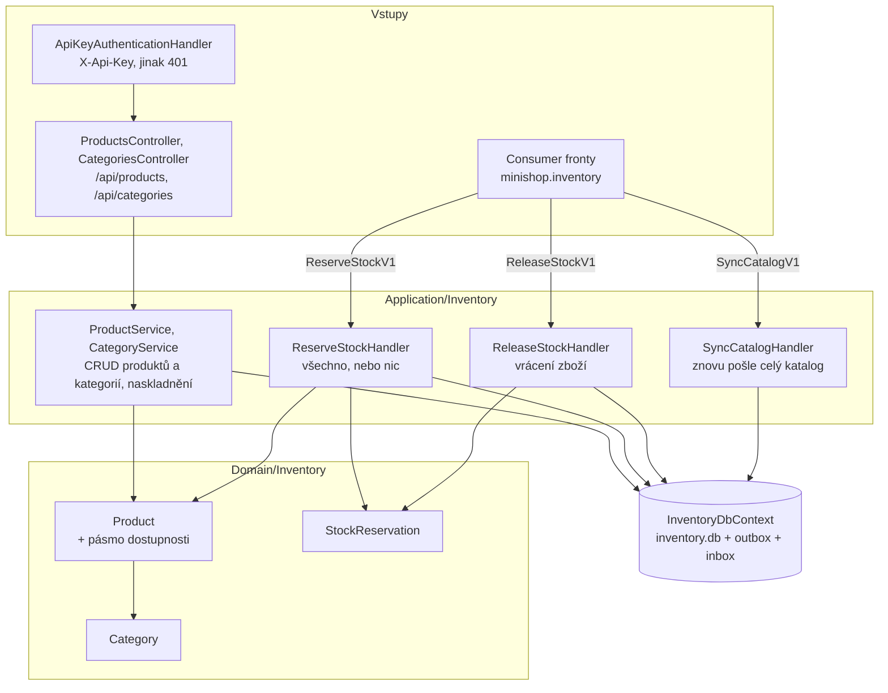

> **V jedné větě:** Inventory spravuje produkty a zásoby a vyřizuje příkazy „zarezervuj“ a „uvolni“.
> Běží jako samostatná služba **Inventory.Api** s databází `inventory.db`.

## Komponentní diagram

## Komponenty

| Komponenta | K čemu slouží | Kód |
| --- | --- | --- |
| **ApiKeyAuthenticationHandler** | Účty krok 7: `/api` jen se servisním klíčem Webu v hlavičce `X-Api-Key` (jinak 401). Web ho přidává v `InventoryApiKeyHandler`. | [ApiKeyAuthentication.cs](code:src/MiniShop.Inventory.Api/ApiKeyAuthentication.cs), [ServiceApiKey.cs](code:src/MiniShop.ServiceDefaults/ServiceApiKey.cs), [InventoryApiKeyHandler.cs](code:src/MiniShop.Web/Inventory/InventoryApiKeyHandler.cs) |
| **ProductsController**, **CategoriesController** | REST API produktů a kategorií (e-shop krok 2) – volá ho UI Webu přes `InventoryApiClient`. | [ProductsController.cs](code:src/MiniShop.Inventory.Api/Controllers/ProductsController.cs), [CategoriesController.cs](code:src/MiniShop.Inventory.Api/Controllers/CategoriesController.cs) |
| **ProductService** | Založení, změna, smazání, naskladnění produktu. Změna produktu vyvolá událost → `ProductUpdatedV1` + `ProductUpdatedV2`. | [ProductService.cs](code:src/MiniShop.Application/Inventory/ProductService.cs) |
| **Product** | Entita s pravidly (cena > 0, zásoba nesmí být záporná, vždy v kategorii). Pásmo dostupnosti (`StockAvailability`: víc než 5 ks / 1–5 / 0) počítá ze zásoby; při jeho změně vyvolá `StockAvailabilityChanged`. | [Product.cs](code:src/MiniShop.Domain/Inventory/Product.cs) |
| **Category**, **CategoryService** | E-shop krok 2: kategorie produktů. Názvy unikátní (česky bez ohledu na velikost písmen), smazat jde jen prázdnou; přejmenování znovu oznámí produkty kategorie. | [Category.cs](code:src/MiniShop.Domain/Inventory/Category.cs), [CategoryService.cs](code:src/MiniShop.Application/Inventory/CategoryService.cs) |
| **ReserveStockHandler** | Vyřídí `ReserveStockV1`: nejdřív zkontroluje všechny položky, pak buď zarezervuje vše, nebo nic. Odpoví `StockReservedV1` / `StockReservationFailedV1`. | [ReserveStockHandler.cs](code:src/MiniShop.Application/Inventory/ReserveStockHandler.cs) |
| **ReleaseStockHandler** | Vyřídí `ReleaseStockV1`: vrátí zboží podle **svých** rezervací (ne podle objednávky) a odpoví `StockReleasedV1`. | [ReleaseStockHandler.cs](code:src/MiniShop.Application/Inventory/ReleaseStockHandler.cs) |
| **SyncCatalogHandler** | Vyřídí `SyncCatalogV1`: pošle `ProductUpdatedV1` + `ProductUpdatedV2` pro každý produkt s časem jeho poslední změny. | [SyncCatalogHandler.cs](code:src/MiniShop.Application/Inventory/SyncCatalogHandler.cs) |
| **StockReservation** | Záznam „pro objednávku X je odložených N kusů produktu Y“. | [StockReservation.cs](code:src/MiniShop.Domain/Inventory/StockReservation.cs) |
| **InventoryDbContext** | `inventory.db`. Doménové události produktu převádí na integrační **rovnou při uložení**. | [InventoryDbContext.cs](code:src/MiniShop.Infrastructure/Inventory/InventoryDbContext.cs) |

## Zajímavá rozhodnutí

- **Zero trust – servisní klíč (účty krok 7).** Sklad nevěří tomu, že je schovaný v síti Dockeru: celé `/api`
  (i čtení) chce klíč, který zná jen Web (secret `INVENTORY_API_KEY`, lokálně ho vygeneruje Aspire). Otevřené
  zůstaly jen `/health` a `/alive`. Bez klíče v konfiguraci se sklad ani Web nespustí. Porovnání klíče běží
  v konstantním čase. **Kdo z uživatelů smí co, rozhoduje Web** (role) – sklad ověřuje jen, že volá Web.
  Správnější varianta – token uživatele (JWT), ze kterého by sklad sám poznal roli Admin – je odložená na později.

- **Sklad nezná objednávky.** Pracuje jen s daty z příkazu (číslo objednávky, položky). Kdyby se Ordering
  přepsal, sklad se nemusí měnit.
- **Idempotentní rezervace.** Když pro objednávku už rezervace existuje (příkaz přišel podruhé s jiným ID),
  sklad jen znovu odpoví „zarezervováno“ – zboží neodečte dvakrát.
- **Změna zásoby vyvolá zprávu jen při změně pásma** (e-shop krok 2). Přesnou zásobu Ordering nepotřebuje (o ní
  rozhoduje rezervace); výloze stačí „Skladem / Poslední kusy / Vyprodáno“ – `StockAvailabilityChangedV1`.
- **Kategorie bez vlastní zprávy.** Jméno kategorie jde ve `ProductUpdatedV2`; přejmenování proto oznámí každý
  produkt kategorie. Existující produkty dala migrace do kategorie „Nezařazeno“.
- **Překlad událostí v `SaveChanges`.** Ordering překládá doménové události na integrační v handleru, Inventory
  přímo při uložení – nemá žádné vlastní doménové handlery, tak nemusí čekat na další kolo workeru.
  Obě varianty jsou popsané v [Integračních zprávách](../../eda/integracni-zpravy.md).

## Jaké zprávy modul posílá a přijímá

| Směr | Zprávy |
| --- | --- |
| přijímá (fronta `minishop.inventory`) | `ReserveStockV1`, `ReleaseStockV1`, `SyncCatalogV1` |
| posílá | `StockReservedV1`, `StockReservationFailedV1`, `StockReleasedV1`, `ProductUpdatedV1`, `ProductUpdatedV2`, `StockAvailabilityChangedV1`, `ProductRemovedV1` |

## Dál

- [Změna produktu → kopie katalogu](../../toky/zmena-produktu.md)
- [Změna dostupnosti → výloha](../../toky/zmena-dostupnosti.md)
- [Zamítnutí objednávky kvůli zásobě](../../toky/zamitnuti-objednavky.md)
