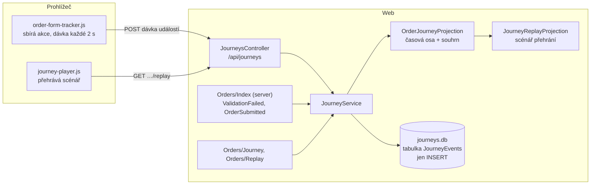

> **V jedné větě:** Journeys zapisuje každou akci uživatele ve formuláři objednávky (otevření, psaní, kliky,
> chyby) jako neměnný **proud událostí** a z něj kdykoli spočítá průběh nebo „videozáznam“ k přehrání.

## Komponentní diagram

## Komponenty

| Komponenta | K čemu slouží | Kód |
| --- | --- | --- |
| **order-form-tracker.js** | V prohlížeči zachytí akce ve formuláři a posílá je dávkově; při opuštění stránky přes `sendBeacon`. | [order-form-tracker.js](code:src/MiniShop.Web/wwwroot/js/order-form-tracker.js) |
| **JourneysController** | Přijme dávku (`POST /api/journeys/{id}/events`), vrátí průběh a scénář přehrání. | [JourneysController.cs](code:src/MiniShop.Web/Controllers/JourneysController.cs) |
| **JourneyService** | Zápis je **idempotentní** podle `EventId` – opakovaně poslaná dávka nic nezdvojí. | [JourneyService.cs](code:src/MiniShop.Application/Journeys/JourneyService.cs) |
| **JourneyEvent** | Neměnný záznam jedné akce. Čas = milisekundy od otevření formuláře. | [JourneyEvent.cs](code:src/MiniShop.Domain/Journeys/JourneyEvent.cs) |
| **OrderJourneyProjection** | Projekce „fold“: z proudu složí časovou osu a souhrn (doba vyplňování, opravy, chyby). | [OrderJourneyProjection.cs](code:src/MiniShop.Application/Journeys/OrderJourneyProjection.cs) |
| **JourneyReplayProjection** | Druhá projekce téhož proudu: scénář pro přehrávač, dlouhé pauzy zkrácené na 3 s. | [JourneyReplayProjection.cs](code:src/MiniShop.Application/Journeys/JourneyReplayProjection.cs) |
| **journey-player.js** | Přehraje scénář nad kopií formuláře (`Replay.cshtml`). | [journey-player.js](code:src/MiniShop.Web/wwwroot/js/journey-player.js) |

Typy událostí v proudu (v pořadí, v jakém vznikaly):

{{auto:journey-event-types}}

## Zajímavá rozhodnutí

- **Ordering o Journeys neví.** Spojení proudu s číslem objednávky zapíše až stránka objednávek (událost
  `OrderSubmitted`). Hlídá to test hranic modulů.
- **Sledování nesmí rozbít objednávku.** Když zápis do `journeys.db` selže, objednávka platí dál a chyba jde jen do logu.
- **Bez outboxu a inboxu.** Journeys neposílá zprávy jiným modulům, proto `JourneysDbContext` nedědí ze společného
  `ModuleDbContext`. Idempotenci řeší unikátní `EventId` z prohlížeče.
- **Ukládá se skutečně napsaný text** (pro výuku je to názorné). V reálném e-shopu by se kvůli ochraně osobních
  údajů hodnoty polí maskovaly.

## Dál

- Koncept: [Proud událostí a projekce](../../eda/proud-udalosti.md)
- Krok za krokem: [Průběh formuláře a přehrání](../../toky/prubeh-formulare.md)
