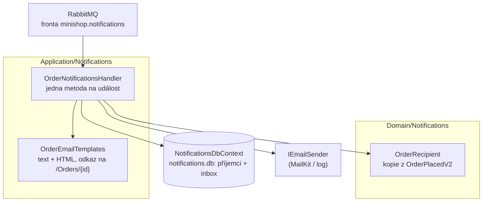

> **V jedné větě:** Notifications poslouchá události objednávky (`OrderPlacedV2`, `OrderConfirmedV1`,
> `OrderRejectedV1`, `OrderShippedV1`, `OrderCompletedV1`, `OrderCancelledV1`) a podle nich píše zákazníkovi.
> Ordering jen oznamuje fakta a o e-mailech neví nic. Běží ve službě **Web**, data má v `notifications.db`.

## Komponentní diagram

## Komponenty

| Komponenta | K čemu slouží | Kód |
| --- | --- | --- |
| **OrderNotificationsHandler** | Odběratel integračních událostí. `OrderPlacedV2` → uloží příjemce a pošle „přijali jsme“; ostatní události → najde příjemce podle čísla objednávky a pošle e-mail. `CustomerAnonymizedV1` → smaže všechny řádky zákazníka. | [OrderNotificationsHandler.cs](code:src/MiniShop.Application/Notifications/OrderNotificationsHandler.cs) |
| **CartReminderHandler** + **CartEmailTemplates** | E-shop krok 10: připomínka opuštěného košíku z `CartAbandonedV1`. Kontakt a souhlas nekopíruje, ptá se přes `ICustomerContacts` (implementace `IdentityCustomerContacts` ve Webu) až při odeslání. | [CartReminderHandler.cs](code:src/MiniShop.Application/Notifications/CartReminderHandler.cs) |
| **OrderEmailTemplates** | Texty e-mailů: prostý text a jednoduché HTML (vše kódované), souhrn položek, číslo zásilky, odkaz na detail. Osobní odběr má vlastní texty. | [OrderEmailTemplates.cs](code:src/MiniShop.Application/Notifications/OrderEmailTemplates.cs) |
| **OrderRecipient** | Komu a o čem psát u jedné objednávky: jméno, e-mail, položky, doprava, adresa – kopie z `OrderPlacedV2`. | [OrderRecipient.cs](code:src/MiniShop.Domain/Notifications/OrderRecipient.cs) |
| **NotificationsDbContext** | `notifications.db`: tabulky `OrderRecipients`, `OrderRecipientItems` a inbox. Outbox má (dědí z `ModuleDbContext`), ale nepoužívá – modul nic neposílá. | [NotificationsDbContext.cs](code:src/MiniShop.Infrastructure/Notifications/NotificationsDbContext.cs) |
| **NotificationSettings** | Veřejná adresa webu pro odkazy (`Notifications:PublicBaseUrl`; produkce `PUBLIC_BASE_URL` v `production.env`). Handler běží za frontou, ne v HTTP požadavku – adresu webu sám nezná. | [NotificationSettings.cs](code:src/MiniShop.Application/Notifications/NotificationSettings.cs) |

## Jaké zprávy modul přijímá

| Zpráva | E-mail |
| --- | --- |
| `OrderPlacedV2` | „Objednávku jsme přijali“ + souhrn (zároveň uloží příjemce) |
| `OrderConfirmedV1` | „Objednávka je potvrzená“ + souhrn |
| `OrderRejectedV1` | „Objednávku nelze vyřídit“ + důvod |
| `OrderShippedV1` | „Je na cestě“ s dopravcem a číslem zásilky (osobní odběr: „připravená k vyzvednutí“) |
| `OrderCompletedV1` | „Doručená“ (osobní odběr: „vyzvednutá“) |
| `OrderCancelledV1` | „Zrušená“ |
| `CustomerAnonymizedV1` | žádný – smaže jméno, e-mail, adresu a souhrny zákazníka |
| `PaymentRefundedV1` | „Platbu vracíme“ – pozdní platba nebo zrušená zaplacená objednávka (e-shop krok 8 a 9, zprávu posílá modul Payments) |
| `ReturnRequestedV1`, `ReturnRejectedV1`, `ReturnCompletedV1` | E-shop krok 12: „pošlete nám zboží do …“, „vrácení nebylo přijato“ (důvod), „objednávka je vrácená“ (kartou / převodem) – viz [Vrácení zboží](../../toky/vraceni-zbozi.md) |
| `CartAbandonedV1` | „Ve vašem košíku zůstalo zboží“ – jen se souhlasem a potvrzeným e-mailem, které `CartReminderHandler` ověří přes `ICustomerContacts` až při odeslání (e-shop krok 10, [opuštěný košík](../../toky/opusteny-kosik.md)) |

Neposílá nic. Ordering o modulu neví – hlídají to
[ModuleBoundariesTests](code:tests/MiniShop.Tests/Architecture/ModuleBoundariesTests.cs) (včetně pravidla, že Ordering
nepoužívá `IEmailSender`).

## Proč samostatný modul

- **Pub/sub:** nový kanál (SMS, push) = nový odběratel stejných událostí. Ordering se nemění (princip
  otevřeno/uzavřeno na úrovni architektury).
- **Výpadek e-mailu nebrzdí objednávky.** Když SMTP nejde, opakuje se jen doručení zprávy do Notifications;
  sága i sklad běží dál.
- **Kopie dat místo „tlustých“ zpráv:** osobní údaje přijdou jednou (`OrderPlacedV2`), další události nesou hlavně
  číslo objednávky. Daní za to je povinnost **zapomenout** – proto `CustomerAnonymizedV1`.

## Na co si dát pozor

- **Pořadí zpráv není zaručené.** Když potvrzení dorazí dřív než vznik, příjemce ještě neznáme – handler vyhodí
  výjimku a zpráva přijde znovu (RabbitMQ za 2 s). Nejvýš 5 minut; pak to vzdá (objednávka starší než modul).
- **Objednávky starší než e-shop krok 7** v `notifications.db` nejsou. Odeslání, doručení a zrušení nesou e-mail
  přímo ve zprávě – pošle se kratší e-mail bez jména a souhrnu.
- **Každá zpráva = nejvýš jeden e-mail** díky inboxu; pád mezi odesláním a zápisem do inboxu = e-mail podruhé
  (at-least-once, stejné jako dřív).
- Zálohuje se (`backup.py`, `notifications.db`) – obsahuje osobní údaje, zálohy mizí po 7 dnech.

## Dál

- [E-maily](../emaily.md) – odesílání přes SMTP, Mailpit, Gmail
- [Expedice](../../toky/expedice.md) – odkud se bere `OrderShippedV1`
