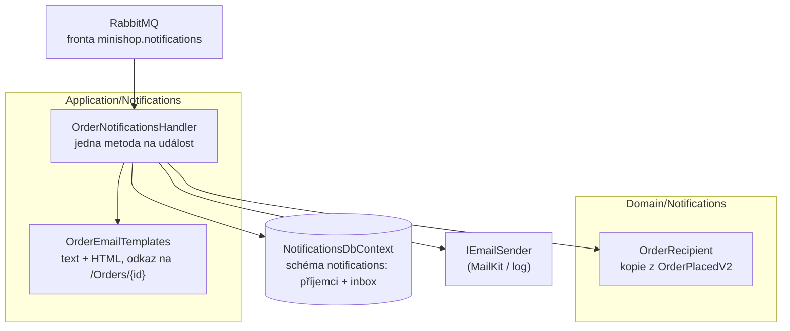
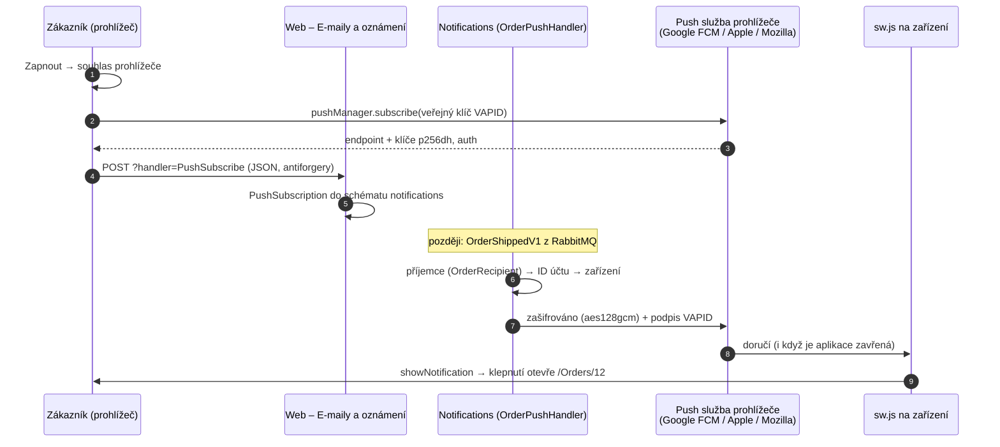
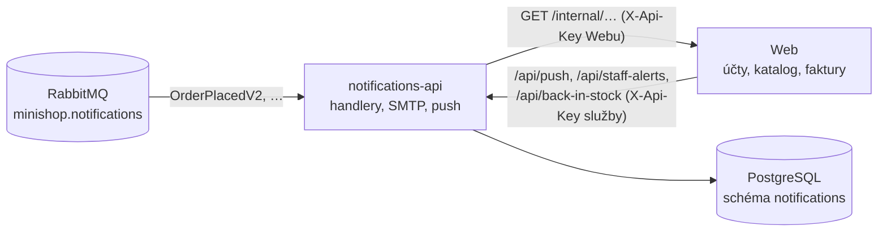

> **V jedné větě:** Notifications poslouchá události objednávky (`OrderPlacedV2`, `OrderConfirmedV1`,
> `OrderRejectedV1`, `OrderShippedV1`, `OrderCompletedV1`, `OrderCancelledV1`) a podle nich píše zákazníkovi.
> Ordering jen oznamuje fakta a o e-mailech neví nic. Od mikroservis M2C běží jako **samostatná služba
> `MiniShop.Notifications.Api`** (kontejner `notifications-api`), data má ve schématu `notifications`.

## Komponentní diagram

## Komponenty

| Komponenta | K čemu slouží | Kód |
| --- | --- | --- |
| **OrderNotificationsHandler** | Odběratel integračních událostí. `OrderPlacedV2` → uloží příjemce a pošle „přijali jsme“; ostatní události → najde příjemce podle čísla objednávky a pošle e-mail. `CustomerAnonymizedV1` → smaže všechny řádky zákazníka. | [OrderNotificationsHandler.cs](code:src/MiniShop.Application/Notifications/OrderNotificationsHandler.cs) |
| **CartReminderHandler** + **CartEmailTemplates** | E-shop krok 10: připomínka opuštěného košíku z `CartAbandonedV1`. Kontakt a souhlas nekopíruje, ptá se přes `ICustomerContacts` (implementace `IdentityCustomerContacts` ve Webu) až při odeslání. | [CartReminderHandler.cs](code:src/MiniShop.Application/Notifications/CartReminderHandler.cs) |
| **BackInStockService** + **BackInStockHandler** + **BackInStockEmailTemplates** | E-shop krok 18: „Dejte mi vědět“. Zákazník u vyprodaného produktu (`/Shop/{id}`) založí lísteček `BackInStockSubscription`; po `StockAvailabilityChangedV1` (Skladem / Poslední kusy) handler pošle jeden e-mail a lísteček smaže. Potvrzený e-mail se ověřuje přes `ICustomerContacts` až při odeslání; smazání účtu lísteček zapomene. | [BackInStockHandler.cs](code:src/MiniShop.Application/Notifications/BackInStockHandler.cs) |
| **InvoiceEmailHandler** | E-shop krok 15: e-mail s fakturou v příloze z `InvoiceIssuedV1`, od kroku 15B i s dobropisem z `CreditNoteIssuedV1`. Příjemce z kopie `OrderPlacedV2`, PDF přes `IInvoiceDocuments` (Notifications modul Invoicing neznají). | [InvoiceEmailHandler.cs](code:src/MiniShop.Application/Notifications/InvoiceEmailHandler.cs) |
| **OrderEmailTemplates** | Texty e-mailů: prostý text a jednoduché HTML (vše kódované), souhrn položek, číslo zásilky, odkaz na detail. Osobní odběr má vlastní texty. | [OrderEmailTemplates.cs](code:src/MiniShop.Application/Notifications/OrderEmailTemplates.cs) |
| **OrderRecipient** | Komu a o čem psát u jedné objednávky: jméno, e-mail, položky, doprava, adresa – kopie z `OrderPlacedV2`. | [OrderRecipient.cs](code:src/MiniShop.Domain/Notifications/OrderRecipient.cs) |
| **NotificationsDbContext** | schéma `notifications`: tabulky `OrderRecipients`, `OrderRecipientItems`, `BackInStockSubscriptions`, `PushSubscriptions` (e-shop krok 23) a inbox. Outbox má (dědí z `ModuleDbContext`), ale nepoužívá – modul nic neposílá. | [NotificationsDbContext.cs](code:src/MiniShop.Infrastructure/Notifications/NotificationsDbContext.cs) |
| **NotificationSettings** | Veřejná adresa webu pro odkazy (`Notifications:PublicBaseUrl`; produkce `PUBLIC_BASE_URL` v `production.env`). Handler běží za frontou, ne v HTTP požadavku – adresu webu sám nezná. | [NotificationSettings.cs](code:src/MiniShop.Application/Notifications/NotificationSettings.cs) |

## Jaké zprávy modul přijímá

| Zpráva | E-mail |
| --- | --- |
| `OrderPlacedV2` | „Objednávku jsme přijali“ + souhrn (zároveň uloží příjemce) |
| `OrderConfirmedV1` | „Objednávka je potvrzená“ + souhrn |
| `OrderRejectedV1` | „Objednávku nelze vyřídit“ + důvod |
| `OrderShippedV1` | „Je na cestě“ s dopravcem a číslem zásilky (osobní odběr: „připravená k vyzvednutí“) |
| `OrderCompletedV1` | „Doručená“ (osobní odběr: „vyzvednutá“) |
| `OrderCancelledV1` | „Zrušená“ |
| `CustomerAnonymizedV1` | žádný – smaže jméno, e-mail, adresu a souhrny zákazníka |
| `PaymentRefundedV1` | „Platbu vracíme“ – pozdní platba nebo zrušená zaplacená objednávka (e-shop krok 8 a 9, zprávu posílá modul Payments) |
| `ReturnRequestedV1`, `ReturnRejectedV1`, `ReturnCompletedV1` | E-shop krok 12: „pošlete nám zboží do …“, „vrácení nebylo přijato“ (důvod), „objednávka je vrácená“ (kartou / převodem) – viz [Vrácení zboží](../../toky/vraceni-zbozi.md) |
| `ReturnRequestedV2`, `ReturnRejectedV2`, `ReturnCompletedV2` | E-shop krok 22: totéž pro vratku po částech – „Vratka 2 k objednávce …“, se seznamem vracených položek a částkou (`ReturnItemV1`) |
| `CartAbandonedV1` | „Ve vašem košíku zůstalo zboží“ – jen se souhlasem a potvrzeným e-mailem, které `CartReminderHandler` ověří přes `ICustomerContacts` až při odeslání (e-shop krok 10, [opuštěný košík](../../toky/opusteny-kosik.md)) |
| `StockAvailabilityChangedV1` | E-shop krok 18: „Produkt je zase skladem“ – jen přihlášeným na lísteček „Dejte mi vědět“ a jen jednou (lísteček se po odeslání smaže); přechod na „Vyprodáno“ nic neposílá. E-shop krok 23: k e-mailu i oznámení push |
| `InvoiceIssuedV1` | E-shop krok 15: „Faktura … k objednávce č. …“ s **PDF v příloze** – PDF si `InvoiceEmailHandler` vezme přes `IInvoiceDocuments` (implementace `InvoiceDocuments` ve Webu nad modulem [Invoicing](invoicing.md)), PDF tak nejde přes RabbitMQ ([Vystavení faktury](../../toky/faktura.md)) |
| `CreditNoteIssuedV1` | E-shop krok 15B: „Dobropis … k objednávce č. …“ s **PDF dobropisu v příloze** (stejná cesta jako faktura, `IInvoiceDocuments.GetCreditNoteAsync`) |

Neposílá nic. Ordering o modulu neví – hlídají to
[ModuleBoundariesTests](code:tests/MiniShop.Tests/Architecture/ModuleBoundariesTests.cs) (včetně pravidla, že Ordering
nepoužívá `IEmailSender`).

## Oznámení push (e-shop krok 23)

Druhý kanál vedle e-mailu: krátké oznámení na telefon nebo počítač („Objednávka č. 12 je na cestě“). Je to přesně to,
co slibuje pub/sub – **nový odběratel stejných událostí**, Ordering ani kontrakty se nezměnily.

| Komponenta | K čemu | Kód |
| --- | --- | --- |
| **PushSubscription** | zařízení zákazníka: endpoint (jen https, unikátní), klíče `p256dh` a `auth`, popisek „Android · Chrome“. Endpoint = identifikátor zařízení = osobní údaj – nikdy do logu ani trasy | [PushSubscription.cs](code:src/MiniShop.Domain/Notifications/PushSubscription.cs) |
| **PushSubscriptionService** | zapnout (stejné zařízení podruhé = obnovit klíče, převezme ho přihlášený účet), vypnout, odebrat, seznam; nejvýš 10 zařízení na zákazníka | [PushSubscriptionService.cs](code:src/MiniShop.Application/Notifications/PushSubscriptionService.cs) |
| **OrderPushHandler** + **PushTemplates** | odběratel `OrderConfirmedV1`, `OrderRejectedV1`, `OrderShippedV1`, `OrderCompletedV1`, `OrderCancelledV1`, `ReturnRejectedV1/V2`, `ReturnCompletedV1/V2` – **vlastní handler = vlastní záznam v inboxu**: když push služba selže, zopakuje se jen push, ne e-mail. Texty bez osobních údajů (číslo objednávky, stav, dopravce, částka) | [OrderPushHandler.cs](code:src/MiniShop.Application/Notifications/OrderPushHandler.cs) |
| **PushNotifier** | pošle na všechna zařízení zákazníka; 404/410 („zařízení už neexistuje“) → záznam smaže. `TrySend…` pro „Dejte mi vědět“ (push vedle e-mailu ve stejném handleru – chyba se jen poznamená) | [PushNotifier.cs](code:src/MiniShop.Application/Notifications/PushNotifier.cs) |
| **WebPushSender** + **PushSettings** | knihovna [Lib.Net.Http.WebPush](../../treti-strany/knihovny.md): šifrování a podpis VAPID, TTL 24 h. Bez klíčů `DisabledPushSender` (sekce na stránce se neukáže) | [WebPushSender.cs](code:src/MiniShop.Infrastructure/Notifications/WebPushSender.cs) |
| **push.js** + **sw.js** | zapnutí/vypnutí v prohlížeči; service worker ukáže oznámení (`push`) a klepnutím otevře stránku MiniShopu (`notificationclick`, cizí adresu ne) | [push.js](code:src/MiniShop.Web/wwwroot/js/push.js), [sw.js](code:src/MiniShop.Web/wwwroot/sw.js) |

- **Klíče VAPID:** `dotnet run --project src/MiniShop.Web -- generate-vapid-keys`
  ([GenerateVapidKeysCommand](code:src/MiniShop.Web/Notifications/GenerateVapidKeysCommand.cs)). Veřejný `PUSH_VAPID_PUBLIC_KEY`
  v `deploy/production.env`, soukromý secret `PUSH_VAPID_PRIVATE_KEY` ([secrets](../../github/secrets.md)). Výměna klíčů =
  zákazníci si oznámení musí zapnout znovu. Jen jeden klíč nebo špatný tvar = Web se nespustí.
- **Stránka** `/Account/EmailPreferences` (*E-maily a oznámení*, jen zákazník): stav na tomto zařízení, seznam zařízení,
  **Poslat zkušební oznámení** (ověření bez objednávky).
- **iPhone/iPad:** push jen v aplikaci přidané na plochu (iOS 16.4+) – stránka to v Safari řekne. Android a počítač i v prohlížeči.
- **Soukromí:** endpoint ani obsah do logu; HTTP span na push službu má `url.full` zkrácenou na jméno serveru
  ([PushServiceHosts](code:src/MiniShop.ServiceDefaults/PushServiceHosts.cs)). Smazání účtu zařízení smaže (`CustomerAnonymizedV1`).
- **Spolehlivost:** best effort – push služba drží zprávu nejvýš 24 h; e-maily se nezměnily. Stejný `tag` oznámení
  nahradí předchozí, takže opakované doručení zákazník neuvidí dvakrát.
### Oznámení k práci pro zaměstnance (e-shop krok 24)

| Typ (`StaffAlertKind`) | Událost | Komu (role) | Oznámení → klepnutí |
| --- | --- | --- | --- |
| `NewOrder` | `OrderConfirmedV1` | Sklad a expedice | „Nová objednávka č. 12 k zabalení“ → `/Admin/Fulfilment` |
| `ReturnRequested` | `ReturnRequestedV1/V2` | Zákaznická podpora | „Žádost o vratku k objednávce č. 12“ → `/Admin/Returns` |
| `OutOfStock` | `StockAvailabilityChangedV1` (Vyprodáno) | Sklad a expedice, Správa sortimentu | „Došlo zboží: Bezdrátová myš je vyprodaný.“ → `/Products` |

- **Opt-in po typech:** zaměstnanec si na stránce *E-maily a oznámení* (od kroku 24 pro každého přihlášeného; připomínka
  košíku jen zákazník) zaškrtne, co chce – výchozí nic. Volba = `StaffAlertSubscription` (tabulka `StaffAlertSubscriptions`,
  typ jako text), zapnout jde jen typy, ke kterým má roli.
- **Role ověřuje Web při odeslání:** Notifications role ani účty nezná – `IStaffDirectory` (implementace
  [IdentityStaffDirectory](code:src/MiniShop.Web/Notifications/StaffAlerts.cs) nad Identity, přiřazení typ → role
  v `StaffAlertRoles`) vrátí jen účty, které roli TEĎ mají a nejsou zablokované. Odebraná role = žádné oznámení.
- **Název produktu** u „Došlo zboží“ přes most `IProductNames` (Web nad kopií katalogu – zpráva nese jen ID).
- **Vlastní handler** [StaffPushHandler](code:src/MiniShop.Application/Notifications/StaffPushHandler.cs) – vlastní inbox;
  odesílá přes `PushNotifier` (úklid zařízení po 404/410). Bez osobních údajů zákazníků.
- **Nový typ** = hodnota na konec `StaffAlertKind` + šablona v `PushTemplates` + `HandleAsync` ve `StaffPushHandler` +
  řádek v `StaffAlertRoles` (role, popisek) + registrace v `AddStaffPushHandlers`.

## Samostatná služba (mikroservisy M2C)

- **Zprávy** přijímá jen služba (fronta `minishop.notifications`); e-maily posílá přes SMTP, oznámení push podepisuje
  soukromým klíčem VAPID (Web zná jen veřejný klíč pro `push.js`).
- **Stránky Webu** (*E-maily a oznámení*, „Dejte mi vědět“ na `/Shop/{id}`) volají API služby přes
  [NotificationsApiClient](code:src/MiniShop.Web/Notifications/NotificationsApiClient.cs) se servisním klíčem `NOTIFICATIONS_API_KEY`;
  kdo je přihlášený a jakou má roli, ověřuje Web a službě pošle jen ID účtu (a u oznámení k práci povolené typy).
- **Výpadek služby** nezastaví nákup: e-maily počkají ve frontě, stránky ukážou „služba oznámení neodpovídá“
  (připomínka košíku – nastavení účtu ve Webu – jde dál). Zprávy služby ukáže `/Admin/Messages` (M2B).
- **Výpadek Webu** zdrží e-maily, které potřebují kontakt nebo PDF: consumer zkusí zprávu 5×, pak ji odloží do
  `minishop.notifications.dead` → *Správa → Zprávy → Vrátit do fronty*.
- **Přechod bez odstávky** jako u přehledu tržeb: `deploy.sh` spustí službu před Webem, stejná fronta a společný inbox.
- Kód: [Program.cs](code:src/MiniShop.Notifications.Api/Program.cs), [NotificationsModule.cs](code:src/MiniShop.Notifications.Api/NotificationsModule.cs),
  [PushController](code:src/MiniShop.Notifications.Api/Controllers/PushController.cs), [StaffAlertsController](code:src/MiniShop.Notifications.Api/Controllers/StaffAlertsController.cs),
  [BackInStockController](code:src/MiniShop.Notifications.Api/Controllers/BackInStockController.cs).

## Závislosti na Webu a interní API (mikroservisy M2A)

Notifications za běhu potřebuje data modulů, které běží ve Webu – přes čtyři rozhraní, která implementuje Web:

| Rozhraní | K čemu | Implementace ve Webu | Služba volá (od M2C) |
| --- | --- | --- | --- |
| `ICustomerContacts` | potvrzený e-mail a souhlas při odeslání (připomínka košíku, „Dejte mi vědět“) | `IdentityCustomerContacts` | `GET /internal/customers/{id}/contact` |
| `IStaffDirectory` | kdo z přihlášených k oznámení k práci má roli a není zablokovaný | `IdentityStaffDirectory` | `POST /internal/staff/allowed` |
| `IProductNames` | název produktu do „Došlo zboží“ | `CatalogProductNames` | `GET /internal/products/{id}/name` |
| `IInvoiceDocuments` | PDF faktury a dobropisu do přílohy | `InvoiceDocuments` | `GET /internal/orders/{id}/invoice`, `…/credit-notes/{číslo}` |

- **Interní API** ([InternalController](code:src/MiniShop.Web/Controllers/InternalController.cs)) jen volá tytéž implementace – žádná
  nová logika. Pustí **jen servisní klíč** `WEB_INTERNAL_API_KEY` ([InternalApi](code:src/MiniShop.Web/Internal/InternalApi.cs) –
  druhé schéma ověření vedle cookie; cookie ani admina tu neplatí a klíč neotevře stránky). Z internetu ho Caddy
  zavře (404) – [HTTPS a přístup](../../nasazeni/https-a-pristup.md).
- **Klient služby** [WebInternalApiClient](code:src/MiniShop.Infrastructure/Notifications/WebInternalApiClient.cs) implementuje
  všechna čtyři rozhraní: 404 = `null` (jako v procesu), jiná chyba = výjimka → zpráva se zopakuje a nakonec skončí
  v dead-letter frontě (e-mail se neztratí). Shodu s implementacemi v procesu hlídá test kontraktu `InternalApiTests`.
- **Proč dotaz a ne kopie ze zpráv:** osobní údaje (e-mail, souhlas) zůstanou jen v Accounts a platí v okamžiku
  odeslání. Cena: když Web dlouho neběží, e-mail počká ([Mikroservisy-roadmap](code:docs/Mikroservisy-roadmap.md)).

## Proč samostatný modul

- **Pub/sub:** nový kanál (SMS, push) = nový odběratel stejných událostí. Ordering se nemění (princip
  otevřeno/uzavřeno na úrovni architektury).
- **Výpadek e-mailu nebrzdí objednávky.** Když SMTP nejde, opakuje se jen doručení zprávy do Notifications;
  sága i sklad běží dál.
- **Kopie dat místo „tlustých“ zpráv:** osobní údaje přijdou jednou (`OrderPlacedV2`), další události nesou hlavně
  číslo objednávky. Daní za to je povinnost **zapomenout** – proto `CustomerAnonymizedV1`.

## Na co si dát pozor

- **Pořadí zpráv není zaručené.** Když potvrzení dorazí dřív než vznik, příjemce ještě neznáme – handler vyhodí
  výjimku a zpráva přijde znovu (RabbitMQ za 2 s). Nejvýš 5 minut; pak to vzdá (objednávka starší než modul).
- **Objednávky starší než e-shop krok 7** ve schématu `notifications` nejsou. Odeslání, doručení a zrušení nesou e-mail
  přímo ve zprávě – pošle se kratší e-mail bez jména a souhrnu.
- **Každá zpráva = nejvýš jeden e-mail** díky inboxu; pád mezi odesláním a zápisem do inboxu = e-mail podruhé
  (at-least-once, stejné jako dřív).
- Zálohuje se (`backup.py`, schéma `notifications`) – obsahuje osobní údaje, zálohy mizí po 7 dnech.

## Dál

- [E-maily](../emaily.md) – odesílání přes SMTP, Mailpit, Gmail
- [Expedice](../../toky/expedice.md) – odkud se bere `OrderShippedV1`
