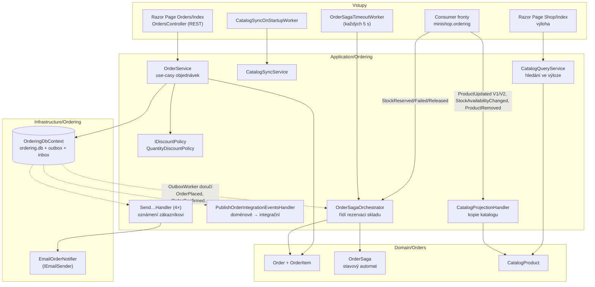

> **V jedné větě:** Ordering přijímá objednávky, řídí jejich životní cyklus (přes [ságu](../../eda/saga.md)) a zná
> produkty jen ze své [kopie katalogu](../../eda/kopie-katalogu.md). Běží ve službě **Web**, data má v `ordering.db`.

## Komponentní diagram

Plné šipky = přímé volání v rámci jednoho požadavku. Čárkované = **doručení události přes outbox** – o chvilku
později, v jiném scope, případně i opakovaně.

## Komponenty

| Komponenta | K čemu slouží | Kód |
| --- | --- | --- |
| **OrderService** | Use-casy: založit, vyřídit, zrušit objednávku, číst katalog. O skladu ani notifikacích neví – jen uloží objednávku a ta vyvolá událost. | [OrderService.cs](code:src/MiniShop.Application/Ordering/OrderService.cs) |
| **Order** | Entita s business pravidly (potvrdit jde jen čekající objednávku…). Každá změna stavu vyvolá [doménovou událost](../../eda/domenove-udalosti.md). Patří zákazníkovi (`CustomerId`), jméno a e-mail jsou kopie z doby objednání. | [Order.cs](code:src/MiniShop.Domain/Orders/Order.cs) |
| **OrderAccess**, **OrderCustomer** | Kdo se ptá (zákazník = jen své objednávky, správce = všechny) a kdo objednává. `OrderService` je dostává parametrem – o přihlášení neví; z cookie je skládá Web. | [OrderAccess.cs](code:src/MiniShop.Application/Ordering/OrderAccess.cs), [OrderAccessExtensions.cs](code:src/MiniShop.Web/Accounts/OrderAccessExtensions.cs) |
| **OrderSagaOrchestrator** | „Dirigent“: na `OrderPlaced` založí ságu a pošle `ReserveStockV1`; na odpověď skladu objednávku potvrdí/zamítne; na zrušení pošle `ReleaseStockV1`. | [OrderSagaOrchestrator.cs](code:src/MiniShop.Application/Ordering/Saga/OrderSagaOrchestrator.cs) |
| **OrderSaga** | Stavový automat ságy – jen rozhoduje, co dál, nic neprovádí. | [OrderSaga.cs](code:src/MiniShop.Domain/Orders/Saga/OrderSaga.cs) |
| **PublishOrderIntegrationEventsHandler** | Překladač: z interních událostí vyrobí veřejné `OrderPlacedV1`, `OrderCompletedV1`, `OrderCancelledV1`. | [PublishOrderIntegrationEventsHandler.cs](code:src/MiniShop.Application/Ordering/IntegrationEvents/PublishOrderIntegrationEventsHandler.cs) |
| **Send…Handler** | Čtyři malé handlery: potvrzení, omluva při zamítnutí, vyřízení, zrušení. Volají `IOrderNotifier`. | [EventHandlers/](code:src/MiniShop.Application/Ordering/EventHandlers/) |
| **EmailOrderNotifier** | E-mail zákazníkovi při potvrzení, zamítnutí, vyřízení a zrušení (účty krok 5). Odesílá se z handlerů za outboxem – když SMTP nejde, opakuje se. Viz [E-maily](../emaily.md). | [EmailOrderNotifier.cs](code:src/MiniShop.Infrastructure/Ordering/EmailOrderNotifier.cs) |
| **CatalogProjectionHandler** | Udržuje kopii katalogu z `ProductUpdatedV1`/`V2`, `StockAvailabilityChangedV1` a `ProductRemovedV1`. | [CatalogProjectionHandler.cs](code:src/MiniShop.Application/Ordering/Catalog/CatalogProjectionHandler.cs) |
| **CatalogSyncService** | Požádá sklad o celý katalog (`SyncCatalogV1`) – po startu s prázdnou nebo neúplnou kopií, nebo tlačítkem. | [CatalogSyncService.cs](code:src/MiniShop.Application/Ordering/Catalog/CatalogSyncService.cs) |
| **CatalogQueryService** | E-shop krok 2: výloha `/Shop` – hledání bez diakritiky (`SearchText`), filtr kategorie a „jen skladem“, řazení, stránkování. Čte jen kopii katalogu. | [CatalogQueryService.cs](code:src/MiniShop.Application/Ordering/Catalog/CatalogQueryService.cs), [Shop/Index.cshtml.cs](code:src/MiniShop.Web/Pages/Shop/Index.cshtml.cs) |
| **QuantityDiscountPolicy** | Množstevní sleva (od 10 ks 10 %). Další pravidlo = nová třída, `OrderService` se nemění. | [QuantityDiscountPolicy.cs](code:src/MiniShop.Application/Ordering/Pricing/QuantityDiscountPolicy.cs) |
| **OrderSagaTimeoutWorker** | Každých 5 s hledá ságy, na které sklad neodpověděl včas (výchozí 30 s). | [OrderSagaTimeoutWorker.cs](code:src/MiniShop.Web/BackgroundServices/OrderSagaTimeoutWorker.cs) |
| **OrderingDbContext** | `ordering.db`: objednávky, ságy, kopie katalogu, outbox, inbox. | [OrderingDbContext.cs](code:src/MiniShop.Infrastructure/Ordering/OrderingDbContext.cs) |

## Jaké zprávy modul posílá a přijímá

| Směr | Zprávy |
| --- | --- |
| posílá (příkazy skladu) | `ReserveStockV1`, `ReleaseStockV1`, `SyncCatalogV1` |
| posílá (události pro kohokoli) | `OrderPlacedV1`, `OrderCompletedV1`, `OrderCancelledV1` |
| přijímá (fronta `minishop.ordering`) | `StockReservedV1`, `StockReservationFailedV1`, `StockReleasedV1`, `ProductUpdatedV1`, `ProductUpdatedV2`, `StockAvailabilityChangedV1`, `ProductRemovedV1` |

## Rozhraní navenek

- UI: **výloha** (`/Shop`, veřejná – e-shop krok 2; tlačítko Objednat vede na `/Orders?productId=…`; obrázky
  ze skladu přes `/media/products/{soubor}` – krok 2B),
  stránka **Objednávky** (`/Orders`), detail průběhu (`/Orders/Journey/{id}`), přehrání (`/Orders/Replay/{id}`).
- REST: `GET/POST /api/orders`, `POST /api/orders/{id}/complete`, `POST /api/orders/{id}/cancel`.
  `POST` vrací **202 Accepted** – objednávka je přijatá, ale o potvrzení teprve rozhodne sága.
- **Vlastník (účty krok 3):** zákazník vidí a ruší jen své objednávky – seznam se filtruje přímo v SQL dotazu
  (`WHERE CustomerId = …`), cizí objednávka vrací **404** stejně jako neexistující (ochrana proti IDOR – zkoušení
  cizích čísel v adrese). Správce vidí všechny. Jméno a e-mail se nepíšou do formuláře, bere je server z účtu.
  Modul Accounts Ordering nezná – jen ID zákazníka (hlídá test hranic modulů). Viz [Accounts](accounts.md).
- **Smazaný zákazník (účty krok 9):** `AnonymizeCustomerAsync` – objednávky smazaného účtu přijdou o jméno a e-mail
  (`Order.Anonymize`, jméno „Smazaný zákazník“), položky a ceny zůstanou. S nevyřízenou objednávkou (Pending,
  Confirmed) se nezmění nic. Volá ho jen Web před smazáním účtu; `EmailOrderNotifier` na prázdnou adresu nepíše.

## Dál

- Krok za krokem: [Vytvoření objednávky](../../toky/vytvoreni-objednavky.md), [Zrušení a vyřízení](../../toky/zruseni-a-vyrizeni.md)
- Stavy objednávky a ságy: [Stavové diagramy](../stavove-diagramy.md)
