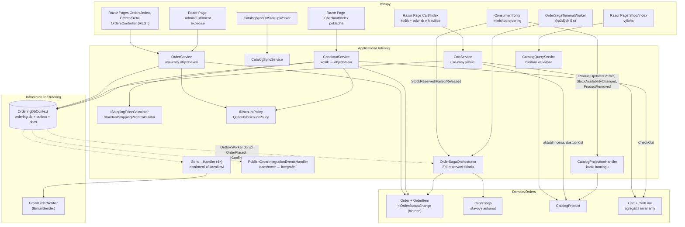

> **V jedné větě:** Ordering přijímá objednávky, řídí jejich životní cyklus (přes [ságu](../../eda/saga.md)) a zná
> produkty jen ze své [kopie katalogu](../../eda/kopie-katalogu.md). Běží ve službě **Web**, data má v `ordering.db`.

## Komponentní diagram

Plné šipky = přímé volání v rámci jednoho požadavku. Čárkované = **doručení události přes outbox** – o chvilku
později, v jiném scope, případně i opakovaně.

## Komponenty

| Komponenta | K čemu slouží | Kód |
| --- | --- | --- |
| **OrderService** | Use-casy: založit, zrušit objednávku, expedice (balit, odeslat, doručeno – e-shop krok 6), číst katalog. O skladu ani notifikacích neví – jen uloží objednávku a ta vyvolá událost. | [OrderService.cs](code:src/MiniShop.Application/Ordering/OrderService.cs) |
| **Order** | Entita s business pravidly (potvrdit jde jen čekající objednávku…). Každá změna stavu vyvolá [doménovou událost](../../eda/domenove-udalosti.md). Patří zákazníkovi (`CustomerId`), jméno a e-mail jsou kopie z doby objednání. E-shop krok 4: doprava (`ShippingMethod`, `ShippingPrice` – snímek jako ceny položek), doručovací adresa (hodnotový objekt `DeliveryAddress`, jen kurýr) a `CheckoutId` (unikátní – idempotence). `TotalPrice` = položky + doprava. E-shop krok 5: každá změna stavu přidá řádek historie `OrderStatusChange` (stav, čas, u zamítnutí důvod) – viz [Stavové diagramy](../stavove-diagramy.md). E-shop krok 6: expedice `StartPacking` → `Ship(dopravce, číslo zásilky)` → `MarkDelivered`, zrušit jen do odeslání, `Version` = concurrency token proti souběhu (odeslat × zrušit). | [Order.cs](code:src/MiniShop.Domain/Orders/Order.cs), [OrderStatusChange.cs](code:src/MiniShop.Domain/Orders/OrderStatusChange.cs) |
| **OrderAccess**, **OrderCustomer** | Kdo se ptá (zákazník = jen své objednávky, správce = všechny) a kdo objednává. `OrderService` je dostává parametrem – o přihlášení neví; z cookie je skládá Web. | [OrderAccess.cs](code:src/MiniShop.Application/Ordering/OrderAccess.cs), [OrderAccessExtensions.cs](code:src/MiniShop.Web/Accounts/OrderAccessExtensions.cs) |
| **OrderSagaOrchestrator** | „Dirigent“: na `OrderPlaced` založí ságu a pošle `ReserveStockV1`; na odpověď skladu objednávku potvrdí/zamítne; na zrušení pošle `ReleaseStockV1`. | [OrderSagaOrchestrator.cs](code:src/MiniShop.Application/Ordering/Saga/OrderSagaOrchestrator.cs) |
| **OrderSaga** | Stavový automat ságy – jen rozhoduje, co dál, nic neprovádí. | [OrderSaga.cs](code:src/MiniShop.Domain/Orders/Saga/OrderSaga.cs) |
| **PublishOrderIntegrationEventsHandler** | Překladač: z interních událostí vyrobí veřejné `OrderPlacedV1`, `OrderShippedV1`, `OrderCompletedV1`, `OrderCancelledV1`. | [PublishOrderIntegrationEventsHandler.cs](code:src/MiniShop.Application/Ordering/IntegrationEvents/PublishOrderIntegrationEventsHandler.cs) |
| **Send…Handler** | Malé handlery: potvrzení, omluva při zamítnutí, odeslání s číslem zásilky (e-shop krok 6), doručení, zrušení. Volají `IOrderNotifier`. | [EventHandlers/](code:src/MiniShop.Application/Ordering/EventHandlers/) |
| **EmailOrderNotifier** | E-mail zákazníkovi při potvrzení, zamítnutí, vyřízení a zrušení (účty krok 5). Odesílá se z handlerů za outboxem – když SMTP nejde, opakuje se. Viz [E-maily](../emaily.md). | [EmailOrderNotifier.cs](code:src/MiniShop.Infrastructure/Ordering/EmailOrderNotifier.cs) |
| **CatalogProjectionHandler** | Udržuje kopii katalogu z `ProductUpdatedV1`/`V2`, `StockAvailabilityChangedV1` a `ProductRemovedV1`. | [CatalogProjectionHandler.cs](code:src/MiniShop.Application/Ordering/Catalog/CatalogProjectionHandler.cs) |
| **CatalogSyncService** | Požádá sklad o celý katalog (`SyncCatalogV1`) – po startu s prázdnou nebo neúplnou kopií, nebo tlačítkem. | [CatalogSyncService.cs](code:src/MiniShop.Application/Ordering/Catalog/CatalogSyncService.cs) |
| **CatalogQueryService** | E-shop krok 2: výloha `/Shop` – hledání bez diakritiky (`SearchText`), filtr kategorie a „jen skladem“, řazení, stránkování. Čte jen kopii katalogu. | [CatalogQueryService.cs](code:src/MiniShop.Application/Ordering/Catalog/CatalogQueryService.cs), [Shop/Index.cshtml.cs](code:src/MiniShop.Web/Pages/Shop/Index.cshtml.cs) |
| **Cart**, **CartLine** | E-shop krok 3: košík zákazníka – **agregát s invarianty**: nejvýš 20 řádků, množství 1–100, každý produkt jen jednou (další přidání navýší množství), nic vyprodaného ani staženého. Zboží neblokuje a nic neposílá. `PriceWhenAdded` jen pro upozornění na změnu ceny. Jeden košík na zákazníka (unikátní index), doménové události zatím žádné. E-shop krok 4: `CheckoutId` = verze obsahu (nová při každé změně, concurrency token), `CheckOut` ověří verzi, ceny a dostupnost a košík vyprázdní, `AcceptCurrentPrices`. | [Cart.cs](code:src/MiniShop.Domain/Orders/Carts/Cart.cs), [CartLine.cs](code:src/MiniShop.Domain/Orders/Carts/CartLine.cs) |
| **CartService** | Přidat, změnit množství, odebrat, načíst košík s **aktuální** cenou a dostupností z kopie katalogu (vyprodaný řádek zůstane, ale nepočítá se; stažený produkt = „už není v nabídce“). Web z něj kreslí stránku `/Cart` a počet kusů v hlavičce (`CartBadgeViewComponent`). | [CartService.cs](code:src/MiniShop.Application/Ordering/Carts/CartService.cs), [Cart/Index.cshtml.cs](code:src/MiniShop.Web/Pages/Cart/Index.cshtml.cs), [CartBadgeViewComponent.cs](code:src/MiniShop.Web/Carts/CartBadgeViewComponent.cs) |
| **CheckoutService** | E-shop krok 4: pokladna – souhrn (slevy, doprava, předvyplněná adresa), přijetí nových cen, objednání: idempotence přes `CheckoutId`, `Cart.CheckOut`, nová objednávka a vyprázdněný košík v **jedné transakci**; při souběhu vrátí objednávku prvního požadavku. Viz [Pokladna](../../toky/pokladna.md). | [CheckoutService.cs](code:src/MiniShop.Application/Ordering/Checkout/CheckoutService.cs), [Checkout/Index.cshtml.cs](code:src/MiniShop.Web/Pages/Checkout/Index.cshtml.cs) |
| **IShippingPriceCalculator** | E-shop krok 4: cena dopravy jako strategie – `StandardShippingPriceCalculator`: osobní odběr zdarma, kurýr 99 Kč, od 1 000 Kč zdarma. Jiný ceník = nová třída. | [StandardShippingPriceCalculator.cs](code:src/MiniShop.Application/Ordering/Pricing/StandardShippingPriceCalculator.cs) |
| **QuantityDiscountPolicy** | Množstevní sleva (od 10 ks 10 %). Další pravidlo = nová třída, `OrderService` se nemění. | [QuantityDiscountPolicy.cs](code:src/MiniShop.Application/Ordering/Pricing/QuantityDiscountPolicy.cs) |
| **OrderSagaTimeoutWorker** | Každých 5 s hledá ságy, na které sklad neodpověděl včas (výchozí 30 s). | [OrderSagaTimeoutWorker.cs](code:src/MiniShop.Web/BackgroundServices/OrderSagaTimeoutWorker.cs) |
| **OrderingDbContext** | `ordering.db`: objednávky, košíky, ságy, kopie katalogu, outbox, inbox. | [OrderingDbContext.cs](code:src/MiniShop.Infrastructure/Ordering/OrderingDbContext.cs) |

## Jaké zprávy modul posílá a přijímá

| Směr | Zprávy |
| --- | --- |
| posílá (příkazy skladu) | `ReserveStockV1`, `ReleaseStockV1`, `SyncCatalogV1` |
| posílá (události pro kohokoli) | `OrderPlacedV1`, `OrderShippedV1` (e-shop krok 6), `OrderCompletedV1` (= doručeno), `OrderCancelledV1` |
| přijímá (fronta `minishop.ordering`) | `StockReservedV1`, `StockReservationFailedV1`, `StockReleasedV1`, `ProductUpdatedV1`, `ProductUpdatedV2`, `StockAvailabilityChangedV1`, `ProductRemovedV1` |

## Rozhraní navenek

- UI: **výloha** (`/Shop`, veřejná – e-shop krok 2; obrázky ze skladu přes
  `/media/products/{soubor}` – krok 2B; tlačítko **Do košíku** – krok 3, od kroku 4B jediná cesta k objednávce),
  **košík** (`/Cart`, jen zákazník s potvrzeným e-mailem – admin neobjednává), **pokladna** (`/Checkout` – krok 4),
  stránka **Objednávky** (`/Orders` – přehled, od kroku 4B bez formuláře), **detail objednávky** (`/Orders/{id}` –
  krok 5: položky, doprava, adresa a časová osa stavů; zákazník jen svou, cizí = 404; sem vede pokladna po odeslání), průběh zadání; **Expedice** (`/Admin/Fulfilment` – e-shop krok 6, jen admin: fronty K zabalení, K odeslání, Na cestě; viz [Expedice](../../toky/expedice.md)); (`/Orders/Journey/{id}`), přehrání (`/Orders/Replay/{id}`).
- REST: `GET/POST /api/orders` (`POST` s volitelným `checkoutId` – opakovaný požadavek vrátí stejnou objednávku, krok 4), `POST /api/orders/{id}/complete` (od e-shop kroku 6 = doručeno, jen po odeslání), `POST /api/orders/{id}/cancel`.
  `POST` vrací **202 Accepted** – objednávka je přijatá, ale o potvrzení teprve rozhodne sága.
- **Vlastník (účty krok 3):** zákazník vidí a ruší jen své objednávky – seznam se filtruje přímo v SQL dotazu
  (`WHERE CustomerId = …`), cizí objednávka vrací **404** stejně jako neexistující (ochrana proti IDOR – zkoušení
  cizích čísel v adrese). Správce vidí všechny. Jméno a e-mail se nepíšou do formuláře, bere je server z účtu.
  Modul Accounts Ordering nezná – jen ID zákazníka (hlídá test hranic modulů). Viz [Accounts](accounts.md).
- **Smazaný zákazník (účty krok 9):** `AnonymizeCustomerAsync` – objednávky smazaného účtu přijdou o jméno a e-mail
  (`Order.Anonymize`, jméno „Smazaný zákazník“), položky a ceny zůstanou. S nevyřízenou objednávkou (Pending,
  Confirmed) se nezmění nic. Volá ho jen Web před smazáním účtu; `EmailOrderNotifier` na prázdnou adresu nepíše.
  E-shop krok 3: ve stejné transakci smaže i košík zákazníka. E-shop krok 4: smaže i doručovací adresy.

## Proč je košík v Orderingu (a ne ve vlastním modulu)

Košík a objednávka mluví stejným jazykem (produkt, množství, cena) a čtou stejnou kopii katalogu. Hlavně ale
**pokladna** (krok 4) musí najednou založit objednávku a vyprázdnit košík. Ve stejné databázi je to jedna
obyčejná transakce. Kdyby měl košík vlastní modul a DB, potřebovali bychom na tak malou věc ságu. Platí pravidlo:
**hranice modulu má kopírovat hranici konzistence** – co se musí měnit spolu, patří k sobě.

Košík proto nepotřebuje **žádnou novou zprávu**. Neposílá nic ani na sklad, protože zboží neblokuje: rezervace
vzniká až objednávkou. Kdyby košík blokoval zboží, deset lidí s plným košíkem by vyprodalo sklad, aniž by
cokoli koupili.

## Dál

- Krok za krokem: [Vytvoření objednávky](../../toky/vytvoreni-objednavky.md), [Zrušení](../../toky/zruseni-a-vyrizeni.md), [Expedice](../../toky/expedice.md)
- Stavy objednávky a ságy: [Stavové diagramy](../stavove-diagramy.md)
