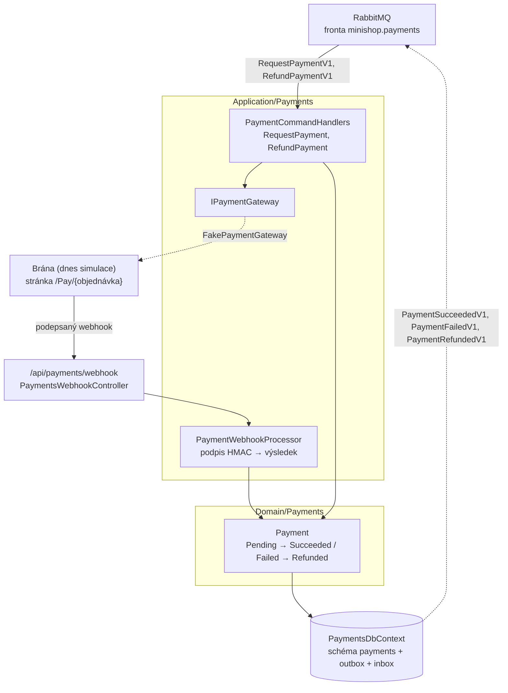

> **V jedné větě:** Payments je druhý **účastník ságy** objednávky. Na příkaz `RequestPaymentV1` založí platbu
> u brány, výsledek z brány přijme **podepsaným webhookem** a oznámí ho událostí `PaymentSucceededV1` /
> `PaymentFailedV1`. Na `RefundPaymentV1` vrátí peníze (pozdní platba, zrušení, od e-shop kroku 12 i vratka – Payments neví proč). Běží ve službě **Web**, data má ve schématu `payments`.

## Komponentní diagram

## Komponenty

| Komponenta | K čemu slouží | Kód |
| --- | --- | --- |
| **Payment** | Stavový automat platby. `Succeed` / `Fail` na stejný výsledek podruhé jen vrátí false (opakovaný webhook nic nezdvojí); `Refund` jen ze zaplacené. Doménové události `PaymentSucceeded`, `PaymentFailed`, `PaymentRefunded` se při uložení rovnou převedou na integrační zprávy. | [Payment.cs](code:src/MiniShop.Domain/Payments/Payment.cs) |
| **PaymentCommandHandlers** | `RequestPaymentV1` → založí platbu (jedna na objednávku, unikátní index) a u brány stránku k zaplacení; `RefundPaymentV1` → vrátí peníze. | [PaymentCommandHandlers.cs](code:src/MiniShop.Application/Payments/PaymentCommandHandlers.cs) |
| **PaymentWebhookProcessor** | Nejdřív **podpis** (HMAC-SHA256 těla sdíleným tajemstvím, porovnání v konstantním čase), pak teprve obsah. Výsledky: přijato (200), špatný podpis (401), nečitelné (400), neznámá platba (404). | [PaymentWebhookProcessor.cs](code:src/MiniShop.Application/Payments/PaymentWebhookProcessor.cs), [WebhookSignature.cs](code:src/MiniShop.Application/Payments/WebhookSignature.cs) |
| **IPaymentGateway** / **FakePaymentGateway** | Rozhraní brány (DIP) a simulace: „založí“ platbu a pošle zákazníka na `/Pay/{objednávka}`. `FakePaymentGatewaySimulator` po kliknutí vyrobí webhook stejně jako skutečná brána (JSON + podpis) a předá ho stejnému zpracování jako HTTP endpoint. | [IPaymentGateway.cs](code:src/MiniShop.Application/Payments/IPaymentGateway.cs), [FakePaymentGateway.cs](code:src/MiniShop.Infrastructure/Payments/FakePaymentGateway.cs) |
| **Stránka brány** | `/Pay/{objednávka}` – jen zákazník a jen svou platbu (cizí = 404); tlačítka Zaplatit / Zamítnout, po termínu „vypršelo“. | [Pay/Index.cshtml.cs](code:src/MiniShop.Web/Pages/Pay/Index.cshtml.cs) |
| **Webhook** | `POST /api/payments/webhook` – `[AllowAnonymous]` (brána nemá účet), chrání ho podpis v hlavičce `X-MiniShop-Signature`. | [PaymentsWebhookController.cs](code:src/MiniShop.Web/Controllers/PaymentsWebhookController.cs) |
| **PaymentsDbContext** | schéma `payments`: tabulka `Payments`, outbox a inbox. | [PaymentsDbContext.cs](code:src/MiniShop.Infrastructure/Payments/PaymentsDbContext.cs) |

## Jaké zprávy modul posílá a přijímá

| Směr | Zprávy |
| --- | --- |
| přijímá (příkazy, fronta `minishop.payments`) | `RequestPaymentV1`, `RefundPaymentV1` |
| posílá (události) | `PaymentSucceededV1`, `PaymentFailedV1` (čte sága), `PaymentRefundedV1` (čtou notifikace) |

## Tajemství webhooku

`Payments:WebhookSecret` (min. 32 znaků) – bez něj se Web **nespustí** (fail fast, jako servisní klíč skladu).
Lokálně ho vygeneruje Aspire (parametr `payments-webhook-secret`), bez Aspire je v `appsettings.Development.json`
Webu, v Compose `PAYMENTS_WEBHOOK_SECRET` v `deploy/.env` (povinné), v produkci secret v GitHubu
([Secrets](../../github/secrets.md)).

## Skutečná brána

Stačí jiná implementace `IPaymentGateway` (např. Stripe v testovacím režimu, sandbox GoPay nebo Comgate):
`CreateAsync` zavolá API brány a vrátí její stránku k zaplacení; brána pak posílá webhooky na
`/api/payments/webhook` podepsané svým tajemstvím. Sága, objednávka ani stránky se nemění. Skutečná brána ale
potřebuje veřejnou adresu (webhook jde z internetu) – lokálně tunel (ngrok apod.).

## Dál

- [Platba kartou](../../toky/platba.md) – celý průběh, timeout a pozdní platba
- [Stavové diagramy](../stavove-diagramy.md) – stavy objednávky a ságy
