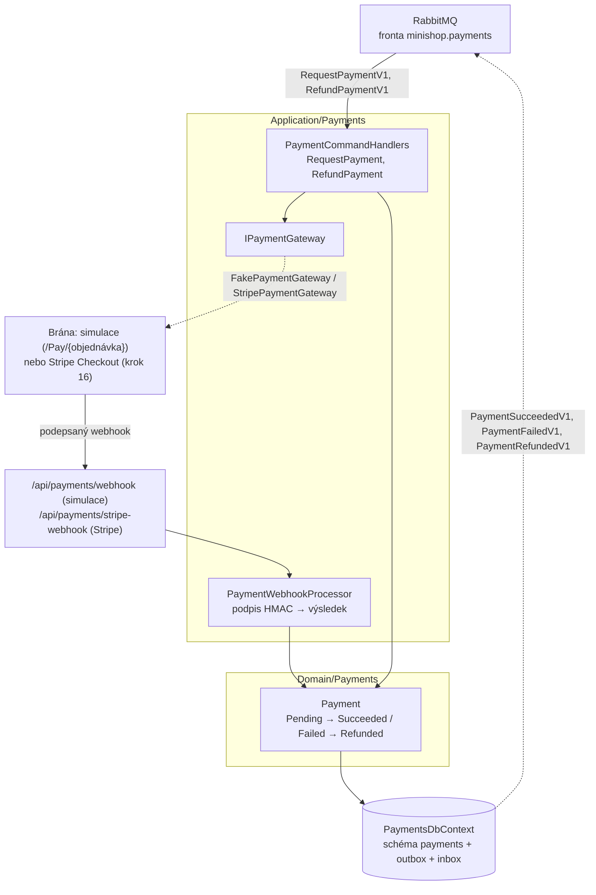
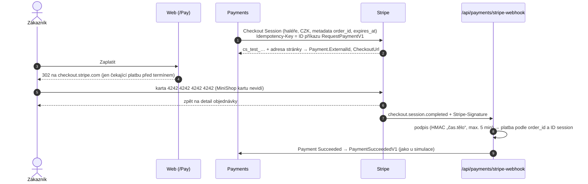

> **V jedné větě:** Payments je druhý **účastník ságy** objednávky. Na příkaz `RequestPaymentV1` založí platbu
> u brány, výsledek z brány přijme **podepsaným webhookem** a oznámí ho událostí `PaymentSucceededV1` /
> `PaymentFailedV1`. Na `RefundPaymentV1` vrátí peníze (pozdní platba, zrušení, od e-shop kroku 12 i vratka – Payments neví proč). Běží ve službě **Web**, data má ve schématu `payments`.

## Komponentní diagram

## Komponenty

| Komponenta | K čemu slouží | Kód |
| --- | --- | --- |
| **Payment** | Stavový automat platby. `Succeed` / `Fail` na stejný výsledek podruhé jen vrátí false (opakovaný webhook nic nezdvojí); `Refund` jen ze zaplacené. Doménové události `PaymentSucceeded`, `PaymentFailed`, `PaymentRefunded` se při uložení rovnou převedou na integrační zprávy. | [Payment.cs](code:src/MiniShop.Domain/Payments/Payment.cs) |
| **PaymentCommandHandlers** | `RequestPaymentV1` → založí platbu (jedna na objednávku, unikátní index) a u brány stránku k zaplacení; `RefundPaymentV1` → vrátí peníze. | [PaymentCommandHandlers.cs](code:src/MiniShop.Application/Payments/PaymentCommandHandlers.cs) |
| **PaymentWebhookProcessor** | Nejdřív **podpis** (HMAC-SHA256 těla sdíleným tajemstvím, porovnání v konstantním čase), pak teprve obsah. Výsledky: přijato (200), špatný podpis (401), nečitelné (400), neznámá platba (404). | [PaymentWebhookProcessor.cs](code:src/MiniShop.Application/Payments/PaymentWebhookProcessor.cs), [WebhookSignature.cs](code:src/MiniShop.Application/Payments/WebhookSignature.cs) |
| **IPaymentGateway** / **FakePaymentGateway** | Rozhraní brány (DIP) a simulace: „založí“ platbu a pošle zákazníka na `/Pay/{objednávka}`. `FakePaymentGatewaySimulator` po kliknutí vyrobí webhook stejně jako skutečná brána (JSON + podpis) a předá ho stejnému zpracování jako HTTP endpoint. | [IPaymentGateway.cs](code:src/MiniShop.Application/Payments/IPaymentGateway.cs), [FakePaymentGateway.cs](code:src/MiniShop.Infrastructure/Payments/FakePaymentGateway.cs) |
| **Stránka brány** | `/Pay/{objednávka}` – jen zákazník a jen svou platbu (cizí = 404); tlačítka Zaplatit / Zamítnout, po termínu „vypršelo“. | [Pay/Index.cshtml.cs](code:src/MiniShop.Web/Pages/Pay/Index.cshtml.cs) |
| **Webhook** | `POST /api/payments/webhook` – `[AllowAnonymous]` (brána nemá účet), chrání ho podpis v hlavičce `X-MiniShop-Signature`. | [PaymentsWebhookController.cs](code:src/MiniShop.Web/Controllers/PaymentsWebhookController.cs) |
| **PaymentsDbContext** | schéma `payments`: tabulka `Payments`, outbox a inbox. | [PaymentsDbContext.cs](code:src/MiniShop.Infrastructure/Payments/PaymentsDbContext.cs) |

## Jaké zprávy modul posílá a přijímá

| Směr | Zprávy |
| --- | --- |
| přijímá (příkazy, fronta `minishop.payments`) | `RequestPaymentV1`, `RefundPaymentV1` |
| posílá (události) | `PaymentSucceededV1`, `PaymentFailedV1` (čte sága), `PaymentRefundedV1` (čtou notifikace) |

## Tajemství webhooku

`Payments:WebhookSecret` (min. 32 znaků) – bez něj se Web **nespustí** (fail fast, jako servisní klíč skladu).
Lokálně ho vygeneruje Aspire (parametr `payments-webhook-secret`), bez Aspire je v `appsettings.Development.json`
Webu, v Compose `PAYMENTS_WEBHOOK_SECRET` v `deploy/.env` (povinné), v produkci secret v GitHubu
([Secrets](../../github/secrets.md)).

## Stripe (e-shop krok 16)

Skutečná platební brána v **testovacím režimu** – jen další implementace `IPaymentGateway` (adaptér). Sága, Ordering,
kontrakty ani stav platby se nezměnily. Zapíná ji `Payments:Gateway=Stripe` (produkce `PAYMENTS_GATEWAY` v
`deploy/production.env`), jinak běží simulace.

| Součást | K čemu | Kód |
| --- | --- | --- |
| **StripePaymentGateway** | Checkout Session (`CreateAsync`) a refund přes PaymentIntent session (`RefundAsync`), obojí s **idempotency key** | [StripePaymentGateway.cs](code:src/MiniShop.Infrastructure/Payments/Stripe/StripePaymentGateway.cs) |
| **StripeWebhookProcessor** | podpis `Stripe-Signature` (`EventUtility.ConstructEvent`), `completed` = zaplaceno, `expired` = nezaplaceno, jiné události 200 bez efektu; výsledek předá `PaymentWebhookProcessor.ApplyResultAsync` | [StripeWebhookProcessor.cs](code:src/MiniShop.Infrastructure/Payments/Stripe/StripeWebhookProcessor.cs) |
| **StripeSettings** | klíče z konfigurace; bez nich nebo s živým klíčem `sk_live_` se Web **nespustí** | [StripeSettings.cs](code:src/MiniShop.Infrastructure/Payments/Stripe/StripeSettings.cs) |
| **StripeWebhookController** | `POST /api/payments/stripe-webhook` – `[AllowAnonymous]`, bez Stripu 404 | [StripeWebhookController.cs](code:src/MiniShop.Web/Controllers/StripeWebhookController.cs) |

Na co si dát pozor:

- **Idempotency key.** Consumer příkaz při chybě zopakuje. Kdyby spadlo uložení platby po úspěšném volání Stripu,
  druhý pokus by bez klíče založil druhou session. Se stejným klíčem (ID příkazu) Stripe vrátí tutéž – parametry
  požadavku proto nesmí obsahovat nic, co se při opakování mění (naše ID platby, „teď“). Refund má klíč podle ID platby.
- **Události celého účtu.** Testovací účet sdílí vývoj i produkce a Stripe posílá události všem endpointům.
  Objednávka 42 lokálně není objednávka 42 v produkci – webhook proto kromě `order_id` kontroluje i ID session;
  cizí session = 200 bez efektu (chyba by vedla k opakování a nakonec k vypnutí endpointu).
- **Termín.** Stripe chce konec session 30 min až 24 h od založení – session vyprší 30 min po našem termínu.
  `/Pay` po termínu na Stripe nepustí; kdo zaplatí na otevřené stránce Stripu po timeoutu ságy, dostane peníze
  zpět (pozdní platba → `RefundPaymentV1` → skutečný refund).
- **Simulace se Stripem nejde použít** – tlačítka `/Pay` i `/api/payments/webhook` vrací 404 (jinak by šlo „zaplatit“ bez peněz).
- **Lokálně:** user secrets Webu (`Payments:Gateway`, `Payments:Stripe:SecretKey`, `Payments:Stripe:WebhookSecret`)
  a Stripe CLI, které webhooky přepošle na localhost:
  `docker run --rm -it stripe/stripe-cli listen --api-key sk_test_… --events checkout.session.completed,checkout.session.expired,checkout.session.async_payment_succeeded,checkout.session.async_payment_failed --forward-to https://host.docker.internal:7180/api/payments/stripe-webhook --skip-verify`
  (vypíše `whsec_…` pro tuto relaci).

Jiná brána (GoPay, Comgate) = další implementace `IPaymentGateway` a vlastní webhook – zbytek se nemění.

## Dál

- [Platba kartou](../../toky/platba.md) – celý průběh, timeout a pozdní platba
- [Stavové diagramy](../stavove-diagramy.md) – stavy objednávky a ságy
