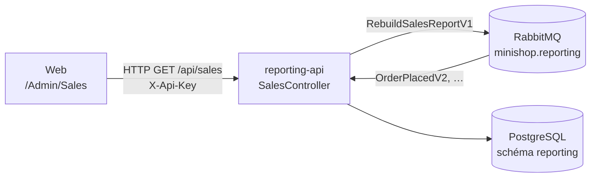

> **V jedné větě:** Reporting si z integračních událostí, které už posílají Ordering a Payments, skládá vlastní
> tabulku pro dotazy admina (tržby za den, nejprodávanější produkty, počty podle stavu) – na objednávky se nikdy
> neptá napřímo. Od mikroservis M1 běží jako **samostatná služba `MiniShop.Reporting.Api`** (kontejner `reporting-api`),
> data má ve schématu `reporting`. Vzniklo v e-shop kroku 11 (tehdy ve Webu).

Princip a diagramy: [CQRS – přehled tržeb](../../eda/cqrs.md). Proč samostatná služba: [Mikroservisy-roadmap](code:docs/Mikroservisy-roadmap.md).

## Samostatná služba (mikroservisy M1)

- **Jen zprávy a jedno HTTP API.** Data dostává služba jen z fronty `minishop.reporting`; Web se ptá
  `GET /api/sales` (přehled) a `POST /api/sales/rebuild` (přestavění) přes `ReportingApiClient` se **servisním klíčem**
  `REPORTING_API_KEY` (hlavička `X-Api-Key`, jiný klíč než sklad – uniklý klíč otevře jen jednu službu). Kdo z lidí smí
  přehled vidět (role Účetní), rozhoduje Web.
- **DTO bez domény:** stavy objednávek jdou v `SalesReportDto.StatusCounts` jako text (`"Confirmed"`, …) – Web doménu
  Reportingu nezná (hlídá `ModuleBoundariesTests.Web_NesahaDoVnitrkuPrehleduTrzeb`).
- **Výpadek služby** e-shop nezastaví: zprávy počkají ve frontě, stránka *Přehled tržeb* místo chyby ukáže
  „přehled je nedostupný“ (`SalesReportUnavailableException`). Hlídá to alarm `MiniShopQueueSilent` v Grafaně.
- **Přechod bez odstávky:** při nasazení chvíli poslouchá frontu stará kopie Webu i nová služba – RabbitMQ dá zprávu
  jen jednomu a inbox ve schématu `reporting` je společný, takže nic neproběhne dvakrát. `deploy.sh` proto spouští
  `reporting-api` **před** Webem.
- **Stránka Zprávy** (`/Admin/Messages`) ukazuje od mikroservis M2B i zprávy této služby (přes její `/api/messages`) –
  *Zkusit znovu* a *Vrátit do fronty* fungují stejně jako u modulů Webu. Hlídají je i alarmy (`MiniShopDeadLetter`, `MiniShopOutboxPoison`).

## Součásti

| Součást | Co dělá | Kód |
| --- | --- | --- |
| **SalesOrder** | řádek čtecího modelu: datum, stav (zjednodušený), částky, řádky; stav jen dopředu | [SalesOrder.cs](code:src/MiniShop.Domain/Reporting/SalesOrder.cs) |
| **SalesProjectionHandler** | projekce – upsert z událostí a ze snímků | [SalesProjectionHandler.cs](code:src/MiniShop.Application/Reporting/SalesProjectionHandler.cs) |
| **SalesReportService** | čtecí strana (součty po dnech, top 10, počty) a přestavění | [SalesReportService.cs](code:src/MiniShop.Application/Reporting/SalesReportService.cs) |
| **ReportingDbContext** | schéma `reporting`: `SalesOrders`, `SalesOrderLines`, inbox, outbox | [ReportingDbContext.cs](code:src/MiniShop.Infrastructure/Reporting/ReportingDbContext.cs) |
| **MiniShop.Reporting.Api** | služba: handlery (`ReportingModule`), vedoucí kopie (zámek `minishop.reporting-api`), API se servisním klíčem | [Program.cs](code:src/MiniShop.Reporting.Api/Program.cs), [ReportingModule.cs](code:src/MiniShop.Reporting.Api/ReportingModule.cs), [SalesController.cs](code:src/MiniShop.Reporting.Api/Controllers/SalesController.cs) |
| **SalesReportOnStartupWorker** | prázdný přehled po startu → požádat o snímky (jen vedoucí kopie služby) | [SalesReportOnStartupWorker.cs](code:src/MiniShop.Reporting.Api/SalesReportOnStartupWorker.cs) |
| **ProductRecommendationService** + **ProductRecommendationsWorker** | e-shop krok 27A: dávka „Zákazníci také koupili“ každých 5 minut (vedoucí kopie) | [ProductRecommendationService.cs](code:src/MiniShop.Application/Reporting/ProductRecommendationService.cs), [BoughtTogether.cs](code:src/MiniShop.Domain/Reporting/BoughtTogether.cs) |
| **ReportingApiClient** | klient ve Webu (`ISalesReportApi`, adresa `https+http://reporting-api`, odolnost ze ServiceDefaults) | [ReportingApiClient.cs](code:src/MiniShop.Web/Reporting/ReportingApiClient.cs) |
| **Stránka Přehled** | `/Admin/Sales` (role Účetní), tlačítko Přestavět | [Index.cshtml.cs](code:src/MiniShop.Web/Pages/Admin/Sales/Index.cshtml.cs) |

## Zprávy

| Směr | Zprávy |
| --- | --- |
| poslouchá (fronta `minishop.reporting`) | `OrderPlacedV2`, `OrderConfirmedV1`, `OrderRejectedV1`, `OrderCancelledV1`, `OrderCompletedV1`, `PaymentRefundedV1`, `OrderSnapshotV1`, `ReturnCompletedV1` (e-shop krok 12 – vrácená se do tržby nepočítá), `ReturnCompletedV2` + `PaymentRefundedV2` + `OrderPartialReturnsSnapshotV1` (e-shop krok 22 – vratka po částech) |
| posílá (příkaz pro Ordering) | `RebuildSalesReportV1` → Ordering odpoví `OrderSnapshotV1` pro každou objednávku |
| posílá (událost, e-shop krok 27A) | `ProductRecommendationsChangedV1` – „Zákazníci také koupili“, jen při změně; v kroku 27A ji zatím nikdo neposlouchá (Ordering od kroku 27B) |

## Co přehled počítá

- **Tržba** = objednávky, které nejsou zamítnuté ani zrušené, včetně dopravy (i ty, které ještě čekají na sklad
  nebo platbu). Den podle českého času vzniku objednávky.
- **Top 10 produktů** za 30 dní podle kusů (stejné pravidlo – jen platné objednávky).
- **Vratka po částech (krok 22):** objednávka zůstává doručená, z tržby se odečte jen vrácená částka (`SalesOrder.Revenue`)
  a z top produktů vrácené kusy (`KeptLines`). Každá vratka jednou (`SalesOrderReturns`, unikátní objednávka + číslo vratky).
  Přestavění je dostane ve snímku `OrderPartialReturnsSnapshotV1` (Ordering ho pošle vedle `OrderSnapshotV1`, jen u objednávek s vratkou).
- **Vráceno** – součet `PaymentRefundedV1` za 30 dní (po přestavění 0 – platby zná jen Payments).
- **Počty podle stavu** – zjednodušené stavy: čeká, potvrzená (i balená a odeslaná), doručená, zamítnutá, zrušená.

## Rychlost vyřízení (proud krok B2)

Druhý čtecí model ve stejné službě – ale **ne z fronty `minishop.reporting`, nýbrž z proudu** `minishop.events`
([Proud zpráv](../../eda/proud-zprav.md)): [LeadTimeProjectionWorker](code:src/MiniShop.Infrastructure/Reporting/LeadTimeProjectionWorker.cs)
(vedoucí kopie) čte `OrderStatusChangedV1` a `ShipmentStatusChangedV1`, plní `OrderLeadTimes` a záložku `StreamCheckpoints`
v jedné transakci. API `/api/lead-times` (+ `/rebuild`), stránka Webu `/Admin/LeadTimes` (sklad, podpora, účetní).
Doby: potvrzení (vznik → potvrzení), expedice (potvrzení → odeslání), doručení (odeslání → doručení, jen dopravce);
p50/p95 po dnech v českém čase podle dne, kdy krok skončil, 14 dní.

## Zákazníci také koupili (e-shop krok 27A)

Třetí čtecí model – **odvozený z jiného čtecího modelu**: nevzniká z nových zpráv, ale z objednávek, které už přehled tržeb
má (`SalesOrder`). Přirovnání: prodavač, který si pamatuje, že kdo kupuje foťák, většinou chce i paměťovou kartu.

- **Dávka, ne reakce na každou zprávu:** [ProductRecommendationsWorker](code:src/MiniShop.Reporting.Api/ProductRecommendationsWorker.cs)
  (vedoucí kopie, `Recommendations:IntervalMinutes` = 5, první běh hned po startu) spočítá všechno znovu z posledních 180 dní.
  Jednodušší než upravovat čítače po každé události a sám opraví cokoli, co se pokazilo. Doporučení nemusí být aktuální na vteřinu.
- **Co se počítá** ([BoughtTogether](code:src/MiniShop.Domain/Reporting/BoughtTogether.cs)): jen objednávky, které si zákazník
  nechal (`CountsAsRevenue` – bez zamítnutých, zrušených, vrácených; `KeptLines` – bez kusů vrácených po částech). Košík = různé
  produkty objednávky, kusy nehrají roli. Nejvýš 4 doporučení, nejčastější první, při shodě nižší ID (stejná data = stejný výsledek).
- **Soukromí:** dvojice se doporučí až od **2 různých objednávek** – z detailu produktu nejde vyčíst nákup jednoho člověka.
  Zpráva nenese nic o zákaznících.
- **Posílat jen změny:** tabulka `ProductRecommendations` (ID produktu, pole `integer[]`, čas výpočtu) = co naposledy odešlo.
  `ProductRecommendationsChangedV1` jen pro produkty se změněným seznamem; produkt, který už nic nedoporučuje, dostane prázdný
  seznam. Uložení a zprávy do outboxu v jedné transakci. Na span `minishop.recommendations.changed` (počet změn).
- **Přestavění přehledu tržeb** smaže objednávky – dávka nad prázdným přehledem nic nepošle; během přestavění (snímky teprve
  přicházejí) se doporučení může na jedno kolo změnit a další kolo to srovná.
- **Testovací objednávky** generátoru provozu se počítají taky (rozhodnutí 22. 11. 2026) – Reporting zákazníky nezná, časem je
  přebije skutečný provoz (okno 180 dní).
