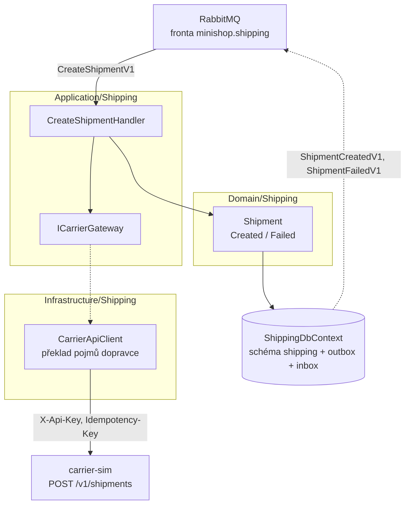
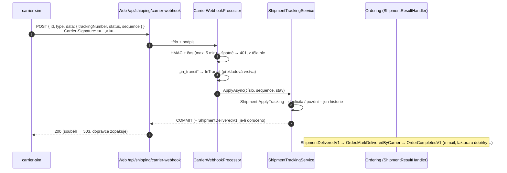

> **V jedné větě:** Shipping na příkaz `CreateShipmentV1` založí zásilku u dopravce ([simulovaný dopravce](../dopravce.md)),
> výsledek oznámí událostí `ShipmentCreatedV1` (číslo zásilky) nebo `ShipmentFailedV1` (dopravce odmítl) a Ordering
> podle ní objednávku odešle, nebo vrátí skladníkovi s hláškou. Od kroku 26C přijímá **webhooky** o stavu zásilky a doručení
> oznámí `ShipmentDeliveredV1`. Běží ve službě **Web** (e-shop krok 26B), data má ve schématu `shipping`.

## Komponentní diagram

## Jak to funguje

1. Skladník v Expedici klikne **Předat dopravci** → `Order.RequestShipment` (jen zabalená objednávka kurýrem) →
   doménová událost `OrderShipmentRequested` → překladač pošle **příkaz** `CreateShipmentV1` (jméno a adresa příjemce,
   u dobírky částka). Od té chvíle objednávku **zrušit nejde** – zásilka už může u dopravce existovat.
2. `CreateShipmentHandler` zavolá dopravce přes `ICarrierGateway` s hlavičkou `Idempotency-Key` = ID příkazu.
3. Výsledek uloží jako `Shipment` a v **téže transakci** zapíše do outboxu událost:
   - přijato → `ShipmentCreated` → `ShipmentCreatedV1` (dopravce + číslo zásilky),
   - trvale odmítnuto (422) → `ShipmentFailed` → `ShipmentFailedV1` (česká hláška).
4. Ordering (`ShipmentResultHandler`): `ShipmentCreatedV1` → `Order.ConfirmShipment` → `OrderShipped` → `OrderShippedV1`
   (dál beze změny: sklad vydá rezervaci, zákazník dostane e-mail s číslem); `ShipmentFailedV1` → `Order.FailShipment` →
   zpět do „K odeslání“ s hláškou a tlačítkem **Zkusit znovu** (nový příkaz = nová zásilka).

## Proč Idempotency-Key, když máme inbox

Inbox chrání **naši** stranu: stejnou zprávu zpracujeme jen jednou. Nepomůže ale v situaci, kdy dopravce zásilku
založí a my spadneme (restart, výpadek databáze) dřív, než si číslo uložíme. Zpráva se zopakuje – a bez ochrany by
u dopravce vznikla **druhá zásilka**. Hlavička `Idempotency-Key` s ID příkazu řekne dopravci „tohle už jsi dělal“
a on vrátí tutéž zásilku. Simulátor to umí vyzkoušet: zlobení `LostResponseRate` zásilku založí, ale odpověď „ztratí“.

Přirovnání: inbox je váš sešit „co jsem už vyřídil“; Idempotency-Key je číslo objednávky, které řeknete na poště –
když přijdete podruhé, poštovní úřednice najde váš první balík a nepošle ho znovu.

## Dočasná × trvalá chyba

| Odpověď dopravce | Co to znamená | Co udělá MiniShop |
| --- | --- | --- |
| 201 / 200 | zásilka vznikla (200 = opakovaný požadavek, stejná zásilka) | `ShipmentCreatedV1` |
| 422 (`invalid_postal_code`, `address_not_serviceable`, …) | údaje zásilky nevyhovují – opakování nepomůže | `ShipmentFailedV1` → hláška v Expedici |
| 503, timeout, síť | dopravce teď neodpovídá | výjimka `CarrierUnavailableException` → consumer zopakuje (5×, pak dead-letter → *Správa → Zprávy → Zkusit znovu*) |
| 401 | špatný klíč e-shopu (`Carrier:ApiKey`) – chyba nastavení | jako dočasná: opakovat, po opravě klíče vrátit z dead-letter |

HTTP klient má navíc resilienci ze ServiceDefaults (opakování, circuit breaker) – opakovat i POST je bezpečné právě
díky Idempotency-Key.

## Překladová vrstva (anti-corruption layer)

[CarrierApiClient](code:src/MiniShop.Infrastructure/Shipping/CarrierApiClient.cs) je jediné místo, které zná JSON
dopravce (`trackingNumber`, kódy chyb). Ven vrací naše typy (`CarrierShipmentAccepted`, `CarrierShipmentRejected`)
a kódy překládá na české hlášky. Kdyby se simulátor vyměnil za skutečnou Zásilkovnu, změní se jen tahle třída.

## Doručení: webhooky a dohledání (e-shop krok 26C)

- **Nejdřív podpis, pak obsah.** [CarrierWebhookProcessor](code:src/MiniShop.Infrastructure/Shipping/CarrierWebhookProcessor.cs)
  ověří HMAC-SHA256 tajemstvím `Carrier:WebhookSecret` nad „čas.tělo“ a stáří zprávy (5 min – starou zachycenou zprávu
  nejde „přehrát“). Endpoint je bez přihlášení a dostupný i z internetu jako webhook Stripu; chrání ho podpis.
- **`sequence` = přirozený klíč idempotence.** `Shipment.ApplyTracking` zapíše stav do historie `ShipmentTrackingEvents`
  (unikátní zásilka + `sequence`): stejné pořadí podruhé = duplicita (nic), nižší než aktuální = jen historie
  („doručuje se“ po „doručeno“ stav nevrátí), vyšší = nový stav. Doručeno → doménová událost `ShipmentDelivered` →
  `ShipmentDeliveredV1` v téže transakci.
- **Rychlá odpověď.** Zápis je malý, takže webhook se zpracuje hned a odpoví 200. Dvě kopie Webu, dva webhooky téže
  zásilky naráz → `Shipment.Version` zastaví druhý zápis → 503 → dopravce ho za chvíli zopakuje.
- **Dohledání.** [ShipmentReconciliationWorker](code:src/MiniShop.Web/BackgroundServices/ShipmentReconciliationWorker.cs)
  (jen vedoucí kopie, každou minutu): zásilka na cestě bez novinky déle než `Shipping:ReconcileAfterMinutes` (2) → GET
  u dopravce → stejné `ApplyTracking`. Dopravce zásilku nezná (404) → `UnknownAtCarrier` a v Expedici se vrátí tlačítko
  „Doručeno“ pro člověka.
- Pozdní doručení po ručním „Doručeno“ nic nezmění (`MarkDeliveredByCarrier` vrátí false).
- **Vráceno odesílateli (e-shop krok 26D).** Nové stavy `DeliveryFailed` (nezastižen), `ReturningToSender`
  a `ReturnedToSender` (konec). Vráceno → doménová událost `ShipmentReturned` → `ShipmentReturnedV1` → Ordering
  `order.ReturnToSender()` → `OrderReturnedToSenderV1` (kompenzace dělají moduly samy – [tok expedice](../../toky/expedice.md)).
  Konečný stav (doručeno / vráceno) už žádná další zpráva nepřepíše.
- **Ztracený mezikrok (e-shop krok 26E).** Webhook „na cestě“ se ztratí, ale další přijdou – stav jde dál, jen v historii
  chybí řádek (`HasHistoryGaps`: méně záznamů než `LastSequence`). Při kroku 30 s nenastanou 2 minuty ticha, takže by
  ho dohledání u zásilky na cestě nenašlo. Proto se dohledání **jednou** zeptá i na ukončenou zásilku s dírou
  (2 min po konci, aby stihly dorazit i opožděné webhooky) a chybějící stavy doplní jen do historie – stav, objednávka
  ani zprávy se nemění. Seznamy stavů „na cestě“ a „ukončeno“ jsou jen v doméně (`Shipment.OnTheWayStatuses`,
  `FinishedStatuses`) – v 26D je repozitář měl zvlášť a dohledání nové stavy neznalo.
- **Živě na stránkách (vzhled krok F3b).** Každá skutečná změna stavu zásilky (vyšší pořadí, jiný stav) vyvolá doménovou
  `ShipmentStatusChanged` → `ShipmentStatusChangedV1` ve stejné transakci; Web ji dostane rozesláním každé kopii a pošle
  signál detailu objednávky a Expedici ([živé aktualizace](../../eda/zive-aktualizace.md)). Duplicity, pozdní zprávy
  a doplnění historie signál neposílají (ukáže je pojistka stránky).
- **Grafana (26E).** [ShipmentStatusSource](code:src/MiniShop.Infrastructure/Shipping/ShipmentStatusSource.cs): zásilky na cestě
  podle stavu, ukončené za 24 h a zaseknuté (15 min bez novinky) → alarm `MiniShopShipmentStale`, řádek Dopravce
  v dashboardu – viz [observabilita](../../eda/observabilita.md).

Přirovnání: čekáte balík – pošta posílá SMS, některá přijde dvakrát, některá pozdě a jedna vůbec. Pořadí poznáte
podle času na SMS (`sequence`), a když se dlouho nic neděje, podíváte se do sledování zásilky sami (dohledání).

## Data

- Tabulka `Shipments` ve schématu `shipping`: jeden řádek na příkaz (unikátní `CommandId`), vytvořená zásilka nejvýš
  jedna na objednávku (filtrovaný unikátní index). Adresu si modul **neukládá** – zná ji objednávka i dopravce.
  Od 26C i stav doručování, `LastSequence`, čas poslední novinky a dohledání, `Version`; historie v `ShipmentTrackingEvents`.
- Objednávka si pamatuje `ShipmentRequestedAtUtc` (předává se / předáno dopravci) a `ShipmentError` (poslední odmítnutí).
- Stránky (detail objednávky – průběh zásilky, Expedice – stav u dopravce) čtou zásilku přes `ShipmentQueryService`;
  Ordering o stavech dopravce neví.
- Do logu jen číslo objednávky a zásilky; na trasu `minishop.order.id`, `minishop.shipment.result` (`created` / `failed`)
  a `minishop.shipment.status` (stav po webhooku).

## Testy

- [OrderServiceTests.Shipping](code:tests/MiniShop.Tests/Application/OrderServiceTests.Shipping.cs) – celá cesta proti
  skutečnému simulátoru v paměti: úspěch, ztracená odpověď (žádná druhá zásilka), odmítnutí a nový pokus, nedostupný
  dopravce, zrušení a dvojklik po předání, osobní odběr a střet zájmů; 26C: doručení webhooky, duplicity a pořadí,
  ztracené webhooky + dohledání, podvržený/starý podpis, pozdní webhook po ručním doručení.
- [OrderServiceTests.ReturnedToSender](code:tests/MiniShop.Tests/Application/OrderServiceTests.ReturnedToSender.cs) – 26D:
  vráceno dopravcem na dobírku i kartou (sklad, refund, dobropis, e-maily, tržby), duplicitní zprávy, pozdní návrat
  po ručním doručení, přestavění přehledu tržeb.
- [FulfilmentPageTests](code:tests/MiniShop.Tests/Web/FulfilmentPageTests.cs) – tlačítko a stav „Předává se dopravci…“;
  [CarrierWebhookEndpointTests](code:tests/MiniShop.Tests/Web/CarrierWebhookEndpointTests.cs) – endpoint přes HTTP.
