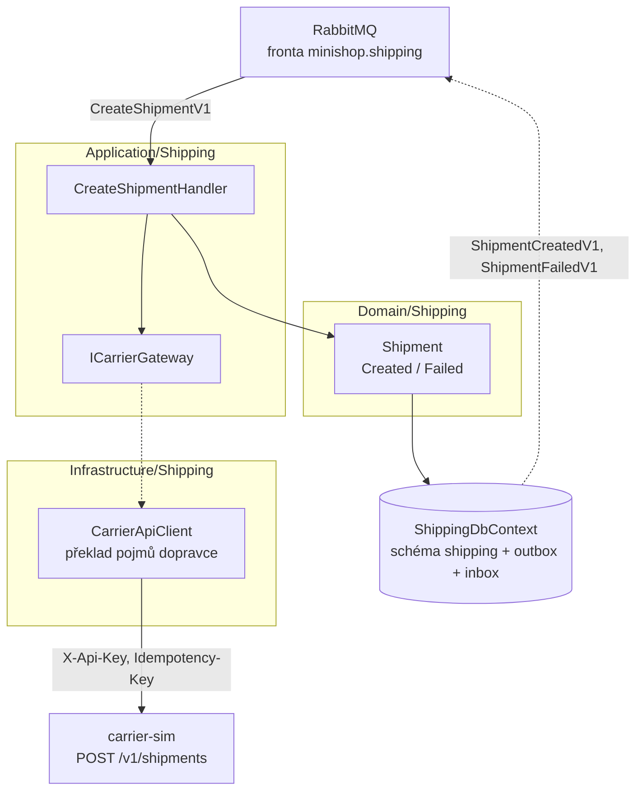

> **V jedné větě:** Shipping na příkaz `CreateShipmentV1` založí zásilku u dopravce ([simulovaný dopravce](../dopravce.md)),
> výsledek oznámí událostí `ShipmentCreatedV1` (číslo zásilky) nebo `ShipmentFailedV1` (dopravce odmítl) a Ordering
> podle ní objednávku odešle, nebo vrátí skladníkovi s hláškou. Běží ve službě **Web** (e-shop krok 26B), data má ve schématu `shipping`.

## Komponentní diagram

## Jak to funguje

1. Skladník v Expedici klikne **Předat dopravci** → `Order.RequestShipment` (jen zabalená objednávka kurýrem) →
   doménová událost `OrderShipmentRequested` → překladač pošle **příkaz** `CreateShipmentV1` (jméno a adresa příjemce,
   u dobírky částka). Od té chvíle objednávku **zrušit nejde** – zásilka už může u dopravce existovat.
2. `CreateShipmentHandler` zavolá dopravce přes `ICarrierGateway` s hlavičkou `Idempotency-Key` = ID příkazu.
3. Výsledek uloží jako `Shipment` a v **téže transakci** zapíše do outboxu událost:
   - přijato → `ShipmentCreated` → `ShipmentCreatedV1` (dopravce + číslo zásilky),
   - trvale odmítnuto (422) → `ShipmentFailed` → `ShipmentFailedV1` (česká hláška).
4. Ordering (`ShipmentResultHandler`): `ShipmentCreatedV1` → `Order.ConfirmShipment` → `OrderShipped` → `OrderShippedV1`
   (dál beze změny: sklad vydá rezervaci, zákazník dostane e-mail s číslem); `ShipmentFailedV1` → `Order.FailShipment` →
   zpět do „K odeslání“ s hláškou a tlačítkem **Zkusit znovu** (nový příkaz = nová zásilka).

## Proč Idempotency-Key, když máme inbox

Inbox chrání **naši** stranu: stejnou zprávu zpracujeme jen jednou. Nepomůže ale v situaci, kdy dopravce zásilku
založí a my spadneme (restart, výpadek databáze) dřív, než si číslo uložíme. Zpráva se zopakuje – a bez ochrany by
u dopravce vznikla **druhá zásilka**. Hlavička `Idempotency-Key` s ID příkazu řekne dopravci „tohle už jsi dělal“
a on vrátí tutéž zásilku. Simulátor to umí vyzkoušet: zlobení `LostResponseRate` zásilku založí, ale odpověď „ztratí“.

Přirovnání: inbox je váš sešit „co jsem už vyřídil“; Idempotency-Key je číslo objednávky, které řeknete na poště –
když přijdete podruhé, poštovní úřednice najde váš první balík a nepošle ho znovu.

## Dočasná × trvalá chyba

| Odpověď dopravce | Co to znamená | Co udělá MiniShop |
| --- | --- | --- |
| 201 / 200 | zásilka vznikla (200 = opakovaný požadavek, stejná zásilka) | `ShipmentCreatedV1` |
| 422 (`invalid_postal_code`, `address_not_serviceable`, …) | údaje zásilky nevyhovují – opakování nepomůže | `ShipmentFailedV1` → hláška v Expedici |
| 503, timeout, síť | dopravce teď neodpovídá | výjimka `CarrierUnavailableException` → consumer zopakuje (5×, pak dead-letter → *Správa → Zprávy → Zkusit znovu*) |
| 401 | špatný klíč e-shopu (`Carrier:ApiKey`) – chyba nastavení | jako dočasná: opakovat, po opravě klíče vrátit z dead-letter |

HTTP klient má navíc resilienci ze ServiceDefaults (opakování, circuit breaker) – opakovat i POST je bezpečné právě
díky Idempotency-Key.

## Překladová vrstva (anti-corruption layer)

[CarrierApiClient](code:src/MiniShop.Infrastructure/Shipping/CarrierApiClient.cs) je jediné místo, které zná JSON
dopravce (`trackingNumber`, kódy chyb). Ven vrací naše typy (`CarrierShipmentAccepted`, `CarrierShipmentRejected`)
a kódy překládá na české hlášky. Kdyby se simulátor vyměnil za skutečnou Zásilkovnu, změní se jen tahle třída.

## Data

- Tabulka `Shipments` ve schématu `shipping`: jeden řádek na příkaz (unikátní `CommandId`), vytvořená zásilka nejvýš
  jedna na objednávku (filtrovaný unikátní index). Adresu si modul **neukládá** – zná ji objednávka i dopravce.
- Objednávka si pamatuje `ShipmentRequestedAtUtc` (předává se) a `ShipmentError` (poslední odmítnutí).
- Do logu jen číslo objednávky a zásilky; na trasu `minishop.order.id` a `minishop.shipment.result` (`created` / `failed`).

## Testy

- [OrderServiceTests.Shipping](code:tests/MiniShop.Tests/Application/OrderServiceTests.Shipping.cs) – celá cesta proti
  skutečnému simulátoru v paměti: úspěch, ztracená odpověď (žádná druhá zásilka), odmítnutí a nový pokus, nedostupný
  dopravce, zrušení a dvojklik po předání, osobní odběr a střet zájmů.
- [FulfilmentPageTests](code:tests/MiniShop.Tests/Web/FulfilmentPageTests.cs) – tlačítko a stav „Předává se dopravci…“.
