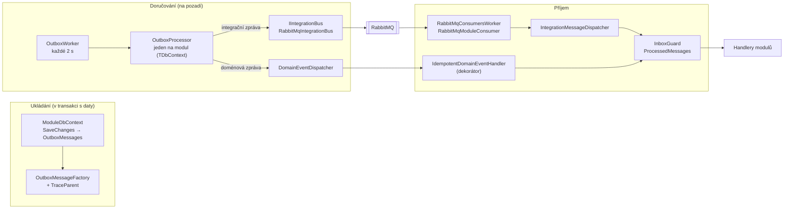

> **V jedné větě:** Sdílené jádro je pošta: umí zprávu bezpečně uložit, doručit a zajistit, že se zpracuje
> jen jednou. Co je v zásilce, ji nezajímá – to řeší moduly.

## Komponentní diagram



## Komponenty

| Komponenta | K čemu slouží | Kód |
| --- | --- | --- |
| **ModuleDbContext** | Předek databáze modulu. V `SaveChangesAsync` uloží data **i** zprávy do outboxu v jedné transakci. | [ModuleDbContext.cs](code:src/MiniShop.Infrastructure/Persistence/ModuleDbContext.cs) |
| **OutboxMessage / Factory** | Řádek outboxu: typ, JSON, druh (doménová / integrační), pokusy, chyba, `TraceParent`. | [OutboxMessage.cs](code:src/MiniShop.Infrastructure/Outbox/OutboxMessage.cs), [OutboxMessageFactory.cs](code:src/MiniShop.Infrastructure/Outbox/OutboxMessageFactory.cs) |
| **OutboxWorker** | Background service – každé 2 s zavolá zpracování outboxu všech modulů služby. | [OutboxWorker.cs](code:src/MiniShop.Infrastructure/Hosting/OutboxWorker.cs) |
| **OutboxProcessor** | Vybere dávku (20) nezpracovaných zpráv, doručí je, označí. Max. 5 pokusů, pak *poison message*. | [OutboxProcessor.cs](code:src/MiniShop.Infrastructure/Outbox/OutboxProcessor.cs) |
| **DomainEventDispatcher** | Najde v DI všechny handlery doménové události a zavolá je. | [DomainEventDispatcher.cs](code:src/MiniShop.Infrastructure/Events/DomainEventDispatcher.cs) |
| **RabbitMqIntegrationBus** | Publikuje integrační zprávu do exchange pojmenované podle kontraktu, čeká na potvrzení brokeru. | [RabbitMqIntegrationBus.cs](code:src/MiniShop.Infrastructure/Integration/RabbitMq/RabbitMqIntegrationBus.cs) |
| **InProcessIntegrationBus** | Totéž bez RabbitMQ – doručí rovnou v procesu. Používají ho testy. | [InProcessIntegrationBus.cs](code:src/MiniShop.Infrastructure/Integration/InProcessIntegrationBus.cs) |
| **RabbitMqModuleConsumer** | Poslouchá frontu `minishop.{modul}` a předá zprávu dispatcheru. | [RabbitMqModuleConsumer.cs](code:src/MiniShop.Infrastructure/Integration/RabbitMq/RabbitMqModuleConsumer.cs) |
| **IntegrationMessageRouting** | Kdo odebírá jaký kontrakt; hlídá, že příkaz má právě jednoho příjemce. | [IntegrationMessageRouting.cs](code:src/MiniShop.Infrastructure/Integration/IntegrationMessageRouting.cs) |
| **IntegrationMessageDispatcher** | Doručí integrační zprávu handlerům jednoho modulu, každý přes inbox. | [IntegrationMessageDispatcher.cs](code:src/MiniShop.Infrastructure/Integration/IntegrationMessageDispatcher.cs) |
| **InboxGuard** | „Sešit odškrtnutých zásilek“ – spustí handler jen jednou pro dvojici (ID zprávy, handler). | [InboxGuard.cs](code:src/MiniShop.Infrastructure/Inbox/InboxGuard.cs) |
| **IdempotentDomainEventHandler** | Dekorátor, který obalí každý doménový handler inboxem. | [IdempotentDomainEventHandler.cs](code:src/MiniShop.Infrastructure/Inbox/IdempotentDomainEventHandler.cs) |
| **MessagingTelemetry** | Spany a metriky zpráv (zdroj `MiniShop.Messaging`). | [MessagingTelemetry.cs](code:src/MiniShop.Infrastructure/Observability/MessagingTelemetry.cs) |
| **OutboxHealthCheck** | `/health` hlásí *Degraded*, když zpráva visí v outboxu déle než 5 minut. | [OutboxHealthCheck.cs](code:src/MiniShop.Infrastructure/Observability/OutboxHealthCheck.cs) |
| **DatabaseMigrator** | Vytvoří nebo aktualizuje databázi modulu přes EF Core migrace, i starou databázi bez historie migrací (baseline). | [DatabaseMigrator.cs](code:src/MiniShop.Infrastructure/Persistence/DatabaseMigrator.cs) |

## Migrace databází

Každý modul má vlastní SQLite databázi a vlastní **EF Core migrace** – očíslované kroky „z verze N na N+1“
(složky `Ordering/Migrations`, `Inventory/Migrations`, `Journeys/Migrations`, `Accounts/Migrations` v Infrastructure).
Přirovnání: stavební deník – místo stavby nového domu při každé přestavbě kuchyně se zapíše, co se upravilo.

- Při startu služby zavolá `…DatabaseInitializer` modulu [DatabaseMigrator](code:src/MiniShop.Infrastructure/Persistence/DatabaseMigrator.cs).
  `Migrate` se podívá do tabulky `__EFMigrationsHistory` a spustí jen migrace, které tam ještě nejsou.
- **Baseline:** databáze z doby před migracemi (vytvořené přes `EnsureCreated`) tabulky mají, historii ne. Migrátor je
  pozná podle značkové tabulky modulu (`Orders`, `Products`, `JourneyEvents`, `AspNetUsers`) a první migraci do historie
  zapíše jako provedenou – jinak by ji spustil znovu a spadl na existující tabulce.
- [DatabaseMigrationTests](code:tests/MiniShop.Tests/Infrastructure/DatabaseMigrationTests.cs) hlídají, že model nemá
  změny bez migrace a že první migrace vytvoří přesně stejné schéma jako `EnsureCreated` (jen tak je baseline správně).
- Nová migrace (z kořene repozitáře, poprvé `dotnet tool restore`):

  ```text
  dotnet ef migrations add <Nazev> --project src/MiniShop.Infrastructure --context OrderingDbContext --output-dir Ordering/Migrations
  ```

  Vygenerovaný kód migrace je potřeba přečíst: přejmenování sloupce EF někdy pozná jako smazání a přidání (= ztráta dat).

## Jak se jádro zapojí do modulu

Modul jen řekne, jakou má databázi a jaké handlery. Zbytek udělá jádro:

```csharp
// Ordering (Web): handler doménové události – vždy obalený inboxem
services.AddDomainEventHandler<OrderPlaced, OrderSagaOrchestrator>();

// Ordering (Web): handler integrační zprávy z fronty minishop.ordering
services.AddIntegrationMessageHandler<StockReservedV1, OrderSagaOrchestrator>(IntegrationModules.Ordering);

// Inventory (Inventory.Api): příkaz – smí mít jen jednoho handlera
builder.Services.AddIntegrationMessageHandler<ReserveStockV1, ReserveStockHandler>(IntegrationModules.Inventory);
```

Handlery se **registrují jen přes tyto metody** – kdyby se zaregistrovaly přímo do DI, obešly by inbox a při
opakovaném doručení by proběhly dvakrát.

## Proč vlastní implementace (a ne knihovna)

Pro produkci existují hotové knihovny (MassTransit, NServiceBus, Wolverine), které outbox, inbox i ságy umí.
MiniShop je **výukový** – vlastní malá implementace ukazuje, co se v takové knihovně děje uvnitř. V reálném
projektu by bylo rozumné sáhnout po knihovně.

## Na internetu

- [MassTransit](https://masstransit.io/) – nejrozšířenější .NET knihovna pro zprávy
- [Enterprise Integration Patterns: Messaging](https://www.enterpriseintegrationpatterns.com/patterns/messaging/)
