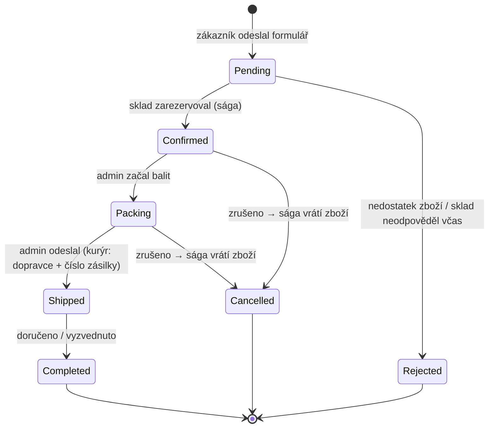
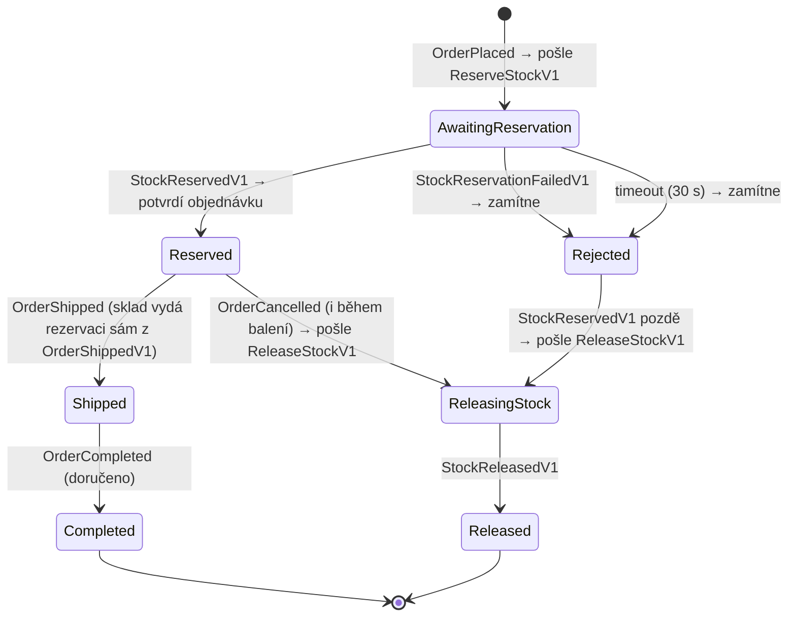

> **V jedné větě:** Objednávka i sága jsou **stavové automaty** – mají pevně dané stavy a přechody mezi nimi.
> Nepovolený přechod (odeslat zamítnutou objednávku, zrušit odeslanou) doména odmítne.

## Objednávka (`Order`)

| Stav | Význam | Událost při vstupu |
| --- | --- | --- |
| `Pending` | Přijatá, čeká na rezervaci skladu | `OrderPlaced` |
| `Confirmed` | Zboží zarezervované | `OrderConfirmed` |
| `Rejected` | Zamítnutá, důvod v `RejectionReason` | `OrderRejected` |
| `Packing` | Balí se (osobní odběr: připravuje se) – e-shop krok 6 | `OrderPackingStarted` |
| `Shipped` | Odeslaná, `Carrier` + `TrackingNumber` (osobní odběr: připravená k vyzvednutí); **zrušit už nejde** – e-shop krok 6 | `OrderShipped` → `OrderShippedV1` |
| `Completed` | Doručená / vyzvednutá (do e-shop kroku 6 „vyřízená“ rovnou z `Confirmed`) | `OrderCompleted` |
| `Cancelled` | Zrušená | `OrderCancelled` |

Pravidla hlídá přímo entita [Order](code:src/MiniShop.Domain/Orders/Order.cs) – metody `Confirm`, `Reject`,
`StartPacking`, `Ship`, `MarkDelivered`, `Cancel` nejdřív zkontrolují stav (`EnsureStatus`) a při chybě vyhodí
`DomainException`. O `Confirmed`/`Rejected` **nerozhoduje uživatel**, ale [sága](../eda/saga.md); o expedici admin
na stránce **Expedice** (`/Admin/Fulfilment`) – viz [Expedice](../toky/expedice.md).

**Souběh (e-shop krok 6):** objednávka má `Version` (*concurrency token*, zvýší ho každá změna stavu). Když admin
odesílá a zákazník ve stejné chvíli ruší, oba načtou stejnou verzi; kdo uloží druhý, narazí na
`UPDATE … WHERE Version = původní`, který nezmění žádný řádek → `ConcurrencyConflictException` (API 409, na stránce
hláška „Objednávka se mezitím změnila“). Vyhraje jen jeden a data zůstanou v pořádku.

### Historie stavů (e-shop krok 5)

Každý přechod (i vznik jako `Pending`) zapíše řádek `OrderStatusChange` – stav, čas a u zamítnutí důvod.
Dělá to jediná privátní metoda `ChangeStatus`, takže stav a historie se mění **vždy spolu** a uloží se v jedné
transakci (tabulka `OrderStatusChanges` v `ordering.db`). Zákazník ji vidí na detailu objednávky `/Orders/{id}`
jako časovou osu – podobně jako sledování zásilky u přepravce.

Proč ne projekce z proudu událostí (jako [Journeys](moduly/journeys.md))? Události objednávky se trvale neukládají
– outbox je jen „pošta“, ne archiv. Záznam přímo v agregátu je nejjednodušší a nemůže se rozejít se stavem.
Objednávky starší než e-shop krok 5 dostaly v migraci vznik (známý čas) a aktuální stav **bez času** – kdy nastal,
se zpětně nezjistí.

## Sága objednávky (`OrderSaga`)

Sága je „deník“ procesu: z tabulky `OrderSagas` je hned vidět, kde objednávka visí. Kód:
[OrderSaga.cs](code:src/MiniShop.Domain/Orders/Saga/OrderSaga.cs).

### Na co si dát pozor

- **Zpráva, která do stavu nepatří, nic neudělá.** Duplicitní `StockReservedV1` ve stavu `Reserved` vrátí akci
  `None`. To je druhá pojistka vedle inboxu.
- **Pozdní odpověď skladu.** Když timeout objednávku zamítne a sklad pak přece jen zarezervuje, sága zboží vrátí
  (`Rejected → ReleasingStock`). Bez toho by zboží zůstalo navždy „odložené“. Viz
  [Timeout a kompenzace](../toky/timeout-a-kompenzace.md).
- **Souběh.** Timeout a odpověď skladu můžou přijít naráz. Sága má `Version` (*concurrency token*) – druhý zápis
  selže a zkusí se znovu nad aktuálním stavem.

## Na internetu

- [Mermaid: State diagrams](https://mermaid.js.org/syntax/stateDiagram.html)
- [Konečný automat (Wikipedie)](https://cs.wikipedia.org/wiki/Kone%C4%8Dn%C3%BD_automat)
