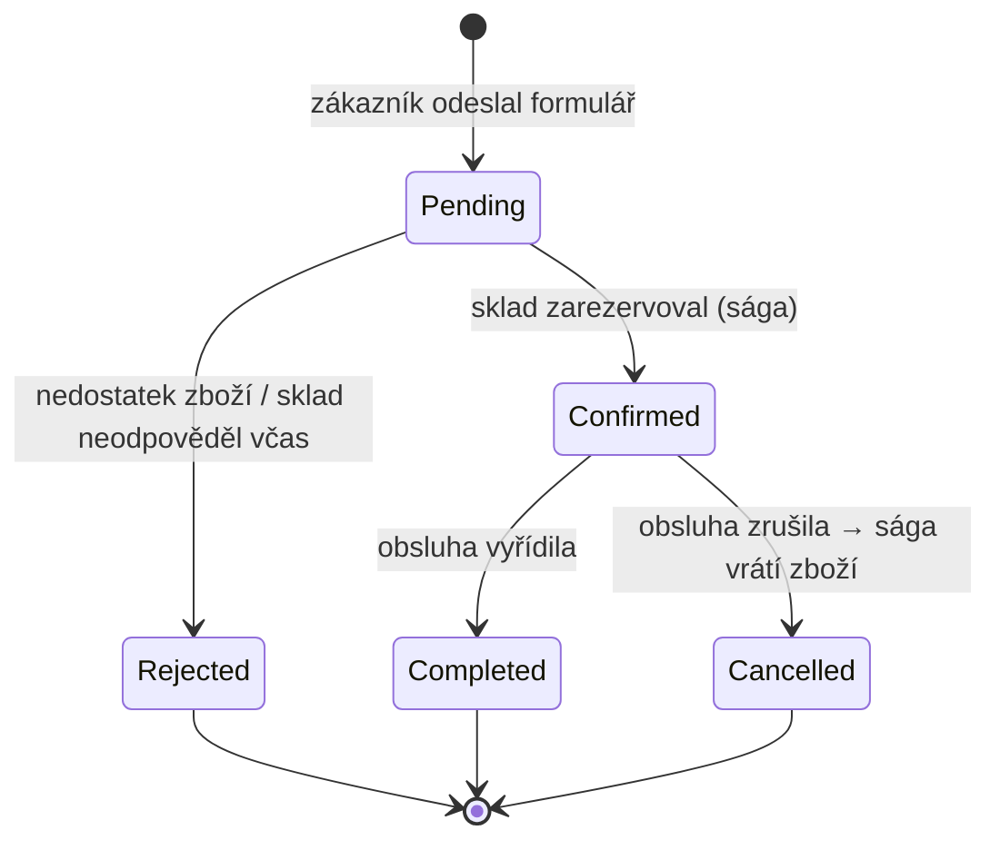
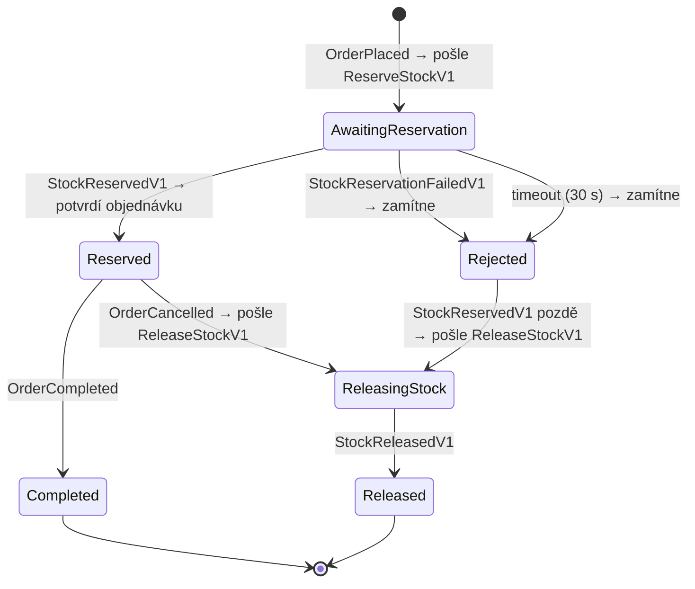

> **V jedné větě:** Objednávka i sága jsou **stavové automaty** – mají pevně dané stavy a přechody mezi nimi.
> Nepovolený přechod (vyřídit zamítnutou objednávku) doména odmítne.

## Objednávka (`Order`)

| Stav | Význam | Událost při vstupu |
| --- | --- | --- |
| `Pending` | Přijatá, čeká na rezervaci skladu | `OrderPlaced` |
| `Confirmed` | Zboží zarezervované | `OrderConfirmed` |
| `Rejected` | Zamítnutá, důvod v `RejectionReason` | `OrderRejected` |
| `Completed` | Vyřízená | `OrderCompleted` |
| `Cancelled` | Zrušená | `OrderCancelled` |

Pravidla hlídá přímo entita [Order](code:src/MiniShop.Domain/Orders/Order.cs) – metody `Confirm`, `Reject`,
`Complete`, `Cancel` nejdřív zkontrolují stav (`EnsureStatus`) a při chybě vyhodí `DomainException`.
O `Confirmed`/`Rejected` **nerozhoduje uživatel**, ale [sága](../eda/saga.md).

## Sága objednávky (`OrderSaga`)

Sága je „deník“ procesu: z tabulky `OrderSagas` je hned vidět, kde objednávka visí. Kód:
[OrderSaga.cs](code:src/MiniShop.Domain/Orders/Saga/OrderSaga.cs).

### Na co si dát pozor

- **Zpráva, která do stavu nepatří, nic neudělá.** Duplicitní `StockReservedV1` ve stavu `Reserved` vrátí akci
  `None`. To je druhá pojistka vedle inboxu.
- **Pozdní odpověď skladu.** Když timeout objednávku zamítne a sklad pak přece jen zarezervuje, sága zboží vrátí
  (`Rejected → ReleasingStock`). Bez toho by zboží zůstalo navždy „odložené“. Viz
  [Timeout a kompenzace](../toky/timeout-a-kompenzace.md).
- **Souběh.** Timeout a odpověď skladu můžou přijít naráz. Sága má `Version` (*concurrency token*) – druhý zápis
  selže a zkusí se znovu nad aktuálním stavem.

## Na internetu

- [Mermaid: State diagrams](https://mermaid.js.org/syntax/stateDiagram.html)
- [Konečný automat (Wikipedie)](https://cs.wikipedia.org/wiki/Kone%C4%8Dn%C3%BD_automat)
