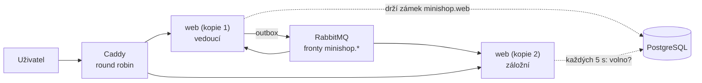
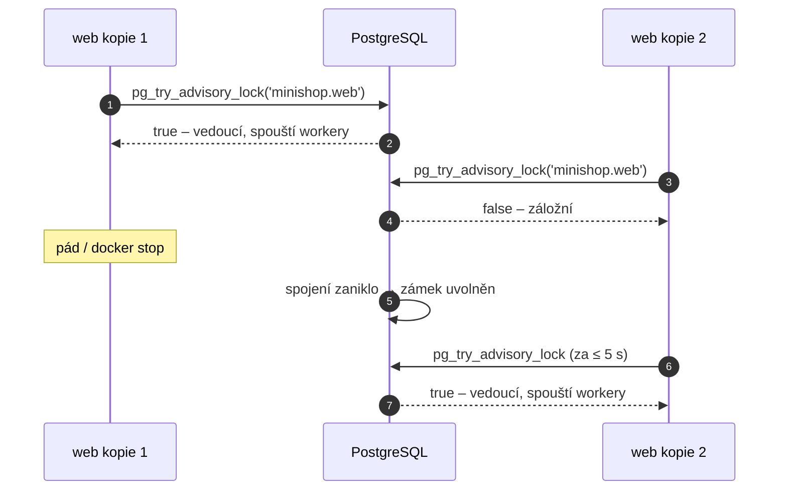

> **V jedné větě:** Web běží ve **dvou kopiích** (škálování krok 5). Caddy mezi ně střídá požadavky, consumery RabbitMQ
> běží v obou a workery s časovačem (outbox, termíny ság, úklid…) jen ve **vedoucí kopii** – tou je ta, která drží
> **zámek v PostgreSQL** (advisory lock).

## Proč dvě kopie

Jedna kopie = jeden bod selhání: pád procesu nebo zaseknutý požadavek a web neodpovídá. Se dvěma kopiemi Caddy pošle
požadavky na tu, která žije, a uživatel výpadek nepozná. Předpoklady splnily dřívější kroky:

- **databáze po síti** – PostgreSQL místo souborů SQLite ([Databáze](databaze.md)),
- **zprávy přes frontu** – RabbitMQ rozdělí zprávy mezi consumery a duplicitu zahodí [inbox](../eda/inbox.md),
- **sdílené klíče Data Protection** na volume – cookie přihlášení a formulář z jedné kopie platí i v druhé.

## Kdo co dělá

| Práce | Kde běží | Proč |
| --- | --- | --- |
| HTTP požadavky (stránky, API) | všechny kopie | Caddy je střídá |
| Consumery RabbitMQ (`RabbitMqConsumersWorker`) | všechny kopie | fronta dá každou zprávu jedné kopii (competing consumers), opakované doručení zahodí inbox |
| `OutboxWorker`, `MessageRetentionWorker` | jen vedoucí | dvě kopie by stejnou zprávu odeslaly dvakrát |
| `OrderSagaTimeoutWorker`, `CartReminderWorker` | jen vedoucí | jinak dvojí zamítnutí / dvě připomínky (druhá by narazila na konflikt) |
| Kontroly po startu (`CatalogSyncOnStartupWorker`, `SalesReportOnStartupWorker`, `PurchasesSyncOnStartupWorker`) | jen vedoucí | nový vedoucí je po pádu původního spustí znovu – jsou idempotentní |

Hlídá to test [WorkerRegistrationTests](code:tests/MiniShop.Tests/Web/WorkerRegistrationTests.cs) – nový worker
s časovačem se registruje přes `AddLeaderOnlyHostedService<T>()`, ne `AddHostedService<T>()`.

## Vedoucí kopie (leader lease)

Přirovnání: v kanceláři je víc úředníků, klíč od pokladny ale jen jeden. Kdo ho drží, vydává peníze; když odejde
domů (nebo omdlí), klíč zůstane na stole a vezme si ho další.

Klíčem je **advisory lock** PostgreSQL – zámek se jménem (`minishop.web`, sklad má `minishop.inventory-api`), který nehlídá
žádnou tabulku, jen „kdo ho má“:

1. [LeaderElection](code:src/MiniShop.Infrastructure/Hosting/LeaderElection.cs) otevře **vlastní spojení** (mimo pool EF Core)
   a zavolá `pg_try_advisory_lock` – vrátí hned `true` (máš ho) nebo `false` (má ho jiná kopie, zkus to za 5 s).
2. Zámek patří **spojení**. Dokud spojení žije, kopie je vedoucí; každých 5 s ho ověří (`SELECT 1`).
3. Kopie spadne nebo se zastaví → spojení zanikne → PostgreSQL zámek **sám uvolní** a do 5 s ho vezme druhá kopie.
   Nic se nemusí „vypršet“ ani uklízet. Pro tichý zánik (pád stroje, síť) má PostgreSQL v Compose TCP keepalive
   (mrtvé spojení pozná do ~1 min).
4. [LeaderOnlyHostedService](code:src/MiniShop.Infrastructure/Hosting/LeaderOnlyHostedService.cs) po dobu vedení spustí
   novou instanci workeru a při ztrátě vedení ji zastaví.

**Proč ne tabulka s „nájmem“ (lease) nebo Redis?** Tabulka potřebuje čas vypršení a obnovování (a hodiny strojů se
liší), Redis je další služba k provozu. Advisory lock je v PostgreSQL zadarmo a uvolní se přesně se zánikem spojení.

**Krátký překryv nevadí:** stará kopie může ještě dokončovat kolo, když nová začíná. Zámek je jen úspora práce –
správnost drží inbox (duplicitní zpráva) a concurrency tokeny (souběžná změna). Stejný druh zámku, jen na dobu
transakce (`pg_advisory_xact_lock`), hlídá „posledního admina“ ve [správě účtů](moduly/accounts.md).

## Compose a Caddy

- `web` má `deploy.replicas: ${WEB_REPLICAS:-1}`, produkce `WEB_REPLICAS=2` ([production.env](code:deploy/production.env)).
- [Caddyfile](code:deploy/Caddyfile): snippet `web-upstream` – `dynamic a web 8080` (adresy kopií z DNS sítě Compose,
  obnova po 5 s), `round_robin`, nedostupnou kopii vyřadí na 5 s a požadavek zkusí na jiné (`lb_try_duration 10s`,
  `dial_timeout 1s` – zmizelá kopie nemá IP, spojení by jinak dlouho čekalo).
- Logy: každá kopie má vlastní soubor `/data/logs/minishop-<kontejner>-RRRRMMDD.log`
  ([PerInstanceLogFiles](code:src/MiniShop.ServiceDefaults/PerInstanceLogFiles.cs)); soubory zaniklých kopií se po 7 dnech smažou.
- Která kopie je vedoucí: `docker compose logs web | grep Vedoucí`.

## Známá omezení

- ~~Nasazení restartuje obě kopie naráz~~ – od kroku 5B se kopie mění postupně bez výpadku
  ([CD – postupné nasazení](../github/cd.md)).
- **Limit formulářů účtu** (rate limiting) počítá každá kopie zvlášť – skutečný limit je 2× vyšší.
- **Sklad** (`inventory-api`) běží v jedné kopii; volbu vedoucí už má, víc kopií by potřebovalo jen balancování na straně Webu.
- Obě kopie jsou na **jedné VM** – pád celého stroje je dál výpadek (druhá VM = škálování krok 6).

## Vyzkoušet lokálně

V `deploy/.env` nastavit `WEB_REPLICAS=2` a `WEB_PORT=8080-8081`, pak `docker compose up -d` – kopie jsou na portech
8080 a 8081. `docker compose logs web | grep Vedoucí` ukáže vedoucí kopii; po `docker stop` jejího kontejneru převezme
vedení druhá (do ~5 s, v generálce do 1 s).

Viz také: [Outbox](../eda/outbox.md), [Doména, HTTPS a přístup](../nasazeni/https-a-pristup.md),
[Souhrn kroku](code:docs/kroky-skalovani/krok-05-vice-instanci.md).
