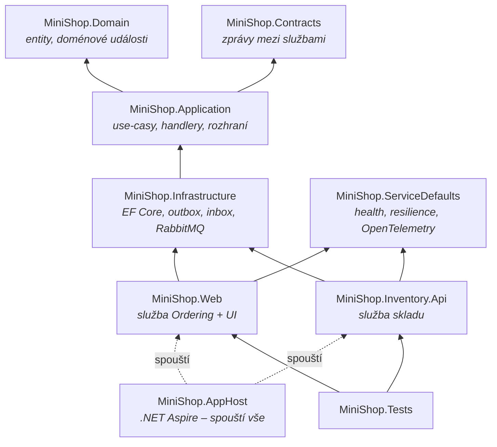

> **V jedné větě:** Kód je rozdělený do vrstev jako cibule – uprostřed **doména** (business pravidla), kolem
> **aplikace** (use-casy), venku **infrastruktura** (databáze, RabbitMQ) a **hostitelé** (Web, Inventory.Api).
> Vnitřní vrstva nikdy neví o vnější.

## Závislosti mezi projekty

Šipka znamená „odkazuje na / zná“. Všimněte si, že **Domain a Contracts nezávisí na ničem** a že Application
nezná Infrastructure – zná jen rozhraní, která Infrastructure implementuje.

## Projekty jeden po druhém

| Projekt | Co v něm je | Proč samostatně |
| --- | --- | --- |
| [MiniShop.Contracts](code:src/MiniShop.Contracts/) | Integrační zprávy (`OrderPlacedV1`, `ReserveStockV1`, …) | „Veřejné API“ mezi službami. Nemá žádné závislosti, takže ho může sdílet kdokoli. Viz [Integrační zprávy](../eda/integracni-zpravy.md). |
| [MiniShop.Domain](code:src/MiniShop.Domain/) | Entity (`Order`, `Product`, `OrderSaga`…), doménové události, business pravidla | Srdce aplikace. Nezná databázi ani web – dá se testovat bez čehokoli dalšího. |
| [MiniShop.Application](code:src/MiniShop.Application/) | Use-casy (`OrderService`), handlery událostí, orchestrátor ságy, rozhraní repozitářů | Říká *co* se má stát, ne *jak* se to uloží. **Nemá žádné NuGet balíčky** (ani DI) – předchází se tím konfliktům verzí. |
| [MiniShop.Infrastructure](code:src/MiniShop.Infrastructure/) | EF Core `DbContext`y, repozitáře, outbox, inbox, RabbitMQ, telemetrie | Technické detaily, které jdou vyměnit (SQLite → PostgreSQL, RabbitMQ → jiný broker) bez zásahu do domény. |
| [MiniShop.ServiceDefaults](code:src/MiniShop.ServiceDefaults/) | Společné nastavení služeb: health checky, service discovery, resilience HTTP, OpenTelemetry | Obě služby se mají chovat stejně – jedno místo místo kopírování. |
| [MiniShop.Web](code:src/MiniShop.Web/) | Razor Pages, REST API objednávek, background workery, `Program.cs` | Hostitel modulů Ordering a Journeys; skládá celou aplikaci (*composition root*). |
| [MiniShop.Inventory.Api](code:src/MiniShop.Inventory.Api/) | REST API produktů, `Program.cs` | Hostitel modulu Inventory. |
| [MiniShop.AppHost](code:src/MiniShop.AppHost/) | Popis celé aplikace pro .NET Aspire | Lokální spuštění jedním příkazem (RabbitMQ + obě služby + dashboard). |
| [MiniShop.Tests](code:tests/MiniShop.Tests/) | Testy domény, služeb, ságy, outboxu, inboxu, kontraktů, architektury a této dokumentace | Testy běží bez RabbitMQ – celá sága v jednom procesu nad SQLite v paměti. |

## Composition root – kde se to celé skládá

Application definuje rozhraní (`IOrderRepository`, `IOrderingUnitOfWork`…), Infrastructure je implementuje
a **propojí je až hostitel** při startu (*dependency injection*):

- [Program.cs (Web)](code:src/MiniShop.Web/Program.cs) a [Program.cs (Inventory.Api)](code:src/MiniShop.Inventory.Api/Program.cs)
- registrace aplikačních služeb a handlerů: [ApplicationServiceCollectionExtensions.cs](code:src/MiniShop.Web/Extensions/ApplicationServiceCollectionExtensions.cs)
  (ve Webu, protože Application nemá balíček DI)
- registrace infrastruktury: [DependencyInjection.cs](code:src/MiniShop.Infrastructure/DependencyInjection.cs),
  [OrderingInfrastructure.cs](code:src/MiniShop.Infrastructure/Ordering/OrderingInfrastructure.cs)

> **Přirovnání:** Doména je kuchař s receptem. Neřeší, jestli suroviny přivezl dodavatel A nebo B –
> to zařídí provozní (composition root). Kuchař jen řekne „potřebuju mouku“ (rozhraní).

## Proč takhle

- **Testovatelnost** – doménu a use-casy jde testovat bez databáze a sítě.
- **Výměnnost** – technologie (DB, broker) jsou za rozhraním. Přechod z volání v paměti na RabbitMQ (krok 8)
  nezměnil jediný handler.
- **Čitelnost** – business pravidla jsou na jednom místě (`Order.Confirm` hlídá, že potvrdit jde jen čekající objednávku).

Cena: víc projektů a rozhraní, než by malá aplikace nutně potřebovala.

## Na internetu

- [Robert C. Martin: The Clean Architecture](https://blog.cleancoder.com/uncle-bob/2012/08/13/the-clean-architecture.html)
- [Microsoft: Clean architecture v ASP.NET Core](https://learn.microsoft.com/dotnet/architecture/modern-web-apps-azure/common-web-application-architectures#clean-architecture)
- [Dependency injection v .NET](https://learn.microsoft.com/dotnet/core/extensions/dependency-injection)
