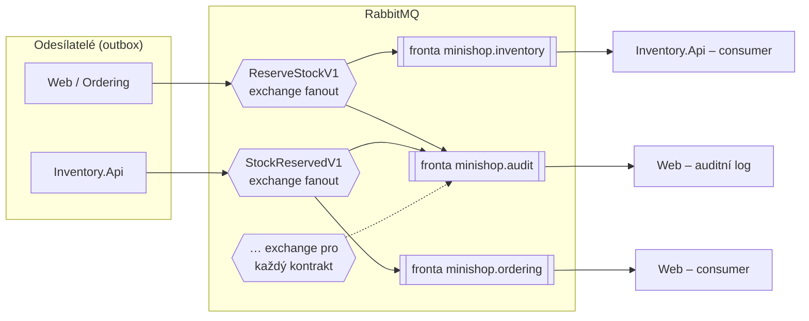

> **V jedné větě:** RabbitMQ přebírá zprávy od odesílatelů a rozděluje je do **front** příjemců; zprávy ve frontě
> čekají, i když příjemce zrovna neběží.

## Topologie v MiniShopu

- **Exchange = jméno kontraktu** (`OrderPlacedV1`, `ReserveStockV1`…), typ *fanout* – každá navázaná fronta
  dostane kopii. Kód: [RabbitMqTopology](code:src/MiniShop.Infrastructure/Integration/RabbitMq/RabbitMqTopology.cs).
- **Fronta = modul** (`minishop.ordering`, `minishop.inventory`) navázaná jen na kontrakty, které modul odebírá.
  Kód: [RabbitMqModuleConsumer](code:src/MiniShop.Infrastructure/Integration/RabbitMq/RabbitMqModuleConsumer.cs).
- **Auditní fronta** `minishop.audit` je navázaná na všechno a jen loguje – „odposlech“ (*wire tap*), v logu je vidět
  celý průběh ságy. Poslouchá ji jen Web. Kód: [RabbitMqAuditConsumer](code:src/MiniShop.Infrastructure/Integration/RabbitMq/RabbitMqAuditConsumer.cs).

> **Přirovnání:** Exchange je třídírna podle druhu zásilky, fronta je poštovní přihrádka oddělení. Oddělení, které
> je zrovna na dovolené, najde po návratu všechno v přihrádce.

## Spolehlivost

| Situace | Co se stane | Kód |
| --- | --- | --- |
| Odeslání | Publisher čeká na **potvrzení brokeru** (*publisher confirms*); bez potvrzení zpráva zůstane v outboxu | [RabbitMqIntegrationBus](code:src/MiniShop.Infrastructure/Integration/RabbitMq/RabbitMqIntegrationBus.cs) |
| Broker neběží | Zprávy čekají v outboxu, nepočítá se to jako pokus | [OutboxProcessor](code:src/MiniShop.Infrastructure/Outbox/OutboxProcessor.cs) |
| Restart brokeru | Exchange i fronty jsou *durable*, zprávy *persistent* | [RabbitMqTopology](code:src/MiniShop.Infrastructure/Integration/RabbitMq/RabbitMqTopology.cs) |
| Handler selže | Zpráva se po 2 s vrátí do fronty (*nack + requeue*) | [RabbitMqQueueConsumer](code:src/MiniShop.Infrastructure/Integration/RabbitMq/RabbitMqQueueConsumer.cs) |
| Nečitelná zpráva | Zahodí se (*nack bez requeue*) | tamtéž |
| Výpadek spojení | Consumer se každých 5 s zkusí připojit znovu | tamtéž |

## Proč broker (a ne přímé HTTP volání)

- **Časové oddělení** – sklad nemusí běžet ve chvíli, kdy vznikne objednávka.
- **Odesílatel nezná příjemce** – nový odběratel = nová fronta, odesílatel se nemění.
- **Vyrovnání špiček** – zprávy se zpracují, jak to příjemce stíhá.

**Proč RabbitMQ:** zralý, rozšířený, s výbornou webovou správou a Docker image; pro výuku přehlednější než
Kafka (log událostí) nebo cloudové služby (Azure Service Bus, AWS SQS) vázané na jednoho poskytovatele.

## Známá omezení

- **Chybí dead-letter fronta** – zpráva, na které handler stále padá, se vrací do fronty bez limitu.
- Fanout na kontrakt je jednoduchý; větší systémy používají *topic* exchange s routovacími klíči.

## Na internetu

- [RabbitMQ – oficiální tutoriály](https://www.rabbitmq.com/tutorials)
- [RabbitMQ: AMQP 0-9-1 – exchange, fronty, vazby](https://www.rabbitmq.com/tutorials/amqp-concepts)
- [RabbitMQ: Publisher confirms](https://www.rabbitmq.com/docs/confirms)
- [Enterprise Integration Patterns: Wire Tap](https://www.enterpriseintegrationpatterns.com/patterns/messaging/WireTap.html)
