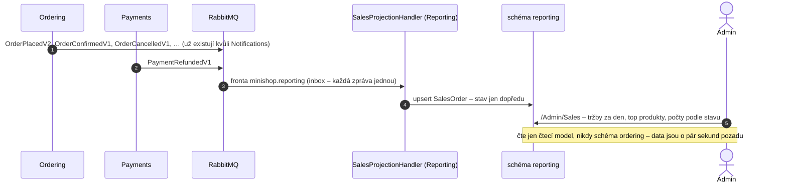
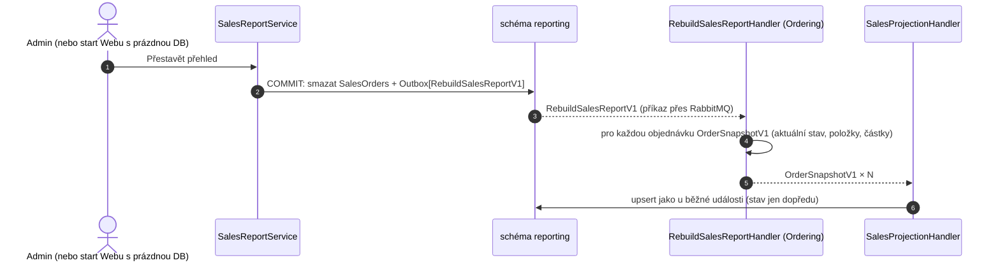

> **V jedné větě:** **CQRS** (Command Query Responsibility Segregation) = zápis a čtení mají **oddělené modely**.
> Ordering zapisuje objednávky tak, jak to potřebují jeho pravidla; přehled tržeb pro admina čte z vlastní tabulky,
> poskládané přesně pro jeho otázky, kterou plní **projekce z integračních událostí** (e-shop krok 11).

Přirovnání: účetní si nechodí počítat zboží do skladu. Vede si vlastní knihu podle dokladů, které mu chodí – a když
o knihu přijde, nechá si poslat kopie všech dokladů a sepíše ji znovu.

## Jak vzniká čtecí model

- **Nový odběratel = nic neměnit u odesílatele.** Ordering ani Payments se kvůli přehledu nezměnily – posílaly
  stejné události už dřív. Test architektury hlídá, že se Reporting s ostatními moduly nezná.
- **Bez osobních údajů.** Přehled si neukládá jméno ani e-mail, takže na `CustomerAnonymizedV1` reagovat nemusí.
- **Eventual consistency.** Stránka ukazuje „data k…“ (čas poslední zpracované události).

## Zprávy mimo pořadí

Potvrzení může předběhnout vznik objednávky. Projekce proto:

1. chybí-li řádek, **založí ho** hned (zatím bez data a částek) – `SalesOrder.Create`,
2. vznik (`OrderPlacedV2`) ho **doplní**,
3. stav posouvá **jen dopředu** (`ApplyStatus`): přijatá → potvrzená → doručená; zamítnutá, zrušená a doručená
   jsou konečné. Pozdní „potvrzeno“ nepřepíše „zrušeno“.

Výsledek tak nezávisí na pořadí – stejná sada zpráv dá vždy stejný přehled.

## Přestavění projekce

Čtecí model je **odvozený** – jde ho kdykoli zahodit a postavit znovu. Hodí se to po chybě v projekci, po změně
toho, co přehled počítá, nebo při prvním nasazení (staré objednávky žádnou událost pro Reporting neposlaly).

**Proč nový kontrakt `OrderSnapshotV1`, a ne znovu `OrderPlacedV2`?** Událost je fakt („objednávka vznikla“).
Kdyby Ordering při přestavění poslal znovu `OrderPlacedV2`, modul Notifications by zákazníkům rozeslal e-maily
„přijali jsme“ o starých objednávkách. Snímek je jiný fakt („takhle objednávka vypadá teď“) a poslouchá ho jen Reporting.
Stejný vzor jako [obnova kopie katalogu](kopie-katalogu.md) (`SyncCatalogV1`).

## Na co si dát pozor

- **Vrácené platby se přestavěním neobnoví** – zná je modul Payments, ne Ordering. Do tržby se stejně nepočítají
  (vrací se jen u zamítnutých a zrušených objednávek), chybí jen v kartě „vráceno“.
- **Dny v českém čase** (`Europe/Prague`) – objednávka v 0:30 patří do „dneška“, i když je v UTC ještě včera.
- **Součty v paměti** – dat za 30 dní je málo (z doby SQLite, které neumělo `decimal` sčítat přesně; v PostgreSQL by šly i v SQL).

## Kód

[SalesOrder](code:src/MiniShop.Domain/Reporting/SalesOrder.cs) ·
[SalesProjectionHandler](code:src/MiniShop.Application/Reporting/SalesProjectionHandler.cs) ·
[SalesReportService](code:src/MiniShop.Application/Reporting/SalesReportService.cs) ·
[RebuildSalesReportHandler](code:src/MiniShop.Application/Ordering/IntegrationEvents/RebuildSalesReportHandler.cs) ·
[OrderSnapshotV1](code:src/MiniShop.Contracts/Orders/OrderSnapshotV1.cs) ·
[RebuildSalesReportV1](code:src/MiniShop.Contracts/Reporting/RebuildSalesReportV1.cs) ·
[Stránka Přehled](code:src/MiniShop.Web/Pages/Admin/Sales/Index.cshtml.cs)

## Na internetu

- [Martin Fowler: CQRS](https://martinfowler.com/bliki/CQRS.html)
- [Microsoft: CQRS pattern](https://learn.microsoft.com/azure/architecture/patterns/cqrs)
- [Microservices.io: CQRS](https://microservices.io/patterns/data/cqrs.html)
