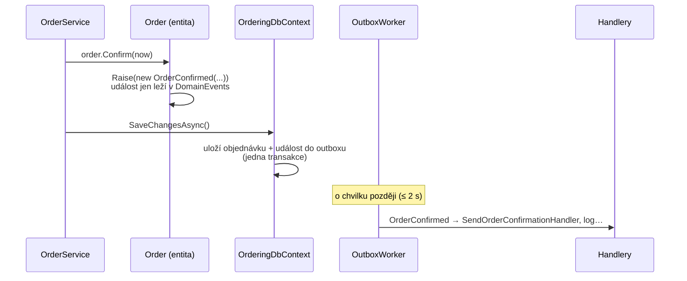

> **V jedné větě:** Doménová událost je **fakt v minulém čase**, který vznikne uvnitř entity při změně jejího
> stavu – `OrderPlaced`, `OrderConfirmed`, `ProductChanged`.

## K čemu slouží

Entita `Order` ví nejlíp, kdy se stalo něco důležitého (potvrzení, zrušení). Místo aby sama volala sklad nebo
e-mail, **jen to oznámí**. Kdo chce reagovat, napíše handler. Entita ani `OrderService` o handlerech nevědí.

> **Přirovnání:** Porodnice nevolá matrice, pojišťovně a babičce. Vystaví rodný list (událost) a každý, kdo ho
> potřebuje, si ho vyzvedne.

## Jak to funguje v MiniShopu

1. Entita dědí z [Entity](code:src/MiniShop.Domain/Common/Entity.cs) a událost zaznamená metodou `Raise`.
2. Událost implementuje [IDomainEvent](code:src/MiniShop.Domain/Common/IDomainEvent.cs) – má `EventId`
   (pro odhalení duplicit) a `OccurredAtUtc`.
3. Při `SaveChangesAsync` ji [ModuleDbContext](code:src/MiniShop.Infrastructure/Persistence/ModuleDbContext.cs)
   uloží do [outboxu](outbox.md); doručí ji worker.
4. Handler implementuje [IDomainEventHandler&lt;T&gt;](code:src/MiniShop.Application/Abstractions/IDomainEventHandler.cs)
   a registruje se přes `AddDomainEventHandler<TEvent, THandler>()`.

## Všechny doménové události

{{auto:domain-events}}

Události Orderingu jdou přes outbox k handlerům. Události Inventory (`ProductChanged`, `ProductRemoved`) se při uložení rovnou převedou na
[integrační zprávy](integracni-zpravy.md) (sklad nemá vlastní doménové handlery).

## Doménová vs. integrační událost

| | Doménová (`OrderConfirmed`) | Integrační (`OrderPlacedV1`) |
| --- | --- | --- |
| Kdo ji vidí | jen vlastní modul | kdokoli – jiné moduly a služby |
| Obsah | může nést celou entitu | jen data, žádné třídy domény |
| Smí se měnit | ano, kdykoli | ne – změna = nová verze `V2` |

## Proč takhle

- **Odstranění vazeb** – `OrderService` se nemění, když přibude další reakce. Viz [SOLID](../architektura/solid.md).
- **Business jazyk** – v kódu jsou vidět fakta, o kterých mluví i zákazník („objednávka byla zamítnuta“).
- Událost se **nepošle hned**, ale uloží – kdyby handler spadl, neztratí se (viz [Outbox](outbox.md)).

## Na internetu

- [Microsoft: Domain events – design a implementace](https://learn.microsoft.com/dotnet/architecture/microservices/microservice-ddd-cqrs-patterns/domain-events-design-implementation)
- [Martin Fowler: Domain Event](https://martinfowler.com/eaaDev/DomainEvent.html)
