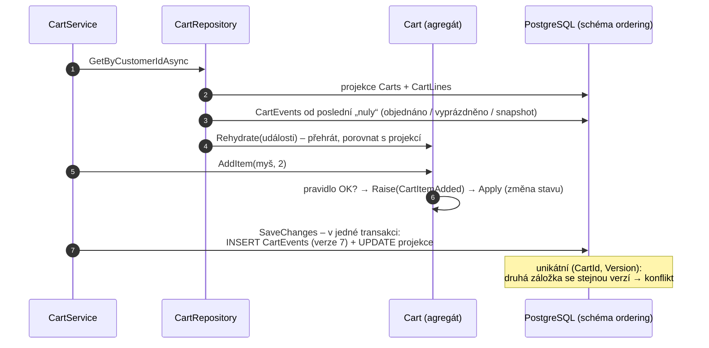

> **V jedné větě:** Košík (e-shop krok 17) neukládá „jak teď vypadá“, ale **co se s ním dělo** – „přidána myš“,
> „odebrána myš“, „přidána klávesnice“, „objednáno“. Stav je **součet událostí** a tabulky `Carts`/`CartLines`
> jsou jen projekce pro rychlé dotazy.

Přirovnání: výpis z bankovního účtu. Banka nemá v trezoru „zůstatek“ – má seznam pohybů a zůstatek z nich spočítá.
Kdykoli umí říct i zůstatek k libovolnému dni, a když se objeví nová otázka („kolik utrácím za kávu?“), odpoví
zpětně, protože pohyby nikdy nezahodila.

## Čím se liší od toho, co už v MiniShopu je

| | Kde | Co je pravda | K čemu události |
| --- | --- | --- | --- |
| [Doménové události](domenove-udalosti.md) + [outbox](outbox.md) | objednávka | řádek v tabulce `Orders` | oznámit ostatním, co se stalo |
| [Proud událostí](proud-udalosti.md) | Journeys | proud `JourneyEvents` | záznam postupu – **nad ním není agregát s pravidly** |
| **Event sourcing** | košík | proud `CartEvents` | **stav agregátu** – pravidla (max. 20 řádků, 1–100 ks…) se hlídají nad stavem složeným z událostí |

Události košíku **nejdou do outboxu ani RabbitMQ** – nejsou to zprávy pro jiné moduly, ale „zápis do účetní knihy“
košíku. Opuštěný košík dál oznamuje `CartAbandonedV1` (e-shop krok 10) beze změny.

## Jak to funguje

1. **Příkaz → pravidlo → událost → stav.** Metoda košíku nejdřív ověří pravidlo; teprve pak vznikne událost
   a `Apply` změní stav. Neplatná událost se tak nikdy nezapíše. `Apply` je **jediné místo**, kde se stav mění –
   při nové události i při přehrávání historie.
2. **Uložení.** `OrderingDbContext.SaveChangesAsync` posbírá nezapsané události sledovaných košíků a vloží je do
   `CartEvents` se stoupající verzí – ve stejné transakci jako projekci (a případně objednávku a outbox).
3. **Načtení.** Repozitář načte projekci a události **od poslední „nuly“** – po objednání nebo vyprázdnění je košík
   prázdný a dřívější události stav neovlivní. To je *přirozený snapshot*: košík zákazníka žije roky, ale načítá
   se jen aktuální nákup.
4. **Souběh.** Dvě záložky načtou verzi 6 a obě chtějí zapsat verzi 7 → unikátní index → `ConcurrencyConflictException`
   (stejná hláška jako dřív „košík se mezitím změnil“).

## Události

| Událost | Kdy | Poznámka |
| --- | --- | --- |
| `CartItemAdded` | přidání produktu (nový řádek nebo navýšení) | nese cenu – „cena při přidání“ |
| `CartItemQuantityChanged` | změna množství | nová hodnota, ne rozdíl |
| `CartItemRemoved` | odebrání řádku | díky ní víme, **co si zákazník rozmyslel** |
| `CartPricesAccepted` | potvrzení nových cen v pokladně | |
| `CartCouponApplied` / `CartCouponRemoved` | slevový kód | |
| `CartCheckedOut` | objednáno | reset; nese objednané řádky |
| `CartCleared` | vyprázdněno | reset |
| `CartReminderSent` | připomínka opuštěného košíku | nemění verzi pro pokladnu |
| `CartSnapshotTaken` | převzetí stavu z tabulek | reset; viz níže |

Kód: [CartEvents.cs](code:src/MiniShop.Domain/Orders/Carts/CartEvents.cs) ·
[Cart.cs](code:src/MiniShop.Domain/Orders/Carts/Cart.cs) ·
[CartEventStore.cs](code:src/MiniShop.Infrastructure/Ordering/CartEventStore.cs) ·
[CartRepository.cs](code:src/MiniShop.Infrastructure/Ordering/CartRepository.cs) ·
[OrderingDbContext.cs](code:src/MiniShop.Infrastructure/Ordering/OrderingDbContext.cs)

## Projekce: proč tabulky zůstaly

Z událostí jde spočítat cokoli, ale ne vždycky rychle. Odznak v hlavičce (počet kusů) se ptá **na každé stránce**
a worker připomínek hledá „košíky beze změny 24 hodin“ – na to je SQL nad tabulkou ideální. Proto `Carts` a
`CartLines` zůstaly jako **projekce** (CQRS: zapisuje se do událostí, čte se z projekce) a aktualizují se ve stejné
transakci jako události, takže nikdy „nezaostávají“.

Nové otázky řeší **projekce při čtení** ([CartHistoryService](code:src/MiniShop.Application/Ordering/Carts/CartHistoryService.cs)):

- **Historie košíku** na `/Cart` – posledních 30 změn („Přidáno: Myš (1 ks)“, „Odebráno: Myš“…).
- **Statistika pro admina** `/Admin/CartInsights` – nejčastěji odebírané produkty, kolik nákupů skončilo objednávkou,
  vyprázdněním nebo zůstalo otevřených. Dřív by to nešlo ani zpětně: odebraný řádek se prostě smazal.

## Převzetí starých košíků a postupné nasazení

Košíky z doby před event sourcingem události nemají. Při prvním načtení si košík „vyfotí“ stav z projekce jako
`CartSnapshotTaken` (důvod `imported`) – uloží se s nejbližší změnou. Totéž, když projekce nesedí s událostmi
(jiná verze pro pokladnu): během [postupného nasazení](../github/cd.md) běží chvíli i stará verze Webu, která mění
jen tabulky. Snapshot (`resynced`) její změnu převezme, zákazník o nic nepřijde. Migrace jen **přidala** tabulku
`CartEvents` – stará verze kódu o ní neví a nevadí jí (expand → contract).

## Na co si dát pozor

- **Události se nemění ani nepřejmenovávají.** Jméno typu je v databázi jako text. Změna tvaru = nová událost
  (`…V2`), nebo převod staré podoby při čtení (*upcasting*) v `CartEventSerializer`. Totéž pravidlo jako u
  [kontraktů](integracni-zpravy.md).
- **Snapshoty.** Proud roste donekonečna; MiniShop vystačí s přirozeným snapshotem (objednáno/vyprázdněno).
  Agregát s tisíci událostmi bez „nuly“ by potřeboval snapshot ukládaný třeba každých 100 událostí.
- **GDPR.** „Události se nemažou“ naráží na právo na výmaz. Smazání účtu proto smaže celý proud košíku
  (cizí klíč `ON DELETE CASCADE`) i projekci. Alternativa ve velkých systémech: *crypto shredding* – osobní údaje
  v událostech šifrovat klíčem zákazníka a při výmazu smazat jen klíč.
- **Testy ve stylu Given–When–Then:** dané události → příkaz → nové události (nebo výjimka) –
  [CartEventSourcingTests](code:tests/MiniShop.Tests/Domain/CartEventSourcingTests.cs).

## Na internetu

- [Martin Fowler: Event Sourcing](https://martinfowler.com/eaaDev/EventSourcing.html)
- [Microsoft: Event Sourcing pattern](https://learn.microsoft.com/azure/architecture/patterns/event-sourcing)
- [Greg Young: Versioning in an Event Sourced System](https://leanpub.com/esversioning/read)
