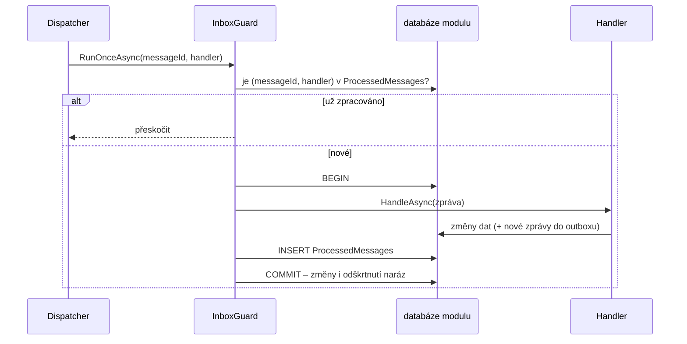

> **V jedné větě:** Příjemce si do tabulky `ProcessedMessages` **odškrtne** každou zpracovanou zprávu
> (ID zprávy + jméno handleru); když stejná přijde znovu, přeskočí ji.

## Jaký problém řeší

Outbox i RabbitMQ doručují **alespoň jednou** (at-least-once). Duplicita vznikne třeba takhle:

1. worker doručí `OrderConfirmed`, handler pošle zákazníkovi potvrzení,
2. aplikace spadne dřív, než worker zprávu v outboxu označí,
3. po restartu worker zprávu doručí znovu → zákazník by dostal dva e-maily.

**Idempotentní** operace = provést ji jednou nebo víckrát má stejný výsledek.

> **Přirovnání:** Sešit odškrtnutých zásilek na recepci. Když kurýr přinese balík s číslem, které už je
> odškrtnuté, recepční ho nepřevezme podruhé.

> **at-least-once doručení + idempotentní příjemce = efektivně právě jednou.**

## Jak to funguje v MiniShopu

- [InboxGuard](code:src/MiniShop.Infrastructure/Inbox/InboxGuard.cs) – samotné odškrtávání.
- [IdempotentDomainEventHandler](code:src/MiniShop.Infrastructure/Inbox/IdempotentDomainEventHandler.cs) –
  dekorátor, kterým `AddDomainEventHandler` obalí **každý** doménový handler.
- [IntegrationMessageDispatcher](code:src/MiniShop.Infrastructure/Integration/IntegrationMessageDispatcher.cs) –
  používá `InboxGuard` pro integrační zprávy.

## Důležité detaily

- **Klíč je dvojice (ID zprávy, handler)** – jednu zprávu zpracuje víc handlerů a každý si ji odškrtne zvlášť.
- **Inbox leží v databázi modulu**, jehož handler běží – jen tak jsou změny handleru a odškrtnutí v jedné transakci.
- **Druhé pojistky.** Některé handlery jsou idempotentní i samy: sága ignoruje zprávu, která nepatří do jejího stavu,
  sklad pozná existující rezervaci, kopie katalogu ignoruje starší změnu, Journeys má unikátní `EventId`.

## Známá omezení

- **Vnější akce nejsou v transakci.** Když handler pošle skutečný e-mail a aplikace spadne před `COMMIT`, e-mail
  při opakování odejde znovu. (V MiniShopu „e-mail“ jen píše do logu.)
- Inbox se nečistí – roste s každou zprávou.

## Na internetu

- [Microservices.io: Idempotent consumer](https://microservices.io/patterns/communication-style/idempotent-consumer.html)
- [Enterprise Integration Patterns: Idempotent Receiver](https://www.enterpriseintegrationpatterns.com/patterns/messaging/IdempotentReceiver.html)
