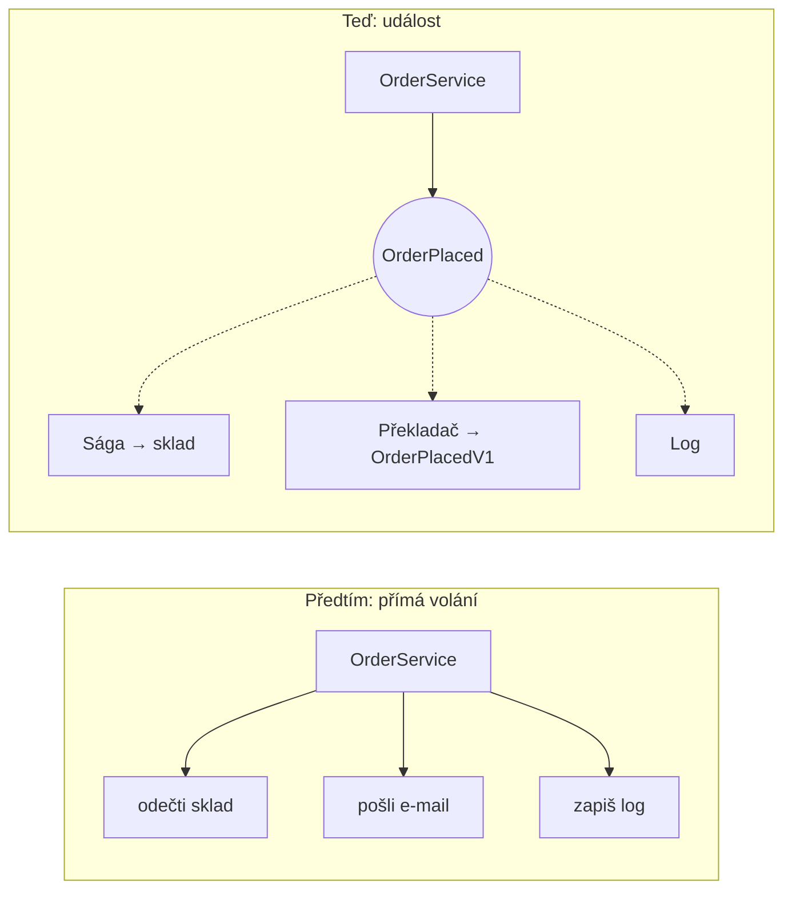

> **V jedné větě:** V event-driven architektuře části systému **nevolají jedna druhou**, ale oznamují,
> **co se stalo** („objednávka vznikla“), a kdo to potřebuje vědět, zareaguje sám.

## Příklad: dřív a teď

**Bez událostí** (MiniShop na začátku): `OrderService.PlaceOrder` uložil objednávku, odečetl sklad a poslal
e-mail. Jedna metoda znala tři oblasti; když spadl e-mail, spadla celá objednávka.

**S událostmi**: `OrderService` jen uloží objednávku. Ta vyvolá událost `OrderPlaced` a na ni nezávisle reagují
sága (rezervace skladu), překladač (zpráva pro okolní svět) a log.

> **Přirovnání:** Místo toho, abyste obvolali všechny kolegy („objednávka přišla, udělej X“), napíšete jednu
> zprávu na nástěnku. Kdo ji potřebuje, ten si ji přečte – a když přibude nový kolega, nemusíte nic měnit.

## Co tím získáme a co to stojí

| Výhoda | Cena |
| --- | --- |
| Odesílatel nezná příjemce – nová reakce = nový handler, nic dalšího se nemění | Tok se hůř čte – není jedna metoda, kde je „všechno“ |
| Výpadek příjemce neshodí odesílatele (zpráva počká) | Data jsou chvíli nekonzistentní (*eventual consistency*) |
| Služby jde nasazovat a škálovat zvlášť | Je potřeba řešit duplicity, pořadí, timeouty a ladění |

**Eventual consistency** v praxi: po odeslání objednávky je chvíli `Pending` a potvrdí se za ~4–8 s
(každý krok ságy čeká na kolo outbox workeru). Nový produkt se objeví v nabídce objednávek za ~2–4 s.

## Stavební kameny (doporučené pořadí čtení)

Každý kámen řeší problém, který vznikl předchozím krokem:

```mermaid
flowchart LR
    k1["1 Doménové<br/>události"] --> k2["2 Integrační<br/>zprávy"] --> k3["3 Outbox<br/>+ worker"] --> k4["4 Inbox<br/>idempotence"]
    k4 --> k5["5 Message<br/>broker"] --> k6["6 Sága"] --> k7["7 Kopie<br/>katalogu"] --> k8["8 Observa-<br/>bilita"] --> k9["9 Proud<br/>událostí"]

    click k1 "/Docs/eda/domenove-udalosti"
    click k2 "/Docs/eda/integracni-zpravy"
    click k3 "/Docs/eda/outbox"
    click k4 "/Docs/eda/inbox"
    click k5 "/Docs/eda/broker"
    click k6 "/Docs/eda/saga"
    click k7 "/Docs/eda/kopie-katalogu"
    click k8 "/Docs/eda/observabilita"
    click k9 "/Docs/eda/proud-udalosti"
```

1. [Doménové události](domenove-udalosti.md) – entita oznámí, co se stalo.
2. [Integrační zprávy](integracni-zpravy.md) – veřejné, verzované zprávy mezi službami (události a příkazy).
3. [Outbox](outbox.md) – jak uložit data a zprávu „naráz“, aby se žádná neztratila.
4. [Inbox](inbox.md) – jak zařídit, aby se zpráva doručená dvakrát zpracovala jen jednou.
5. [Message broker](broker.md) – RabbitMQ doručuje zprávy mezi procesy.
6. [Sága](saga.md) – proces přes dvě služby bez distribuované transakce, s kompenzací.
7. [Kopie katalogu](kopie-katalogu.md) – vlastní kopie cizích dat udržovaná událostmi.
8. [Observabilita](observabilita.md) – jak sledovat jednu objednávku přes služby a zprávy.
9. [Proud událostí](proud-udalosti.md) – ukládat, *co se dělo*, a stav z toho počítat.

## Na internetu

- [Martin Fowler: What do you mean by „Event-Driven“?](https://martinfowler.com/articles/201701/event-driven.html)
- [Microsoft: Event-driven architecture style](https://learn.microsoft.com/azure/architecture/guide/architecture-styles/event-driven)
- [Eventual consistency (Wikipedie)](https://en.wikipedia.org/wiki/Eventual_consistency)
