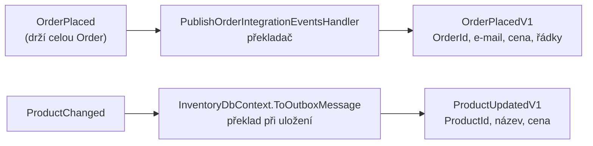

> **V jedné větě:** Integrační zpráva je **smlouva** mezi službami: jednoduchý záznam (`record`) jen s daty,
> s verzí v názvu (`…V1`), který se po zveřejnění už nemění.

## Události vs. příkazy

| | Událost (`IIntegrationEvent`) | Příkaz (`IIntegrationCommand`) |
| --- | --- | --- |
| Gramatika | minulý čas: `StockReservedV1` | rozkazovací způsob: `ReserveStockV1` |
| Kolik příjemců | 0 až N – odesílatel neví kdo | **právě jeden** – služba, které příkaz patří |
| Odpověď | žádná | očekává se událost (`StockReservedV1` / `…FailedV1`) |
| Přirovnání | oznámení na nástěnce | objednávka u dodavatele |

Pravidlo „jeden příkaz = jeden příjemce“ hlídá
[IntegrationMessageRouting](code:src/MiniShop.Infrastructure/Integration/IntegrationMessageRouting.cs) už při startu.

## Všechny kontrakty

{{auto:contracts}}

Kód: [MiniShop.Contracts](code:src/MiniShop.Contracts/). Projekt nemá žádné závislosti, takže ho může
referencovat kdokoli.

## Překlad: z doménové události na integrační

Doménové události jsou interní a smí se měnit. Ven proto jde **překlad** – jen data, která ostatní potřebují:

- **Ordering** překládá v handleru
  [PublishOrderIntegrationEventsHandler](code:src/MiniShop.Application/Ordering/IntegrationEvents/PublishOrderIntegrationEventsHandler.cs) –
  je to jediné místo, kde se rozhoduje, co se okolní svět o objednávce dozví.
- **Inventory** překládá přímo při uložení v
  [InventoryDbContext](code:src/MiniShop.Infrastructure/Inventory/InventoryDbContext.cs) – o kolo workeru rychleji.

## Pravidla verzování

1. Kontrakt se po zveřejnění **nepřejmenovává a nemění**. Příjemce může běžet ve starší verzi.
2. Větší změna = **nový kontrakt** `…V2`; chvíli se posílají oba, dokud všichni příjemci nepřejdou.
3. Hlídá to [IntegrationContractTests](code:tests/MiniShop.Tests/Contracts/IntegrationContractTests.cs) –
   test zná přesný tvar každého kontraktu a změnu neprojde bez vědomého rozhodnutí.

### Příklad: `ProductUpdatedV1` → `ProductUpdatedV2` (expand → contract)

E-shop krok 2 potřeboval ve zprávě o produktu popis, kategorii a dostupnost. Postup ve dvou fázích:

| Fáze | Odesílatel (sklad) | Příjemce (Ordering) |
| --- | --- | --- |
| **expand** (krok 2) | posílá **obě** verze – každá zpráva má vlastní ID | zpracuje obě; V1 kvůli zprávám, které při nasazení čekaly ve frontě |
| **contract** (později) | přestane posílat V1 | handler V1 se odstraní |

> **Přirovnání:** Úřad vydá nový tiskopis „vzor 2“. Nějakou dobu přijímá oba, protože lidé mají doma vyplněný starý.
> Teprve když starý nikdo nenosí, přestane ho přijímat.

Jedna doménová událost (`ProductChanged`) tak vede na dvě zprávy v outboxu – `ToOutboxMessages` modulu jich může vrátit víc.
ID druhé zprávy je **odvozené** z ID události ([MessageIds](code:src/MiniShop.Infrastructure/Outbox/MessageIds.cs)):
stejné při opakovaném uložení, ale jiné než u V1 – inbox příjemce rozlišuje zprávy podle (ID, handler) a V2 by jinak
zahodil jako duplicitu.

## Proč takhle

- Služby se nasazují **nezávisle** – kontrakt je jediné, na čem se musí shodnout.
- Interní model (entita `Order`) se může libovolně měnit, protože ven nikdy přímo nejde.

## Na internetu

- [Microsoft: Komunikace přes integrační události](https://learn.microsoft.com/dotnet/architecture/microservices/multi-container-microservice-net-applications/integration-event-based-microservice-communications)
- [Enterprise Integration Patterns: Command Message](https://www.enterpriseintegrationpatterns.com/patterns/messaging/CommandMessage.html)
- [Enterprise Integration Patterns: Event Message](https://www.enterpriseintegrationpatterns.com/patterns/messaging/EventMessage.html)
