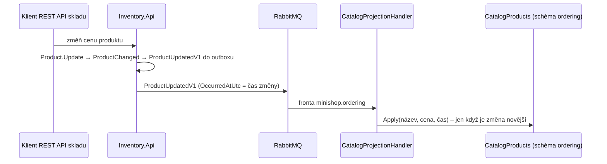
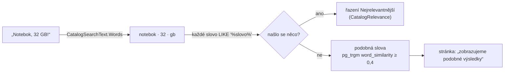

> **V jedné větě:** Ordering nesahá do databáze skladu – drží si **vlastní kopii** (`CatalogProduct`) jen s tím,
> co objednávka a výloha potřebují (název, cena, popis, kategorie, dostupnost), a aktualizuje ji podle událostí
> `ProductUpdatedV1`/`V2`, `StockAvailabilityChangedV1` a `ProductRemovedV1`.

## Jaký problém řeší

Při objednávce je potřeba znát název a cenu produktu. Možnosti:

| Varianta | Problém |
| --- | --- |
| číst tabulku skladu | sdílená databáze = skrytá závislost, sklad nemůže měnit schéma |
| zavolat sklad přes HTTP | když sklad neběží, nejde objednávat |
| **vlastní kopie z událostí** | data jsou pár sekund pozadu (*eventual consistency*) – to je přijatelná cena |

> **Přirovnání:** Prodejna má vlastní ceník. Sklad posílá oběžník při každé změně ceny; prodejna si ceník
> přepíše. Nemusí kvůli každému zákazníkovi volat do skladu.

## Jak to funguje

- [CatalogProduct](code:src/MiniShop.Domain/Orders/CatalogProduct.cs) – kopie produktu; pamatuje si čas poslední změny.
- [CatalogProjectionHandler](code:src/MiniShop.Application/Ordering/Catalog/CatalogProjectionHandler.cs) – projekce.
- [CatalogSyncService](code:src/MiniShop.Application/Ordering/Catalog/CatalogSyncService.cs) – obnova celé kopie.
- [CatalogQueryService](code:src/MiniShop.Application/Ordering/Catalog/CatalogQueryService.cs) – výloha: hledání, filtry, řazení (e-shop krok 2).
- [CartService](code:src/MiniShop.Application/Ordering/Carts/CartService.cs) – košík (e-shop krok 3): ukládá jen ID produktu a množství, název, cenu a dostupnost bere při každém zobrazení z kopie – proto je v košíku vždy aktuální cena.

## Na co si dát pozor

- **Pořadí zpráv není zaručené** (retry, opakování). Kopie proto porovná čas změny a **starší změnu ignoruje**.
- **Smazaný produkt se nemaže, jen označí** (`IsRemoved`). Kdyby se smazal, pozdě doručená starší změna by ho „vzkřísila“.
- **Cena v objednávce je snímek.** Položka si uloží název a cenu v okamžiku objednání – pozdější změna ceny
  starou objednávku neovlivní.
- **Obnova:** když je kopie prázdná (nová schéma `ordering`) nebo neúplná (produkt bez dostupnosti), Web po startu
  pošle `SyncCatalogV1` a sklad znovu pošle všechny produkty. Viz [Obnova katalogu](../toky/obnova-katalogu.md).

## Výloha: popis, kategorie a dostupnost (e-shop krok 2)

Výloha ([`/Shop`](code:src/MiniShop.Web/Pages/Shop/Index.cshtml.cs)) potřebuje víc než objednávka. Kopie katalogu
se proto rozšířila – a ukazuje dva vzory:

**1. Nová verze kontraktu místo změny staré.** Popis a kategorie nejdou přidat do `ProductUpdatedV1` (kontrakt se
po zveřejnění nemění). Sklad posílá **`ProductUpdatedV2`** s celým stavem produktu – a zatím i V1 vedle ní
(*expand → contract*, viz [Integrační zprávy](integracni-zpravy.md)). Projekce zpracuje obě; V2 má odvozené vlastní ID,
jinak by ji inbox projekce zahodil jako duplicitu V1 ([MessageIds](code:src/MiniShop.Infrastructure/Outbox/MessageIds.cs)).

**2. Událost navržená podle potřeby příjemce.** Výloha nepotřebuje přesný počet kusů – jen pásmo:

| Pásmo | Zásoba ve skladu |
| --- | --- |
| Skladem | víc než 5 ks |
| Poslední kusy | 1–5 ks |
| Vyprodáno | 0 |

Sklad pošle **`StockAvailabilityChangedV1`** jen při **změně pásma** (doménová událost `StockAvailabilityChanged`
v [Product](code:src/MiniShop.Domain/Inventory/Product.cs)), ne při každém prodaném kusu. Dostupnost má v kopii
vlastní čas (`AvailabilityChangedAtUtc`) – změna ceny a vyprodání jsou nezávislé zprávy a nesmí se přepisovat.
`ProductUpdatedV2` nese dostupnost jako snímek, takže nový produkt ji zná hned. Tok viz
[Změna dostupnosti](../toky/zmena-dostupnosti.md).

> **Přirovnání:** Prodejna nepotřebuje inventurní soupis skladu – stačí jí cedulka „poslední kusy“ nebo „vyprodáno“.
> Sklad volá, jen když se má cedulka vyměnit.

Dostupnost ve výloze může být o pár sekund pozadu. O objednávce rozhoduje až rezervace v [sáze](saga.md) –
výloha to zákazníkovi říká.

### Obrázky (e-shop krok 2B)

Obrázek je soubor ve skladu – do zprávy jde jen jeho **jméno** (`ProductUpdatedV2.ImageFileName`), kopie katalogu ho
uloží jako každé jiné pole. Výloha pak obrázek načte z adresy Webu
[`/media/products/{soubor}`](code:src/MiniShop.Web/Catalog/ProductImageEndpoint.cs), který ho stáhne ze skladu.
Jméno obsahuje otisk obsahu, takže nový obrázek = nové jméno = nová zpráva – a prohlížeč si každý obrázek smí
uložit natrvalo. Podrobnosti v [modulu Inventory](../architektura/moduly/inventory.md).

> **Přirovnání:** V katalogu zásilkové služby je u zboží jen číslo fotky. Fotky leží v archivu a tiskárna si je
> vyzvedne, až je potřebuje – nikdo je nerozesílá s každou změnou ceny.

## Hledání: read model tvarovaný pro čtení (CQRS)

Výloha hledá jen v kopii katalogu ([CatalogQueryService](code:src/MiniShop.Application/Ordering/Catalog/CatalogQueryService.cs)) –
funguje i při výpadku skladu. SQLite ale porovnává bez ohledu na velikost písmen jen ASCII a o diakritice neví
(„mys“ by nenašlo „Myš“). Kopie si proto při každé změně uloží **`SearchText`** – název, popis a kategorii malými
písmeny bez diakritiky ([CatalogSearchText](code:src/MiniShop.Domain/Orders/CatalogSearchText.cs)) – a stejně se
upraví i hledaný text. To je podstata CQRS: data pro čtení jsou uložená tak, jak se z nich čte, ne jak se zapisují.

- Filtr (text, kategorie, „jen skladem“) dělá databáze; řazení podle ceny a české řazení názvů až aplikace
  (z doby SQLite, které neřadilo `decimal`) – u stovek produktů to nevadí.

### Po slovech, s překlepy a našeptávačem (e-shop krok 21)

Hledání je jako prodavač, který rozumí i nepřesnému dotazu: „notebook 32 gb“ najde notebook s 32 GB RAM, i když slova
v popisu nejdou za sebou, a „klavesnyce“ najde klávesnici.

- **Slova** ([CatalogSearchText.Words](code:src/MiniShop.Domain/Orders/CatalogSearchText.cs)): dotaz se normalizuje
  (malá písmena bez diakritiky), rozdělí na slova a z krajů slov se ořízne interpunkce. **Každé** slovo musí být v `SearchText`
  (v libovolném pořadí, stačí kus slova – „nord“ najde „Nordix“). Znaky `%` a `_` z dotazu se v `LIKE` berou doslova.
- **Relevance** ([CatalogRelevance](code:src/MiniShop.Application/Ordering/Catalog/CatalogRelevance.cs)): s hledaným textem je
  výchozí řazení „Nejrelevantnější“ – shoda v názvu má váhu 3, v kategorii 2, v popisu 1; celé slovo > začátek slova > kus slova.
  Ostatní řazení (cena, hodnocení, název) jde dál vybrat.
- **Překlepy** – rozšíření PostgreSQL **pg_trgm** rozloží slova na trojice písmen („klavesnyce“ → `kla`, `lav`, `ave`…) a změří,
  kolik jich má dotaz společných s textem produktu (`word_similarity`, 0–1). Použije se, **jen když přesné hledání nic nenajde**
  (přesná shoda má přednost, jinak by se do výsledků pletl šum); hranice 0,4 je naměřená
  (`CatalogQueryService.SimilarityThreshold`). Rozšíření a index GIN (`gin_trgm_ops`, zrychlí i `LIKE '%…%'`) zakládá migrace
  `CatalogSearchTrigrams` – rozšíření patří celé databázi (schéma `public`), index je ve schématu `ordering`.
- **Našeptávač** – `GET /api/catalog/suggest?q=` ([CatalogController](code:src/MiniShop.Web/Controllers/CatalogController.cs),
  veřejný, limit 120 dotazů za minutu z IP – `CatalogRateLimiting`) vrátí až 3 kategorie a 6 produktů;
  [search-suggest.js](code:src/MiniShop.Web/wwwroot/js/search-suggest.js) je ukáže pod polem v hlavičce i na stránce Obchod
  (200 ms po dopsání, šipky, Enter, Esc). Bez JavaScriptu zůstává obyčejný formulář.
- **Bez osobních údajů:** text dotazu je volný text zákazníka – do trasy jde jen počet výsledků (`minishop.search.results`)
  a příznak podobných slov (`minishop.search.similar`), Serilog loguje cestu bez parametrů a Alloy maže `url.query`.
- **Záměrně ne:** český slovník (stemming) PostgreSQL – ve výchozí instalaci není a v kontejneru by se musel doinstalovat;
  tvary („notebooky“) pokryje kus slova a podobnost trojic.
- Kategorie ve filtru vznikají z kopie (jen ty, ve kterých je něco v nabídce). Kategorie samotné spravuje sklad;
  Ordering zná jejich jméno jen ze zpráv o produktech – přejmenování kategorie proto sklad oznámí novou
  `ProductUpdatedV2` pro každý její produkt.

## Známá omezení

- Nový produkt je v nabídce objednávek za ~2–4 s, změna dostupnosti stejně.
- Obnova produkty jen přidává/aktualizuje – zmeškané `ProductRemovedV1` neopraví.
- Sklad zatím posílá V1 i V2 (dvojnásobek zpráv o produktech); odebrání V1 je samostatný krok.
- Hledá se podřetězcem (`instr`) bez indexu a bez překlepů – pro stovky produktů stačí, pro tisíce by byl potřeba
  fulltext (PostgreSQL `tsvector`) nebo vyhledávací služba.

## Na internetu

- [Microsoft: Materialized View pattern](https://learn.microsoft.com/azure/architecture/patterns/materialized-view)
- [Microservices.io: CQRS](https://microservices.io/patterns/data/cqrs.html)
- [Martin Fowler: CQRS](https://martinfowler.com/bliki/CQRS.html)
