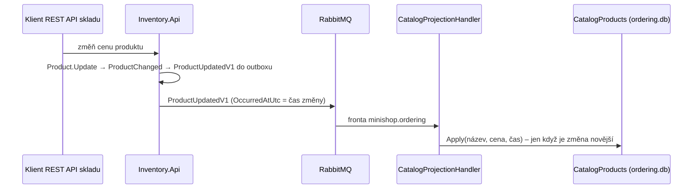

> **V jedné větě:** Ordering nesahá do databáze skladu – drží si **vlastní kopii** (`CatalogProduct`) jen s tím,
> co objednávka potřebuje (název, cena), a aktualizuje ji podle událostí `ProductUpdatedV1` / `ProductRemovedV1`.

## Jaký problém řeší

Při objednávce je potřeba znát název a cenu produktu. Možnosti:

| Varianta | Problém |
| --- | --- |
| číst tabulku skladu | sdílená databáze = skrytá závislost, sklad nemůže měnit schéma |
| zavolat sklad přes HTTP | když sklad neběží, nejde objednávat |
| **vlastní kopie z událostí** | data jsou pár sekund pozadu (*eventual consistency*) – to je přijatelná cena |

> **Přirovnání:** Prodejna má vlastní ceník. Sklad posílá oběžník při každé změně ceny; prodejna si ceník
> přepíše. Nemusí kvůli každému zákazníkovi volat do skladu.

## Jak to funguje

- [CatalogProduct](code:src/MiniShop.Domain/Orders/CatalogProduct.cs) – kopie produktu; pamatuje si čas poslední změny.
- [CatalogProjectionHandler](code:src/MiniShop.Application/Ordering/Catalog/CatalogProjectionHandler.cs) – projekce.
- [CatalogSyncService](code:src/MiniShop.Application/Ordering/Catalog/CatalogSyncService.cs) – obnova celé kopie.

## Na co si dát pozor

- **Pořadí zpráv není zaručené** (retry, opakování). Kopie proto porovná čas změny a **starší změnu ignoruje**.
- **Smazaný produkt se nemaže, jen označí** (`IsRemoved`). Kdyby se smazal, pozdě doručená starší změna by ho „vzkřísila“.
- **Cena v objednávce je snímek.** Položka si uloží název a cenu v okamžiku objednání – pozdější změna ceny
  starou objednávku neovlivní.
- **Obnova:** když je kopie prázdná (nová `ordering.db`), Web po startu pošle `SyncCatalogV1` a sklad znovu pošle
  všechny produkty. Viz [Obnova katalogu](../toky/obnova-katalogu.md).

## Známá omezení

- Nový produkt je v nabídce objednávek za ~2–4 s.
- Obnova produkty jen přidává/aktualizuje – zmeškané `ProductRemovedV1` neopraví.

## Na internetu

- [Microsoft: Materialized View pattern](https://learn.microsoft.com/azure/architecture/patterns/materialized-view)
- [Microservices.io: CQRS](https://microservices.io/patterns/data/cqrs.html)
- [Martin Fowler: CQRS](https://martinfowler.com/bliki/CQRS.html)
