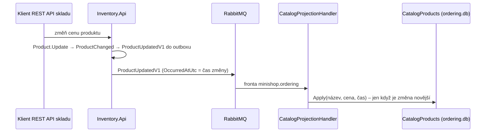

> **V jedné větě:** Ordering nesahá do databáze skladu – drží si **vlastní kopii** (`CatalogProduct`) jen s tím,
> co objednávka a výloha potřebují (název, cena, popis, kategorie, dostupnost), a aktualizuje ji podle událostí
> `ProductUpdatedV1`/`V2`, `StockAvailabilityChangedV1` a `ProductRemovedV1`.

## Jaký problém řeší

Při objednávce je potřeba znát název a cenu produktu. Možnosti:

| Varianta | Problém |
| --- | --- |
| číst tabulku skladu | sdílená databáze = skrytá závislost, sklad nemůže měnit schéma |
| zavolat sklad přes HTTP | když sklad neběží, nejde objednávat |
| **vlastní kopie z událostí** | data jsou pár sekund pozadu (*eventual consistency*) – to je přijatelná cena |

> **Přirovnání:** Prodejna má vlastní ceník. Sklad posílá oběžník při každé změně ceny; prodejna si ceník
> přepíše. Nemusí kvůli každému zákazníkovi volat do skladu.

## Jak to funguje

- [CatalogProduct](code:src/MiniShop.Domain/Orders/CatalogProduct.cs) – kopie produktu; pamatuje si čas poslední změny.
- [CatalogProjectionHandler](code:src/MiniShop.Application/Ordering/Catalog/CatalogProjectionHandler.cs) – projekce.
- [CatalogSyncService](code:src/MiniShop.Application/Ordering/Catalog/CatalogSyncService.cs) – obnova celé kopie.
- [CatalogQueryService](code:src/MiniShop.Application/Ordering/Catalog/CatalogQueryService.cs) – výloha: hledání, filtry, řazení (e-shop krok 2).

## Na co si dát pozor

- **Pořadí zpráv není zaručené** (retry, opakování). Kopie proto porovná čas změny a **starší změnu ignoruje**.
- **Smazaný produkt se nemaže, jen označí** (`IsRemoved`). Kdyby se smazal, pozdě doručená starší změna by ho „vzkřísila“.
- **Cena v objednávce je snímek.** Položka si uloží název a cenu v okamžiku objednání – pozdější změna ceny
  starou objednávku neovlivní.
- **Obnova:** když je kopie prázdná (nová `ordering.db`) nebo neúplná (produkt bez dostupnosti), Web po startu
  pošle `SyncCatalogV1` a sklad znovu pošle všechny produkty. Viz [Obnova katalogu](../toky/obnova-katalogu.md).

## Výloha: popis, kategorie a dostupnost (e-shop krok 2)

Výloha ([`/Shop`](code:src/MiniShop.Web/Pages/Shop/Index.cshtml.cs)) potřebuje víc než objednávka. Kopie katalogu
se proto rozšířila – a ukazuje dva vzory:

**1. Nová verze kontraktu místo změny staré.** Popis a kategorie nejdou přidat do `ProductUpdatedV1` (kontrakt se
po zveřejnění nemění). Sklad posílá **`ProductUpdatedV2`** s celým stavem produktu – a zatím i V1 vedle ní
(*expand → contract*, viz [Integrační zprávy](integracni-zpravy.md)). Projekce zpracuje obě; V2 má odvozené vlastní ID,
jinak by ji inbox projekce zahodil jako duplicitu V1 ([MessageIds](code:src/MiniShop.Infrastructure/Outbox/MessageIds.cs)).

**2. Událost navržená podle potřeby příjemce.** Výloha nepotřebuje přesný počet kusů – jen pásmo:

| Pásmo | Zásoba ve skladu |
| --- | --- |
| Skladem | víc než 5 ks |
| Poslední kusy | 1–5 ks |
| Vyprodáno | 0 |

Sklad pošle **`StockAvailabilityChangedV1`** jen při **změně pásma** (doménová událost `StockAvailabilityChanged`
v [Product](code:src/MiniShop.Domain/Inventory/Product.cs)), ne při každém prodaném kusu. Dostupnost má v kopii
vlastní čas (`AvailabilityChangedAtUtc`) – změna ceny a vyprodání jsou nezávislé zprávy a nesmí se přepisovat.
`ProductUpdatedV2` nese dostupnost jako snímek, takže nový produkt ji zná hned. Tok viz
[Změna dostupnosti](../toky/zmena-dostupnosti.md).

> **Přirovnání:** Prodejna nepotřebuje inventurní soupis skladu – stačí jí cedulka „poslední kusy“ nebo „vyprodáno“.
> Sklad volá, jen když se má cedulka vyměnit.

Dostupnost ve výloze může být o pár sekund pozadu. O objednávce rozhoduje až rezervace v [sáze](saga.md) –
výloha to zákazníkovi říká.

## Hledání: read model tvarovaný pro čtení (CQRS)

Výloha hledá jen v kopii katalogu ([CatalogQueryService](code:src/MiniShop.Application/Ordering/Catalog/CatalogQueryService.cs)) –
funguje i při výpadku skladu. SQLite ale porovnává bez ohledu na velikost písmen jen ASCII a o diakritice neví
(„mys“ by nenašlo „Myš“). Kopie si proto při každé změně uloží **`SearchText`** – název, popis a kategorii malými
písmeny bez diakritiky ([CatalogSearchText](code:src/MiniShop.Domain/Orders/CatalogSearchText.cs)) – a stejně se
upraví i hledaný text. To je podstata CQRS: data pro čtení jsou uložená tak, jak se z nich čte, ne jak se zapisují.

- Filtr (text, kategorie, „jen skladem“) dělá databáze; řazení podle ceny a české řazení názvů až aplikace
  (SQLite neřadí `decimal`) – u stovek produktů to nevadí.
- Kategorie ve filtru vznikají z kopie (jen ty, ve kterých je něco v nabídce). Kategorie samotné spravuje sklad;
  Ordering zná jejich jméno jen ze zpráv o produktech – přejmenování kategorie proto sklad oznámí novou
  `ProductUpdatedV2` pro každý její produkt.

## Známá omezení

- Nový produkt je v nabídce objednávek za ~2–4 s, změna dostupnosti stejně.
- Obnova produkty jen přidává/aktualizuje – zmeškané `ProductRemovedV1` neopraví.
- Sklad zatím posílá V1 i V2 (dvojnásobek zpráv o produktech); odebrání V1 je samostatný krok.
- Hledá se podřetězcem (`instr`) bez indexu a bez překlepů – pro stovky produktů stačí, pro tisíce by byl potřeba
  fulltext (SQLite FTS5) nebo vyhledávací služba.

## Na internetu

- [Microsoft: Materialized View pattern](https://learn.microsoft.com/azure/architecture/patterns/materialized-view)
- [Microservices.io: CQRS](https://microservices.io/patterns/data/cqrs.html)
- [Martin Fowler: CQRS](https://martinfowler.com/bliki/CQRS.html)
