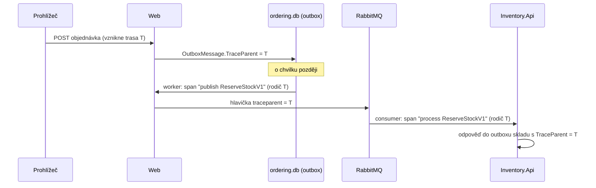

> **V jedné větě:** Každý požadavek dostane **trace ID**, které putuje s každou zprávou (v outboxu i v RabbitMQ),
> takže v Aspire dashboardu je celá cesta objednávky vidět jako jeden strom.

## Jaký problém řeší

U jedné aplikace stačí log. U EDA je jedna objednávka rozprostřená do HTTP požadavku, několika kol outbox workeru,
dvou služeb a brokeru – a mezi kroky jsou sekundy. Bez trasování by se hledání chyby rovnalo hledání jehly v kupce sena.

> **Přirovnání:** Sledovací číslo zásilky. Ať balík leží na kterékoli poště, podle čísla zjistíte celou jeho cestu.

## Jak se trace ID přenáší

- Trace ID nese **obálka** zprávy, ne kontrakt: sloupec `OutboxMessage.TraceParent`
  ([OutboxMessageFactory](code:src/MiniShop.Infrastructure/Outbox/OutboxMessageFactory.cs)) a hlavička
  `traceparent` v RabbitMQ (standard [W3C Trace Context](https://www.w3.org/TR/trace-context/)).
- Spany a metriky zpráv vytváří jen [MessagingTelemetry](code:src/MiniShop.Infrastructure/Observability/MessagingTelemetry.cs)
  (zdroj `MiniShop.Messaging`). Infrastructure používá jen `System.Diagnostics` – balíčky OpenTelemetry má jen
  [ServiceDefaults](code:src/MiniShop.ServiceDefaults/ServiceDefaultsExtensions.cs).
- Číslo objednávky se na span přidá jako tag `minishop.order.id`
  ([TraceTags](code:src/MiniShop.Application/Abstractions/TraceTags.cs)) – v dashboardu jde hledat podle objednávky.

## Tři pilíře

| Pilíř | Co v MiniShopu | Kde vidět |
| --- | --- | --- |
| **Trasy** | HTTP, SQL (EF Core), outbox, RabbitMQ, sága | Aspire dashboard → Traces |
| **Metriky** | doručené/selhané zprávy, zpoždění outboxu, zpracované zprávy consumerů, runtime .NET | Aspire dashboard → Metrics |
| **Logy** | Serilog → konzole, denní soubor a OpenTelemetry (propojené s trasou) | Aspire dashboard → Structured logs, `logs/` |

## Health checky

- `/health` – služba je připravená (Aspire, Docker Compose a monitoring se ptají sem).
- `/alive` – proces žije.
- [OutboxHealthCheck](code:src/MiniShop.Infrastructure/Observability/OutboxHealthCheck.cs) hlásí *Degraded*,
  když zpráva visí v outboxu déle než 5 minut („visí pošta?“).

## Známá omezení

- Timeout ságy a obnova katalogu začínají **vlastní trasu** (nenavazují na původní požadavek) – nejsou vyvolané uživatelem.
- Telemetrie se drží jen v paměti dashboardu (po restartu je pryč), bez vzorkování.

## Na internetu

- [OpenTelemetry – koncepty](https://opentelemetry.io/docs/concepts/)
- [.NET Aspire dashboard](https://learn.microsoft.com/dotnet/aspire/fundamentals/dashboard/overview)
- [W3C Trace Context](https://www.w3.org/TR/trace-context/)
- [Microsoft: Health Endpoint Monitoring pattern](https://learn.microsoft.com/azure/architecture/patterns/health-endpoint-monitoring)
