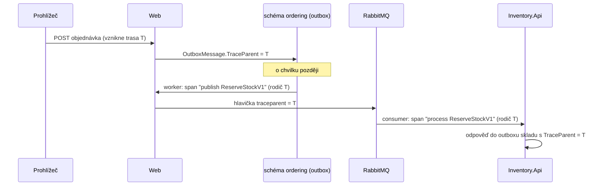

> **V jedné větě:** Každý požadavek dostane **trace ID**, které putuje s každou zprávou (v outboxu i v RabbitMQ),
> takže v Aspire dashboardu je celá cesta objednávky vidět jako jeden strom.

## Jaký problém řeší

U jedné aplikace stačí log. U EDA je jedna objednávka rozprostřená do HTTP požadavku, několika kol outbox workeru,
dvou služeb a brokeru – a mezi kroky jsou sekundy. Bez trasování by se hledání chyby rovnalo hledání jehly v kupce sena.

> **Přirovnání:** Sledovací číslo zásilky. Ať balík leží na kterékoli poště, podle čísla zjistíte celou jeho cestu.

## Jak se trace ID přenáší

- Trace ID nese **obálka** zprávy, ne kontrakt: sloupec `OutboxMessage.TraceParent`
  ([OutboxMessageFactory](code:src/MiniShop.Infrastructure/Outbox/OutboxMessageFactory.cs)) a hlavička
  `traceparent` v RabbitMQ (standard [W3C Trace Context](https://www.w3.org/TR/trace-context/)).
- Spany a metriky zpráv vytváří jen [MessagingTelemetry](code:src/MiniShop.Infrastructure/Observability/MessagingTelemetry.cs)
  (zdroj `MiniShop.Messaging`). Infrastructure používá jen `System.Diagnostics` – balíčky OpenTelemetry má jen
  [ServiceDefaults](code:src/MiniShop.ServiceDefaults/ServiceDefaultsExtensions.cs).
- Číslo objednávky se na span přidá jako tag `minishop.order.id`
  ([TraceTags](code:src/MiniShop.Application/Abstractions/TraceTags.cs)) – v dashboardu jde hledat podle objednávky.

## Tři pilíře

| Pilíř | Co v MiniShopu | Kde vidět |
| --- | --- | --- |
| **Trasy** | HTTP, SQL (EF Core), outbox, RabbitMQ, sága | Aspire dashboard → Traces; s historií 14 dní Grafana Cloud → Explore (Tempo) |
| **Metriky** | doručené/selhané zprávy, zpoždění outboxu, zpracované zprávy consumerů, runtime .NET; od observability G2 i **stav** (viz níže) a doba potvrzení objednávky | Aspire dashboard → Metrics; Grafana Cloud (Mimir) + dashboard „MiniShop – zprávy a ságy“ |
| **Logy** | Serilog → konzole, denní soubor a OpenTelemetry (propojené s trasou) | Aspire dashboard → Structured logs, Grafana Cloud (Loki), `logs/` |

## Metriky stavu (observabilita G2)

Čítače výše říkají, **co se stalo** („doručena zpráva“). Pro dashboard a alarmy je potřeba i **jak to teď vypadá** – přirovnání:
počítadlo projetých aut vs. pohled na parkoviště, kolik jich právě stojí.

| Metrika (v Grafaně) | Co znamená | Štítky |
| --- | --- | --- |
| `minishop_outbox_pending` | nezpracované zprávy v outboxu modulu (i čekající na další pokus) | `module` |
| `minishop_outbox_poison` | zprávy, které vyčerpaly pokusy – čekají na člověka | `module` |
| `minishop_queue_backlog` | zprávy čekající ve frontě modulu v RabbitMQ | `queue` |
| `minishop_queue_dead_letters` | zprávy v `minishop.{modul}.dead` | `queue` |
| `minishop_saga_active` | rozpracované ságy (konečné stavy se nehlásí) | `saga` (order/return), `state` |
| `minishop_order_confirmation_duration_seconds` | histogram: od založení objednávky po potvrzení ságou | `payment` (none/card/cashondelivery) |

- Stav zjišťuje [OperationalMetricsWorker](code:src/MiniShop.Infrastructure/Hosting/OperationalMetricsWorker.cs) každých 30 s
  ze zdrojů `IOperationalMetricsSource` ([outbox a fronty](code:src/MiniShop.Infrastructure/Observability/MessagingStatusSources.cs),
  [ságy](code:src/MiniShop.Infrastructure/Ordering/SagaStatusSource.cs)) – **jen na vedoucí kopii** (jinak by dvě kopie Webu hlásily totéž
  dvakrát). Hodnoty drží [OperationalMetrics](code:src/MiniShop.Infrastructure/Observability/OperationalMetrics.cs) a OpenTelemetry je čte
  jako *observable gauge*; snímek starší než 2 min se nehlásí (žádná zamrzlá čísla po ztrátě vedení).
- Doba potvrzení se zapíše v [OrderSagaOrchestrator](code:src/MiniShop.Application/Ordering/Saga/OrderSagaOrchestrator.cs) až po
  uložení ([OrderingTelemetry](code:src/MiniShop.Application/Ordering/Saga/OrderingTelemetry.cs), zdroj `MiniShop.Ordering`).
- Štítky nikdy nenesou ID (objednávky, zprávy) – každá kombinace štítků je v Grafaně samostatná řada (limit free tieru 10 000).
- Jména v Grafaně: tečky → podtržítka, čítač dostane `_total`, jednotka sekundy `_seconds`.
- Každá kopie služby nese vlastní `service.instance.id` (v Grafaně štítek `instance`; [ServiceInstance](code:src/MiniShop.ServiceDefaults/ServiceInstance.cs) – jméno
  kontejneru, lokálně z Aspire). Bez něj se metriky dvou kopií Webu slily do jedné řady a čítače dávaly nesmysly (observabilita G3).
  Kontrola: `target_info{job="web"}` má mít tolik řad, kolik běží kopií.

## Health checky

- `/health` – služba je připravená (Aspire, Docker Compose a monitoring se ptají sem).
- `/alive` – proces žije.
- [OutboxHealthCheck](code:src/MiniShop.Infrastructure/Observability/OutboxHealthCheck.cs) hlásí *Degraded*,
  když zpráva visí v outboxu déle než 5 minut („visí pošta?“).

## Známá omezení

- Timeout ságy a obnova katalogu začínají **vlastní trasu** (nenavazují na původní požadavek) – nejsou vyvolané uživatelem.
- Telemetrie se drží jen v paměti dashboardu (po restartu je pryč), bez vzorkování.

## Na internetu

- [OpenTelemetry – koncepty](https://opentelemetry.io/docs/concepts/)
- [.NET Aspire dashboard](https://learn.microsoft.com/dotnet/aspire/fundamentals/dashboard/overview)
- [W3C Trace Context](https://www.w3.org/TR/trace-context/)
- [Microsoft: Health Endpoint Monitoring pattern](https://learn.microsoft.com/azure/architecture/patterns/health-endpoint-monitoring)
