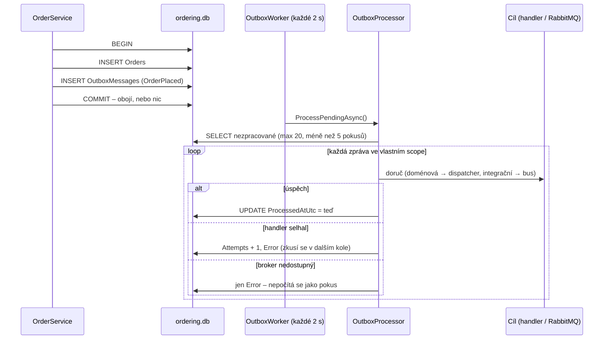

> **V jedné větě:** Zpráva se neposílá hned, ale **uloží se do tabulky `OutboxMessages` ve stejné transakci
> jako data**. Proces na pozadí ji pak doručí – a když se to nepovede, zkusí to znovu.

## Jaký problém řeší (dual write)

Uložit objednávku do databáze a poslat zprávu do RabbitMQ jsou **dvě různé operace**. Bez outboxu:

- uložím objednávku → aplikace spadne → zpráva nikdy neodejde (sklad o objednávce neví),
- pošlu zprávu → uložení selže → sklad rezervuje zboží pro objednávku, která neexistuje.

Distribuovaná transakce přes DB a broker v praxi nefunguje (a SQLite ani RabbitMQ ji neumí).

> **Přirovnání:** Podací kniha na poště. Dopis nenesete rovnou adresátovi – zapíšete ho do knihy spolu s ostatními
> papíry v jedné složce. Pošťák chodí každé dvě sekundy, bere zápisy z knihy a odškrtává doručené.

## Jak to funguje v MiniShopu

Kód:
[ModuleDbContext.SaveChangesAsync](code:src/MiniShop.Infrastructure/Persistence/ModuleDbContext.cs) (uložení),
[OutboxWorker](code:src/MiniShop.Infrastructure/Hosting/OutboxWorker.cs) (časovač),
[OutboxProcessor](code:src/MiniShop.Infrastructure/Outbox/OutboxProcessor.cs) (doručení),
[OutboxMessage](code:src/MiniShop.Infrastructure/Outbox/OutboxMessage.cs) (řádek tabulky).

## Důležité detaily

- **Každý modul má vlastní outbox** ve své databázi. Jinak by zpráva nebyla v téže transakci jako data.
- **Dva druhy zpráv** (`Kind`): *doménová* jde handlerům ve stejné službě, *integrační* ven přes
  [broker](broker.md).
- **Retry bez backoffu:** neúspěšná zpráva se zkusí v dalším kole (za 2 s), maximálně 5×. Pak je to
  **poison message** – zůstane v tabulce s chybou a čeká na člověka.
- **Výpadek brokeru se nepočítá jako pokus** – chyba není ve zprávě, zprávy počkají, až se RabbitMQ vrátí.
- **Doručení „alespoň jednou“ (at-least-once):** když aplikace spadne po doručení, ale před označením, zpráva odejde
  znovu. Proto příjemce potřebuje [inbox](inbox.md).
- **Trasování:** zpráva si v `TraceParent` nese ID trasy, ve které vznikla – viz [Observabilita](observabilita.md).
- **Health check:** `/health` hlásí *Degraded*, když zpráva visí déle než 5 minut
  ([OutboxHealthCheck](code:src/MiniShop.Infrastructure/Observability/OutboxHealthCheck.cs)).

## Známá omezení

- Worker počítá s **jednou instancí** služby. Při více instancích by bylo potřeba zprávy zamykat.
- Zpracované zprávy se nemažou (tabulka roste) – pro výuku to nevadí, v produkci by se čistila.
- Každý krok ságy čeká na kolo workeru, proto potvrzení objednávky trvá několik sekund.

## Na internetu

- [Microservices.io: Transactional outbox](https://microservices.io/patterns/data/transactional-outbox.html)
- [Microsoft: Transactional outbox (příklad s Cosmos DB)](https://learn.microsoft.com/azure/architecture/databases/guide/transactional-outbox-cosmos)
