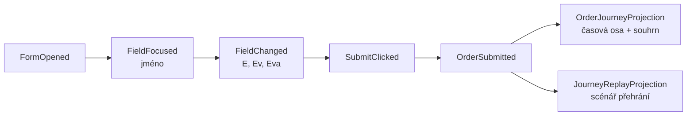

> **V jedné větě:** Modul Journeys neukládá „jak formulář nakonec vypadal“, ale **seznam všeho, co uživatel
> udělal**. Časovou osu, souhrn i přehrání z něj počítají **projekce**.

## Jak se to liší od běžného ukládání

| Běžně (stav) | Proud událostí |
| --- | --- |
| tabulka `Orders` – řádek se přepisuje | tabulka `JourneyEvents` – řádky jen přibývají |
| víte, *jak to je* | víte, *jak se to stalo* |
| nový pohled na data = často nedostupný | nový pohled = nová projekce nad stejným proudem |

> **Přirovnání:** Výpis z účtu. Banka si nepamatuje jen zůstatek, ale každý pohyb. Zůstatek kdykoli spočítá –
> a stejně tak třeba „kolik jsem utratil za jídlo v březnu“, na což při ukládání nikdo nemyslel.

## Projekce = fold

Projekce začne s prázdným stavem a pro každou událost v pořadí zavolá `Apply`, která stav posune dál.
Kód: [OrderJourneyProjection](code:src/MiniShop.Application/Journeys/OrderJourneyProjection.cs),
[JourneyReplayProjection](code:src/MiniShop.Application/Journeys/JourneyReplayProjection.cs).

Stejný princip má i [kopie katalogu](kopie-katalogu.md) – jen se výsledek projekce ukládá do tabulky.

## Důležité detaily

- **Čas = milisekundy od otevření formuláře** (hodiny prohlížeče). Pořadí a pauzy jsou přesné, i když dávky
  dorazí na server pozdě nebo v jiném pořadí.
- **Idempotence přes unikátní `EventId`** z prohlížeče – dávka poslaná dvakrát (`fetch` i `sendBeacon`) se nezdvojí.
- **Nové typy událostí jen na konec** `JourneyEventType` (ukládají se jako text, staré proudy musí jít číst dál).
- Některé události zapisuje **jen server** (`ValidationFailed`, `OrderSubmitted`) – prohlížeči se nevěří.

## Proč takhle

Pro průběh formuláře je proud ideální: zajímá nás právě *jak* uživatel postupoval (kde váhal, co opravoval).
Plný **event sourcing** (i objednávky jako proud) MiniShop nepoužívá – přináší složitost (verzování událostí,
snapshoty), která by výuku ostatních konceptů zbytečně zatemnila.

## Na internetu

- [Martin Fowler: Event Sourcing](https://martinfowler.com/eaaDev/EventSourcing.html)
- [Microsoft: Event Sourcing pattern](https://learn.microsoft.com/azure/architecture/patterns/event-sourcing)
