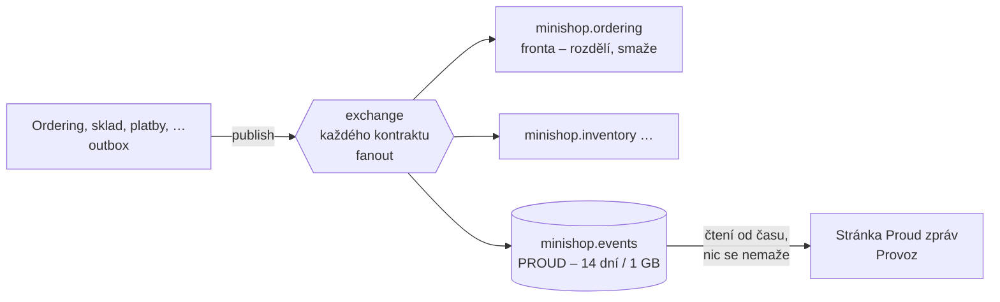

> **V jedné větě:** Kromě front, ze kterých si moduly zprávy **berou** (a zprávy mizí), teď každá zpráva skončí i v **proudu**
> `minishop.events` – deníku, ze kterého se jen **čte** od zvolené záložky a nic se nemaže (až po 14 dnech).

## Fronta vs. proud (log)

| | Fronta (dosud) | Proud / log (od kroku B1) |
| --- | --- | --- |
| Přirovnání | schránka na dopisy – vyzvednuto = pryč | kniha jízd – zápisy zůstávají, každý čtenář má svou záložku |
| Po přečtení | zpráva zmizí (ack) | zpráva zůstává; ack jen řídí, kolik zpráv broker pošle dál |
| Víc čtenářů | každý potřebuje vlastní frontu (kopii) | čtou tentýž proud nezávisle, každý od svého místa |
| Nový čtenář | dostane jen nové zprávy | může si přečíst historii (přehrání, *replay*) |
| Neúspěch | opakování, dead-letter fronta | nic takového – čtenář přeskočí nebo zastaví |
| Mazání | po zpracování | **retence**: podle stáří (14 dní) a velikosti (1 GB) |
| Na co | úkol, který má někdo udělat (rezervuj, pošli e-mail) | historie, ze které si každý vyčte, co potřebuje (audit, statistiky) |

Tohle je princip **Apache Kafka**. RabbitMQ ho umí od verze 3.9 jako typ fronty `stream` – nový broker nepotřebujeme.

**Záložka (offset)** = pořadové číslo zprávy v proudu (0, 1, 2…). Čtenář řekne, odkud chce číst: `first` (od začátku
retence), `next` (jen nové), konkrétní číslo, nebo **čas** – RabbitMQ najde blok zpráv z té doby.

**Proud není zdroj pravdy.** Pravda zůstává v databázích modulů. Proud je kopie zpráv na 14 dní – na rozdíl od
[event sourcingu košíku](event-sourcing.md), kde jsou události samy stavem a nemažou se.

## Jak to MiniShop používá

- **Založení:** [RabbitMqEventStream](code:src/MiniShop.Infrastructure/Integration/RabbitMq/RabbitMqEventStream.cs) –
  fronta s `x-queue-type: stream`, `x-max-age: 14D`, `x-max-length-bytes` 1 GB, segmenty po 50 MB (retence maže celé
  segmenty – menší = jemněji). Navázaná na exchange **všech** kontraktů. Zakládá ji Web po startu
  ([EventStreamSetupWorker](code:src/MiniShop.Infrastructure/Hosting/EventStreamSetupWorker.cs), vedoucí kopie,
  idempotentně) – nový kontrakt se tak naváže sám s nasazením kódu.
- **Čtení:** [RabbitMqEventStreamReader](code:src/MiniShop.Infrastructure/Integration/RabbitMq/RabbitMqEventStream.cs) –
  vlastní kanál, `BasicQos` (proud ho vyžaduje), `BasicConsume` s argumentem `x-stream-offset` = čas. Čte, dokud chvíli
  (0,8 s) nepřijde nic – to je „konec“ – a odpojí se. Nejvýš 50 000 prohledaných a 2 000 zobrazených zpráv.
- **Stránka Proud zpráv** (`/Admin/EventStream`, role Provoz): od kdy (15 min … 7 dní, nebo čas), typ zprávy, číslo
  objednávky → tabulka: pořadí v proudu, čas faktu, typ, objednávka, JSON. Číslo objednávky ukáže celou **pouť
  objednávky napříč moduly** (OrderPlacedV2 → ReserveStockV1 → StockReservedV1 → … → OrderStatusChangedV1 →
  ShipmentStatusChangedV1 → OrderCompletedV1 → InvoiceIssuedV1) v pořadí, jak šly brokerem. Z detailu objednávky odkaz
  „Zprávy v proudu“ (jen Provoz).
- **Osobní údaje:** zprávy je nesou (jméno, e-mail, adresa kvůli e-mailům a dopravci). Stránka je ukazuje
  zamaskované – [PersonalDataMask](code:src/MiniShop.Infrastructure/Integration/PersonalDataMask.cs) podle jména pole
  (`CustomerName`, `CustomerEmail`, `RecipientName`, `DeliveryAddress`, `Street`, `City`, `PostalCode`, `Reason`,
  `…Email`). Nový kontrakt s takovým polem bez masky zastaví test `PersonalDataMaskTests`.

## Rozhodnutí

- **AMQP, ne nativní protokol streamů.** RabbitMQ má pro proudy i vlastní protokol (port 5552, plugin `rabbitmq_stream`,
  knihovna `RabbitMQ.Stream.Client`) – rychlejší, umí říct „kde proud končí“ a hlídá záložky čtenářů na serveru. Pro náš
  provoz stačí stávající AMQP knihovna bez změny nasazení; „konec“ poznáme podle ticha.
- **Počet zpráv v proudu RabbitMQ přes AMQP nehlásí** (u proudu vrací 0) – metrika pro Grafanu proto není; velikost
  proudu je vidět v RabbitMQ UI.
- **Do zálohy nepatří** – je to kopie, data jsou v databázích modulů.
- Historie začíná nasazením kroku B1; přehrát jde nejvýš 14 dní zpět.

## Kudy dál

- **Krok B2:** nový čtecí model postavený **jen přehráním proudu** (vlastní záložka v databázi modulu, „přestavět“ =
  záložka na začátek) – srovnání s přestavěním přes snímky v [CQRS](cqrs.md).

## Na internetu

- [RabbitMQ Streams](https://www.rabbitmq.com/docs/streams) – typ fronty, retence, `x-stream-offset`
- [Stream vs. fronta (RabbitMQ blog)](https://www.rabbitmq.com/blog/2021/07/13/rabbitmq-streams-overview)
- [Jay Kreps: The Log – what every software engineer should know](https://engineering.linkedin.com/distributed-systems/log-what-every-software-engineer-should-know-about-real-time-datas-unifying)
