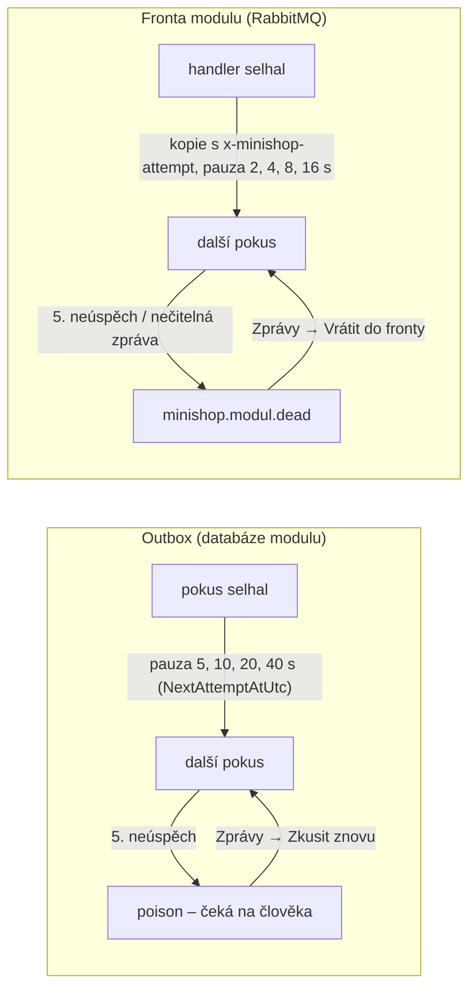

> **V jedné větě:** Zprávy se doručují spolehlivě, ale provoz potřebuje ještě tři věci: **uklízet** staré zpracované
> záznamy, **opakovat s rozvahou** (čím dál delší pauzy) a vadné zprávy **odložit stranou** (dead-letter), místo aby
> se ztratily nebo točily v kruhu (EDA krok 13).

Přirovnání: pošta archivuje obálky jen pár týdnů, doručovatel při nezastižení přijde zítra a pozítří (ne pětkrát za
minutu), a dopis, který nejde doručit, skončí na oddělení nedoručitelných zásilek – ne v koši.

## Cesta selhávající zprávy

| Kde | Opakování | Konec | Kdo si všimne |
| --- | --- | --- | --- |
| **Outbox** (odeslání z modulu) | 5 pokusů, pauza 5, 10, 20, 40 s; nedostupný broker se nepočítá | poison zpráva v tabulce (`Attempts` = 5) | stránka Zprávy, health check outboxu (stará nezpracovaná zpráva = Degraded) |
| **Fronta** (zpracování v modulu) | 5 pokusů, pauza 2, 4, 8, 16 s (počet v hlavičce `x-minishop-attempt`) | `minishop.{modul}.dead` s chybou v `x-minishop-error` | stránka Zprávy, health check `dead-letters` (Degraded → UptimeRobot) |

**Proč kopie a ne „nack + requeue“?** RabbitMQ u vrácené zprávy nemění hlavičky, takže by nešlo počítat pokusy.
Consumer proto publikuje kopii s vyšším číslem a originál potvrdí. Spadne-li mezi tím, přijde zpráva dvakrát –
to zachytí [inbox](inbox.md). Existující fronty se nemění (RabbitMQ by změnu argumentů existující fronty odmítl),
dead-letter fronty jsou nové obyčejné fronty.

## Úklid (retence)

`MessageRetentionWorker` (Web i Inventory.Api, hned po startu a pak každou hodinu) smaže v každé databázi modulu:

- **zpracované** zprávy outboxu starší než `Messaging:Retention:OutboxDays` (**7 dní**) – stačí na dohledání a ladění,
- záznamy inboxu starší než `Messaging:Retention:InboxDays` (**30 dní**).

Nezpracované a poison zprávy **nemaže nikdy**. Pravidlo pro inbox: jeho lhůta musí být delší než nejdelší možné
opakované doručení. Kdyby se záznam „tuhle zprávu už mám“ smazal dřív, než zpráva naposledy dorazí, zpracovala by se
podruhé. Opakování trvá minuty, lhůta dny – rezerva je velká.

## Stránka Zprávy (`/Admin/Messages`)

Pro každý modul služby Web: kolik zpráv čeká v outboxu a které vyčerpaly pokusy (s chybou) – tlačítko **Zkusit znovu**
vynuluje pokusy. Pro každou frontu: počet odložených zpráv v dead-letter frontě – **Vrátit do fronty** je přesune zpět
(publikuje s potvrzením, pak teprve smaže z dead-letter). Obsah odložených zpráv ukáže RabbitMQ Management.

## Kód

[OutboxProcessor](code:src/MiniShop.Infrastructure/Outbox/OutboxProcessor.cs) ·
[MessageStore](code:src/MiniShop.Infrastructure/Outbox/MessageStore.cs) ·
[MessageRetentionWorker](code:src/MiniShop.Infrastructure/Hosting/MessageRetentionWorker.cs) ·
[RabbitMqQueueConsumer](code:src/MiniShop.Infrastructure/Integration/RabbitMq/RabbitMqQueueConsumer.cs) ·
[RabbitMqDeadLetters](code:src/MiniShop.Infrastructure/Integration/RabbitMq/RabbitMqDeadLetters.cs) ·
[RabbitMqDeadLetterService](code:src/MiniShop.Infrastructure/Integration/RabbitMq/RabbitMqDeadLetterService.cs) ·
[Stránka Zprávy](code:src/MiniShop.Web/Pages/Admin/Messages/Index.cshtml.cs)

## Na internetu

- [AWS: Timeouts, retries and backoff with jitter](https://aws.amazon.com/builders-library/timeouts-retries-and-backoff-with-jitter/)
- [RabbitMQ: Dead Letter Exchanges](https://www.rabbitmq.com/docs/dlx)
- [Enterprise Integration Patterns: Dead Letter Channel](https://www.enterpriseintegrationpatterns.com/patterns/messaging/DeadLetterChannel.html)
