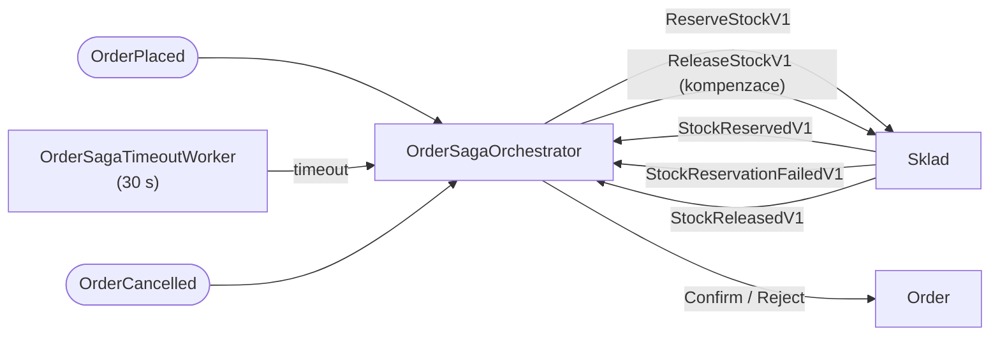

> **V jedné větě:** Sága rozdělí jednu velkou „transakci“ (objednávka + rezervace skladu) na **řadu malých
> lokálních kroků**; když některý nevyjde, místo rollbacku se provede **kompenzace** (vrácení zboží).

## Jaký problém řeší

Objednávka je v `ordering.db`, zásoby v `inventory.db` v jiné službě. Neexistuje transakce, která by obojí
potvrdila nebo vrátila najednou. Přitom chceme: **potvrdit objednávku, jen když se zboží podařilo zarezervovat**.

> **Přirovnání:** Cestovka skládá zájezd – letenka, hotel, transfer. Každý krok je samostatná rezervace u jiné
> firmy. Když hotel nemá volno, cestovka letenku **zruší** (kompenzace) – nedá se „vrátit čas“.

## Orchestrace vs. choreografie

| | Orchestrace (MiniShop) | Choreografie |
| --- | --- | --- |
| Kdo řídí | jeden „dirigent“ (`OrderSagaOrchestrator`) | nikdo – každý reaguje na události ostatních |
| Kde je stav procesu | v tabulce `OrderSagas` | rozptýlený po službách |
| Výhoda | celý průběh na jednom místě, snadno se ladí | žádný centrální bod |
| Nevýhoda | orchestrátor zná kroky procesu | u více kroků se tok špatně sleduje |

MiniShop zvolil **orchestraci** – pro výuku je mnohem čitelnější: stačí se podívat do tabulky ság.

## Jak to funguje

Rozdělení práce:

- [OrderSaga](code:src/MiniShop.Domain/Orders/Saga/OrderSaga.cs) (doména) – **stavový automat**, jen rozhoduje:
  „v tomhle stavu a s touto zprávou → přejdi do stavu X a proveď akci Y“. Nezná RabbitMQ ani databázi.
- [OrderSagaOrchestrator](code:src/MiniShop.Application/Ordering/Saga/OrderSagaOrchestrator.cs) (aplikace) –
  **provádí** akce: pošle příkaz, potvrdí nebo zamítne objednávku. Každý krok = jedna lokální transakce
  (sága + objednávka + odchozí příkaz v outboxu + odškrtnutí v inboxu).
- [OrderSagaTimeoutWorker](code:src/MiniShop.Web/BackgroundServices/OrderSagaTimeoutWorker.cs) – každých 5 s
  hledá ságy, na které sklad neodpověděl do `Sagas:ReservationTimeoutSeconds` (30 s).

Stavy a přechody: [Stavové diagramy](../architektura/stavove-diagramy.md).

## Kompenzace

Kompenzace je **sémantické vrácení** – nová akce, která ruší účinek předchozí:

- zákazník zruší potvrzenou objednávku → `ReleaseStockV1` → sklad vrátí zboží,
- sklad zarezervoval **až po timeoutu** (objednávka už je zamítnutá) → `ReleaseStockV1`.

Podrobně: [Timeout a kompenzace](../toky/timeout-a-kompenzace.md), [Zrušení a vyřízení](../toky/zruseni-a-vyrizeni.md).

## Proč takhle

- Objednávka se přijme **hned** (HTTP 202), i když sklad zrovna neběží – rozhodne se za pár sekund.
- Nedostatek zboží není chyba (HTTP 400), ale **business výsledek** – objednávka `Rejected` s důvodem.
- Nic nezůstane „viset“: timeout zaručí, že každá objednávka skončí potvrzená, nebo zamítnutá.

## Na internetu

- [Microservices.io: Saga](https://microservices.io/patterns/data/saga.html)
- [Microsoft: Saga distributed transactions pattern](https://learn.microsoft.com/azure/architecture/reference-architectures/saga/saga)
- [Microsoft: Compensating Transaction pattern](https://learn.microsoft.com/azure/architecture/patterns/compensating-transaction)
