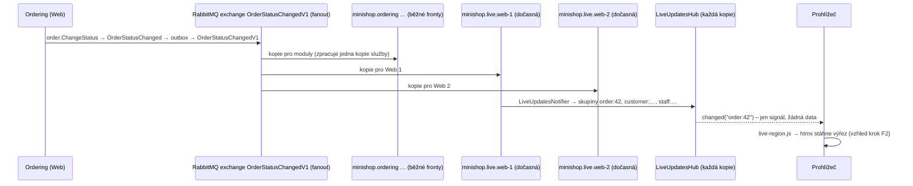

> **V jedné větě:** Když se objednávka změní, server pošle otevřeným stránkám **signál „obnov se“** přes SignalR
> (WebSocket) – a stránka si změněný výřez stáhne sama. Místo „ptám se každé 3 s“ je „dám vědět, až se něco stane“.

## Proč to není jednoduché: dvě kopie Webu

Web běží ve **dvou kopiích** za Caddy ([víc instancí](../architektura/vice-instanci.md)). Prohlížeč má WebSocket otevřený k **jedné**
z nich. Zprávu o změně (`OrderStatusChangedV1`) ale z běžné fronty `minishop.ordering` zpracuje **libovolná** kopie –
fronta zprávy mezi posluchače **rozděluje**. Kdyby signál poslala jen ta, která zprávu dostala, polovina prohlížečů by
se nic nedozvěděla.

**Řešení: rozeslání každé kopii.** Každá kopie Webu si v RabbitMQ založí **vlastní dočasnou frontu** navázanou na tytéž
exchange. Exchange typu *fanout* kopíruje zprávu do všech navázaných front – takže ji dostane každá kopie a pošle signál
svým připojeným prohlížečům.

Přirovnání: běžná fronta = úkol na nástěnce, který si vezme jeden kolega. Rozeslání = hlášení rozhlasem do každé kanceláře.

## Části

- **Událost** `OrderStatusChangedV1` (ID objednávky, ID účtu zákazníka, nový stav) – vyvolá ji jediné místo,
  `Order.ChangeStatus` (doménová událost `OrderStatusChanged`, překladač). Pokryje **každý** přechod, i ty, které vlastní
  událost nemají (čeká na platbu, balí se). Konkrétní události (`OrderConfirmedV1`…) zůstávají.
- **Rozeslání** – [RabbitMqBroadcastConsumer](code:src/MiniShop.Infrastructure/Integration/RabbitMq/RabbitMqBroadcastConsumer.cs):
  fronta `minishop.live.<kontejner>.<náhoda>` je `exclusive` (patří jen tomuto spojení) a `autoDelete` (po odpojení zmizí).
  **Doručení nejvýš jednou** – bez inboxu, opakování a dead-letter: je to jen upozornění, ztracené dožene pojistné
  dotazování stránky. Do metrik jde jen jméno `minishop.live` (bez náhodné části – limit řad v Grafaně).
- **Komu** – [LiveUpdatesNotifier](code:src/MiniShop.Web/LiveUpdates/LiveUpdatesNotifier.cs): zpráva → skupiny SignalR.
  Změna stavu → objednávka, seznam zákazníka, přehled všech objednávek, Expedice, Vratky; vratky po částech a jejich sága
  (naskladněno, peníze vráceny) → objednávka a Vratky; odmítnutí dopravcem a **krok zásilky u dopravce**
  (`ShipmentStatusChangedV1`, vzhled krok F3b – převzato, na cestě, nezastižen…; stav objednávky se přitom nemění)
  → objednávka a Expedice. Platba (`/Pay`) signál nemá – ptá se 3 s jen pár sekund, než se platba založí (záměrně,
  kvůli tomu nový kontrakt v Payments nedává smysl).
- **Hub** – [LiveUpdatesHub](code:src/MiniShop.Web/LiveUpdates/LiveUpdatesHub.cs) (`/hubs/live`, jen přihlášení):
  prohlížeč se přihlásí k **tématu** (`order:42`, `my-orders`, `staff:fulfilment`, `staff:returns`, `staff:orders`) – se
  **stejnými oprávněními jako stránka** (cizí objednávku ne, Expedici jen sklad). „Moje objednávky“ = skupina podle ID účtu
  z přihlášení, ne od prohlížeče. Bez práva = chyba odběru a stránka zůstane u dotazování.
- **Prohlížeč** – [live-region.js](code:src/MiniShop.Web/wwwroot/js/live-region.js) + klient `@microsoft/signalr` lokálně:
  výřez s `live-topic` se přihlásí; signál → obnovit hned, pojistně jednou za 60 s (do kroku F3b 30 s). Bez spojení (výpadek, starý prohlížeč)
  každé 3 s jako dřív. Připojení **rovnou přes WebSocket** bez úvodního vyjednávání – vyjednávání a spojení by jinak
  u dvou kopií za Caddy mohly trefit různé kopie.
- Signál **nenese data** – co se změnilo, si stránka stáhne sama, se svými oprávněními (bezpečnější a jednodušší).

## Co z toho plyne

- **Fronta vs. rozeslání:** stejný exchange, různé fronty. Moduly chtějí zprávu zpracovat **jednou** (fronta modulu,
  inbox), prohlížeče chtějí upozornění **všude** (fronta na kopii, nejvýš jednou).
- **Ztráta signálu nevadí,** protože stav je v databázi – signál je jen nápověda „podívej se“. Proto není potřeba inbox
  ani opakování.
- Restart kopie = nová dočasná fronta; prohlížeče se samy připojí znovu (automatické opakování) a jednou výřez dohoní.

## Na internetu

- [ASP.NET Core SignalR](https://learn.microsoft.com/aspnet/core/signalr/introduction)
- [RabbitMQ: exclusive a auto-delete fronty](https://www.rabbitmq.com/docs/queues#exclusive-queues)
- [Publish/subscribe (fanout) – RabbitMQ tutoriál](https://www.rabbitmq.com/tutorials/tutorial-three-dotnet)
